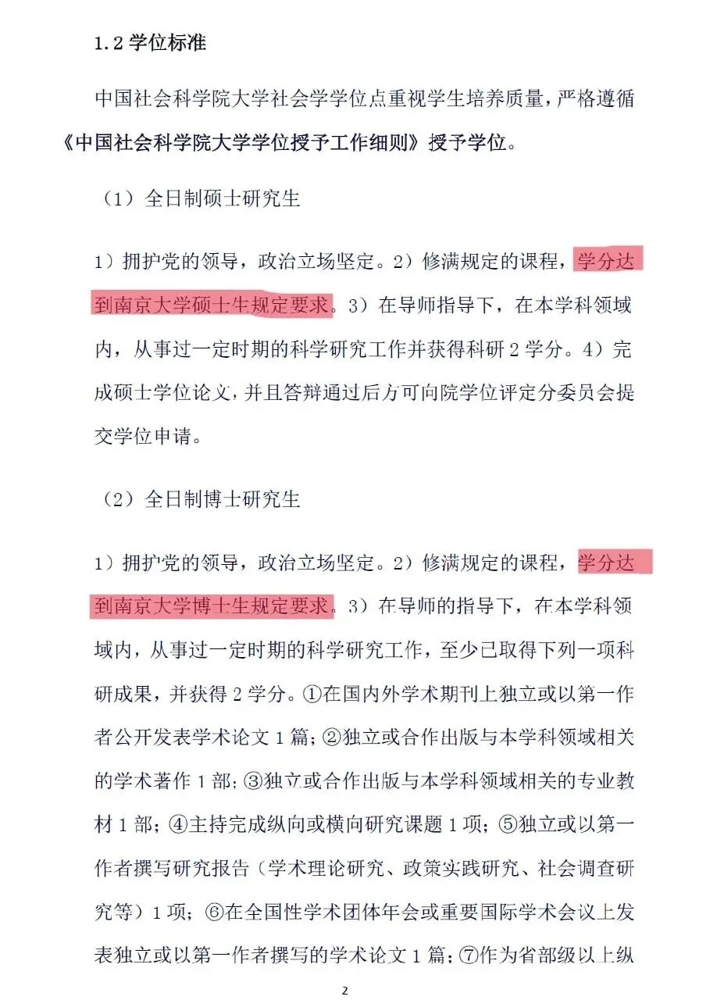

请相关部门及时关注并跟进问题。

## 1 食堂

“学餐车的油烟味有点大，一号楼西侧的寝室一旦开窗通风，屋里都有油烟味。餐车能不能换一个离寝室远的地方？”

“投稿：最近气温上升太快了，希望夏天食堂可以多推出些甜汤类食品。中午喝点甜汤少吃点饭也比较舒服，不然天气太热感觉很难熬。昨天的银耳汤就不错。”

## 2 宿舍

## “投稿：

良乡校区，这两天晚上六七点洗澡时，放的热水都很冷。希望学校做好及时的热水供应。”

## 3 学院问题

## “投稿：

为何社民学院在社会学博士学位授权点2024年度建设报告中，较之于23年，特地强调符合南大标准。是南大社会学已强至成为行业标准；还是有人抄作业都抄不明白，把名字也一并抄过来了呢？

并附链接：

https://shymzxy.ucass.edu.cn/info/1106/5544.htm”

