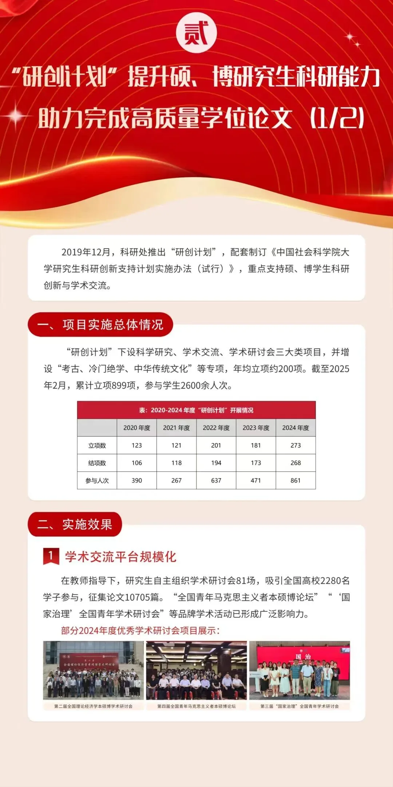
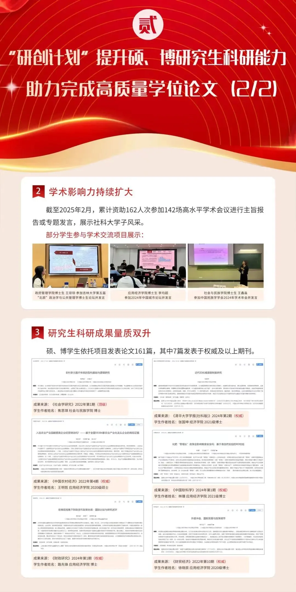
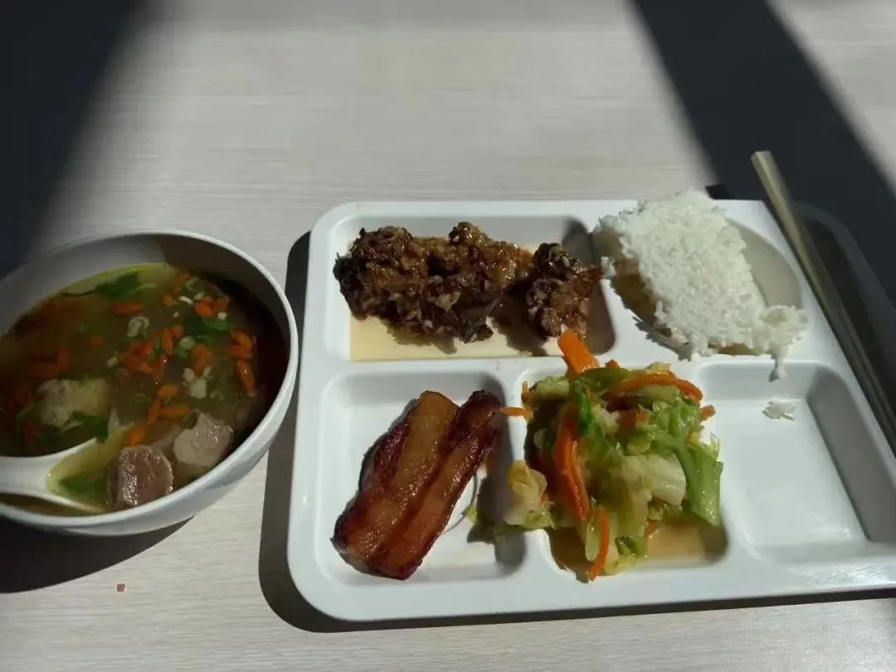

请相关部门及时关注并跟进问题。

## 1 研创计划

## “投稿：

如图，猛猛夸科研处。怪不得对研创提问捂嘴不回复呢。原来在换种方式回应啊。那既然称为“举措与成效”了，为何还说往年结项效果不好，今年必须开题才能报呢？到底哪个是真实的科研处成果啊？到底有没有成果。咱不能对内说不好，对外猛猛自夸啊是吧。

既然往期效果好，今年这新要求是哪个能人提出来的？研创立项也快出结果了吧？是不是该给个答复给个解决方案了？

”

## 2 学院问题

“社会与民族学院这个“南京大学”问题确实值得批评，必须严厉批评！工作态度不端正，一点不认真！社科大是人文社科顶尖大学，这事对学校声誉有影响！。”

## “投稿：

都要本科合格评估了，我们各个学院给本科生上课的师资队伍还是不清楚的。说是花了重金重新聘请一批特聘教授和岗位教师给本科生上课，但我们还是不知道到底是什么人？各个学院的官网的师资显示极其混乱，有的好一点，有个“岗位教师”的栏目，但已经一两年不更新了。你既然新聘了老师，为何不显示最新的情况。还有的老师都已经去北大人大了，还挂在社科大的学院官网上，是我们还在怀念往昔的风光吗？

更有甚者，索性眉毛胡子一把抓。为了不让人知道本科授课的明细，干脆不显示“四位一体”教师的具体情况。我觉得我们应该像国科大一样，明确：

（1）岗位教师到底是什么职责？要上多少课时的课？应尽快落实培养方案上的课，该调整要调整。

（2）既然花钱聘了，应该让各个学院的老师同学知道，哪些老师是岗位教师、特聘教授。

（3）既然要求给本科生上课，那应该公布一下这些老师到底上了多少课时的本科课程。不要掩耳盗铃，让岗位教师只上极少的课，还美其名曰这是科教融合。"

## 3 食堂有关

## “一食堂中午的牛肉汤有小飞虫，恶心了一下午，食堂这样的卫生条件就问怕不怕！

”

“投稿：一食堂的炒白萝卜、青萝卜、红萝卜丝 太好吃了，能不能每天都做啊！我是萝卜丝的忠实信徒！！！一大份不够吃那种！"

“哎呀，二食堂自选区那条警戒线，不知道是哪位‘高明’的领导想出来的主意呢？领导您敢不敢站出来认领一下，让我们大家都铭记您的大名呀？大家吐槽了那么久，您还坚持己见不改，是不是觉得特别有成就感，特别‘了不起’呀？权力真是神奇，又能一次‘战胜’合理性了呢！只希望领导您吃饭的时候，可别一不小心被人‘撞’到河里去哦~"

“投稿：良乡校区的食堂可不可以多做一点纯素菜啊？上学期还有炒茼蒿、生菜啥的，这学期顿顿都是圆白菜，能不能多做点绿叶菜相关的”

## 4 通勤班车

## “求学校开设早上六点四十去火车站的班车～一趟就行！”

## 5 热水问题

“良乡校区，别说晚上六七点了，就是八点洗澡的时候热水依旧很冷。希望学校做好及时的热水供应。”

“天气渐热，是健身锻炼的好时间了，希望学校考虑这个因素适当提早每天傍晚的热水供应时间，希望提早到5点左右”

## 6 春假小诗

## “

放眼别校十日休，

春假何日到身边？

假若得闲游山水，

好景当不负流年。

处处芳菲皆醉眼，

多情最是三月天。”

## 7 感谢老师

> “特别感谢一下国际交流处的史嘉瑶老师。史老师人美心善，在负责CSC项目时非常认真负责。尽可能为同学们争取及时提交材料的机会。对政策的讲解也很细致，很有耐心。尊重学生，极有礼貌，做事也很有效率。提交材料时史老师会一直在办公室等待学生过去。感觉是社科大行政方面最好的老师之一。”
