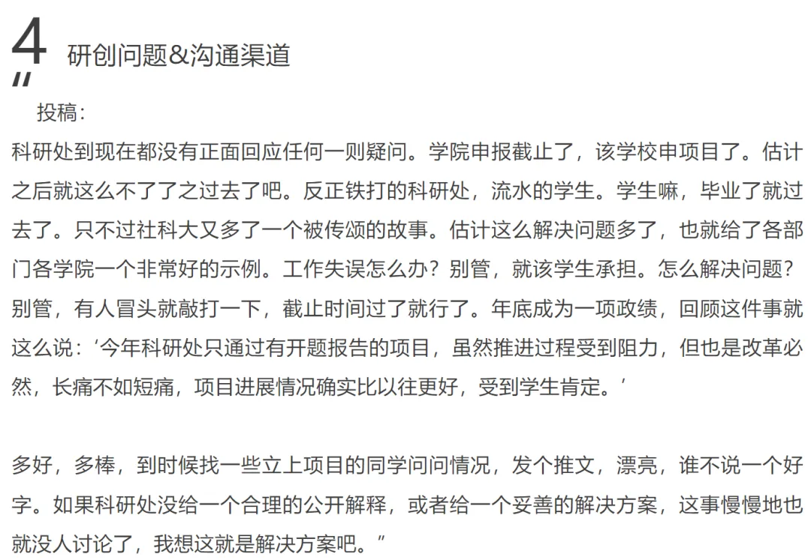
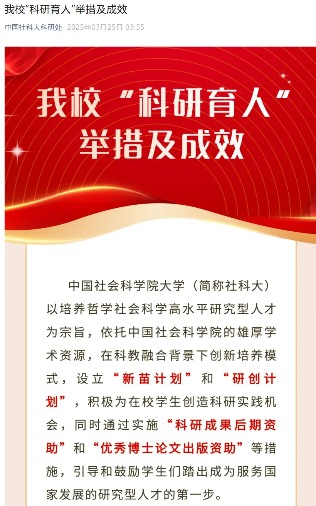

请相关部门及时关注并跟进问题。

## 1 回应投稿

## “投稿：评论3.27第一条：离谱，真的离谱。角度清奇，虽然离谱又带着一丝道理。

第一点，错即是错。结果正义不代表程序正义。既然前期工作有不足，商学院承认且道歉。这便是态度。公职人员、权力部门有接受监督的义务，而我们有监督的权利。你觉得小事可以不提，但不应阻人口舌。

第二第三，错即是错。不论挂出所谓研创成效目的是什么，内外不一就不应该，到底往年成效好坏应该接受质疑，而不是前后不一致，语焉不详。而所谓博三积攒论文能使项目获得更好结果。请问国社科国自然为何要设立青年基金。老教授们积攒了这么多年的论文，也能输出更好的成果呢。研创项目目的在于支持学生科研，支持不是以目的为导向，是激励。只要你有这个能力，就可以给予支持。而不是为博三专门服务。以目的为导向那叫后期项目，你有成果了，我补加支持。

第四，有怀疑可以提出，可以质疑。不是“为什么别人不会”“为什么别人没有”。请问你为什么没考上清北？请问你为什么在社论发言？个体差异不是借口，只要这个质疑合理。有关部门可以自查可以取证。自选都得有留样，如果留样查验没有问题，公布结果即可。最后，如果最近的发言都被说为无理取闹，那么社论就没有存在的意义，之所以存在是为了倒闭自改。”

注：可参见[【读者投稿】大家怎么这么坏](https://mp.weixin.qq.com/s?__biz=Mzg2MjcwNzQ1Mw==&mid=2247490687&idx=1&sn=d365f3a67916fb7c351a6a45c35c6a72&scene=21#wechat_redirect)第一条投稿

## 2 闸机问题

“请社科官爷看一则新闻： #地震逃生还需要刷脸刷卡出闸机 河北廊坊4.2级和2.9级地震，京津冀多地有震感。北京某高校一网友发帖称，她们因出宿舍楼需要刷脸过闸机，逃生时一直被堵在楼道里。

评： 在已经有校园门禁情况下你们还非要安寝室门禁，一点卵用没有，各个寝室需要登记才能进（怎么骂就是不改），拿的东西多了，也不会主动帮开门，紧急情况怕是我们都得死在里面，除了给大家添麻烦还是添麻烦。 也求求你们放过阿姨吧，阿姨又不是机器人，领那么点工资，不让开门的是你们，最后锅还得阿姨背。 有钱麻烦给我们买数据库吧，别再乱花了。”

## 3 审美水平

> “投稿：社科大作为一个文科院校审美水平实在是需要提高，从小细节即可见一个学校的水平与风格。学校确定的主色调为红色，校名校徽到校园建筑基调也是红色，在这红色里面为什么要夹一个蓝色实在是让人捉摸不透，之前新的教学综合楼楼梯上的logo是蓝色，校园跑道是蓝色，最近贴在各个办公室门口的门牌也是蓝色，这蓝色既不好看，也与学校的整体气质不符。特别是最近新贴的各个办公室门口的门牌，且不说其他学校的门牌做的都很精致而社科大的门牌就是贴在墙上的一张纸，而且这纸还是蓝色非常突兀，社科院物业贴在厕所门口的温馨提示标都比这个正式、好看，而且人那个还是红色。建议统一风格，突出社科大红，这有助于校园氛围的营造。”

## 4 大预言家

## “

## 5 热水问题

## “希望后勤部门，做好热水供应。热水要热一点，供应时间提前一点。”
