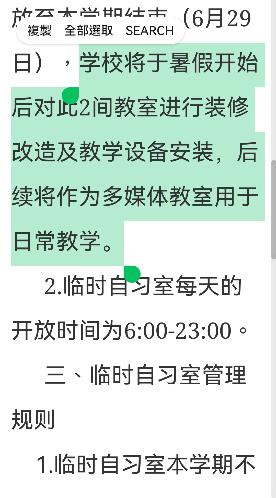
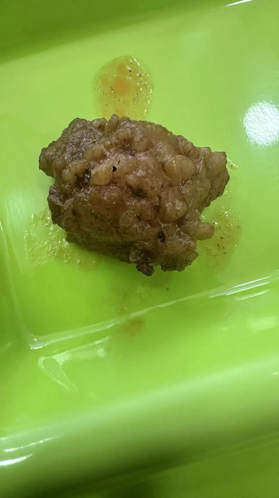
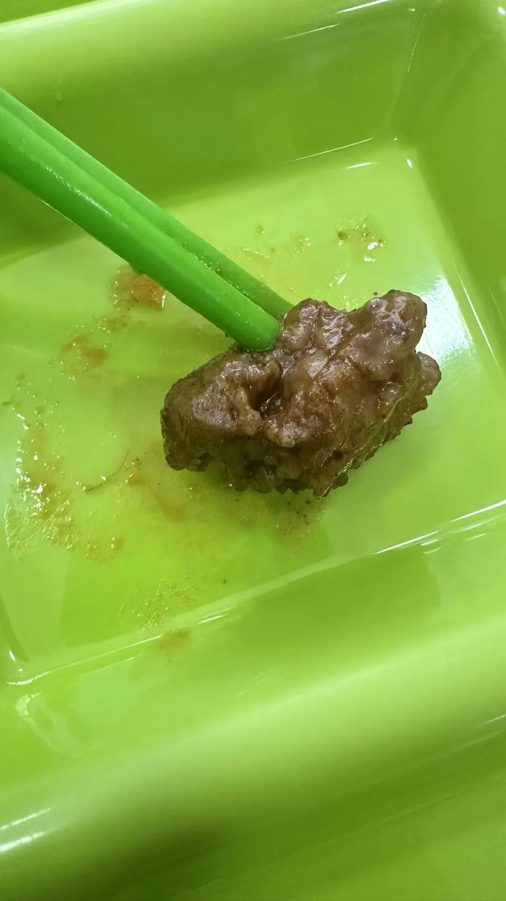

请相关部门及时关注并跟进问题。

## 1奖助学金

> “投稿：表扬一下学工处的奖助学金办公室，工作效率极高。月初家里突发重大变故，跟班主任反馈过之后，通过学院开通了临时困难补助申请渠道。然后联系学校奖助办的老师，非常细致耐心地讲解了需要提交的材料。材料提交后，审批非常迅速，解了家里的燃眉之急，让我得以继续学业。”

## 2 自习室

> “感谢灵岛啊！正经自习室全都收走，给我们留的自习室不是板房就是地下，唯一一个139还有对面140做伴舞，可热闹啦！这样的环境，一定是“天将降大任于社科学子”吧，感恩啊 ，太感恩啦。附：前天有个投稿给skd洗，说什么“转型摩擦”，是不是社科大不合理的东西都是转型的小小摩擦，那麻烦下次别转型了，或者这摩擦就发生在您身上就好了。感恩。（活脱脱像钟小艾“权力的小小一任性”）”

“果然学校在改造教室方面从来不缺钱，把原来的自习室改造成办公室，新楼的教室也改造成办公室，完了再把临时自习室改造成教室，搁这左手倒右手，玩呢？？？ 还看到一些教室，挂满天花板的麦克风，大大小小的摄像头，哎呀，真是好营生啊。 ps：好像开个自习室受了你们多大恩惠一样，一个学校连正常的学习环境都没有

”

## 3食堂

> “看到有同学反映二食堂麻辣烫的问题，我真的想说这个档口早就应该关门了 之前吃过一次，肉类全都是合成肉，肉片甚至不是鲜红色而是粉色，口感也完全不是正常冻鲜肉的味道；还有肉丸也不知道添加了什么东西，能吃出来是打碎了的肉糜加上粘合剂做成的。肉类品质差，蔬菜也不新鲜，前两天放进冷柜的菜叶都已经蔫掉了也不更换，甚至频繁出现菜品卖光了却并没有及时补充的现象。我就吃过那一次，感觉自己花了钱吃了一肚子工业垃圾，以后再也没有去过，希望这种垃圾档口趁早倒闭吧！！！”

“

投稿，在清真食堂吃到的，这是什么肉

？”

