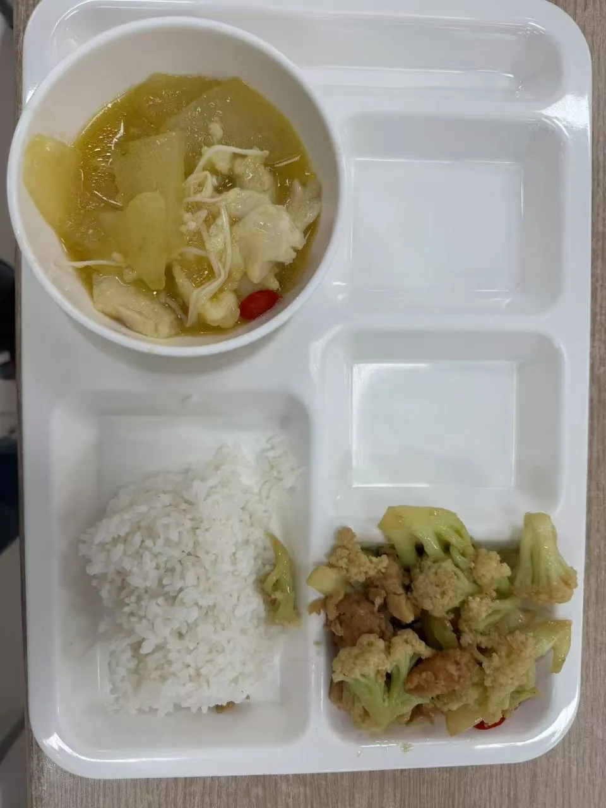
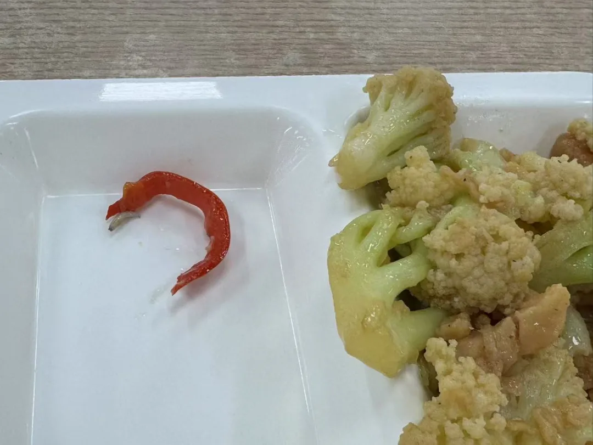
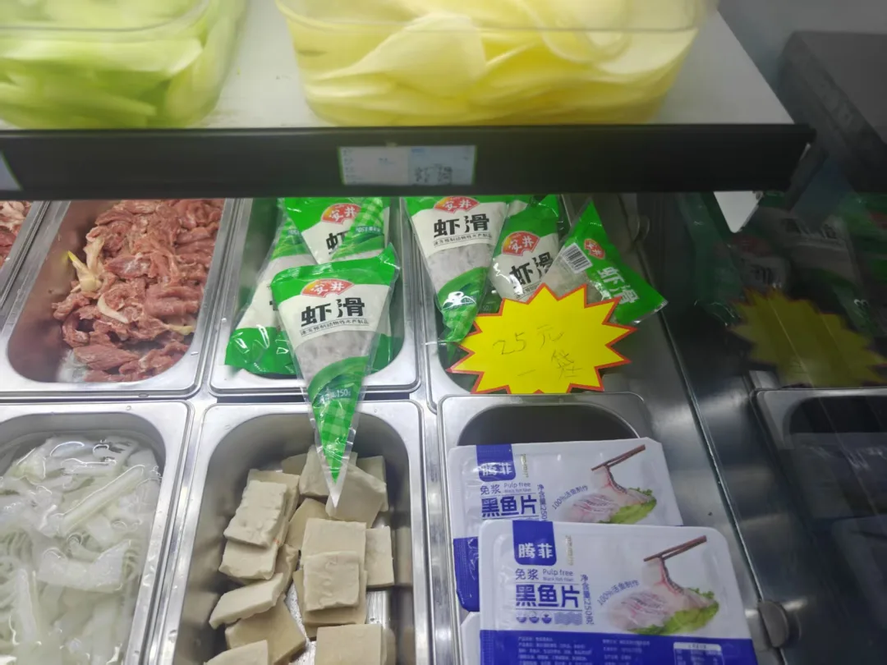
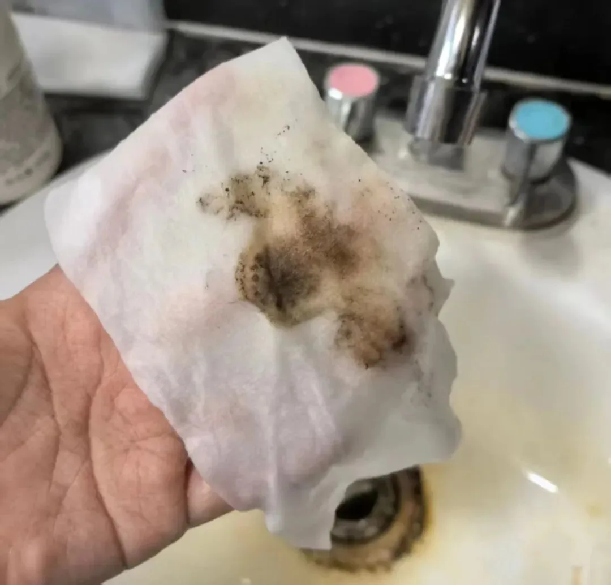
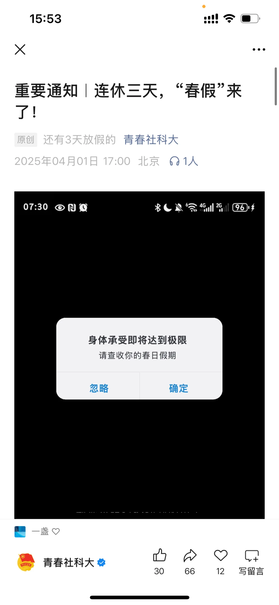

请相关部门及时关注并跟进问题。

## 1 研创

> “投稿：研创二次立项千呼万唤始出来，夸一夸还是能解决问题的。不过从这份文件也确实看出学校行政某些职业素养非常不足。第一，“统一的立项比例”是多少，是不能公示的吗。第二，今年预算不足，搞预立项变成后期核报没问题，科研处给出一些指导意见，这一年该留哪些发票，还是得26年的发票才行，给个说明，不是这么语焉不详的明年按计划拨付。第三，是谁想到的立项暨结项证书一块发的好主意。这样子明年奖学金不还是加不了项目分吗？为什么在解决问题的时候总是要加上一些限制？都是立项，要么统一一块发立项书或者给立项证明，要么就都不发，一块发结项证明。这是什么分化学生的手段吗，给有开题报告的一些优越感。”

> “在同学们的争取下研创计划开放了复活赛，学校如果学生科研经费不足，应该更加择优选取立项，严格把控结项环节，而不是变着法子卡想要申请的同学，剥夺答辩资格；积极上进的大学应当抱有：你前期研究经验丰富欢迎来申请，你选题有价值有意义欢迎来申请，你研究计划书写的好欢迎来申请！往年卡一下新生年级跟毕业年级还能理解，今年给中间年级设限必然怨声载道啊！本来就很简单的事情，前期研究有价值就立项，有论文发表就结项。这样学校的成果也会更好，后面发公众号的数据也更好看。”

## 2 学工

> “狠狠给马院、国际处、学籍办公室还有学生工作处的老师们点赞!!!老师们都太好了，因为我的不仔细导致有一张表格出了点问题，老师们都超级无敌耐心！还是在快下班的时候，呜呜呜呜老师们真的太好啦！！最最感谢赵老师、史老师、胡老师！！”

## 3 食堂

## “感谢二食堂的工作人员让我找到了丢失的平板电脑！！！”

“【良乡校区食堂投诉】菜花炒鸡丁里有疑似虫卵的东西瞬时没胃口了。天气回暖，麻烦食堂多注意些卫生吧，驱逐苍蝇，检查食物是否变质。

把这个虫卵单独挑出来拍的”

> “社论君好，在外面实习很久了，有的时候感觉外面美食档口卖的那种均价25+的饭比不上学校里的一食堂。这几年食堂开始创新，有一批红烧肉把子肉什么的，让我这个在学校呆了四五年的学生又有了去食堂吃饭的欲望。一顿饭十块钱在北京能吃到这种程度的饭菜我感觉很有性价比了。一食堂肯定有需要进步的空间，但是我也很感谢它在我求学历程中对我的保障。今当毕业之际，再次感谢一下一食堂的叔叔阿姨，也希望一食堂未来更多创新，继续注重食品安全，希望一食堂办的越来越好！”

“

今天遇到学校检查二食堂的麻辣烫，碰巧说了25元一袋的虾滑，良心的老板说“这个虾滑是大品牌，京东上也卖25元一袋，这等于没赚”，我感觉这个价格不合理，去京东上验证了一下，结果如下图。想问一下，这个价格合理吗？学校检查只是走个过场吗？为什么只听商家一面之词也不自己验证一下呢？

## 4 毕业

“投稿：为什么毕业生学历证书图像信息采集要收费？？？这是学生要掏钱的事情吗？本科的时候根本没掏任何费用好吗？教学楼里那个机器可以用吗？要收钱吗！”

## 5 自习室

> “今天上午一个可以自习的空教室都没有，而经济学院教工支部会议却独占122一个大教室，还预定一上午。请问你们那么多的办公区域都找不到一个开支部会议的地方吗？几个人非要来占300座的大教室？为学生着想一下那么难吗？”

> “投稿：举报某些人利用公共资源投机倒把，竟然出售自习室空位。这是堂堂skd学子干出来的？就这等素质还要双一流？开地下室、开板房不行，现在又开新自习室，真是给某些人资源太多了。这些人不配拥有公共资源。”

## 6 考核

> “中期考核和开题报告提交都集中在一个月，学校发的通知是6月底之前开题答辩，那么报告提交时间真的早意义何在？或者给开题报告撰写预留充足时间，而不是这样都集中在一个月，中期也没有任何准备时间，还得突击写开题，这样真的合理吗？”

## 7 宿舍

“社论君好，我今天（4月1日晚上）发现宿舍洗漱的水龙头流出棕色的水，于是用洗脸巾裹住了水龙头。洗完脸发现洗脸巾非常脏，里面都是棕色的不明物质。想问这种问题能否联系维修？或者有什么处理方法吗？

”

8

春假

“

何其不要脸的社科大：目前好多高校都宣布了放春假。已知厦门大学的春假从四月末开始放，一共九天，而人民大学，春假与五一劳动节连放总共九天。社科大，你一个清明假期美名其曰是春假？你是何其的不要脸？春假是春假，清明是清明，就好像对于劳动人民，双休日是双休日，春节假期是春节假期，你不能因为今年春节在周末，你就只给工人放两天，美其名曰是放假。所以，属于社科大同学的春假在哪里？我作为一个老生，亲眼见证了社科大培养方案越来越不合理，给学生的压力越来越多，学校官方媒体越来越号召大家内卷，所以呢？社科大的学生就不需要放假去看大好风光了吗？难道社科大学生只需要读万卷书不需要行万里路吗？

”

欢迎大家前往读者频道进行有关稿件讨论，可向公众号后台发送“读者频道”或“读者群”获取加入方式
