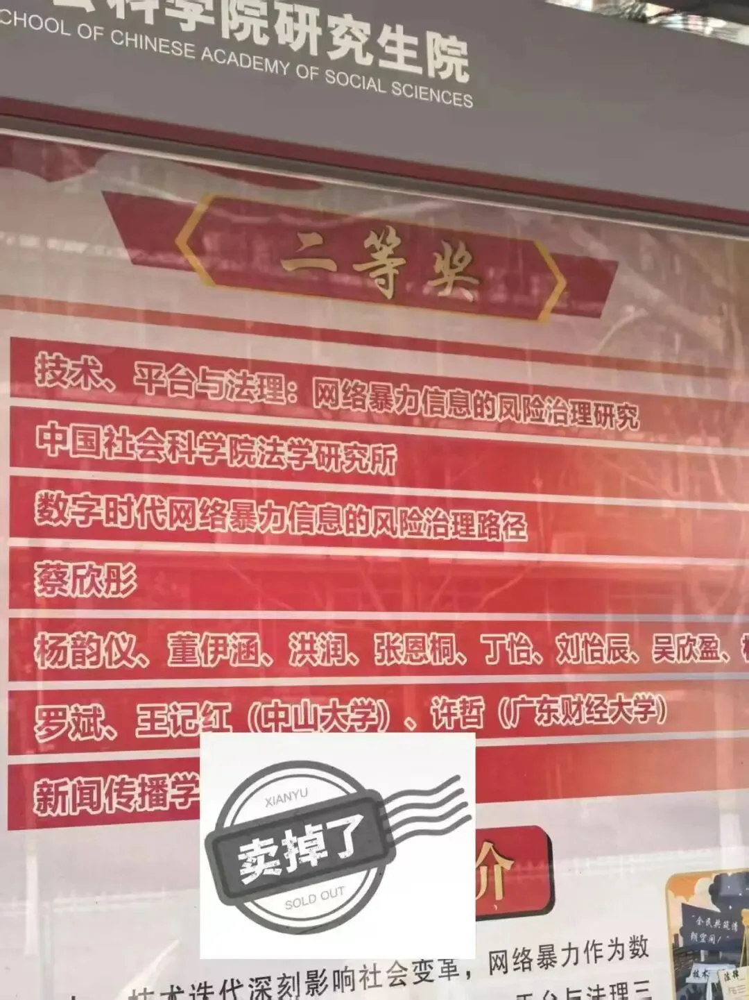

请相关部门及时关注并跟进问题。

## 1 图书馆

## “投稿，图书馆静音舱每次都要晚上12点钟预约，慢几分钟就没位置了！！！”

> “图书馆研讨室的使用，能否想办法把隔音问题解决一下？有些学生和老师很不自觉，或者根本不自知，讲高兴了，里面上大课，外面上自习的同学在上小课，偌大的自习室，安静的只能听到你讲课！二楼……已经听了一下午到一晚上的课。本身自习室不大，你的声音飘了大半个自习室。或者在预约系统里设置提示静音的选项！”

## 2 食堂

> “中午12点，饥肠辘辘的我冲向食堂麻辣烫窗口，看着冰柜里蔫儿吧唧的青菜，以及疑似“薛定谔的保质期”的丸子，内心还抱有一丝幻想：“毕竟食堂，再贵能贵到哪儿去？” 同学安慰我：“贵是贵了点，但人家有科技与狠活啊！”可不是吗？丸子Q弹到能打乒乓球，青菜焯水后依然保持荧光绿的倔犟，那个虾滑实在太贵了不合实际”

“投一个自选食堂的问题。这是直接从取餐具的机器里拿出来的勺子。和已消毒的牌子在一起，学校不觉得讽刺吗？给学生用的餐具，真的好好洗过吗？

”

## “良乡校区一餐厅旁边的展板，错别字明目张

胆，希望学校注意一下吧，本来是好事的。

”

“【投稿】二食堂这一排水龙头能不能好了，要么不出水，要么水压超大，直接溅到衣服+裤子，我是要洗手不是要洗衣服啊！”

## 3 考核

> “想说一下23级马骨干博士的中期考核和大论文开题的问题。院里通知4月1号要交中期考核报告，4月中旬完成中期考核。5月1号又要交大论文的开题报告，但又规定大论文的开题要在6月30号之前完成。既然这样的话想问5月1号提交开题报告的意义在哪里呢？貌似马骨干是全校23级博士中期考核和开题最早的，早也就算了，至少要给同学们留够开题准备的时间，开题报告不仅需要撰写文献综述，还要和导师反复沟通论文框架，这点时间真的够吗？而且开题是自己准备好后个人单独开，也不是学院的统一行为，所以合理的安排应该是个人开题前完成开题报告，且开题时间不晚于6月30号。”

## 4 宿舍

> “抢劫犯—社科大 社科大最近开始大查寝时代，能理解查寝的原因，但是，社科大的查寝是不是有点太过分了？宿管在不通知的情况下，进去寝室把除了电脑以外几乎所有的电器都收走，这难道不是抢劫吗？你们自己要不要看一下功率呢？能放在宿舍里的东西基本上都是在限电功率内的东西，你这也要收走，我不免怀疑你们的初衷是什么？群众之中有坏人。建议宿管大人在查寝之前先列一个标准，比如功率多少以上的电器是违规的，这样的收走并且贴纸条➕通知，这才是合乎理性的做法，而不是赤裸裸的抢劫。”

## “良乡8号楼这两天又是搬走开间的衣架，又是未经通知进屋查寝，到底是要干什么？

”

## 5 热水问题

## “希望后勤部门，做好热水供应。热水要热一点，供应时间提前一点。”
