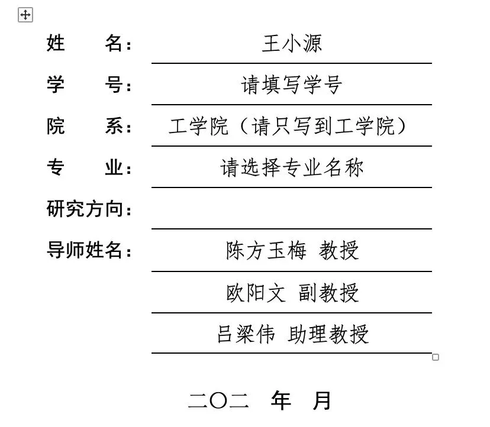
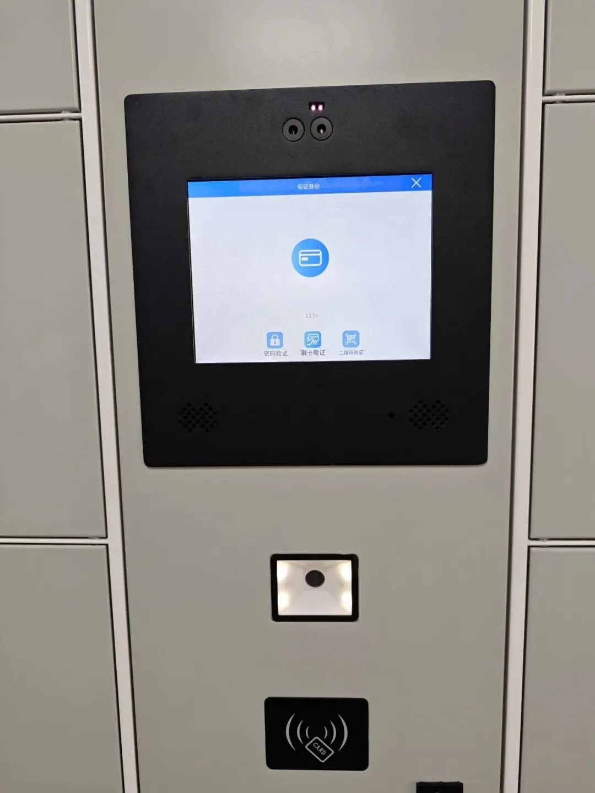

请相关部门及时关注并跟进问题。

## 1 食品卫生

“学校蜜雪冰城的杨枝甘露好像有问题。我两周前喝了一次，拉肚子两天。在校外喝、一样的配方，没问题。刚才有喝了一杯校内的，又开始闹肚子了”

## 2 毕业论文

“本人研二，准备开始撰写毕业论文，就想着先去学校官网找出硕士学位论文的模板和格式要求，先把格式都设置好，这样写起来就很顺畅了。这个时候问题就出现了。首先，我们来说说模板本身的问题。可能是我没找到完整的模板，学校好像只提供了《学术硕士学位论文封皮（2019级及以后用）》和《中国社会科学院研究生院学位论文基本要求（2011年12月制定）》。也就是说，毕业论文主体的格式，学生需要对第二个文档进行阅读理解，然后才能够完整地确定整个毕业论文的格式。毕业论文右上角是“学号”与“密级”（见下图）。

模板提供的学号（包括字母）是9位，但是当前硕士的学号都是11位，导致如果直接输入的话，学号的“学”和密级的“密”就无法对齐。这也算是个细节问题，可能长期没有更新。因为本校的硕博论文会收录知网，所以我就上知网，想借鉴一下前人已经设置完成的全部格式。结果随手下载的2024年的一篇论文，就发现“学号”和“密级”是没有对齐的（如下图）。

其次，首页封皮会要求填写“导师姓名及职称”、“院系”、“专业”与“研究方向”。一般来说这部分内容会插入表格，然后隐藏边框（如下图北京大学毕业论模板所示）。

但是，本校提供的模板就仿佛没有上过大一的计算机课，是如同狗啃一般。

接着，我们就进入了需要自行阅读理解，来设置格式的范围，问题就更加多样了。《格式要求》只明确说明了英文摘要的正文内容选用Times New Roman小四号字体，但是没有说“摘要”与“ABSTRACT”采用几号字体、什么字体，我们只能通过《格式要求》的第七条“正文”来判断，“摘要”、“ABSTRACT”与“目录”应该遵从大标题“二级宋体”的要求。但是随机从知网下载的去年的本校硕博论文并不是这么设置的。以这篇为例，这篇论文的“摘要”是二号宋体、“Abstract”也是二号Times New Roman，但是“绪论”首先没有使用《格式要求》规定的“第一章”或“第一节”，并且采用的是非二号的黑体。细心的同学发现了，前文说到《格式要求》第七条规定摘要的英文版应该完全大写，但是这个例文却并没有这么做，不仅如此，《格式要求》规定关键词的英文应该写作“KEY WORDS”，但是例文写作了“Keyword”。可以说是漏洞百出。

最后，《格式要求》根本没有说明“摘要”、“ABSTRACT”是否需要居中，也没有说摘要、目录与正文是否采用相同的页码、是否连续标页（北京大学给出的模板是摘要与目录是单独以罗马数字标页，正文单独以阿拉伯数字连续标页），这就导致毕业论文里，有的人“摘要”、“ABSTRACT”左对齐，有些人不小心给封皮标了页码、有些人用阿拉伯数字标了摘要与目录的页码、有些人没有给目录标页。

综上所述，整个毕业论文的格式可以说是一团乱麻。难道给出一个完整的模板如此之难吗？既然某些学院连培养计划都可以复制粘贴南京大学，倒不如也在这上面多向其他学校学习学习，起码体现出一个大学的严谨性。”

## 3 感谢

> “投稿：真诚感谢团委张志跃老师！！！临近毕业季，找工作实在是太drama，之前看到网上以前志愿者宣传推送，前几天也听了线上宣讲，了解到了西部计划，有点心动。宣讲会结束后线下来办公室找张老师咨询了一下，张老师回答的很耐心，而且根据实际情况帮我分析了去不同地区服务的特点和优劣，也结合我自身的情况和规划给出了特别中肯的建议，也让我坚定了就业方向。真的可以看出来是真心为学生考虑的，而且业务能力很强，为我耐心解答了各项政策，对我来说很有意义！感谢校团委！感谢张老师！”

> “表扬一下望京校区。上学期去行政楼补办学生卡，工作人员特别热心帮忙操作，还问现在学生卡都电子化了，有啥必要补办呢？我说图书馆储物柜必须刷卡才能存，不然每天都要搬书。对方说我们回头沟通整改一下。结果这学期储物柜也能扫码使用啦！”

## 4 校园基建

## “快餐柜越来越远了 无语了\[Facepalm\]”

## 5 课程设置

> “我要投稿：建议法学院多开一点实务型的选修课，除了诉讼的案例分析以外，非诉的也可以开一些，比如合同审查、公司合规、破产清算等与实际律所操作流程相同的课程，这样可以增强学生的求职竞争力，不一定非要以上课的形式，可以以与律所或者律师合作的模式，让学生实际参加几个真实案例的流程，实习虽然可以但除了一次社会实践和专业实习以外并不计算学分，最好弄成课程学分，可以增强选课动力。”

## 6 补助

## “特别想知道咱们学校博士生的补助，以后还会有上涨的空间嘛”

## 7 研创后续

“投稿：要身体力行，不能只说不做。转发完自己也得看看，好好学习。最近研创这些事可不像是好好调查之后的发言和决策。”

（【见《[【读者投稿】研创余波》](https://mp.weixin.qq.com/s?__biz=Mzg2MjcwNzQ1Mw==&mid=2247490739&idx=1&sn=aca2aa9f92c194863636cf050b4c403c&scene=21#wechat_redirect)第2条）
