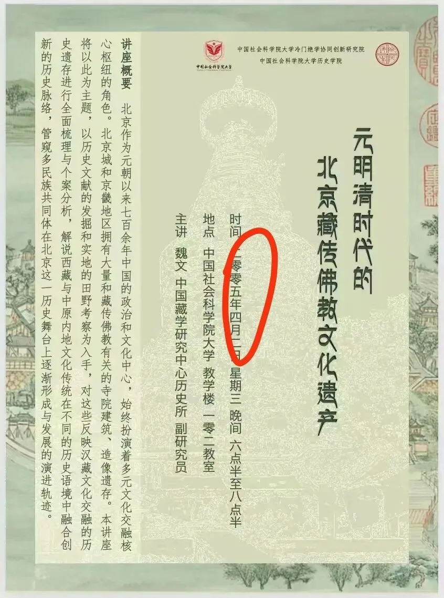
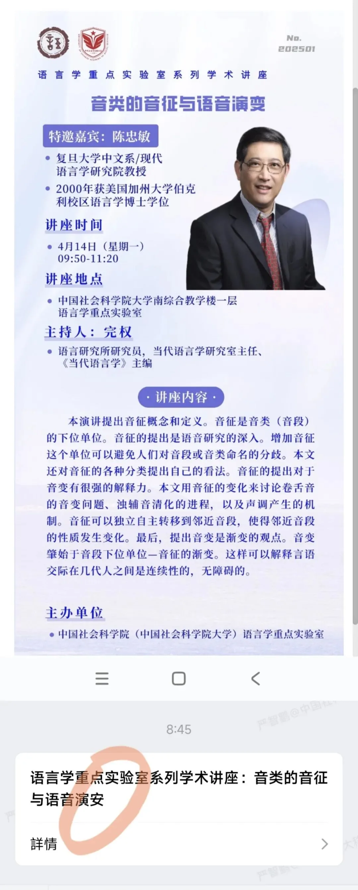

请相关部门及时关注并跟进问题。

## 1 错别字

“投稿：近期错别字收集。咱也不要求内容准确无误了，但标题和时间，总得多看一眼吧？”

## 2 校园基建

## “关于良乡校区2号楼照明问题的反馈意见

尊敬的校领导：

近期发现2号楼4层更换为感应灯后，整体照明效果不佳，楼层环境较为昏暗，给学习生活带来不便。目前1、2、3、5、6层均保持常亮灯照明，仅4层处于黑暗状态，形成明显反差。

若学校计划在4层进行照明改造试点，部分同学建议恢复原有的常亮灯照明方式，以保障良好的学习生活环境。恳请领导予以考虑为盼。”

## 3 奖学金＆研创

“按闹分配是吧？去年研创立项的同学，因为评奖是在十月，结项是在十二月，评奖的时候说什么“立项不给加分，结项才给加分”。现在毕业年级补立了一堆项目，如果按照去年的规则，毕业年级立项者同样可以加分。试问这对我们去年年底顺利结项的同学们公平吗？之前学校围绕奖学金规则制定的事宜，邀请同学们报名参会提建议，学校的工作态度以及尊重学生的精神，是值得充分肯定的。现在会开完了，又出现了新情况，那么建议学校在2024-2025学年的奖学金规则制定中，做出相应的修补措施。

明确下要求：去年评奖学金，因“立项不加分，结项方可加分”的规则而导致研创项目没有加上分的，今年要给人家补上。”

（【见《[【读者投稿】千呼万唤始出来](https://mp.weixin.qq.com/s?__biz=Mzg2MjcwNzQ1Mw==&mid=2247490725&idx=1&sn=ec5a248ac384338e83d192113815abfa&scene=21#wechat_redirect)》第1条）
