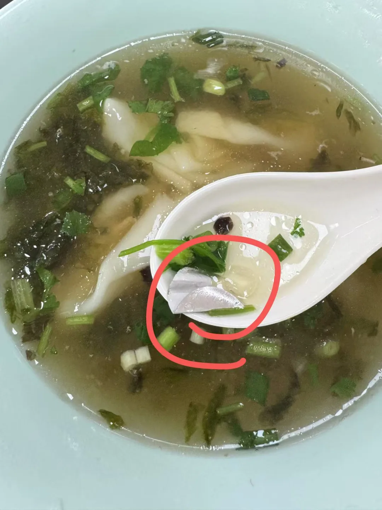
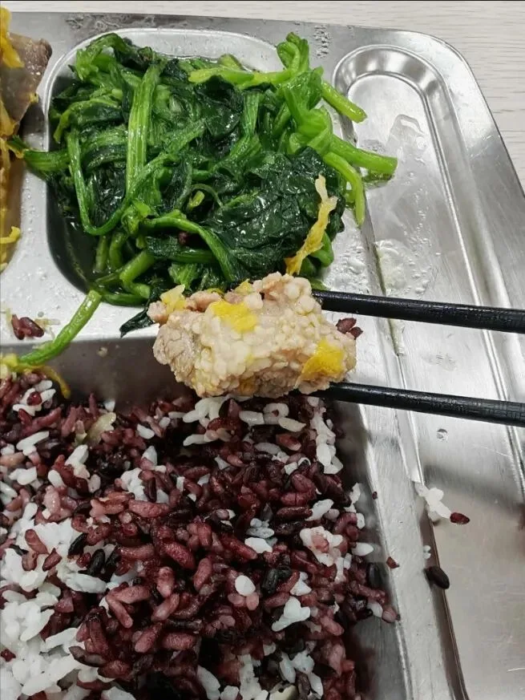
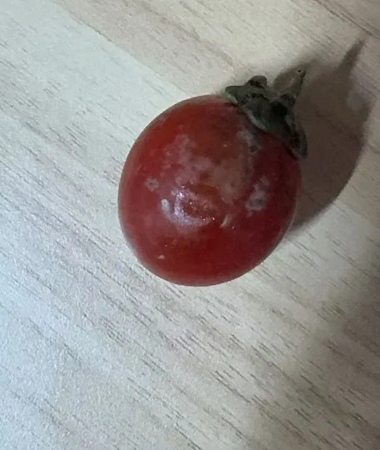

请相关部门及时关注并跟进问题。

## 1 新综合楼

“天气不是很冷了，新综合楼可不可以多通通风？本人每周都要来上课，每次上完课都是头晕嗓子痒咳嗽，现在（21：15）还有10分钟下课，短短三节课，鼻子已经堵的没办法呼吸，心脏突突跳，人也上不来气了，今天一进门就发现新楼貌似又进行了一些软装，味道超级大。求多通风，我快要晕过去了。。。。。

补一点：一直有好好戴口罩，今天症状尤其严重”

## 2 食品安全

## “食品安全：良乡风味食堂馄饨，吃到类似塑料纸的异物。”

> “望京食堂午餐酸菜排骨中疑似出现淋巴肉，给我干恶心了。本来就没几块肉，好不容易挑出一块还是淋巴肉。你社菜价确实便宜，但是如果连基本的食材品质都不能保证，我宁愿你早点滚蛋，让哈耶克的大手接管一切”

## “投稿，校内蜜雪冰城的冰淇淋缩水了，根之前比小了一圈”

## “美联福卖的柿子”

## 3 奖学金＆研创

## “回复4.8第三条奖学金：

每年好像都是这样吧，非毕业年级得结项的时候才能加分，毕业年级评奖时立项的项目也可以加分。为的就是不重复加分啊。非毕业年级如果立项加一次，结项加一次，一个项目分两年加分重复了。毕业年级没有这个顾虑，加完立项分就不会再加一次结项分，因为结项完没评奖学金啦。

说的把上次立项没加分的补上，意思是立项加分结项了再加一次分？你自己想想合理吗。哪有立项结项重复加分的。一个项目加一次，哪个学校都是这么操作。非毕业年级按结项加分，毕业年级立项也加分。”

（【见《[【读者投稿】笔落方显社科本色](https://mp.weixin.qq.com/s?__biz=Mzg2MjcwNzQ1Mw==&mid=2247490757&idx=1&sn=04a81e2b10baec586b0c646c5e209fa4&scene=21#wechat_redirect)》第3条）
