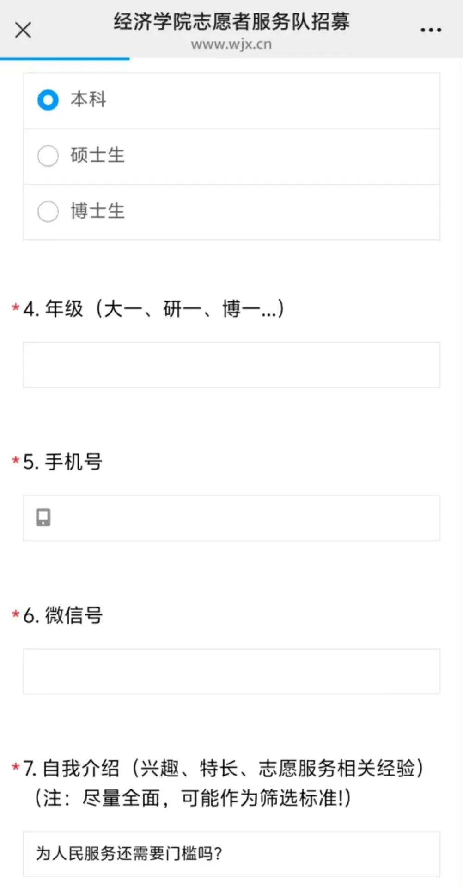

请相关部门及时关注并跟进问题。

## 1 卫生

“问题反映：目前八号楼宿舍出现黑色小蚂蚁、在其他寝室门上看到了指甲盖大小的蜘蛛，上网查可能是某个宿舍或者区域有食物残渣等原因造成的，同学们在宿舍吃外卖的常态可以理解。

然而天气渐渐热了，各类蚊虫伺机而动，在此请求后勤处老师和宿舍楼进行大面积的喷洒消杀工作。”

## 2 志愿

> “贵院真是重新定义了'志愿'二字——服务他人的资格还得经过“政审”的筛选？建议下次选拔时增设才艺展示环节，毕竟在贵院眼里，帮扶弱势群体和选秀出道一样需要综合实力。不如直接开发个志愿服务考核系统，先笔试再面试，确保每个递纸巾的动作都符合精己学院核心价值观。连发善心都得持证上岗，这波公益内卷真是让我等平民开了眼界！”

## 3 极端天气

> “【投稿】关于周末极端大风天气的小倡议。安全第一！不管是我们自己的安全，还是周围人的安全。如果周末计划不外出的话，可以囤一些食物饮料，做好准备。外出饮食可以选择就近，最近食堂的口感还是改善不少。极端天气下外卖员的工作也会遭遇很大挑战，尤其是在安全风险上，虽然平台会在此期间增加单价来“鼓励”外卖员继续跑单，但相应的风险却是落在外卖员个体上。因此还是想倡议在极端天气下尽量减少点外卖，或是点了外卖后，对送单时间少一些催促，有条件的话可以提供一些打赏给骑手个人。在大风中骑行，毕竟不是一件容易的事。”

## 4 奖学金

“非常赞同这位同学的观点，国奖就是要奖励给有真才实学的同学。博士生本来就是培养科研人才的，尤其是在社科院这种科研单位。建议学校把国家奖学金和学业奖学金的评审标准分开。挂名搭便车，可以去卷学业奖学金。

国家奖学金只在以社科大为第一单位，以学生本人为独立作者或者第一作者发表CSSCI论文的同学中评选。让那些坐的冷板凳踏踏实实搞学术的人真正被发掘出来。

把学业奖学金的其他评审条件当做基本参与条件。比如期末没有挂科，中期考核通过等作为基本参与条件，不计分。只看以社科大为第一单位学生本人为独立作者或者第一作者的CSSCI论文。

而且学工部在公示的时候，不要写一些虚头巴脑的东西，应该写清楚，具体参与什么课题，课题名字编号都写上。以第一作者在什么期刊发表了几篇论文，以第二作者在什么期刊发表了几篇论文，把期刊名字写清楚。不要写虚头八脑的东西，不要出现等字，不夸大不缩小，有一说一，不要写在核心期刊发表多篇论文这种模糊的用词。一方面供大家学习，另一方面接受大家监督。”

> “学校的国奖风采展示做的挺好，了解下国奖获得者的实力所在。但有个小建议：前学历阶段的成就就不必写了吧。硕士只写硕士阶段获得的成绩，博士也不必写本硕甚至高中之前的成绩了。哪个阶段得奖，就写该阶段成果好了。大篇幅不一定大含金量。望采纳！乱花迷人眼，淹没了真正属于本阶段的“辉煌懂的都懂，大家都明眼人，至少本学科的人是明白那些经历的含金量的当然啦，大多数国奖获得者还是很厉害的，有很多CSSCI和同级别论文，向他们学习！”

## “滥竽充数的故事

故事内容：战国时期，齐宣王非常喜欢听人吹竽，而且喜欢许多人一起合奏给他听，所以齐宣王派人到处搜罗善于吹竽的乐工，组成了一支三百人的吹竽乐队。而那些被挑选入宫的乐师，都能拥有特别优厚的待遇。当时，有一个游手好闲、不务正业的浪荡子弟，姓南郭。南郭先生听说齐宣王有这种嗜好，就一心想混进乐队，于是设法求见宣王，向宣王吹嘘自己是一名了不起的乐师，博得了齐宣王的欢心结果宣王把他也编入吹竽的乐师班里。

可笑的是，这位南郭先生根本不会吹竽。每当乐队给齐宣王吹奏的时候，他就混在队伍里面，学着其他乐工的样子，摇头晃脑，东摇西摆，装模作样地在那里“吹奏”。由于南郭先生学得维妙维肖，而且几百个人一起吹奏，齐宣王也听不出什么异样。就这样，南郭先生滥竽充数，混了好几年，不但没有露出一丝破绽，而且还和其他乐工那样，领到一份优厚的赏赐，过着舒适的生活。

后来，齐宣王死了，他的儿子齐湣王继位，齐湣王同样爱听吹竽。只有一点不同，他不喜欢合奏，而喜欢乐师一个个单独吹给他听。

南郭先生得知这一消息之后，吓得浑身冒汗，成天战战兢兢、如履薄冰。南郭先生心想，这回要是露出马脚，丢饭碗还是小事，要是落个欺君犯上的罪名，恐怕连脑袋都保不住了，不如溜之大吉。所以，趁着齐湣王还没叫他演奏，南郭先生就赶紧溜走了。

成语寓意：不会吹竽的南郭先生混在三百人的乐队中装模作样地凑数虽然可以得到赏赐，但是要自己凭真实本领单独演奏时，南郭先生就只好逃之夭夭。弄虚作假的方式纵然可以换取一时的成功，但换不来一世的成功。人只有刻苦学习，使自己拥有真才实学，才能取得真正的成功。”

（【见《[【读者投稿】记录在案](https://mp.weixin.qq.com/s?__biz=Mzg2MjcwNzQ1Mw==&mid=2247490770&idx=1&sn=56e77c67fc00e2c4f5df5eb4715c91d1&scene=21#wechat_redirect)》第1条）
