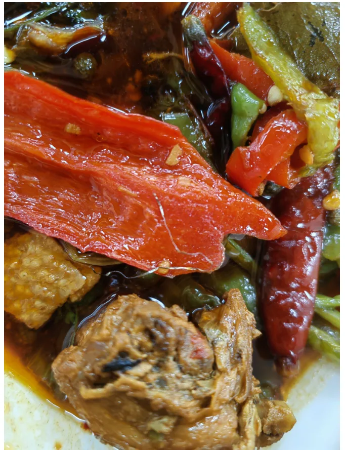
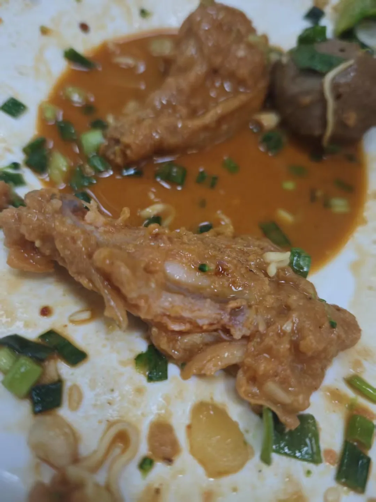
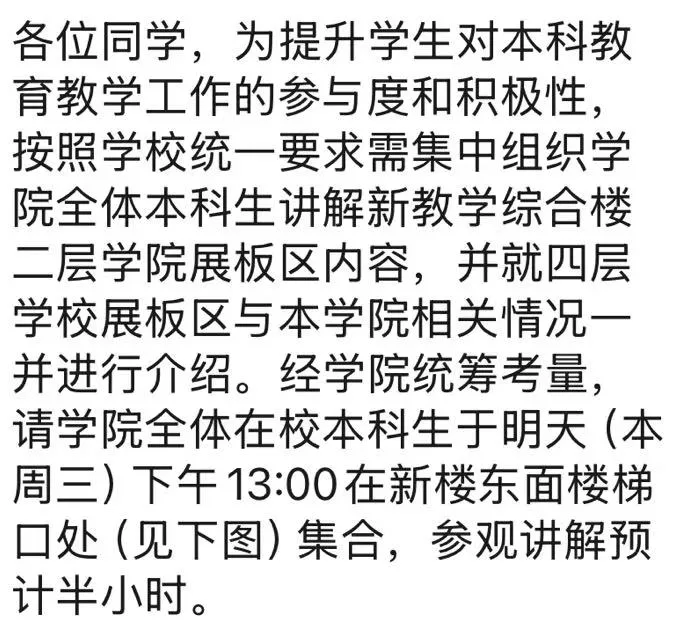

请相关部门及时关注并跟进问题。

## 1 食堂

## “

## 良乡一食堂一楼的山东炒鸡又吃出了铁丝。”

“

想为一食堂的叔叔阿姨们疯狂打call！自从推出大小份菜后，为了控制饮食每次都点一大一小份。没想到师傅阿姨们特别暖心，看我体型可能觉得吃太少，每次打小份菜时都会贴着标准上限给。而且从来没见过其他学校传闻的“手抖打菜法”，反而总是被叔叔阿姨们的实在感动到！”

“

一食堂自制的猪肉水饺很好吃，表扬！胡辣汤最近没见卖了，不知道还会不会再做？夏天快要到了，学校食堂可不可以考虑增加凉皮，想吃点凉皮，米皮之类的。”

“

望

京食堂那条帖子我附议！！这个学期不知道怎么了，食堂感觉饭越来越少。以前12点去菜基本都是全的，这个学期11.40去热销菜基本就没了。如果12.20（一点闭餐）以后去，三个窗口就只剩下一个了，然后还全点素菜。最后只能去吃麻辣烫或者面，能不能多备点菜啊！”

参见

【读者投稿】老问题

第二条稿件

“

风味食堂麻辣拌，烂肉进行时

”

## 2 停车规范

## “投稿：这样停车真的合适吗。

## ”

3

科教融合

> “投稿：看了一下全校所有学院的公众号，发现很有意思的现象，科教融合好的学院科研成果突出也大力宣传，可以看出想进步的心，有的学院则是天天装死，什么学术活动也没有。给无事可干的科研处提一个建议，定期发布分学院的科研成果，公众号宣传科研指数也可以。”

（【见《[【读者投稿】研创余波](https://mp.weixin.qq.com/s?__biz=Mzg2MjcwNzQ1Mw==&mid=2247490739&idx=1&sn=aca2aa9f92c194863636cf050b4c403c&scene=21#wechat_redirect)》第2条）

4

形式主义

“

良乡校区：1.建议形式主义的东西少搞，尤其是没什么同学想去还要催着人去装模作样拍照片；2.强烈反对占用同学们午休时间搞这些事情。尤其是新楼里还有装修粉尘、甲醛残留等，严重威胁生命健康！

”
