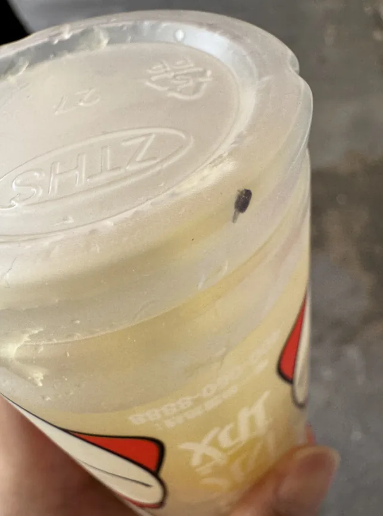
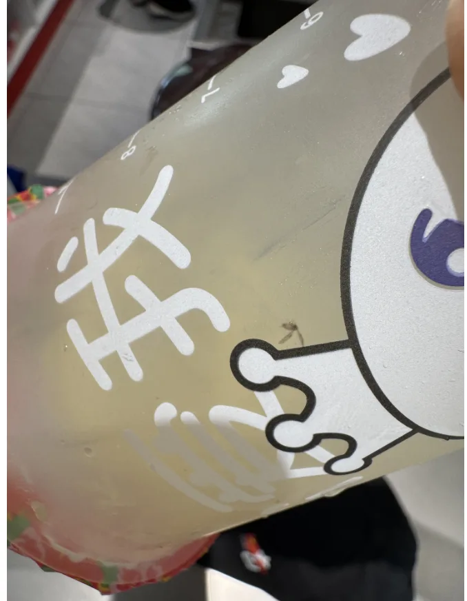
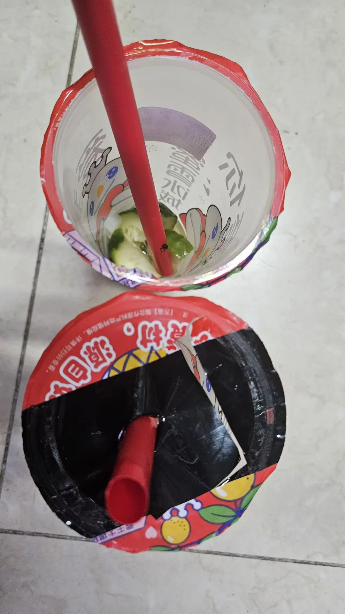
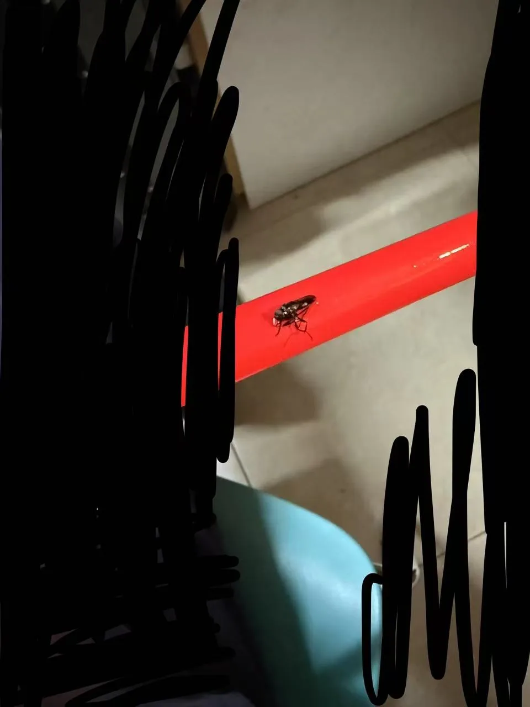
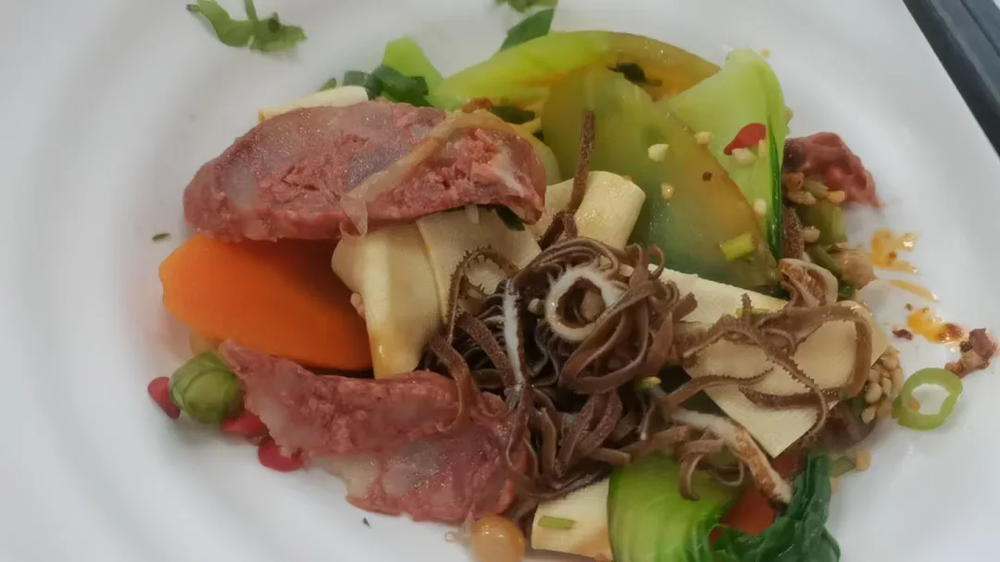

请相关部门及时关注并跟进问题。

## 1 蜜雪冰城

“

蜜雪冰城柠檬水有“可爱的小飞虫”，要求店员重做了一杯，第二杯里仍有两只“可爱的小飞虫”。感慨于小虫的可爱，遂发！”

“

投稿：今天下午买了杯柠檬水，都快喝完了，发现吸管上有个黑色的东西，把杯封划开一看，是一颗苍蝇，太恶心了🤢。我后来找了蜜雪冰城，他们给我把钱退回来了。 我朋友下午也买了一杯柠檬水，结果杯封上有一片黑胶带，也不知道是否卫生。”

## 2 食堂

“

感谢望京食堂倾听我们的需求，推出低脂健康餐！不仅解决了减肥/健身人群的饮食难题，更传递了科学饮食的理念。低脂≠寡淡，调味恰到好处，这样的改变超暖心~❤

”

“

良乡校区风味食堂现在的自选的品种很多，点赞。希望能多多提供，寿司，土豆丝鸡蛋饼。”

## 3 论文

> “遵循学术的规律做学术。学校规定博士生毕业生论文查重率统一20%。对于文科有些思想史等需要看前辈大量文字材料的同学，真正写论文时需要大量旁征博引，才能真正言之有理，言之有物。每个专业对查重率建议有不同的要求”

## 4 六号楼空调

“

投稿：夏日将至，学校是否应该考虑为同学们更换宿舍楼的空调了呢。6号楼（其他宿舍楼情况未知）当前使用的空调生产年份久远，能耗高，制冷效果差，但是耗电迅速。更换能耗更低、制冷效率更高的空调，既是响应国家的低碳政策，也能够降低同学们的电费支出。“

5

海外学术交流

“

查了各种规章制度，学校对学生出去开会的补助似乎只有研创项目的后期资助，一年只能有一次，而且不包括港澳台地区的会议和国际会议，结合参加国际顶会也不在综测考核标准之中（不同于其他学校），想请问是学校不鼓励学生进行境外学术交流活动吗？想请教务处/学工办解答一下。”

6

办好说清

“

最近学校官网建了一个栏目“办好说清”，挺有意思。第一条消息居然是研究生教育管理部（学位办）发的，估计是被某同学的“诬告”逼急了，无处喊冤吧。不过，发布这条消息对于面临学位论文开题和写作的同学倒是很及时。希望“办好说清”既办得好又说得清，能够解决一些“接诉即办”不能解决的问题。”

“

办好说清”这个栏目能很及时地回应我们的诉求，很好，但翻了一下好像目前基本都只有后勤处的回应，几乎没有别的部门说过话。好像快准狠的“办好说清”只针对后勤（在此感谢后勤处的老师和其他工作人员们），不知道是其他部门解决问题的效率不高，还是权责主体和对话对象不够明确时，就可以假装没看见了。如果是后者，建议之后投稿的同学都在最后标注。”
