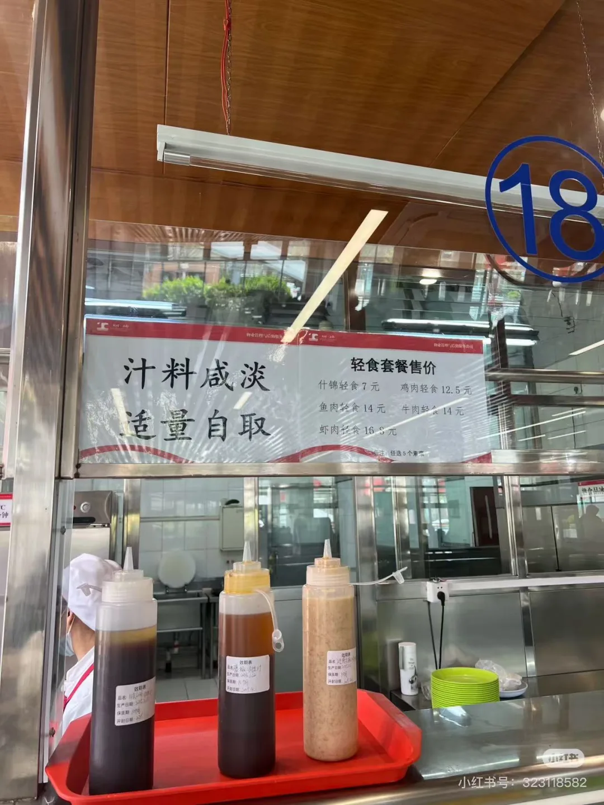
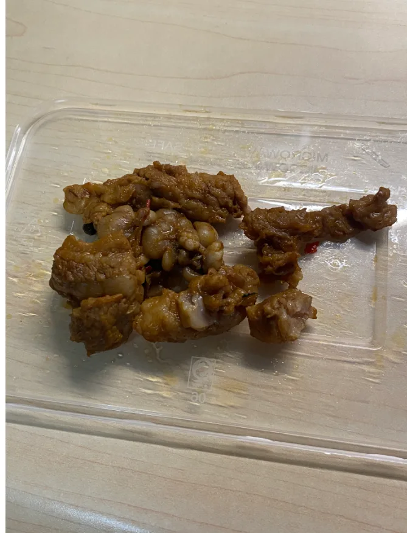

请相关部门及时关注并跟进问题。

## 1 食堂相关

“【投稿】看到望京食堂有减脂餐窗口了，想问问良乡能不能做哇？看到隔壁北理也有减脂轻食窗口（如图），恳请良乡食堂也能开一个专门的窗口

”

“

投稿：食堂定价和打饭效率问题。定价带0.5就罢了，为什么一定要定价为0.6 0.4这种不规整的。忙碌的时候食堂叔叔阿姨本身就乱，加上需要记非常多小数点➕计算更容易出问题，出了问题还需要沟通更加耽误时间，为什么不能设置成大份整数、小份允许0.5这样的统计标准呢？”

“

良乡食堂牛肉炖粉条里的大量牛肉如下图，希望学校食堂可以少点这种肉。

”

“

你好 想许愿一波望京食堂的减脂餐只要素食能不能便宜些，一个只爱吃青菜但是胃口巨大的小女孩悄悄碎了，随便买一些都20多块，真的很难崩，西红柿啥的都挺重的，16.8一斤水煮蔬菜还是太贵了，希望可以便宜一丢丢，太感谢啦！！！希望小院越来越好！？”

## 2 转诊

> “请问为什么良乡校区的学生在望京不能转诊到望京医院？公费医疗就近选择医院不是为了学生就诊的方便吗？因为实习原因住在望京校区，去医务室转诊，校医告知学校要求良乡校区学生不能转诊到望京医院，解释原因是有良乡校区学生专门到望京来转诊看中医，学校作出了规定。所以就要一刀切吗？”

## 3 宿舍问题合集

> “希望学校能说明一下良乡校区2号楼4层照明问题：以后宿舍楼确定都用感应灯了吗，为什么4层楼整层是感应灯，其他楼层还是常亮灯呢？作为四层的同学，真的很不喜欢这个黑暗的过道常态以及仅有4层整层换感应灯的差别化情境。”

“

热天就要快到了，4号楼宿舍的空调太高能耗了，刚开学我还不知道这事，开了一段时间发现总是要充电费，开始以为是电表问题，没想到竟然是空调高能耗，钱就像流水一样。是时候该换更为节能的空调了。”

## 4 奖学金评选

> “投稿：最近各学院在征询奖学金意见，但看了几个学院的细则，关于班委加分过高过乱且不作为的情况，仍然没有被考虑到新的细则里面。暂不提班长、党支书、团支书这三位有常规工作的职位，其他班委几乎一学年就转发一次通知，并没有其他的作为。请问转发这次通知就多了非班委近1分的折算分，这是否合理？相当于顶掉一个系统认领参与教师科研。当然如果保持的话，以后也可以宣传：班委加分特别多，不用干活。去年说今年会考虑，今年听说座谈也说会考虑进去给出新方案，但实际一点都没有考虑。希望学校学工部好好考虑这一点，对班委评分做出限制，不然今年奖学金一二等奖又全是班委，到时候又有得闹。也别说我们只闹不给建议。参考其他学校的做法，提出两个或许可行的方式：（1）由班级成员给各班委工作情况打分，按平均分百分比乘以细则分数来加分（比如班长得分90，就按0.9\*12赋分）（2）对每个班委分等级加分，分为优秀、良好、一般、不合格。全部班委优秀名额不超总班委名额30%，良好及优秀不超80%。优秀按100%赋分，良好按80%，一般按60%，不合格不赋分（班级成员超10%认为不合格则不予加分）。”
