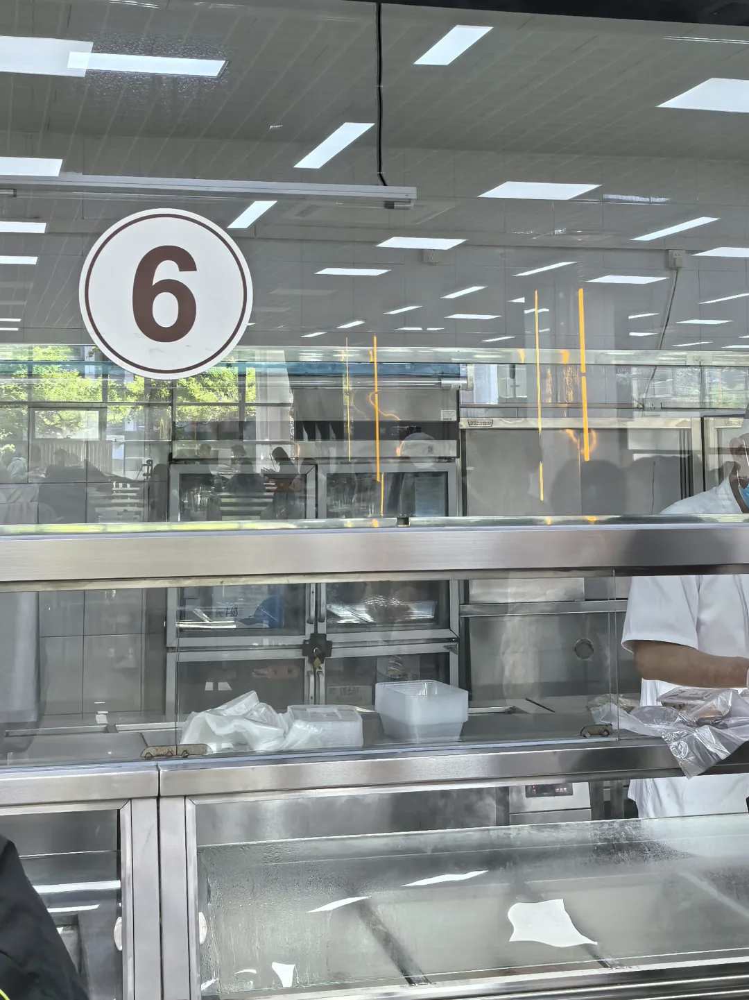
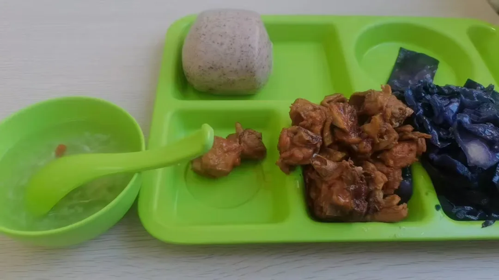
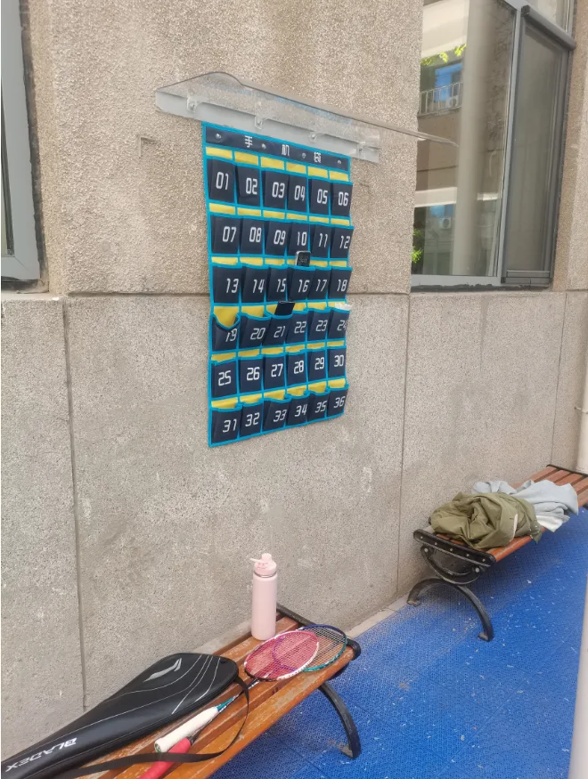

请相关部门及时关注并跟进问题。

## 1 食堂有关合集

“今天中午一食堂从6号窗口开始菜品都是空的，有至少四个窗口没有开，6号窗口打饭的叔叔阿姨必须走很远到34窗口去盛菜，打饭效率极低

”

“

望京校区餐厅上了紫甘蓝！满满的维C呀～爱了爱了😆

”

“

【投稿】这两天吃了良乡一食堂的肉饼系列两次，稍微有一点点咸，每次吃到最后很齁扔掉又觉得很浪费食物，希望可以少放点盐

## 2 毕业问题

“请问如果博导故意在毕业程序上制造认知障碍，导致失去盲审前的最后修改机会，该怎么反映问题呢”

## 3 校庆日提问

## “投稿：五月份的校庆日会像北大那样多几日放假吗？”

## 4 望京校区球场

“最近打球的同学多起来了，望京校区天井的羽毛球场只有两个凳子，如果坐人就没法放别的东西了，尤其手机无处安放，今天中午打球时惊喜的发现羽毛球场地内多了一个专门放手机的袋子~上面还有一个透明的防水小遮挡~~ 如果未来可以再增加几把凳子，天井的顶棚铺一个防晒网就更好了哈！感恩的心~~🥰🥰🥰

”

## 5 图书馆预约

“前不久图书馆预约系统更新后，个人信用分恢复似乎出了点问题。我最近一次违约记录距今都3周了，到现在都还没恢复为原始分数300，之前可是几天就恢复了。”

## 6 活动空间

> “最近学校又把原本给艺术团训练用的005交由艺教中心改造办展？？？而且是永久占用？？？再加上之前学校关于老师办公室的相关操作，本人真的很好奇这个学校还有多少空间是给学生们学习、活动的？？？这个学校到底需要多少办公室给老师们办公？？？这个地方到底是学生的还是老师的？？？”
