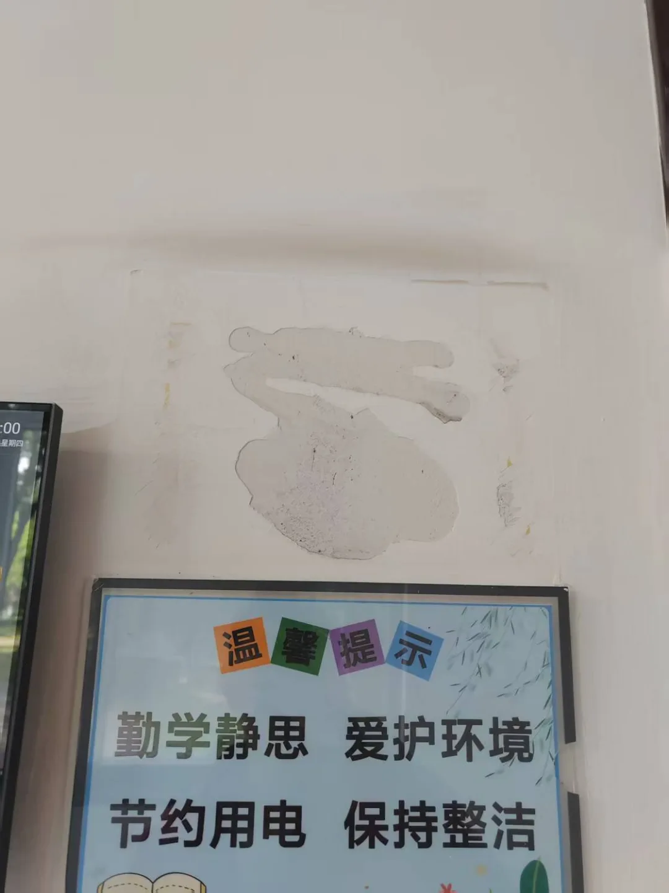
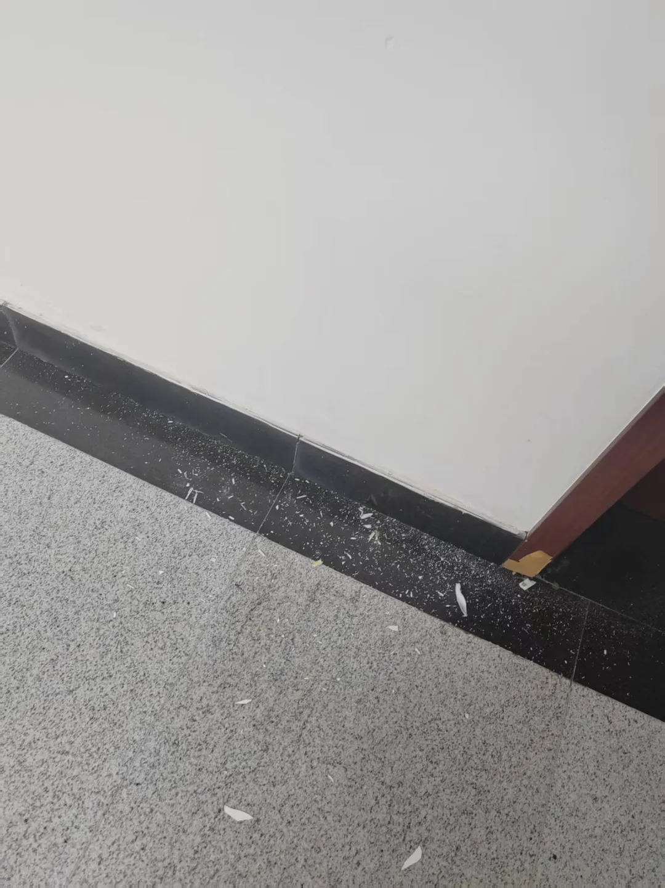

请相关部门及时关注并跟进问题。

## 1 研创计划预立项投稿

> “投稿：《关于〈关于学生科研项目预立项机制及经费管理的说明〉的质询函》 ［1］科某处在本次说明中旁征博引了各大高校的预立项制度，说明本次预立项的合理性。对此，并没有人质疑预立项的制度设计合理性，同学们质疑的是制度适用的合理性，请相关部门理清同学诉求到底是什么。 ［2］同学们的情绪点在于：起初说不予立项，随后少数学院又自行资助，后续又实行二次立项，即预立项，那么请问这个预立项是否征求过同学们意见？为何一个学生科研项目的经费资助问题朝令夕改？立项到现在两个月都没有好好的实行项目，而一直在为经费而扯皮，这符合一个想冲击双一流大学的行政效率吗？ ［3］如果一直保持这种行政效率，贵校只会丧失民心，学生们对贵校早已失望。话已至此，自己掂量吧。”

“

投稿：

科研处要搞清楚一个事情，你校的预立项是应对全校硕士生无人可立项的一个应急解决办法，从一开始就不是“应用于探索方向、争取资源或为正式立项做准备”。但是“作出“预立项”调整后，一二年级的项目仍然没承认立项，经费在研究期间仍然分文没有，参与和没有参与研创计划对研究没有实质影响”（4月25日稿件）。这么多期人文之光学生们都已经指出了根本诉求：改变研究进行期间没有得到任何支持的事实结果。办好说清的必要条件是办好，不要滥用这个频道。”

> “投稿：科研处的论据合理但论点没有现实意义一个号称支持研究生搞研究的计划，全校硕士研究生没有一个人有资格申请，没有一个人受到支持。对上述结果的修正方案解决了没人有申请资格的问题，但研究进行期间全校硕士生仍然没有一个人受到支持。 “预立项”只是众多修正方案中的一种，遗憾的是这一方案对结果没有影响。科研处花了大篇幅在“办好说清”论证这一修正方案的意义，但并没有论证这一方案对解决你们工作失误造成的灾难性后果（全校硕士生无人符合申请条件；全校硕士生无人受到支持）有修复作用。”

“

投稿：

一位女士刚买了一台新车，车载收音机能够根据人的指令播放对应的音乐。 “古典”，女士命令道，收音机里马上开始播放肖邦的钢琴曲；“摇滚”，女士又命令道，这时电台里就开始播放起了最新的摇滚，女士感到很满意。突然一辆轿车逆行而过，连忙打转方向盘的同时女士骂道：“混蛋！” 电台里突然开始播放《关于学生科研项目预立项机制及经费管理的说明》。 \*本苏联笑话研究系中国社会科学院大学“研究生科研创新支持计划”（预立项编号2025435KFC）的阶段性成果。 \* 感谢评审专家给出的修改意见，文责kyc负。通讯作者：全体预立项同学。”

> “投稿：科研处的这个发言，似乎想表达这样一个事实，即所谓预立项是早已研究决定好的，只是学生似乎不懂得预立项之于学术研究的良苦用心，于是方在办好说清这样一个既没有办也说不清的栏目向我们陈词，预立项是有理有据的。那么既然已经研究决定好，为何不在三月或是四月便广而告之，而要等到此时此刻呢？这不免让人怀疑：所谓预立项不过是慌乱中从其他学校搜刮而来的说辞。进而言之，预立项的研究决定，其过程是怎样的？公开透明吗？足以服众吗？向其他高校看齐的所谓预立项制度，在出台过程上却不向他们看齐，岂不是画虎不成反类犬，滑天下之大稽吗？并不是在否认这样一个事实：预立项不能保障科研质量。而是说：当前，预立项制度无法给出科研支持的可信承诺。科研处对于款项报销等事宜尚解释不清，怎么能够相信，预立项成果之后必然得到经费的支持呢？”

## 2 良乡网络问题

“良乡校区校医院发热门诊的网络信号非常差，导致用二维码挂号付费效率低下。希望学校采取措施解决问题，方便学生就医。”

3

池塘清洁问题

“

希望良乡校区相关工作人员定期清除一下池塘上漂浮的柳絮。。”

4

宿舍水质问题

> “投稿学校水质问题。1234号楼和78号楼宿舍的同学都有反映宿舍洗手台和浴室水龙头处残留水渍仅过一天就会产生严重黄色水垢，这超出正常水质偏硬的范畴了，严重影响生活。用这样的水洗头掉头发，洗脸毛孔粗大，洗身体产生各种皮肤问题，强烈希望后勤部门重视研究水质差问题，是否存在学校可改善的地方比如改善过滤管道？关乎同学们基本健康的问题，希望有关部门认真研究并向同学们说明清楚原因并进行改进措施”

5

研教楼教室门牌

“

研教楼前不久贴的门牌，全都又撤了，墙皮薅一大块，墙灰掉一地，换来换去，不知所谓

”

6

望京校区问题

## “投稿：望京校区的饮水机该清理一下了，都有一股洗澡水味儿”

7

物价补贴回应

> “你好，我要投稿关于前一稿件第三条关于物价补贴的信息。“本科生物价补贴是根据《北京市人民政府贯彻落实国务院关于建立健全普通本科高校高等职业学校和中等职业学校家庭经济困难学生资助政策体系文件的意见》（京政发〔2007〕24号）文件要求，对普通本科高校学生进行物价补贴的发放。”

参见[【读者投稿】钱在哪](https://mp.weixin.qq.com/s?__biz=Mzg2MjcwNzQ1Mw==&mid=2247490879&idx=1&sn=b16f770bcfaf77113812368ecc1a852b&scene=21#wechat_redirect)第三条

8

办好说清

> “表扬“办好说清”，社论反映问题，办好说清解决问题。在这个穷乡僻壤领着一千二百五的翰林院编修薄禄，能有这样师生共治的体验与机会，多少还是能慰藉一下被苦难折磨的心灵的。”

9

科研奖励规则

> “看到科研处发的年度学生科研奖励公告，抱着学习的心态仔细看了看，发现果然是脸都不要了！某些英文期刊特意去查了查基本是三四区（当然也有不错的），甚至不是相关领域期刊（似乎科研处老师不太懂得如何查询英文期刊，看到英文期刊直接被唬住了），某些给钱就能发的期刊级别竟然等同于权威期刊，殊不知某些“英文权威期刊”的发表难度甚至不如中文核心或者扩展，更不论中文权威期刊，现在的发表难度大家都有目共睹，你校的科研奖励似乎是鼓励大家花钱灌水英文期刊，基本套路是：先花钱灌水某些英文期刊，然后凭借灌水成果拿奖学金再拿一笔科研奖励，不但报销了当时的灌水版面费，还多拿奖学金和科研奖励在内的各种荣誉，简直是稳赚不赔！只是大多数人都是爱惜自己羽毛不愿意灌水，致使一部分善于利用规则漏洞的人赚得盆满钵满，不由得是寒了踏实做科研的学子的心！似乎这个问题每年都在反映，但是每年都没有变化，中文期刊的分类和级别大家都有共识也都有客观评价标准，怎么到了英文期刊就群魔乱舞！某些灌水期刊放在自己的简历上不觉得是学术污点吗？希望科研处加强审核力度或者参照兄弟高校英文期刊目录，严格按照论文分区评定，如果是一区二区期刊认定为权威期刊没问题，怎么一些灌水三四区期刊也来碰瓷权威期刊了？希望最终不要变成鼓励大家都去灌水垃圾英文期刊的导向，道德感高的人反而成为当前规则的吃亏者，寒了大家的心！”
