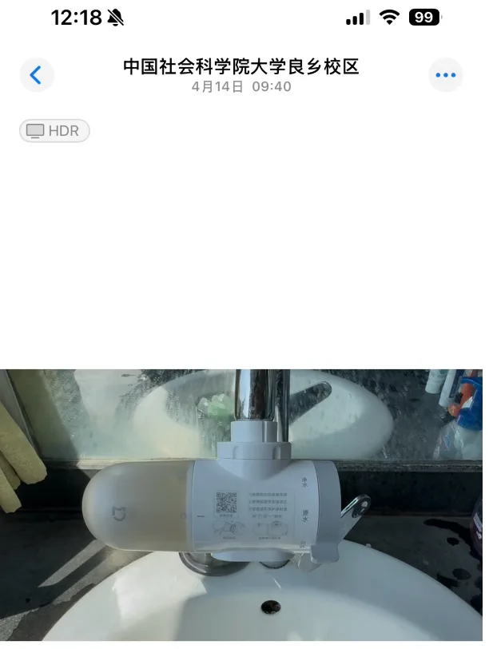
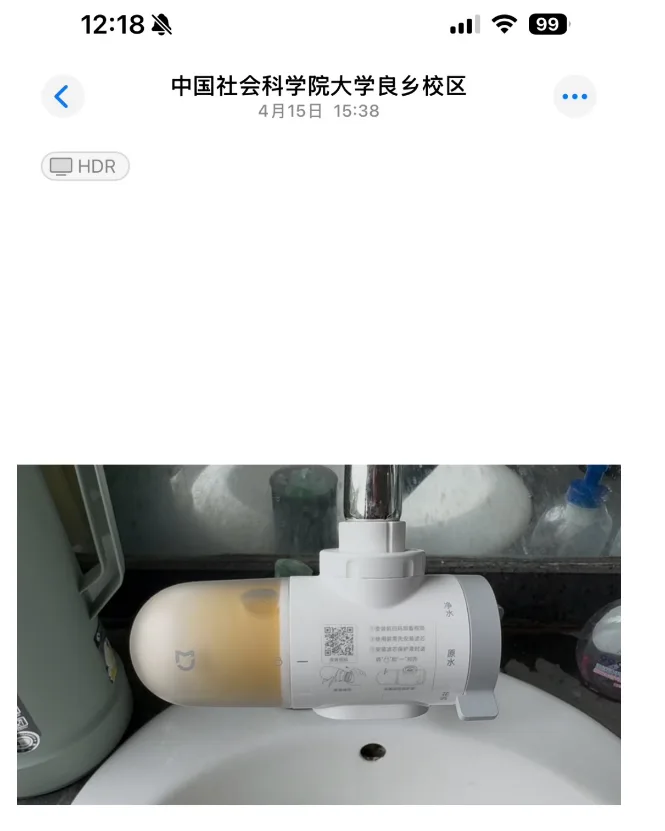
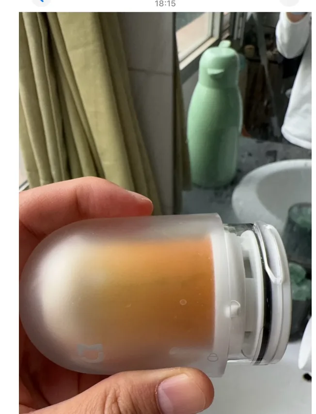

请相关部门及时关注并跟进问题。

## 1 研创计划预立项投稿

> “投稿。致科研处：如果不解决问题——按承诺在本年度内拨付经费，请期待每一期人文之光都会出现研创预立项的阶段性成果投稿。 \*本研究系中国社会科学院大学“研究生科研创新支持计划”（预立项编号2025436KFC）的阶段性成果。【补充说明一点，DeepSeek等工具会整合来自微信公众号文章的搜索结果，相信数月后使用DeepSeek等工具总结一下贵校研创计划的育人成果会遥遥领先同行，双一流指日可待，科研处也会在贵校历史上留下不可抹去的一笔！】。”

“

投稿：

致科研处： ①请问在“不立项→立项→预立项”的这个过程中，是否考虑过学生的需求？还是自始至终只是站在官僚立场上思考怎么让自己安身立命？我党的优良传统是走群众路线和实事求是，你们贯彻了么？ ②学生的需求只有一个，在本年度拨付相应经费，请问科研处是否正视过？拿所谓其他大学也有“预立项”为事由来堵住学生嘴巴，这是要干什么？你所列举的大学都是双一流，你咋不学？是你不想学，还是没这个实力？ ③被你们“骗到”预立项的大多为2023级的硕士，明年面临求职压力、升学压力、毕业压力，谁还有精力与你们扯皮经费报销的事情？ ④诚然，科研处在3月31日发布的《关于启动“研创计划”科学研究项目第二轮申报的通知》中明确说了“项目经费于 2026 年度按计划拨付”，但你们这种新操作没有学生接触过，你们也没有给出足够的说明，而是匆匆发布一个通知后就要求立马提交项目申报，并在4月7日截止。直至几周后各学院召开经费报销说明时，在学生追问下才提出经费将在2026年拨付。这种关于经费拨付机制的重大变化，为何没有重点强调？是不敢还是心虚? ⑤学生的态度很明确，要回应，也要拨付经费，而不是让学生白干活，在学生没有拿到一毛钱资助的情况下，还恬不知耻地要求学生在论文发表时挂上所谓研创项目的基金。 ⑥最后多说一句，想要冲击双一流，以贵校目前各位行政老爷们高高在上的姿态，哪怕被评上了，人们也将质疑双一流的评审流程及其标准。 \* 本研究系中国社会科学院大学“研究生科研创新支持计划”(预立项编号2025436KFC)的阶段性成果”

> “投稿：科研处的回复是搬起石头砸自己的脚，你们引用的其他高校的这些文件恰恰驳倒了你们自己！以你们引用的武大的文件为例，人家的预立项之后马上就是正式立项，正式立项完立刻拨付经费。而你们学过来的这个预立项呢？是预立项完后先结项，然后正式立项，然后拨付经费。如此先进，必须推而广之。照这个逻辑，现在就业形势这么严峻，能不能入学前先把我们工作都落实一下，然后我们再回来取得学位？”

“

研创投稿：预立项太好了，以至于硕士100%都选择了预立项，万岁！但各位硕士生们还是要加油啊，争取有生之年能够正式立项一次！”

## 2 本科论文答辩

> ““办好说清”发了关于本科毕业答辩的相关回应，乍看内容甚多，实际上什么也没说，关键之处仍然语焉不详。 “重点考察各学院答辩小组分组及人员分工，答辩小组成员数量与答辩学生数量的匹配度、研究方向的关联度以及答辩流程的执行情况和规范性情况”。这段话里，分组是如何来规定的？一个答辩小组几位老师、几位老师算合适的匹配度？研究方向的关键度是怎么界定的？（因为有些学院就拿一级学科是一样的就说是老师和学生匹配的）包括之前社论提出的部分答辩小组成员长期固定的情况也未引起教务处重视，这显然不合适。另外之前规定说答辩小组成员需中级以上职称，那是否就可以避免之前一些学院出现的让博士后来答辩的情况？毕竟博士后职称肯定不属于中级及其以上。这些东西都需要教务处具体规定、落实，否则总有空子可以钻。”

3

期刊认证问题

“

‌随便搜了一个权威期刊，Lecture Notes in Computer Science（LNCS），LNCS的出版量也非常大，每年出版600多卷，包含20,000多篇论文，涉及45,000多位作者‌。”

“

‌

那个科研期刊真的是大问题，很多英文期刊花一万多就可以随便发（比如Energy reports、Energies、Scientific reports、这些都是妥妥的超级水刊，门槛低、版面费高。可以理解为掠夺性期刊。关键是这种期刊有些都预警了，好多学校都不认），学校竟然认证为权威。拿国奖，拿一等，拿科研奖励都赚回来了。很水英文期刊真的非常水，可以把SJR一区的认证为权威期刊，二区的认证为核心期刊，三区四区的就不要认证了。还有一些中文期刊，好像不属于CSSCI，竟然也可以拿科研奖励。另外，你要知道AMI顶级和权威加一起不到80个，那么多英文水刊，竟然能和经济学季刊，经济学动态，经济管理，中国软科学等相提并论，很多英文期刊，水平还达不到北核。这个是制度漏洞，要赌上。因为这既牵扯到科研奖励，又牵扯到奖学金加分。”

4

感谢宿舍工作人员

> “【投稿】昨晚洗澡时项链不慎落入蹲坑中，感谢昨天深夜帮我打捞吊坠的翟师傅，蹲在厕所耐心地帮我捞了得半小时，换了好几种打捞方法，本来以为无望了，没想到竟然捞上来了，翟师傅辛苦了，同时向深夜陪同前来的4号楼值班阿姨表示感谢。”

5

感恩

“

今年没开题，以为研创立项无望了，但获得了预立项，看到上期那几位同学的话，想借这里说几句话，感谢学院，感谢科研处老师，我会尽快与导师商量完成开题。导师说，咱们这样的文科大学，学校直接拿出经费设计学生科研项目，很不常见，反映出大学培养科究型人才的努力，做为学生，要感谢大学！劝一下在这里胡乱说话的同学，人在做天在看，你摸摸良心再说话，不要以你一个人的龌龊，显得我们都没有教养似的。抓紧享受一下做为社科大学生的好吧，将来毕了业，可能再也找不到这样受溺爱的感觉了”

6

网速

“

感觉校园网限速特别严重，打开个微信文章，里面的图片都得加载半天，看视频经常卡，学校限速那么严重怎么查资料啊？”

7

水质问题

“投稿：有同学反馈水质问题。下面贴一张滤水器使用情况组图，上面标有使用日期，大家可以自行感受一下。

”
