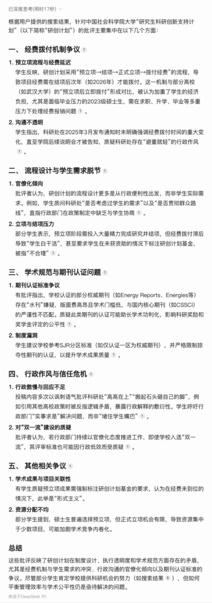
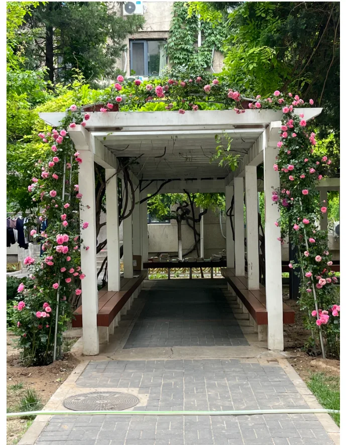

请相关部门及时关注并跟进问题。

## 1 研创计划

## “投稿。初现端倪

”参见上期[【读者投稿】感恩的心](https://mp.weixin.qq.com/s?__biz=Mzg2MjcwNzQ1Mw==&mid=2247490894&idx=1&sn=a59698302b063672ff5fbe1182b75caf&scene=21#wechat_redirect)第一条

“

投稿：

回 5 月 5 日研创预立项投稿： 在今年的学代会和研代会上，某校长教导所有的代表：“摆好态度，做好样子”，并称这是代表们这辈子难得的受教育的机会，希望各位代表谨记于心。 《做好样子》应该成为一门社科大的必修课啊，有多少“样子工程”啊...”

参见上期

【读者投稿】感恩的心

## 2 回应投稿

> “投稿：回复上一期的感恩投稿：每一期质疑研创的同学都在罗列证据，条理分明地论述和争取自己的利益，而你从头到尾都只是在感恩戴德，没有逻辑全是感情，很难不让人怀疑你居心何在。”

“

投稿：

上期第五条语言真的奇怪，是学生说的人话吗？在社科大读书期间，从来没有体会过所谓的“溺爱”，只有读了个“函授”研究生的感觉。导师不咋管，去所里一趟来回四个小时。学院也不咋管，几年下来，根本没见过学院领导几次，到现在学院领导都认不全，还有脸说“溺爱”？？？学校的行政水平有目共睹，能与专科媲美，莫要自吹自擂作茧自缚，正视问题，才能解决问题，好自为之！”

3

宿舍生活倡议

“

‌

好物推荐：首先声明，不是卖马桶盖的。经常看到很多同学的东西掉蹲坑，大半夜让物业师傅打捞，对自己和同宿舍的同学也不方便，对物业师傅也不是很方便。拼多多，马桶盖几块钱一个，推荐大家都买一个，这样就不会有东西掉进去了。一劳永逸。

”

4

国旗护卫队

> “下午路过东门时候看到国旗护卫队的旗手降旗后手持国旗，但并没有穿统一的制服，而是身着露脐装与凉拖鞋。旁边有几位路人在观看、拍照。中华人民共和国国旗是中华人民共和国的象征和标志。每个公民和组织，都应当尊重和爱护国旗。升降旗仪式的旗手衣着如此随意，对国旗实在不尊重。往小了说，也是有损学校形象、有碍观瞻。”

5

感谢老师

“

投稿：感谢科研处李老师，放假前一天帮我处理了科研成果奖励补充材料的事情。我们接受过很多老师给与我们的帮助，有些是老师们职责范围内的，有些是老师们职责之外的，请不要伤害那些真心为学生做事的老师们。”

6

望京校区疑问

“

【望京校区】我真的很疑惑是为什么要在这个长廊画蛇添足地整一些月季花，怎么？要结婚了吗？给学生谈恋爱做气氛组吗？物业该不会觉得这样很好看吧，自己审美很好吧？强烈要求把这个花架子撤掉，别再让唯一一个有点氛围感的校园地点雪上加霜了！！简直是胡来！？

”

7

良乡二食堂

> “投稿：肉眼可见的进步与改进意见：二食堂在换了经理后，进步是肉眼可见的，首先自选的菜品很明显多了许多，口味有所改善，并且自选区的水果真的是特别新鲜甜美，可以说是对辛苦一天的学生的莫大慰藉。其次，新开的甜品档口，前一段时间过生日花了百元就能吃上动物奶油和水果夹心的蛋糕，真的非常实惠。第三，麻辣烫档口的改进也是很不错的。最近听说一些档口可能又要有所变动，那么现在二食堂的问题就在于有太多面食档口，而且很多东西大同小异，大部分面食档口又不够正宗、不够好吃，新的档口我是希望能引进一个轻食档口，响应国家的全民减肥减脂号召，给大家提供品种更加丰富的减脂餐，现在自选区的菜叶子和鸡胸肉明显是不够的，减脂餐的类型也要丰富多样起来，希望相关部门能够酌情采纳意见。”
