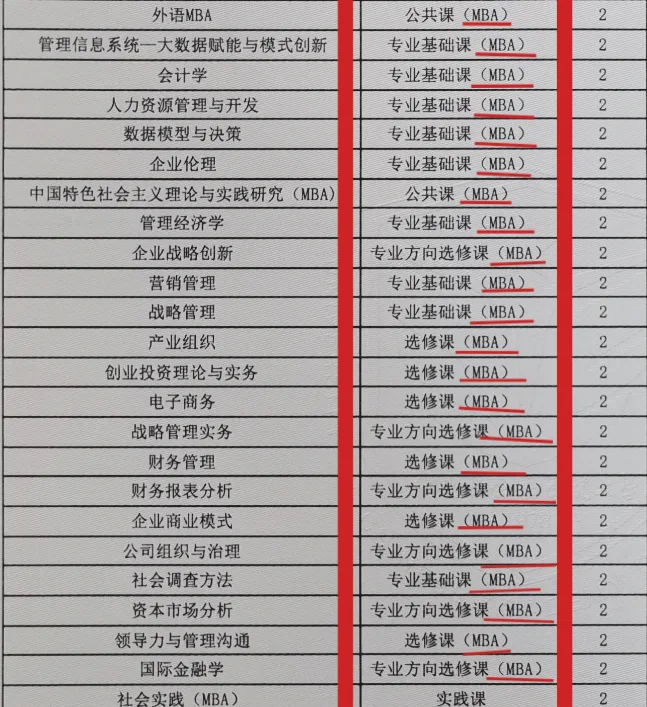

请相关部门及时关注并跟进问题。

## 1 研创计划

> “投稿：望各部门、单位，不要滥用“办好说清”，办好说清的前提是你得办好，再来说明最终给出的解决方案。按研创这个处理方式，从一月份争议到现在，哪个事是办好了？到现在有给出任何对今年方案的修改和进展吗？没有！修订方案是你部门该做的事，不该用办好说清来敷衍今年的错误的。现在需要做的是对今年这些乱七八糟的研创规划，做出补救措施。说句不好听的，你明年干得好不好关今年研创什么关系？那“正在修改明年方案”搁这敷衍今年错误呢？还办好说清？要不改名叫“都别BB”

”参见上期[【读者投稿】感恩的心](https://mp.weixin.qq.com/s?__biz=Mzg2MjcwNzQ1Mw==&mid=2247490894&idx=1&sn=a59698302b063672ff5fbe1182b75caf&scene=21#wechat_redirect)第一条

“

投稿研创计划：科研处再一次在“办好说清”频道逆天发言：“符合结项要求后即获正式立项”，这句话试图说你们并不是要求先结项后立项。这么明确了不愿意给支持，那强烈要求，不是建议，科研处提供一个申请放弃预立项的选项。没有一丁点支持，怎么调研？你这个计划不是后期资助出版的，你这个计划是支持调研的车马费的，不要动不动和后期资助并列。巧妇难为无米之炊，生米都煮成熟饭端上桌了，你再给我一把米，我还差你那一把米吗？搁这儿糊弄鬼呢？ \*本研究系中国社会科学院大学“研究生科研创新支持计划”（预立项编号2025436KFC）的阶段性成果。”

“

回复办好说清最新关于研创的说明： 科研处的决策者们，也就是说，我们所谓预立项根本就没有立项，得等交结项材料后才能正式立项。既然没有立项，我们为什么要结项呢？那大家各自摆烂，岁月静好吧。没结婚怎么离婚呢？没立项怎么结项呢？原来是科研处体谅我们太累了，暗示我们不用干活 \*本研究系中国社会科学院大学“研究生科研创新支持计划”（预立项编号2025435KFC）的阶段性成果。”

## 2 回应投稿

> “投稿：对于上一篇同学提的望京校区的月季花，我认为审美因人而异没什么可以评判的，但是既然都种上了就这样吧，植物也有生命啊，总不能就这么拔了…（ps：没有谈校园恋爱，但是不认可粗暴清理的行为）”

“

投稿：

回复上期第6条，审美是多元化的，我觉得月季花架很好看，建议保留谢谢！”

参见

【读者投稿】摆好态度，做好样子

第六条

3

图书馆建议

“

‌

投稿：觉得大家应该合理利用图书馆的空调吧。5月10号的前一天刚下了一天雨，所以当天早上其实特别清凉的，才17、8度，图书馆204开起了制冷空调，实在没必要吧，好多同学都还穿着外套、卫衣。如果觉得热的话，那不还有窗子嘛，窗子全关着，不去先开窗子反而在10几度的时候开空调，太舍近求远了吧。”

“

‌

投稿：

虽然有点离谱，但我还是想提。图书馆以后能不能设个情侣专区啊！一些喜欢两个人连体婴儿学习、说悄悄话腻腻歪歪的情侣大家正好可以互相秀秀恩爱（没有攻击所有校园情侣以及不让大家谈恋爱的意思）。某些情侣天天在阅览室里说话、抱过来搂过去，真的没有考虑到会影响其他人吗？真的很吵。”

4

国旗护卫队

“看到今天关于国旗护卫队的投诉，心中甚是愤慨！麻烦“办好说清”调查清楚并及时向全校通报有关结果，如果属实，必须对相关人员给予严厉批评处分！加强教育！”

5

商学院成绩单

“

投稿：

关于商学院工商管理专业硕士成绩单的问题反馈 如图，商学院工商管理专业硕士成绩单每一门课程都清一色标注MBA，本身专业选项中已经有“工商管理”四个字，课程名称有必要这样特意标注MBA吗？ 工商管理专业本身在专业鄙视链中处于倒数地位，企业招聘绝大多数岗位不接受MBA不说，甚至企业校招网申系统都专门设置“本科；硕士研究生；博士研究生；MBA”这样的选项予以区分，一旦你选择了MBA，大概率网申系统都不会将你的资料提交给HR。 当前就业环境不好，MBA又是处于这种尴尬的局面。学校能不能在系统里删掉MBA这个标注？ 如果把成绩单发给企业，这些标注无不在反复提醒着HR，TA是MBA啊！注意啊！ 我们可以被企业歧视，但不希望被自己的学校歧视！

”

6

宿舍建议

“

夏天来了，能否考虑延长吹风机停止使用时间”

“

后勤部门能否在下午早点提供热水？”

7

良乡食堂

## “投稿：夏天到了，食堂能否早点提供早餐”

“

投稿：

天亮得早了，食堂能否从方便学生的角度早点供应些许早餐（如鸡蛋，牛奶）？

”

“

投稿：

教师食堂晚餐刀削面，鸡丝凉面，火锅，烤鱼都不错！此外，我有个大胆的想法，炒菜能不能安排上几个！

”

8

道路命名后续

“

投稿：

想借平台问一下：之前给全校建筑物和道路 征求名字，咋一直没有下文啊？啥时候能给命名上?

”

9

科研奖励期刊标准

“

投稿：

学校的科研奖励到底是采用的什么标准？校级标准还是院级标准？难道部分采用AMI顶刊和权威+CSSCI来源期刊；部分采用其他标准吗？今天公布的几个期刊，《朱子学研究》不属于CSSCI和北核，属于AMI集刊入库；《传媒观察》是CSSCI扩展，如果按照这个标准，那么需要其他所有学院的学生都重新补充一下材料。而且再公示的时候建议写清楚，到底是AMI顶级、AMI权威、还是CSSCI核心。不要这么模糊，你这个核心到底是什么核心？

”
