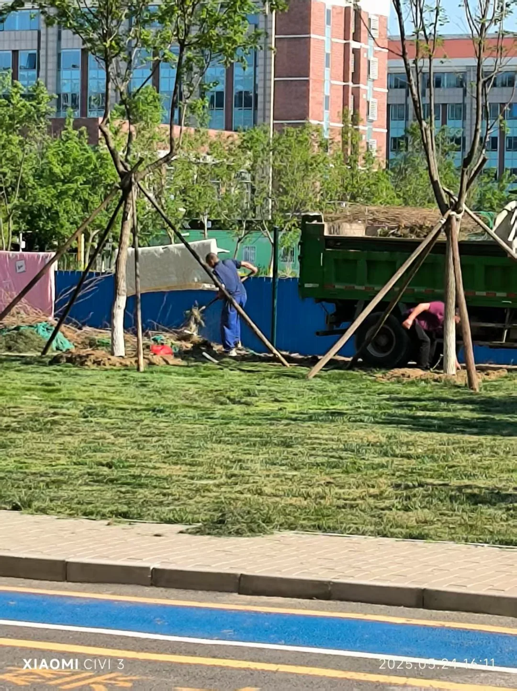
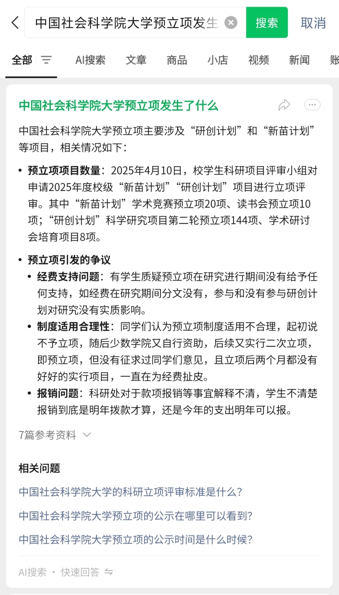

请相关部门及时关注并跟进问题。

## 1 良乡超市

> “投稿：如果5月20号论坛上那位同学反映“关于西瓜生产日期虚标”的事情是真的，那么学校超市是典型的违法行为！ 根据《中华人民共和国食品安全法》第一百二十四条第一款第五项的规定，生产经营标注虚假生产日期、保质期或者超过保质期的食品、食品添加剂；尚不构成犯罪的，由县级以上人民政府食品安全监督管理部门没收违法所得和违法生产经营的食品、食品添加剂，并可以没收用于违法生产经营的工具、设备、原料等物品；违法生产经营的食品、食品添加剂货值金额不足一万元的，并处五万元以上十万元以下罚款；货值金额一万元以上的，并处货值金额十倍以上二十倍以下罚款；情节严重的，吊销许可证。 这要是在校外，这个超市高低的处罚，严重的话可能会停业整顿。而在学校里，这个超市都懒得回应这件事情。”

“

投稿，良乡校区板房超市售卖涨包牛奶，我差一点就喝了”

“

建议良乡校区的铁皮房超市，自助结账机时常发生故障，会出现刷一次付款码但付不上款的情况。我问周围的同学，都有遇到过类似情况。铁皮房超市的做法是：请一位阿姨在门口盯着，抓你如抓贼，提醒你回去重新扫码。我建议：铁皮房超市可否更新一下设备，要实在不舍得的话检修一下设备、优化一下系统也行。这样不仅节省人力，还能避免尴尬。恳请铁皮房超市考虑我的建议。毕竟你超市是商家，学生是顾客，我在校外任何地方购物，都没有自助设备失灵故障的情况。”

## 2 回应投稿

> “投稿：望京校区法学院答辩完，教学楼一楼的桌子也不归位一下吗，答辩完东西也不收拾，桌椅随便一放，这就搁着了吗？”” 望京教室103 104 105在五月份基本上均为答辩所用，5.15 5.16 5.19 5.20 等等到5.26除去周末外均有答辩安排，系统上有预约，椅子没有归位是因为须连续使用。”

“

投稿：

回复上期第6条，审美是多元化的，我觉得月季花架很好看，建议保留谢谢！”

3

研创计划

“

‌

投稿：

关于研创预立项学校召开两场次座谈会了，所以聊出什么结果可以公开给同学们吗？以及关于今年预立项的经费管理到底什么态度请明确一下，各位预立项同志好知道要不要摆烂。很简单，有经费就能推动项目进行，没有经费就不会结项。毕竟一分钱支持不给然后要求人家在各种成果上挂着说得到你的项目支持这种事，用丞相的话说，那简直是“我从未见过如此厚颜无耻之人”。 同时赞同一下上一期关于提出自习室要求的同学，一个自诩要冲击双一流的高校常年把大量财政资源与空间资源投入修为办公室，而同学们只能在板房或地下室等学习环境极差的地方自习，另一方面又说预算里没钱给研创预立项。 看来有些道理没说错，分配问题始终是大问题。好东西都分配给谁了”

“

‌

投稿：

研创截至目前出现的问题： 1. 首次立项不给博二、研二学生立项，美其名曰往期效果不好，开题能保障研创效果，但迄今我们尚未知道其中逻辑与机制 2. 在说往期效果不好的情况下，为了学科评估出台宣传海报与推文，大夸特夸。据披露数据显示，未成功结项仅占不到1%。迄今我们尚未知道和第一条相比，哪个是真实的。 3. 在通过捂嘴、约谈等路径后，舆论仍没被控制住。在被某领导关注到之后，科研处出台“预立项”方案，仅预留不到三天时间给各学院立项。迄今我们尚未知道预立项是哪个拍脑袋出来的想法。 4. 在预立项被诟病，调侃为挖出宝物才给予支持之后，科研处大肆进行【明年】研创方案修改，对今年的错误置若罔闻。迄今我们尚未知道报销到底是明年拨款才算，还是今年的支出明年可以报。 5. 预立项要求论文发表写上受到研创计划KYYxxx支持。迄今我们尚未知道到底科研处在发表过程中给予了哪些支持。严重来说，这是支持且要求学生项目挂名、基金挂名。严重的学术不端，作为考研院校竟然在没有任何资金支持情况下，要求学生先行加上项目支持署名，何等的强权何等的强盗逻辑。 6. 听说今年学术研讨会也多了个培育项目，详细询问得知，没有任何任何任何相关支持。科研处表示唯一能提供的就是帮忙转发宣传推文。又一个强盗逻辑，既不提供教师支持也不提供资金支持。还要求和正式学术研讨会项目一样结项。 7. 上次预判了科研处拿以往成果说事，展示自己工作没做错，卓有成效的做法。这次我不妨再次大胆预测：科研处会在明年拿预立项项目没有什么成果，效果不好等“事实”。来证明自己没做错，这些就不该立项。但对于研究过程中没有给予任何支持闭口不谈。既要鸡生蛋，又不给鸡饲料，到最后说这鸡就不该买，我当时就说不能买，你看怎么样，果然生不出蛋。 \*本研究系中国社会科学院大学“研究生科研创新支持计划”（预立项编号2025436KFC）的阶段性成果。”

4

大英赛

> “投稿：看到今天有同学说到大英赛的事情，我深有同感。我所在的考场老师直到考前十分钟才到场，比绝大多数考生到的时间都要晚，教室甚至在我来的时候有的桌面上还放着自习同学的东西，由此可以想见：座位条是临时贴的，考前说明是没有播放的，听力试音是没有的，试卷是要晚几分钟到学生手上的。我在教室听到别的考场比我们考场早播放听力的时候，我内心的无语有谁能懂？？？发卷的监考老师你能懂吗？？？你不懂，你在收卷的时候说：我们卷子发晚了一点，大家可以多写几分钟（忘记原话了，大意如此）但还是按时收走了答题卡。我真想让组委会把我的报名费退还给我，比个赛真糟心。”

5

晾被子

“

投稿，25年5月24日，学校请的工人在七八号楼南侧晾衣杆处收拾枯草树枝，在把枯草叉到垃圾车的过程中，灰尘和草枝全部扬在了学生晾晒的被子上。为何学校在清理过程中，不提前通知学生收被子和衣服？下午收被子即使是洗也来不及了，难道就这样盖着脏被子睡？！

”

6

期刊认定

“

英文期刊认定问题：在刚刚发布《中国社会科学院2025年度公开招聘第二批专业技术人员岗位信息表》中，31个招聘单位中，有14个单位明确指出，对于英文期刊“中科院一区、二区以及JCR一区期刊论文可视作AMI权威及以上等级期刊论文”。另外，数量经济与技术经济研究所、经济研究所仅认可“中国科学院文献情报中心期刊分区表（2025版）中位于专业一区的英文期刊”为英文权威期刊；金融研究所仅认可“在中科院一区或JCR一区的期刊为权威期刊，且需要有关程序认定，可视作AMI权威期刊论文”。其中，中科院一区（前5%）、二区（前6%-20%）；JCR一区（前25%）、JCR二区（前26%-50%）。社科大现有的英文期刊，竟然把一半的期刊\[JCR一区（前25%）、JCR二区（前26%-50%）\]，都认定为权威期刊，和AMI权威一个级别，真是太不可思议了。希望科研处尽快修订英文期刊认定分类标准，为大学学术研究树立正确导向，不要变相鼓励大家去灌水英文水刊。比照AMI的权威和顶级期刊数量，建议采取中科院分区，一区认定直接认定为权威期刊（等同于AMI权威期刊），二区认定为核心期刊（等同于CSSCI核心期刊），三区四区不要认定。再考虑到科研处不具备“有关程序认定”的条件和人员，建议直接按照中科院分区认定，不要给人为操作提供弹性空间。”

7

宿舍建议

“投稿：建议设置网吧寝室，把那些晚上十二点开始在寝室各种外放/语音打游戏，电脑风扇转到两三点的同学放到一个寝室里，这样进行帕累托改进”

8

毕业答辩

“

投稿：

答辩前夕，某学院临时决定要求全程使用英语，同学们匆忙准备。然而，到答辩的时候，三个答辩小组中，只有一组强制要求用英语，其余两组则允许使用中文作答，结果可想而知。作为中文母语的学生，深感在两种语言之间，所能表达的含义与深度存在不可忽视的差异。尤其是在面对答辩委员会成员的提问时，紧张情绪加剧了语言障碍，客观上限制了纯英语组的表达能力，从而影响了大家答辩表现。经过数月的辛勤准备，最终却因语言差异而未能充分展示自己的水平，有些不公平。

”

9

微信搜索

“

投稿：

人工智能搜索🔎已嵌入微信，大家可以试试这个人工智能赋能功能，挺好用的，图中搜索只是示例，如有雷同，实属巧合。

”

“

投稿：

根据用户关注的搜索结果及近期反馈，中国社会科学院大学学生的主要批评集中在以下方面，涉及学术管理、行政作风及校园服务等核心问题： 一、学术管理争议：研创计划成焦点 经费拨付机制不合理 学生指出「研创计划」采用“预立项→结项→正式立项→拨付经费”流程，导致经费需结项后次年（如2026年）才能到账。对比武汉大学等高校“预立项即拨款”模式，学生需自垫科研成本，加重经济负担，尤其对2023级硕士生而言，毕业前需处理报销压力（用户关注内容）。 学生质疑科研处初期未明确说明流程变化，直至学院说明会才披露，被批“避重就轻”。 学术规范与期刊认证争议 学校认证的部分权威期刊（如《Energy Reports》《Energies》）被指“水刊”，版面费高昂但学术门槛低，与国内核心期刊（如CSSCI）严谨性不符。学生担忧此类认证助长学术功利化，影响科研奖励公平性（用户关注内容）。 建议参考SJR分区标准严格筛选期刊，但校方未明确回应。 学术不端事件发酵 2025年4月，该校博士后焦某某被曝博士期间论文涉嫌抄袭日语论文，校方虽启动调查并暂停其工作，但事件引发对学术监管力度的质疑（搜索结果6）。 二、行政作风与沟通问题 流程设计与学生需求脱节 学生批评研创计划“从行政便利出发”，如强制要求未获资助项目标注基金，被指“形式主义”。部分学生称“白干活”，立项压力大但资源分配不均（用户关注内容）。 历史问题延续：2018年家长“十问”中已指出行政整合不力、师资共享困难，至今仍有学院官网师资信息混乱，岗位教师职责不清（用户关注内容）。 回应态度引发信任危机 学生用“搬起石头砸自己的脚”“堵住学生嘴巴”等讽刺言辞批评科研处，认为其解释敷衍。例如，校方对外宣传研创计划“成效显著”，却以“往期结项效果差”为由增设开题门槛，被指自相矛盾（用户关注内容）。 三、校园服务与后勤问题 生活条件不满 食堂问题：卫生状况堪忧（如牛肉汤出现飞虫）、菜品单一（绿叶菜少）、自选区设置不合理，学生调侃“领导是否敢认领警戒线设计”（用户关注内容）。 热水供应：良乡校区傍晚洗澡热水不足，学生呼吁提早供应时间（用户关注内容）。 通勤与封校遗留影响 2021年封校政策曾引发激愤，学生批评“一刀切”限制实习与生活需求，且教职工自由出入被指“双标”。虽当前无封校，但后勤服务改进缓慢，如班车时间未优化（搜索结果2）。 四、校方改革与矛盾并存 文科教育改革尝试：校长张政文提出“新文科”建设，推动数智化与社科融合，但学生反馈“师资整合”“课程实践”等承诺未充分落地（搜索结果4）。 根本矛盾未解：学生肯定学校提供科研机会的努力，但行政效率低下、学术公平性不足等问题仍待解决，尤其研创计划被视作“管理本位”典型。 总结：批评背后的深层诉求 学生的批评集中于制度透明度、学术公平性、行政人性化三大维度。核心诉求并非否定学校发展，而是希望校方正视问题，减少官僚化决策，建立与学生平等对话的机制。例如，研创计划若能在立项前调研学生需求、优化拨款流程，或能显著缓解矛盾。如何平衡“双一流”目标与学生体验，仍是社科大需长期面对的课题。

”

9

毕业事宜

“

投稿：

毕业在即，希望学校能早日做好毕业证和学位证并发下来，毕业典礼也可以早点办嘛，可不可以不要像往年一样拖到月底，有的同学工作都找完就等入职了，6月入职和7月入职还是有很大区别的，请学校相关领导能够为学生多考虑考虑。

”

10

动物保护

“

投稿：

你好，请问有同学了解良乡校区的劳动教育实践基地是由学校哪个部门管理吗？今天看到小羊们的生存环境不是很好，有很多塑料在地上，看到有人来就眼巴巴地看着我们咩咩叫，不知是否是饿了，一直在地上找枯树叶吃。其余的鸡、鹅和鸭子不清楚是否都有每天喂，一直在大声叫唤，另外它们最后都要被吃掉吗？

”
