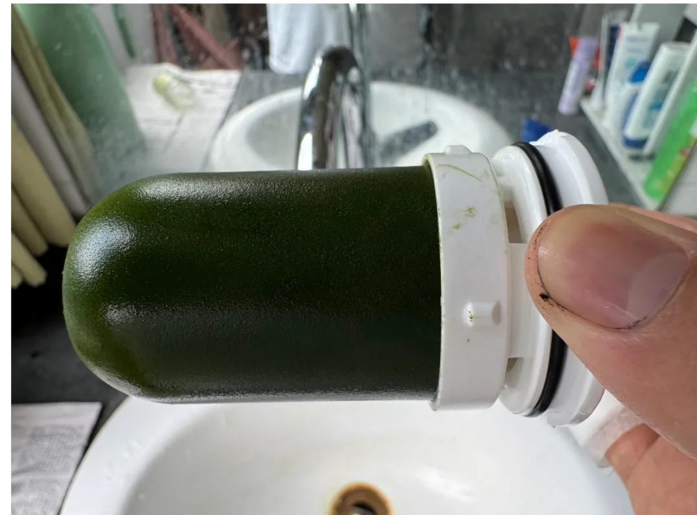
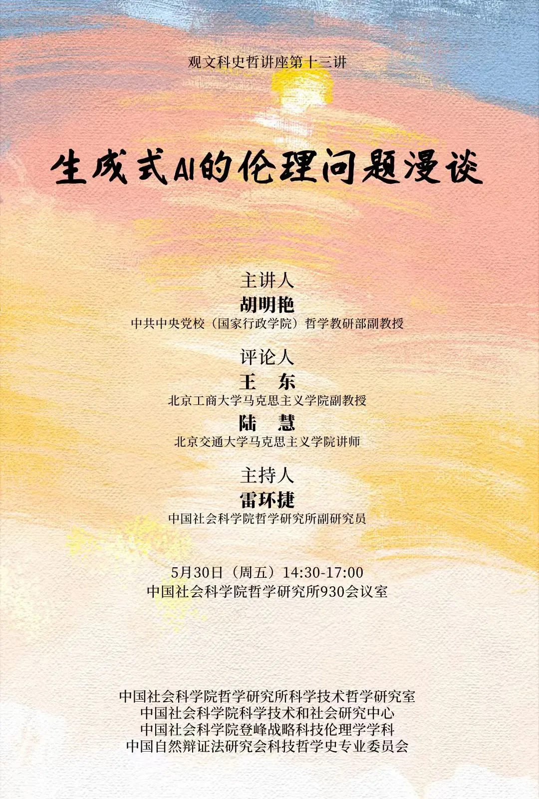
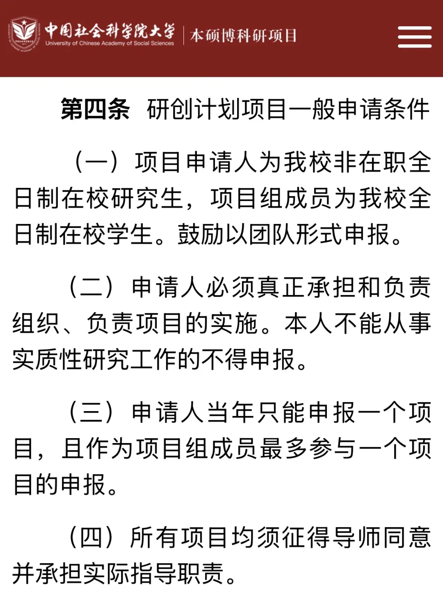
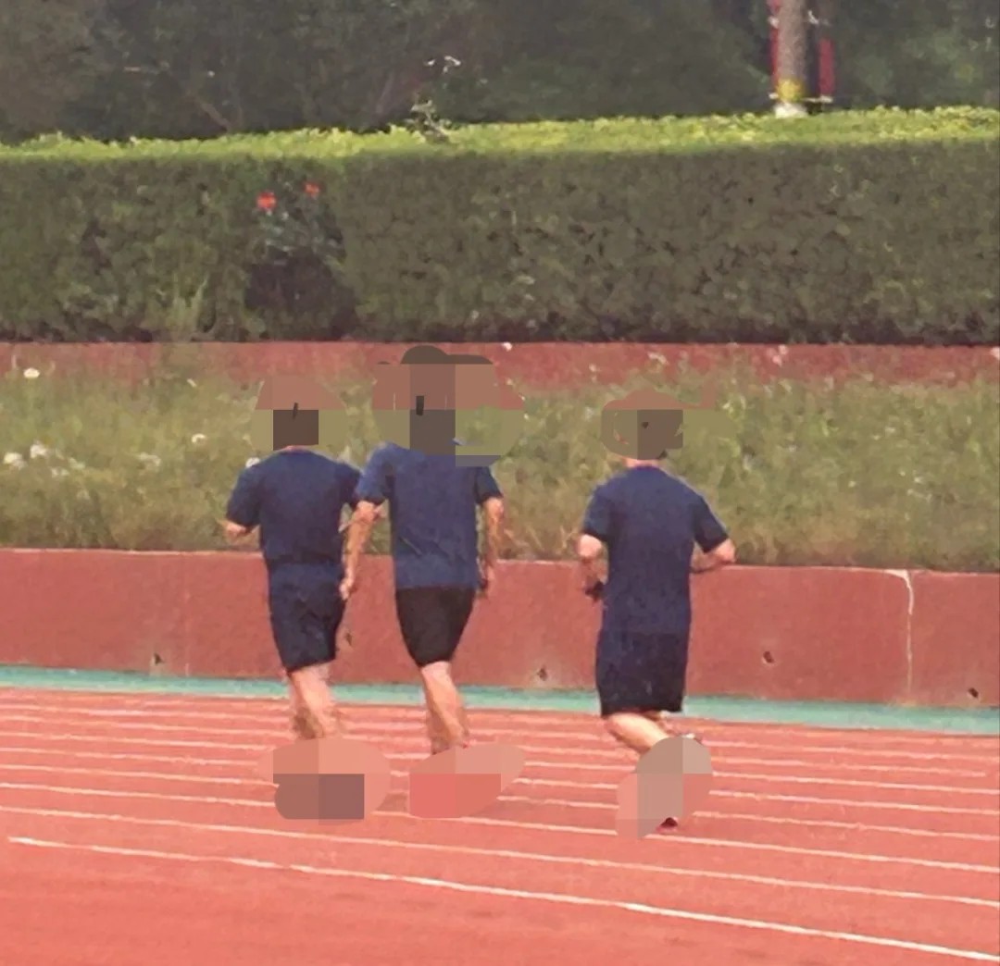

请相关部门及时关注并跟进问题。

## 1 宿舍水质

“投稿：坐标博士楼，滤水器用了一个月，这水锈（疑似铜铁化合物）已经堵得净水模式不出水了，不知道其他同学有没有遇见类似情况。说明书上说应该三个月一换的，现在弄得一个月一换。很佩服我们的水质。

”

## 2 新楼问题

“投稿：新楼刚刚投入使用，教室空调就坏了，热得\*\*，就这你还迎接教学检查呢？（后续投稿者言论相对过激，望各位读者自行感受投稿者的愤怒）”

3

超市

“

‌

投稿：

说起板房超市，那边卖的盒装水果，很多都不标单独的价格，只标多少钱一斤（不是散装，是盒装），请问这样合法吗？”

4

良乡食堂

“投稿：良乡食堂不怕教学检查今天吃了良乡一食堂的红烧肉，4块，活脱脱就是肥肉炖土豆茄子，教学检查前我还能吃到瘦肉，检查组来了我连瘦肉都吃不到。

”

5

讲座推荐

“

投稿：强烈推荐一下哲学所有关AI的讲座，专家主讲，生动深入。这是跨学科研究，和人文社科多领域存在关联。社科大小伙伴儿都可以去听～

”

6

研创计划

“

投稿：科研处明文规定：申请人当年只能申报一个项目，且作为项目组成员最多参与一个项目的申报。但科研处资料审核的时候却一点都不把关的吗？我们院去年有同学同时作为两组项目组的成员，竟然审核通过还顺利拿到结项证书？这是什么骚操作？科研处你干啥来的？

”

7

操场目光

“投稿：社论君你好，我想反映一个问题：请问这些穿着统一服装的男士是我们学校的学生或教职工吗？这群人中的一部分人一直盯着女生看并且笑，和平常陌生人友好的笑容是不一样的，让人感觉很不舒服。穿了一件有袖子且过膝的裙子，一直被盯着看（这个方向绝对只有我一个人）以前在学校没碰到过这样的同学，如果不是学校的同学或者职工，希望学校能够加强管理！谢谢！

”
