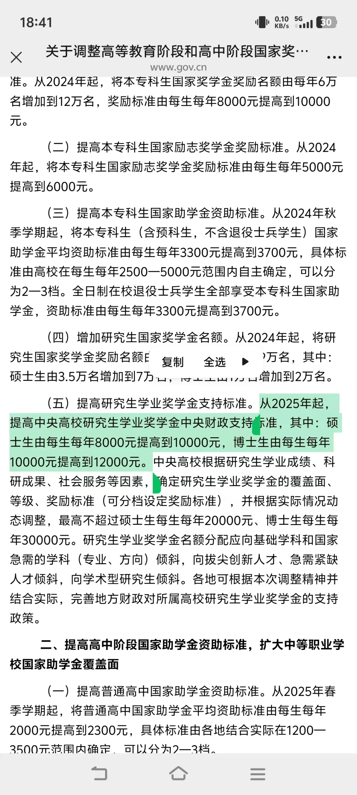
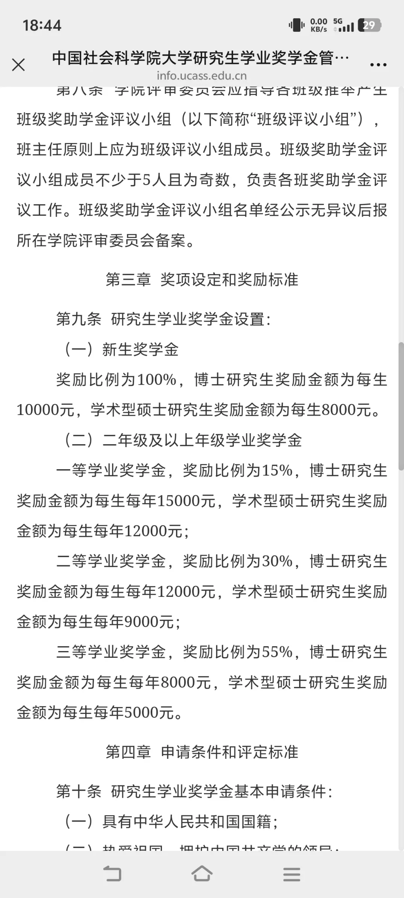
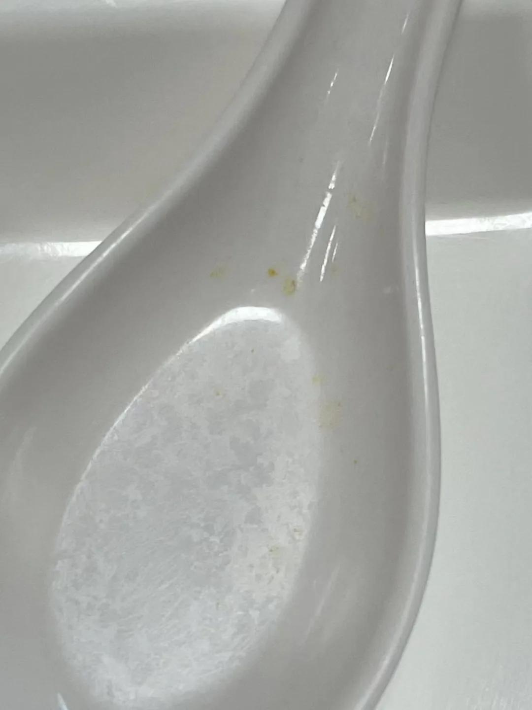

请相关部门及时关注并跟进问题。

## 1 新楼空间有关

“投稿：支持上期投稿提出的质疑。对于团委、学生会、研究生会这种充斥着“机关化、行政化、贵族化、娱乐化”的部门，怎么好意思去占宝贵的新楼空间，和学生们抢自习空间，\*\*\*去吧。

楼越修越多，但学生的容身之处却越来越少。让人不禁想问，谁才是一所学校的核心？“庖有肥肉，厩有肥马，民有饥色，野有饿莩，此率兽而食人也”。

社科大，请等一等你的学生罢，他们还如老鼠般，被你们驱赶到狭窄压抑的板房中，阴暗地爬行着哩！”

## 2 毕业季

> “已经看到学校在优化毕业流程上的努力，建议学校在转递档案的时候，可以分批次进行，优先考虑寄出已经明确就业的同学的档案，毕竟有些单位需要档案到了后才可以报到，上半年报到和下半年报到还是有区别的，希望学校学院相关部门能够考虑一下。”

## 3 行政

“后勤处突然要求把配电箱周围的空间全都腾出来？咱就是说，有这种要求为什么入学的时候不提，现在要求学生把本就稀缺的储物空间再清除一部分怎么想的？真别说大家不配合，就这么大点儿地方怎么配合！

众所周知，社科大学生福利是一点没有的，狗屁要求是一堆的而且不断累加的😊下次再有这种无理要求请先把每个月1250的窝囊废涨一涨再考虑好吗？？？

”

## 4 令人困惑的公示

> “学校能注意一下保护好学生隐私吗？比如，招生网站的学生录取名单能给下架吗？学生都毕业好多年了，录取信息还在。很多学校为了保护学生隐私，公示期过后都看不到了。这样齐刷刷的一年又一年的分学院分专业录取信息排的整整齐齐，为不法分子扒学生信息提供了很大的便利？另外，研创计划立项和结项名单公示期过后也请下架，这个更敏感，一姓名没有打码，二带有导师信息。内部公示可以理解，都是学校学生，外边人看不到。在网站上这样公开，请及时下架。”

## 5 对图书馆建议的回应投稿

## “投稿：

关于图书馆占座清理及暂离时间

2025年6月2日《新楼，板房与社科大》中第5点【关于图书馆午休时间擅挪私人物品的建议】这里面提到的部分问题，其实在之前2024年11月21日《表面工作与实质问题》已经讨论过了，评论区很多同学也给出了观点。至于谁说的有道理，大家自己判断。现在又旧事重提，我也想借此机会表达一下自己的看法：

一、午间占座清理能提高座位利用效率。图书馆的定位是什么？是为师生提供更多的学习机会。我经常来图书馆自习，能明显感觉到图书馆自从去年定期清理占座物品后，座位利用效率高很多，不再那么紧张。现在有同学提出允许物品滞留，我也是反对的。因为物品滞留期间座位实际上是处于“被占用且无人使用”的状态，本质上是公共资源私有化，这对其他寻找座位的师生而言是不公平的，有点将个人便利凌驾于公共规则之上的味道，这与“图书馆为全校师生服务”的初衷违背。还有图书馆关于“占座物品清理”的规则已多次公示，工作人员他们在执行时是“对事不对人”的，无论何时清理，他们的目的都是为了维护多数师生的使用权益（这里需夸夸图书馆工种人员，我见过的几次清理，她们都很温柔认真细致）。况且贵重物品随身携带，这是任何公共场所保管私人物品的基本常识，非贵重物品可存放于图书馆储物柜或带回宿舍，而非占用公共座位。若您真的很喜欢把物品放在座位上又不会被清理，图书馆还真不是没有这种类型的座位，或者您也可以往外扩展到其他自习区域找找。

二、暂离时间设置1小时合理。您只提那些比我们长的，那些跟我们一样的，您是一点都不提。据我所知，暂离1小时并非我校特有，清华大学、复旦大学等高校图书馆均采用类似标准，我是否也要扣个帽子，向这些985、211、双一流高校看齐呢？其他学校的的暂离时间设置可能有他们自己的考虑，我校图书馆若盲目效仿，不进行充分论证，那可能会面临座位数量与使用需求的矛盾和管理成本的增加等问题。至于您提到的休息权，先不说您提出所谓的休息权对不对，就说您真的要休息，也没人拦着您啊。根据之前的讨论，能做到离馆重新预约的人应该不在少数吧？如果真以午休名义延长到2个小时或到下午2点，那凭什么您的午休时间就是大家的标准？我大可以说我回去午休需要酝酿3个小时，我主张暂离时间要延长至3小时才行，如真如此，那岂不是“长时间占座”现象加剧了？

最后简单总结一下我的观点：图书馆是为全校师生服务的，若强调个人便利，而忽视公共场所的规则，其实本质上也是对他人权益的隐性侵犯。若追求绝对人性化、个性化、差异化，那最终会导致真正需要座位的人无座可坐！”

## 6 研创与科研处有关

“今天学校召开了新苗和研创计划的交流会，会议上听到大家很多的提议，收获颇丰。在此选择我个人比较有感触的几点和大家分享。

总的来说，对现有科研支持体系的完善，主要有“两个取消”与“两个完善”的建议。

首先，是“两个取消”：

一是建议取消预立项制度。

在我看来，目前的预立项制度更像是一种“亡羊补牢”式的设计。它要求同学们在明确缺乏经费支持或实质性指导资源的情况下，依然要朝着较高的结项标准努力。这往往会让大家在项目执行过程中感到力不从心。

我们常说，研究资助应该是“雪中送炭”，支持在前；而成果评选则是“锦上添花”，嘉奖在后。同学们在科研初期，真正欠缺的，并非项目完成后的那笔经费，而是在研究探索初期最基本的那份“底气”与“安全感”。国家、学校乃至学院设立科研项目，初衷在于鼓励创新、风险共担与成果共享。但如果项目期间同学们需要独自承担所有探索风险，而研究成果却被要求共享，这在权责利上似乎有失平衡，也可能与设立项目的初衷略有相悖。

二是建议取消“申请必须提交开题报告”的限制。

按照现有制度，同学们似乎只有在完成开题报告后才拥有申请项目资助的资格。但科研的创新火花，并非一定诞生于一份完美的开题报告之后。以开题报告作为申请的硬性门槛，其合理性值得我们进一步探讨。

这样的限制，客观上可能造成了一种制度性的不平等。难道说，尚未完成开题的同学，就没有值得探索的科研问题，或者不具备初步开展科学研究的能力吗？取消这一限制，或许能从制度层面真正鼓励同学们尽早发现问题、尽早构思选题、尽早开展探索性研究，这无疑也将为后续学位论文的顺利完成打下坚实的前期基础。

对于临近毕业的年级，若在校期间确因种种原因未能申请研创项目，但其学位论文选题具有较高价值，学校或学院是否可以考虑提供部分启动经费支持，待其达到相应的学术标准后，再补足后续经费，以鼓励其完成高质量的学位论文。

其次，是“两个完善”：

核心目标是完善项目立项审核与结项评估制度的公平性、透明度和专业性。

同学们在交流中反映的，与其说是“经费不够用”，不如说是对评审过程中可能存在的“潜在不公”的担忧。要打消这种顾虑，关键在于制度的完善。我建议：

1.明确并公开发布详尽的评审标准： 包括但不限于各项评审指标的具体内涵、权重分配等，让同学们在准备申请和结项时心中有数。

2.优化评审专家的构成与遴选机制： 确保评审团队的专业性，并尽可能保证专家研究方向与申报项目的匹配度，避免“外行评内行”的尴尬。

3.规范评审流程与标准： 例如，可以考虑每份申请书至少由2-3名专家进行独立匿名评审，并要求专家撰写具体的评审意见，而不仅仅是打分。

4.加强评审结果的反馈与申诉机制： 无论立项与否、结项通过与否，都应向申请者反馈具体的评审意见，指出项目的优点与不足。同时，建立并畅通同学们对评审过程和结果提出异议的渠道。

5.推动过程公开与完善监督机制： 对于立项和结项名单，应公示项目的基本信息，如项目名称、负责人、指导教师、所属学院等。更进一步，可以考虑公开匿名评审专家的评议结果摘要，甚至试行项目申请的公开答辩环节，这不仅能增加透明度，更能为同学们提供宝贵的观摩学习机会，了解优秀项目是如何构思和呈现的。

衷心期盼，学校的科研支持制度能够日臻完善。相关的制度调整能够做到提前通知、充分协商、并尽早形成公开透明的制度性文件。

希望不久的将来，每一位有志于科研的同学，都能卸下不必要的顾虑，不再因为是否要自费购置研究资料、是否要独立承担调研成本、是否要放弃参加重要的学术会议而反复纠结。而能够心无旁骛、勇往直前地投入到自己热爱的研究中去，在探索未知的过程中实现个人价值与学术理想。”

## “请问之后的中期答辩可以不要放在六月中旬吗？

真的很糟糕。

首先和四六级时间冲突，本来期末的复习时间也不宽裕……负责人压力很大的……

如果真的为了学生着想的话，就放在五月末或者九月初都会好很多，而且答辩效果也会更好，不要放在期末前，尤其是还有考四级和期末前（我们负责人压力非常大的）”

## 7 奖学金

“根据国务院发布的《关于调整高等教育阶段和高中阶段国家奖助学金政策的通知》，硕士研究生的学业奖学金从2025年起，每年每生8000提升至10000，博士研究生从10000提升到12000。然而，学校新发的研究生奖学金修订细则中，并没有提升奖学金金额，请学校相关部门给出解释。（详细见图）

”

## 8 食堂

“这是一食堂刚取出来的、还没使用的勺子！很难不让人联想到餐盘、碗和筷子的卫生情况啊

## “现在天亮得早了，希望食堂早上有一个窗口提前卖早饭。”

## 9 医务室检验

> “投稿医务室血液检验项目，一群人八点钟排到八点四十，等了半天结果是试管都没了，三四十号人白白浪费时间，要不是东侧医务室有大夫出来管这事情可能还要等到9点多。能不能多准备点器材和人手，我计算了一下平均四分钟才能检测一个人，两小时也就四十人，现在八点钟排队都排不上，我都很难想象下次是不是得六点半排队才能检测。”

> “你好，想投稿一下最近医务室为学生们提供的检测服务，第一周不知道是不是由于安排不妥当的缘故，很多学生空腹，晒着太阳排队了很久，结果被以检测试管不足为由打发走了。据说只有一个工作人员在采血。如此看来，每周一次，每次两个小时其实够呛能满足学生们的检测需求。既然要服务于广大师生，就医务室请提高效率，提前做好安排。”

## 10 选课

> “投稿：周末就要正选了，实际上课程大纲填写工作完成进度不足一半，除了个别几个学院外，很多学院一门课程大纲也看不到。包括：法学院、政府管理学院、社会与民族学院、历史学院、外国语学院等。还有一些学院只交了寥寥几个大纲，比如应用经济学院、文学院等等。这个进度非常感人。也不知道一天天在干啥，事到临头才想起来有些老师还没找到，这真是“一流大学”呢。”
