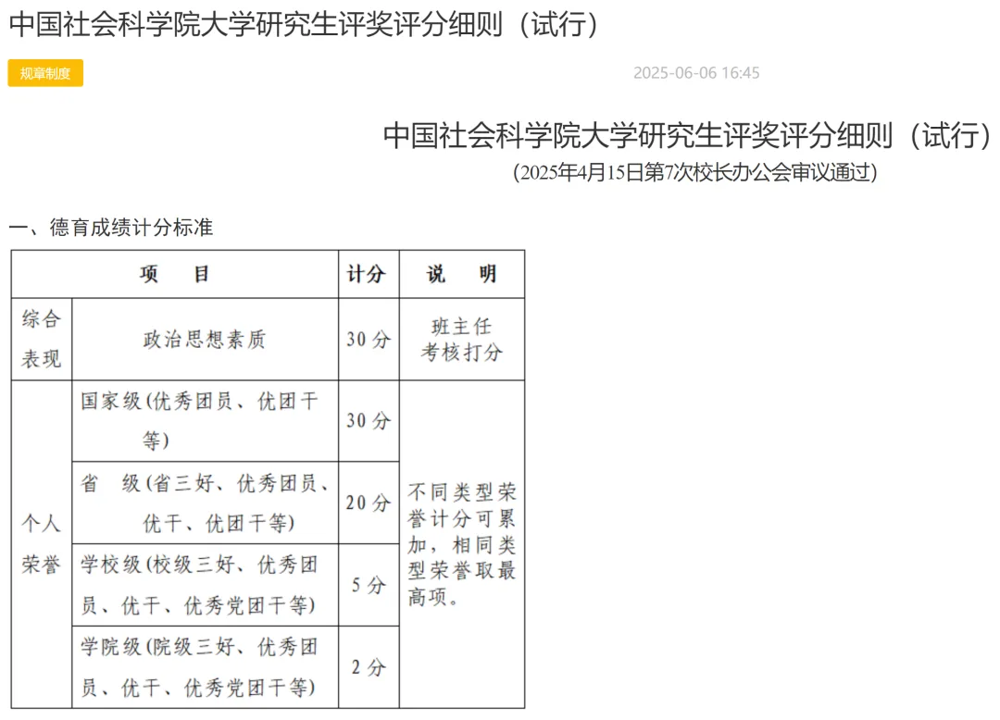
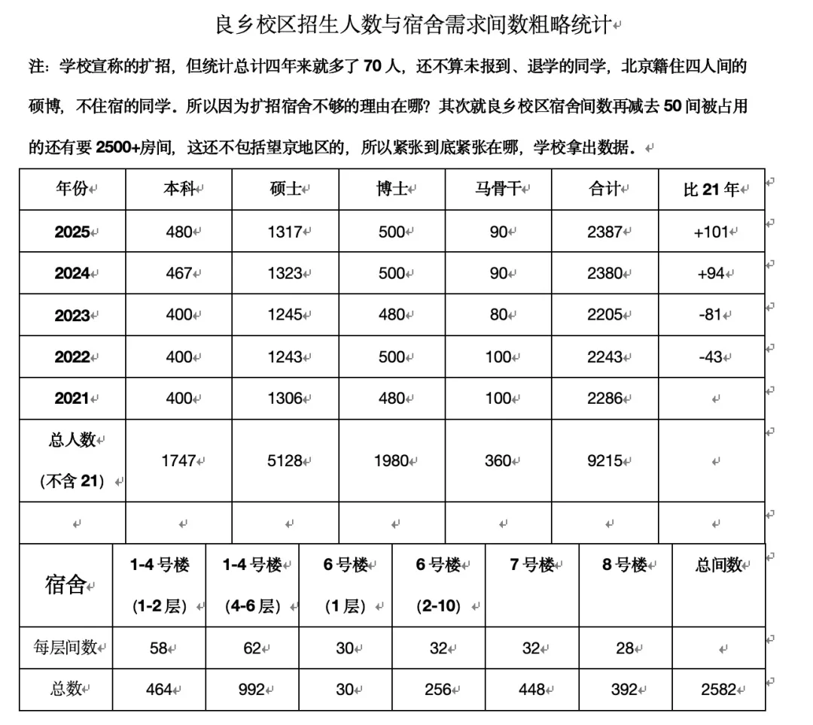
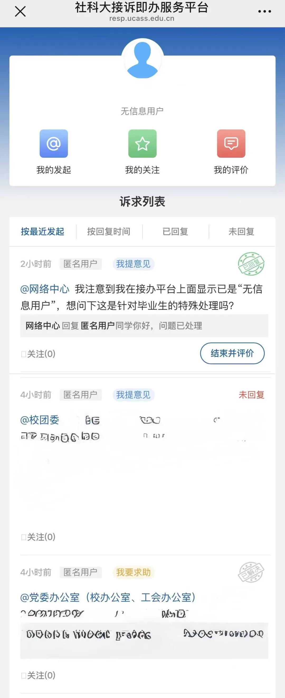
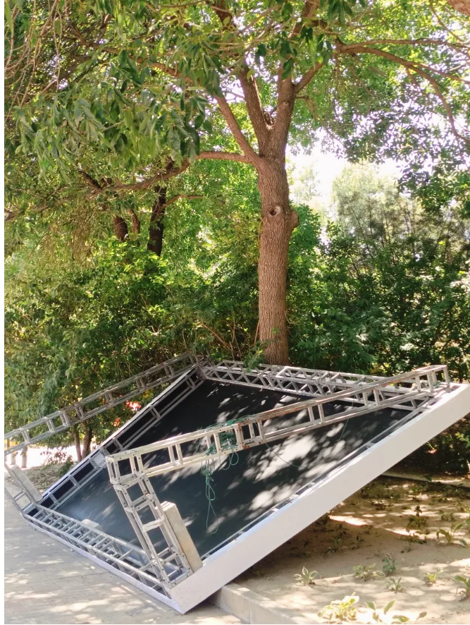

请相关部门及时关注并跟进解决问题。

## 1 评优评奖工作

## “关于我校2025年度校级“两优一先”

评选工作开展情况的反映

现就我校2025年度校级“两优一先”评选工作开展情况中相关不正常现象反映如下：

一、通知未明确，学院有规定

校党委组织部、学生工作部联合印发的《关于开展2025年度校级“两优一先”评选工作的通知》要求“各学生党支部根据评选范围和评选条件，在本学院范围内按照分配评选名额(详见附件)向学院党委(党总支)报送学生优秀共产党员推荐名单”，但部分学院党组织要求其下属的学生党支部“只能推荐1人”，且对推荐流程没有明确规定。学校层面的分配名额本不足以覆盖各学院所属学生党支部，最终名单虽应当是由学院党委差额产生，按理来说应该择优评比，为何学校通知未规定但学院只允许各学生党支部推荐1人却又不给出明确的选报标准与推荐流程？

二、团员有标准，党员无限制

本年度学校的优秀团员评选中校团委对参评人有明确限制：一是志愿时长、二是学习成绩，但学生优秀共产党员的评选条件只有一句话：“学生党员重点是带头执行校规校纪，在学习、科研、社会服务等工作中表现突出”，并没有其他硬性规定与条件。而提请您注意的是：优秀团员是各班级团支部均有名额，而优秀党员名额则是未覆盖各学生党支部，理应有更明确的硬性条件与更严格的选拔流程，但学校与学院并未作出相关要求，各支部的做法也不统一，进而各学院党组织如何开展评选呢，为何有的支部有党员入选而有的支部没有？这真能选出优秀党员吗？

三、选举或投票，推荐看支委

学校只要求“学生党支部……向学院党委(党总支)报送学生优秀共产党员推荐名单”，但是具体怎么报送呢？在我们了解的情况中：有的支部民主投票选举、有的支部开会通报一声、有的支部支委自行决定、有的支部没有任何程序、有的支部什么都不知道，等等。我们认为这不是正常的推荐程序，没有充分有效保障班级内广大群众尤其是支部内普通党员的知情权、参与权和选举权，尤其是有些支部只有支委选，选出来的也只有支委。综前所述，我们认为目前优秀学生党员产生程序的民主性和规范度远不如我校优秀团员、三好学生、优秀学生干部的评选过程。

四、学院认名选？全是研究生

最重要的一点是，在此次评选过程中我们发现报名参选不需要走任何程序、交任何材料，只需要报一个名字，而优秀团员的评选不但通过支部大会开展参选演讲和投票选举，并且还需要提交相关参选材料！这还是在每个班级团支部均有评优名额的情况下；但与此形成鲜明对比与强烈反差的是，优秀学生党员的参选人甚至不需要填写报名表，只需要报个名字就差额产生学院的公示名单了？明明是差额选拔，学院党组织是如何在不看事迹不知实绩仅认人名的情况下从各支部推荐人选中产生优秀学生党员公示名单的？？而且个别学院公示的清一色都是研究生？？？本科生党员就不能参评吗？？？？其他没有入选优秀学生党员公示名单的支部推荐人选难道不合格不达标吗？？？？？

我们热切期盼、强烈要求校党委推动我校2025年度校级“两优一先”评选工作公开化、民主化、透明化，尤其是在支部推荐和学院审核环节，应分别增加投票选举和事迹公示环节，充分保证广大群众和普通党员的知情权、参与权和选举权，为党员之间公平竞争和支部之间公平竞争创造良好制度环境与厚植公正选拔土壤。

“国家奖学金管理办法”规定任何一门课程不足75分就没有评奖资格……去年还是及格就行的。既然国奖注重学术成果，普刊都不认了只认C刊，那平时成绩就不要卡这么死嘛……

如果发了C刊，却因为一门课考试失利不到75，因而无法评奖，这也不太好吧

”

“23年年末时候法学院颁布了伟志宪尊奖学金，主要为奖励绩点前列的法律硕士研究生，但是25年非法本班同学马上毕业了还没有得到奖学金。目前接诉即办平台一直回复的都是与之前的投资方解约然后走接下来审批手续流程，那想问一下这个流程什么时候能走完，马上毕业了，害怕拿不到这笔奖学金了。“

“想问问学校优秀党员的评选：为什么学校的通知没有说每个支部只能推一个，但学院会有这样的要求？为什么优秀团员是有评选报名表，优秀党员反而没有？只需要报一个名字，学院就选出来了？班里推选好像也是各有各的方法：有的开会投票；有的只有支委选，选出来的也是支委。而且为什么某些院？清一色都是研究生？？本科生就不能参评吗？？？不公开不透明强烈质疑！！！！“

## 2 延毕问题

“——来 算算 咱们2021级博士受了什么苦 1、硕博连读学生重新上必修课 2、必修二外 3、在大礼堂（没有桌子）上必修三高课 4、中期考核必须参加统一笔试 5、延毕没有宿舍 6、按期毕业的毕业礼物没有定制姓名章 还有吗 ——学校在一步一个脚印前进，每个脚印踩着的都是那一届学生 就不能一步到位吗 ——不 踩的都是21级“

“再想谈谈延毕没宿舍:1.之前有同学好心，组建了一个延毕学生群，想倾听同学心声与学校进行沟通，但被恶人举报。一个非毕业的进延毕群，其用心可知，造成很快解散，沟通受限，可见人品烂透了。 2.前有同学说学校发通知不提供宿舍，但我目前没找到官方通知，都是同学们互相传播，我们学院也没有任何通知。 3.最近浏览了周围合租的房价，基本都在1100+/月，这还是有段距离的，近的更贵；延毕同学需要支出的资金（含中介费）最少也得7700-14300元，不包含水电网、取暖等费用；且在租房中人员混杂，合租也只能找小中介。无论是安全性还是学习方便程度，都大打折扣；没了可怜的最低补助，还要付学费，跟家里再要生活费，简直是雪上加霜。本来延期毕业压力大，学校更应该有关怀。只要在读，无论延毕与否，学生出现安全情况，学校都要负责。 4.学工和后勤有没有好好统计、实际摸查真实宿舍入住情况，包括工作人员乱占用的。 5.学校既然说扩招带来的宿舍不够，我做了简单的统计，也请其他同学补充计算，看看学校的真实情况。

”

“投稿：希望学校为同学们考虑一下吧，延毕在博士生中是再常见不过的现象了，而且合格甚至是优秀的学位论文，无论是对学生，还是对咱们学校自己，都是只有好处没有坏处的。不要让一群没有收入、顶着学业压力，真是会给同学们造成太大太大负担了。况且，延毕的同学之中可能本来有不少一部分就存在经济困难的情况。“

## 3 毕业事宜

“投稿：临毕业之际才发现，我们的“接”诉即“办”平台已经进化到既不接又不办了。本来有点事想问下相关部门，19日下午两点左右问的，图是晚上19点左右截了（为突出重点，诉求具体内容已抹去），没想到问了俩部门，校办基本是半小时内即刻回复了，团委却一直不做回复，不知道是有什么要紧事忙到这个地步，比校办都忙呢？我想这应该不符合接诉即办平台设立的初衷吧。有人会说兴许是你已显示“无信息用户”导致的，可能人家根本没收到回复。OK我转头去问了网络中心“无信息用户”究竟是怎么回事。网络中心倒是回了，很可惜只丢下一句“问题已处理”，什么问题、怎么处理的、有没有解决，一概不知。好嘛，我该是无信息用户还是无信息用户，其他部门很可能照样不清楚我有没有向他们提出诉求。毕业季当然大家都忙，可以理解。但忙不代表一团乱麻，不能说让毕业季服务在无序中没了保障。起码在接诉平台这一点上，学校在毕业季的行动并不足以证明自己有做好相关保障工作，而更多给人以混乱无序之感。希望有关部门可以做好相关工作，切莫给大家在毕业季还留下这样的幽默印象。

”

> “现在学位授予仪式由各个学院自行安排，但是很多学院通知得非常匆忙——通知时间和举行时间相隔很近、留给学生安排的时间很短。很多同学的行程有冲突，无法参与。 这之中的一部分学院参考了学生的意见，适当延迟了学位授予仪式的日期，并将学院学位授予安排在靠近学校典礼的日期。还有的学院提供了电子版合照，没有前来的毕业生可以通过PS技术自行添加个人合照。非常感谢这些学院对毕业生的理解。对于目前没有表示的学院，恳求学院能否考虑： 1⃣在明年能够尽早发布通知，让毕业生尽早准备与安排。 2⃣因为各种原因不能尽早出通知的学院，能否考虑将学院典礼和学校典礼日期挨近，这样也可以方便学生准备。 3⃣对于无法参与的学生，能否参考其他学院，采取P S技术补全或提供电子版合照供毕业生自行添加？ 各个学院的不同举措体现了学院间不同的管理水平和人文关怀，也正因为各个学院展现了不同的行动和解决方案，期待学院能学习有温度、有水平的方案，建设有关怀、有人文的学院！”

“投稿：社科大能不能别晚上办毕业典礼了，能不能学学别的学校啊，非要走黑暗路线吗！”

## 4 行政一刀切

> “在“小院”待得久了，才明白“一刀切”、层层加码，是社科大行政工作、后勤管理和保卫处的底色。“一刀切”即为懒政，即为形式主义，也是学校最得心应手的手段之一：无论你学习环境如何，自习室一律强拆变办公室；无论你经济状况如何，延毕则交着学费清扫出宿舍；无论你精神健康如何，一切就是“按规章制度办事”。按照规章制度，你即使有能力也因为年级限制而不能立项；按照规章制度，一个“干部”头衔的加分盖过你废寝忘食的见刊。你想换宿舍时遭遇了阴阳怪气；正常跑步时感受到了奇怪凝视（5.29 第七条目光）；在这个偏僻到需要“守护最后一公里”的地方，你精心比价得到的二手电动车，开始不被允许进入校园，哪怕迄今为止学校从来没有发生过任何因为电动车造成的意外事件。一个有趣的现象是，无论是拆自习室还是给电动车办证，都是发完一则时间模糊的通知后再无下文，接着在考试周或放假前几天通知学生在几日内迅速完成所有手续。这种暴力执行确实也有其高明之处，学生往往是被打得措手不及，头昏眼花，只能忍气吞声，抱头鼠窜。学校习惯于将“层层加码”伪装成“积极作为”，用简单粗暴代替精准治理，拿“形式主义”掩盖能力短板。这些漠视学生尊严的行为还好只是分别发生在不同人的身上，因为如果一个人要同时经历上述懒政带来的后果，莫不显得过于残忍了。”

## 5 科研成果奖励

## “已看到科研成果奖励公示，希望能尽早把证书和奖金发下来，毕业生都快离校了。”

## 6 后勤处

> “投稿：科研处折腾没完学生，后勤处也来折腾了。高校出台电动车规范使用政策是大势所趋，但政策制订与具体落实的脱节，在社科大尤为明显。领导班子一拍脑就是一个新点子，从不考虑师生学子具体需求。对于电动车管理条例，我有如下几问，如果后勤处没法回答或者出台完善的处置方案，那么就等着在各大校门口堵着电动车吧。一、要求师生不要购买二手车，但丝毫不提现有未过户二手车应该怎么处理，不能领证是否可以入校使用？二、管理条例里面写着，如果通行证识别不出，可通过刷脸、刷卡等方式进出学校。请问没有通行证是否可以刷脸刷卡？三、要求师生规范停靠电动车，鉴于现有电动车棚远远不够，常有自行车占领电动车棚导致电动车无法在规定地点停放。请问学校是否安排人手清理、整理自行车停放，将指定停车点留给电动车？提供解决方式：对于二手未过户电动车，发放一年期通行证，逐步等学校现有二手未过户电动车学生离校后（1-2年），再全部要求必须有证电动车。而非像现在一刀切砍下来，让现有二手电动车无处可停。当然如果学校各位领导觉得无所谓，校门口停一堆电动车不影响校容校貌的话，可以直接一刀切。大家就把车停门口吧，特别是北门人行道上，不属于学校管辖范围，就一排排地放吧～”

## “良乡校区风味食堂前面的鱼池，后勤部门能不能组织员工定期打捞上面漂浮的柳絮？”

## “新楼的自习室里有好多小飞虫不知道是啥，可否做一下消杀？”

## 7 门禁

“请问学校什么时候能把宿舍闸机关了啊，之前一刀切的办法也不是个事呀。现在快到假期了，留校的人真的很担心安全问题，宿舍里也经常看到陌生的异性出入。”

“投稿：请问可以取消出门的门禁吗？能够理解学校保卫校园安全所以设置进门门禁的措施，但是，出门的门禁是在干嘛？是学校为了防止学生出门危害社会吗？”

## 8 考试身份认证

> “投稿。哇，贵校研究生的期末考试简直神奇，一个学校官方印刷并发布的，可以用来刷门禁，刷食堂，借书以及成为返所证明的卡片，竟然无法成为考试时证明我是我，本次考试是本人到场的材料。也就是说，学生证可以，身份证可以，但是学生卡不可以。重点是这个条例完全没有提前通知，是去了之后才获得消息，不允许使用学生卡。一共两个小时的考试时间，前一个小时监考方一直在找学生签字，非常打扰学生答题。我的建议是如果没办法做到有序考试，可以还是采用论文的形式捏，不要再搞这种学生不舒服老师也未必舒服的东西了。”

## 9 网速

“学校的网真的慢死了，想查个外文资料一天光转圈圈了，真是让人心焦，严重影响学习效率！”

## 10 公共空间占用

> “特别好奇学校领导收了\*\*\*多少钱？之前说驿站那边都是学校资产不允许同学们长期占用，结果\*\*\*长期占用柜子不说，现在都拆了柜子重装了一个？这会儿怎么不说是学校资产了？之前放在那里的东西也不知道清理到哪里去了，反正大家的东西都得为\*\*\*让路呗！明明是学生自己搞的平台但是却能“拿鸡毛当令牌”到如此境地，不知道学校的管理到底管理在什么地方！”

## 11 树

## “学校的树原来还有这用处啊？？！！

## ”
