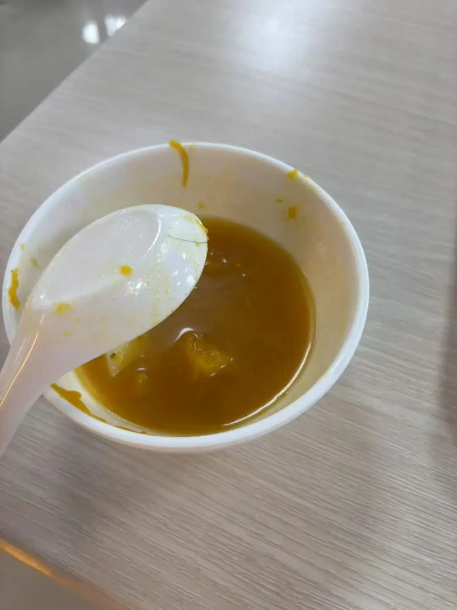
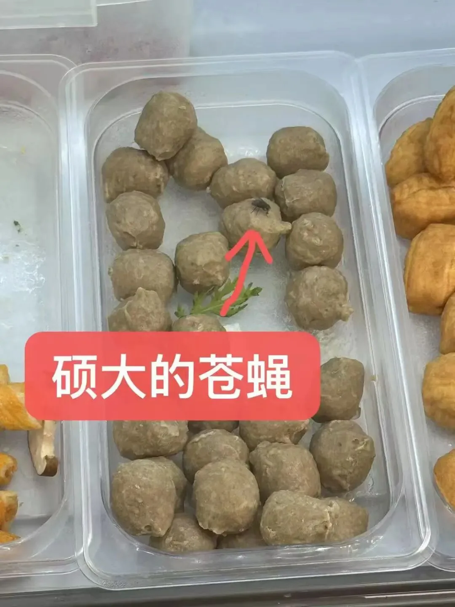
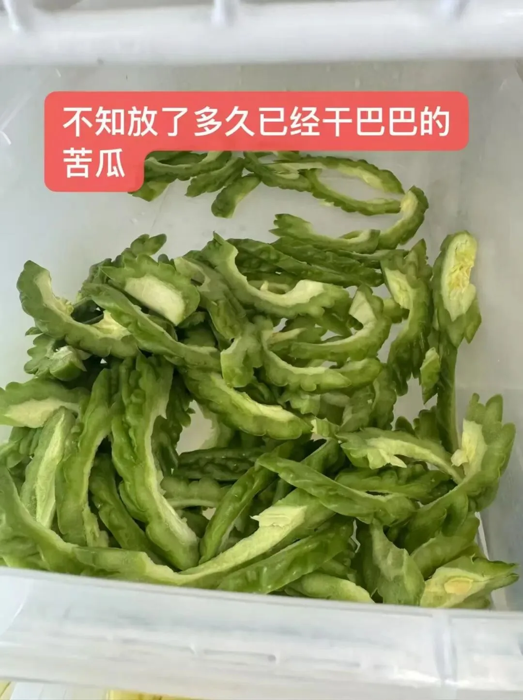
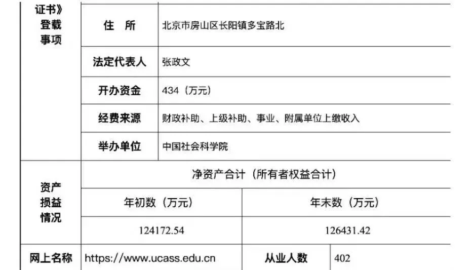

请相关部门及时关注并跟进问题。

## 1 图书馆

“想夸夸良乡校区图书馆，有两次让工作人员帮忙找一本没有定位信息的书。很快收到了电话或短信。荐购采纳的速度也很快，一些新书荐购完很快都上架了。真不错！很有效率！”

## 2 研创立项

> “投稿研创：现在研二的开题陆续结束了，你那个因为没开题不给立项的研创是不是应该给预立项的打钱了？不要以为这事就这么算了过去了，声势浩大的搞了好几场会后面有结果吗，啥也没有。这么说吧，已经7月了再放两个月假就9月了，就算9月拨经费也只剩3个月研究时间了，再不打钱，你那个预立项就拉几巴倒吧，大家都别做了。大型烂尾工程希望写进招生简章，给新生们看看研究型大学是怎么搞研究的。有种卡我们毕业喽？\*本研究系中国社会科学院大学“研究生科研创新支持计划”（预立项编号2025436KFC）的阶段性成果”

## 3 毕业流程

> “投稿：毕业生6月30日离校，手续办理很早就通知了，需要完成一系列步骤才能拿到毕业证；同学们也很早在6月初提交论文到图书馆；借还书手续也在6月10号左后办理完毕。因为系统中毕业生离校手续图书馆是第一步，最后一步才是退宿，才能拿到毕业证。从6月10日开始直至6月30日足足20天，为什么图书馆不尽快更新办理流程？使得毕业生手续卡在图书馆第一步，直到打电话到图书馆，让办理退宿以后才办理图书馆论文提交和借还书手续？电话过程中还说办理离校的不止我一个同学，那请问提交手续到打电话这中间20天图书馆的工作人员不上班吗？”

## 4 食品安全

“建议一食堂的一层和二层洗漱区购置新的洗手液，我发现现在的洗手液都是去年已经过期的抗菌洗手液，而且有的已经是空罐子了。”

“投稿：一食堂二楼的南瓜山药，快吃完了才发现有头发。食品安全无小事，希望学校重视重视再重视！”

> “6月27日晚上在一食堂一楼就餐点的韭菜鸡蛋，严重怀疑鸡蛋是坏的，有点异味，但是这个异味不太明显，当时也没多考虑，因为从来没有在食堂吃饭出现过食品安全问题。回到寝室，差不多2个小时过后，我出现恶心呕吐低烧头晕的症状，赶忙去北门药店开了急性肠胃炎的药。吃坏肚子真的很难受，这道韭菜鸡蛋里面的鸡蛋可能里面出现了坏的鸡蛋，写这个贴子目的是建议食堂重视食品安全问题，不要再出现此类状况。”

“必须吐槽望京食堂的减脂餐定价！素菜9.8元/斤，荤素搭配16.8元/斤，听起来挺清晰是吧？但操作起来就很迷。有一次我只夹了一盆素菜加一小块腊肠，结账竟要20多块！我提出去掉腊肠，结果阿姨再称，价格瞬间掉到7.8元？一小块腊肠值十几块？！ 这是镶了金还是镀了银？外加“隐藏设计费”？阿姨秤菜是不过脑子，还是卖腊肠真有提成？

更离谱的是荤菜定义！除了真肉和预制丸子，鹌鹑蛋、鸭血，甚至纯素紫薯丸子，统统按荤菜收费！ 你没听错——就是在南城乡里免费加到饱的鸭血，和连肉沫都找不到的紫薯丸子！最“神奇”的是，阿姨结账算错过几次钱，但无一例外——全是多算！ 从不失手少收。

最后说菜品：素菜一斤9.8元，比校外还贵，质量能否对得起价格？ 给点真正新鲜像样的蔬菜行不行？具体情况看图更直观。反正本人及身边同学吃这个都出现过肠胃不适、拉肚子、恶心的症状。快毕业了，实在咽不下这口气，但真心希望学弟学妹们将来能等到食堂的改进。”

## 5 校园文创

“今年的毕业生礼物，包装精美，也很有创意，感受到小院满满的温暖。提个小建议，能不能每个学院给毕业生分发一个刻着院系logo的帆布包？”

## “投稿：

刚从“社科大学工”公众号上看到学校为今年毕业生准备的毕业礼物的介绍视频，真的有被惊艳到，透卡、领带和丝巾都好好看，但无奈我不是今年毕业的学生，很想在这里求助一下，学校有没有把今年的毕业礼上文创店的想法，非毕业生也很想拥有啊T^T”

## 6 学院问题

“政府管理学院某些行政老师的工作能力真的堪忧。以下是在本学期中期及开题过程中的不完全吐槽：

1. 交材料时间和面试时间间隔太远。四月初要求提交中期考核报告，但各专业面试时间安排从5月5日到6月4日，非常分散。长时间间隔使得这份考核报告与最后呈现的完全不一样，那交这份报告的意义是什么？且缺乏明确的报告撰写模版（即这一部分需要涵盖什么内容等指导）导致许多学生在面试中被老师批评报告不符合要求或者内容太少。建议在未来的工作中提供更详细的撰写说明，并合理规划交表时间与面试时间，且尽早告知学生！！

2. 时间安排不合理。最晚结束中期考核的专业是6月4日，原定的开题报告提交时间6月13日，时间不到两周，严重不符合学生的实际准备情况（虽最终调整至6月20日）。且开题报告通知要求的发布时间较晚，5月27日才公布撰写要求，询问学长学姐后发现要求没变，那为什么要拖到5月27再公布具体报告要求？建议在每年在固定时间前提前发布开题报告要求，以便学生有更充足的时间完成报告写作。而不是轻描淡写在3月说6月底答辩，五月底公布通知提交要求和时间再轻飘飘回复学生已经告知过你们时间了。

3. 各种私聊同学的要求交材料的通知写的一塌糊涂，需要多次阅读才能理解老师的意思。麻烦发通知之前自己读几次看看能不能明白在写什么。信息沟通存在问题，学生在咨询时得到的回复需要经过多次转发。例如，在大群里询问却得到老师发给同学，让同学转发到专业小群这一多此一举的环节。建议直接、及时地公开信息，利用好您组建的大群以提高工作效率。

4. 对于开题结束后需要提交的材料，通知内容存在不确定性。一会要这个一会要交那个，每年需要提交的材料没有一个具体清单吗？需要您想起来什么然后我们交什么，如此低效率建议反思。

5.任何时候都说忙，忙到消息不回复，时间压到最后再公布。永远您最忙，学生一切事情都得跟着您走，我们永远等待中且多次出现临时被通知被安排的情况，建议您在繁忙的工作之余换位思考。”

## 7 换导制度

“导师没有任何责任心，从开题到预答辩再到盲审程序，一直误导毕业论文的进程，然后延毕没宿舍，学校不允许换导师，难道所有责任都由学生承担吗？”

## 8 科教融合

## “投稿：

### 科教融合并不体现在科教融合学院的学位授予仪式上

学位授予仪式作为高等教育的重要传统，承载着对学生多年求学历程的庄重认可和对其未来发展的美好祝愿。这一仪式的神圣性和重要性，在各大高校的实践中得到了充分体现。无论学校规模大小，无论是否举办学院级的分别仪式，几乎所有高校都会精心组织校级学位授予仪式，将其视为展现学校形象、凝聚师生情感的重要时刻。

中国农业大学的做法便是典型例证：校长亲自为每一位毕业生拨穗，从白天持续到夜晚十一点，连续两天不辞辛劳。这不仅是对学生几年努力的最高规格认可，更体现了大学对人才培养使命的庄重承诺。这样的坚持，传递的是一所大学对教育事业的深度认同和对学生成长的由衷关怀。

然而，在这样的背景下，社科大今年做出的决定显得格外引人注目。社科大宣称“为体现科教融合学院的主体性”而取消校级学位授予仪式，改由各科教融合学院分别举办。乍看之下，这似乎是在强化学院的办学地位，体现所谓的“科教融合”特色。但深入分析不难发现，这一决定与真正的科教融合理念并无实质关联，反而可能暴露出更深层次的问题：

真正的科教融合，绝非简单的形式调整或仪式重组，而应当体现在教学与科研的深度融合、理论与实践的有机结合、人才培养模式的根本创新上。将校级学位授予仪式分解为学院级仪式，充其量只是管理形式的变化，与科教融合的核心要义相距甚远。

科教融合的真正内涵，在于将中国社会科学院深厚的科研资源有效转化为社科大的教学优势，实现科研实力与人才培养质量的相互促进。要实现这一目标，核心是要处理好社科院各研究所与社科大各学院之间的关系，使二者形成有机的协同机制。

然而，理想与现实之间往往存在巨大差距。在实际运行中，社科院下属各研究所与社科大各学院依然呈现“两张皮”的分离状态，缺乏真正意义上的融合互动。这种分离不仅体现在机构设置的独立性上，更突出地表现在日常工作的沟通机制上。

一个令人啼笑皆非的现象是：学院教学秘书在处理一些整体性教学事务时，竟然无法直接与导师进行沟通，而必须通过学生作为中介来传达信息。具体而言，教学秘书首先将通知发送给学生，再由学生转达给其导师。这种匪夷所思的沟通方式，使得社科院各院所与社科大各学院如同离异的夫妻，只能通过他们共同的“孩子”——学生——来完成必要的交流沟通。

这种现象不仅效率低下，更暴露出机构间缺乏有效协调机制的根本问题。学生被迫承担起本应由行政体系承担的沟通职能，既增加了学生的负担，也降低了工作效率，更难谈及什么科教融合的效果。

这种“两张皮”现象的背后，反映的是社科院对办学事业的深层漠视。社科院一位学部委员曾敏锐指出：“一个研究机构如果没有一流的大学为依托，它的一流的科研上的学术地位也是难以长久的。所以，未来中国社会科学院应当让研究所考虑把教学和培养学生放在更加重要的位置。我们不能说双中心吧，最起码要放在更加重要的位置上来考虑。”

如果不能认识到认识到办学对其科研事业长远发展的战略价值，不将教学职能置于应有的重要位置。这种认识上的偏差，必然导致实践中的边缘化处理。

诚然，有不少人会说：社科院办本科教育是几代社科人的夙愿，社科大的成立凝聚着几代社科人的心血。这种情怀和理想值得敬佩，但仅有美好愿望是远远不够的。在具体的体制机制建设上，我们却看不到这种理想的有效落实。虽然社科大在形式上已经成立，但在实际运行中，社科院采取的是将办学职能完全切割给一个下属二级单位的做法，这种“甩包袱”式的处理方式，与真正的重视和支持相去甚远。

“举全院之力办好社科大”这一响亮口号，如果不能落实到具体的体制机制建设中，不能体现在科研与教学制度并重的机构设置里，那么所谓的办好社科大就只能沦为一句空洞的口号。实际上，当前社科院的体制机制完全是围绕科研需要而设计的，对教学特别是本科教学的适配性严重不足。

这种体制机制的不匹配，在研究生教育阶段或许还能通过让研究生深度融入科研机制来部分弥补，毕竟研究生教育本身就具有较强的科研色彩。但在本科教育中，这种以科研为中心的机制就显得格格不入了。本科教育有其独特的规律和要求，需要专门的教学资源、教学管理体系和教学文化氛围的支撑。

如果社科院不能将办学融入其核心职能，不能让各职能部门、各院所都实质性地承担起办学任务，而仅仅依靠“大学”这一在办学自主权和资金各方面都受到严重制约、勉强支撑起一所大学应有门面的实体来完成教学任务，那么要真正办好社科大无疑是天方夜谭。

将视角转向大学内部，我们会发现问题同样严重。社科大的学科设置和学院配置呈现出明显的“贪大求全”特征，这种追求全覆盖的做法在资源有限的情况下显得尤为不合理。一个在编在岗人员402人的事业单位，竟然设置了17个所谓的科教融合学院和其他教学机构，再加上22个职能部门，下属二级机构总数达到39个。按照简单的数学计算，平均每个部门仅有十人左右的配置，这种人员分布结构实在是匪夷所思。

在编人员如此稀缺的情况下，有人可能会建议通过外聘来解决人手不足的问题。然而，社科大的财政状况同样捉襟见肘，外聘岗位的待遇仅为税前5500元，扣除五险一金后实际到手收入仅四千多元。这样的薪酬水平，在北京这样的高消费城市很难吸引到优秀人才，更难以保证人员的稳定性。

本就稀缺的人力资源和紧张的资金状况，在这种叠屋架床的机构设置下进一步被摊薄稀释。这种资源配置方式的直接后果，是形成了弱学院、弱职能部门的扁平化管理格局。各科教融合学院不得不在人员严重短缺的情况下勉力维持运转，疲于应对工作疏漏带来的学生投诉和意见。与此同时，各职能部门也处于疲于奔命的状态，因为一旦学生对某项服务有意见，往往会将矛头指向整个学校而非具体负责该事务的学院或部门，这进一步加剧了各部门的工作压力。

在这样的背景下，社科大今年做出的“为体现各科教融合学院的办学主体性而取消统一学位授予仪式，转而让科教融合学院举办各自学位授予仪式”的决定，无疑是在本就不堪重负的科教融合学院身上又增加了一副重担。

这种做法的问题是多重的：首先，组织学位授予仪式需要大量的人力、物力和时间投入，包括场地布置、流程设计、嘉宾邀请、设备调试等诸多环节，对于人手本就紧张的学院来说无疑是雪上加霜；其次，分散举办的仪式很难达到校级仪式的规格和效果，无论是在嘉宾层次、仪式氛围还是社会影响力方面都会大打折扣；再次，这种做法可能会加剧各学院之间的不平衡，资源相对充足的学院可能会举办更好的仪式，而资源匮乏的学院则可能只能草草了事，这反而会制造新的不公平。

更为关键的是，这种表面上的“放权”并不能真正解决科教融合的根本问题。真正的科教融合需要的是深层次的体制机制创新，需要的是科研资源与教学需求的有机对接，需要的是学术文化与教育文化的深度融合。而单纯的仪式分散，既不能促进科研与教学的融合，也不能提升人才培养的质量，更不能解决当前面临的资源短缺和管理困难问题。

可以明确地说，科教融合并不体现在科教融合学院的学位授予仪式上。真正的科教融合应当体现在更加根本的层面：体现在科研优势向教学优势的有效转化上，体现在学术资源与教育资源的统筹配置上，体现在培养模式与培养质量的持续提升上。

当前社科大面临的问题，本质上是一个发展中的新兴大学在探索适合自身的办学模式过程中遇到的挑战。这些问题的解决，需要的不是简单的形式调整，而是系统性的改革创新。只有当社科院真正将办学事业纳入其核心战略，只有当大学内部形成合理高效的治理结构，只有当科教融合从口号变成实实在在的机制创新时，社科大才能真正实现其办学目标，也才能为我国高等教育改革发展贡献独特的价值。

在这个意义上，取消校级学位授予仪式这一决定，与其说是科教融合的体现，不如说是当前困境的一个缩影。真正的科教融合之路，还有很长的路要走。”

## 9 新楼问题

“投稿：近期因事去新楼，路过四楼，发现新楼的四楼这个装饰工作可谓已然是“老编”个人秀专场。整个四楼本就不多的文化装饰，基本上是“小院十二时辰”、“社科大二十四小时”这俩“专题摄影展”。仔细看这两个主题下的各摄影作品呢，基本上将近八九成的摄影者都是“老编”一人，他人作品少得可怜，可以说是“老编”个人的摄影专场，毫无谦抑之意。不知究竟是这位“老编”摄影水平已远超我校全体教职工师生乃至校友了，所以需要花费新楼建设预算特地为其设立几个展板；还是“老编”在新楼建设中已经是公认地居功至伟了，无论出钱抑或出力，各方面的功劳都盖过他人，故特划区域展其作品以铭记之。若是第一种情况，建议校方加大力度宣传，社科大有如此大才，自当是学校的莫大的荣誉，应该宣传；若是第二种情况，建议我们直接把新楼命名为老编楼，以公平地彰其功绩。

此等事情，我愿称之为高校摄影的勇毅担当。这位“老编”，或者说是我们伟大的管理三级职员大人，在学校中分管的一项事情应该就是学校宣传工作。感叹“领导”好雅兴之余，恐怕此事更可能是有人在新楼布置过程中话语权比较大吧。若真为如此，试问这是否可有以权谋私之意呢？慷预算之慨，飨摄影雅兴，想来确实美味。笔者在此不多做评价，相信每个路过新楼四楼感受校园文化气息，却只能强制观看此摄影展的社科大人自有论断。只能说，再这样办下去，恐怕能办好的只有摄影展了。”

## 10 闸机问题

“提议关闸机的是怎么回事？？被养出惯性来了吗？大家呼吁了多久，才因为地震的时候不能快速疏散到楼外而把闸机打开了！闸机才用两年，以前校门楼门都没闸机的时候要怎么办？有被害妄想把自己宿舍装上防盗门好了。

（见《[【读者投稿】一地鸡毛](https://mp.weixin.qq.com/s?__biz=Mzg2MjcwNzQ1Mw==&mid=2247490979&idx=1&sn=6ce581b4f1707b2a93c82a464c98edbc&scene=21#wechat_redirect)》第7.1）

## 11 奖助补费

“关于上期同学提到的“《国家奖学金管理办法》规定，任何一门课程成绩低于75分将无法获得评奖资格”，我认为这一规定总体上是合理的。75分并不是一个特别高的标准，对于认真对待课程学习的学生来说，达到这个分数并不困难。

但与此同时，我也认为这一规定在某些特殊情况下可以适当灵活。比如，对于有能力在核心期刊（C刊）上发表文章的同学来说，学术研究本身就非常具有挑战性，可能会导致他们在某些课程上出现疏忽。因此，我建议可以适度放宽对这类同学的评奖门槛——例如，在确保大多数课程合格的基础上，允许有一门课程低于75分。而对于没有发表文章的同学，仍可保持原有的硬性标准，以体现公平。

不过，也存在另一个值得思考的问题：我们本身在奖学金评选中已经对发表论文有明确的加分项，如果再在评审门槛上给予特殊照顾，会不会导致新的不公平？毕竟能够发刊本身就已经体现出相应的竞争优势。

此外，我认为目前奖学金评定过程中存在“班委加分”权重过高的问题。在实际操作中，不同等级的班干部无论工作实际付出如何，加分几乎是相同的。这对于一些专业课程难、文章难发的学生来说尤其不公。辛辛苦苦提高各科成绩，最终可能因为一个职位加分被轻易超过，这会打击真正专注学业同学的积极性。

奖学金的初衷应当是激励综合表现优秀的学生。如果在制度设计中不能更合理地区分“学业投入”与“职务加分”的权重，势必影响评奖的公平性与公信力。

（见《[【读者投稿】一地鸡毛](https://mp.weixin.qq.com/s?__biz=Mzg2MjcwNzQ1Mw==&mid=2247490979&idx=1&sn=6ce581b4f1707b2a93c82a464c98edbc&scene=21#wechat_redirect)》第1条）

## 12 延毕问题

“投稿，学校的招生就业处在接诉即办回复，延期学生今年不安排宿舍，下周出宿舍通知。那么请问，就只有10来天的时间，延期的学生一停了补助，二时间紧张，去哪里住宿呢？再则，往年的延期学生都要交学费2500半年，一年是5000，请问那么不能提供住宿，还要交学费，这样的意义又在哪里呢？最后，是不是交了学费，自己辅导住宿费，公费医疗保障也要停止。还请学校给延毕学生的权益一个明确的答复。这是六月份的招生季，相信安排好延期的学生，也能给未来的招生一个保障！

“坐标良乡校区，先叠个甲：如果我们宿舍只有我一个人，我还不想搬的话是我有问题，我在提出这个意见的时候是已经考虑了不会太过占用学校总体的住宿空间。

我们宿舍还继续交学费和住宿费，还继续在学校住，为什么还强迫我们必须搬宿舍？赶上你们不搬家不知道来回搬宿舍有多少东西？再加上必须退宿换宿舍的话如果想在暑假在学校继续自习的话，我们可以线上直播在您社科大的大街住宿上嘛？在学校读第二学位的人，大多都是想安安静静的再复习一年，还可以增加学校就业率，而不是想掺和这些破事，还得搬家的话为啥不直接搬回家？我感觉学校的行政应该是给学生以方便，而不是没事找麻烦。去找了宿舍的管理人员，明确说学校有规定必须得搬，那请把规定拿出来看看（最好还是红头文件的，威吓我们一下。而不是口头说说。）

## “看到贵校下发的红头文件了，果然是狠啊。

贵校延毕政策，真乃“人文之光”照耀下的绝妙设计！像贵校这种既要缴纳学费，又不给住宿的延毕政策，偌大个中国真不知有几所，不知贵校又在向哪个高校看齐呢？（其他高校的好友那么多，还真未听闻这样给延毕学生搞双重经济压力的）

一边高举“人文”火炬，一边微笑着将经济包袱（学费+房租）精准投放到延毕学子肩头，这“光”照得人钱包发凉、心头恶心。原来“人文之光”的终极奥义，是教会学子深刻理解“知识付费”与“生存成本”的辩证关系。

建议贵校再发一纸“延毕生存指南”：如何优雅地一边缴纳知识赎买券，一边在京城寻得片瓦栖身？这政策，实乃培养“抗压与理财能力”的独门秘笈，佩服，佩服！这“光”，果然与众不同，黑光闪闪！

有钱买野榜，不如少从学生身上割点肉。

也许，21届延毕学子没有“母校”。”

（见《[【读者投稿】一地鸡毛](https://mp.weixin.qq.com/s?__biz=Mzg2MjcwNzQ1Mw==&mid=2247490979&idx=1&sn=6ce581b4f1707b2a93c82a464c98edbc&scene=21#wechat_redirect)》第2条）
