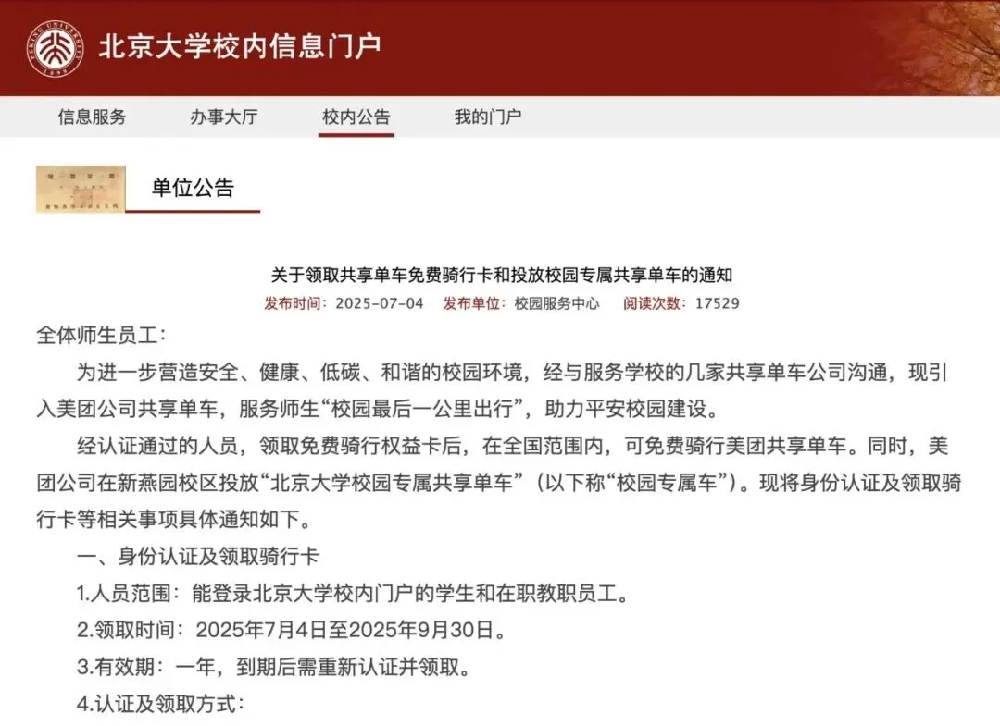

请相关部门及时关注并跟进问题。

## 1 自习室

“暑假来临，良乡校区封闭教学楼一层和三层，本来学校图书馆的位置有限，学生安静读书的空间一再被缩减。”

## 2 毕业季

“为什么对社科大爱得深沉，我想不只是因为学校优质的教学资源，我想更多的是小院对学生无微不至的关怀。作为今年的毕业生，在即将离开学校的时刻，一直想再吃上一次食堂做的糯米蒸排骨，鼓起勇气向食堂的叔叔阿姨表达自己的心愿，没想到第二天一食堂两层都做上了糯米蒸排骨（真的有被强制爱的感动/::\<。

这就是独属于小院的人文关怀，希望此去今年，我们的小院可以愈来愈好，愿我们万事胜意，再见小院/:rose/:rose/:rose”

“你好 我要投稿，政府管理学院刘姓硕博辅导员骚扰、辱骂毕业生。我是政府管理学院的毕业生，今年毕业，本来开开心心毕业，但是就因为拍毕业照的时候没有去找他合影（至于具体原因相信政管的人都懂，一个天天在办公室穿秋裤和拖鞋接见来办事的同学的男老师……）本以为毕业就再无瓜葛，没想到就因为这件事情，他先是给我们发微信，我们置之不理。之后在晚上八点左右，不知道从哪里搞到我们的手机号码，用学院的办公电话给我们挨个打电话问为什么不和他合影 要求给他个解释，我很震惊也很害怕，没说什么就把电话挂了（我认为用公家的电话在半夜问我私事我有权利挂断）。结果第二天不巧在学院又见到刘姓硕博辅导员，我因为害怕，快步走过去，没有理他，但是他却在我身后说 挺狂啊，招呼都不打，你算什么玩意。（原话）

我震惊和委屈实在崩不住了才来发布人文之光。我本人对学院很有感情 我也感受到学院的其他老师都特别好，但是总有老鼠屎腥了一锅汤。希望学校或者学院可以严格查一下，首先 我开学时给学院留过手机号不假，但是是留给学院的 而不是留给刘姓硕博辅导员个人的，他有什么权利为了不和他拍毕业照这一私事窥探我的手机号？第二，在工作时间之外用学院的办公电话打电话问为什么不和他打招呼 并且要求学生给他一个说法是合理的吗？这种行为应该可以定义为骚扰了。第三，就算学生躲着他走，他为什么要骂人？骂人这件事可以查监控，他原话就是骂我“你算什么玩意”。刘姓硕博辅导员在政府管理学院早已劣迹斑斑，今天只不过是我是在绷不住才说出来，想信很多人也有类似遭遇 甚至有过之无不及。毕业之际还是感慨一下，公道自在人心，祝大家毕业快乐！希望一些老鼠屎早日离开政府管理学院！”

## 3 研创中期

## “呼吁广大预立项的拒绝参与研创中期考核，用实际行动抵制科研处的科研欺诈行为。

\*本研究系中国社会科学院大学“研究生科研创新支持计划”（预立项编号2025436KFC）的阶段性成果”

“惊闻研创立项要中期考核，但此前已被定义为预立项的同学不用担心，你们不需参加，因为你们没有立项。从概念界定来看，满足立项必须有两个条件，一是承认已立项而非预立项，二是拿到立项经费并开展研究。

\*本研究系中国社会科学院大学“研究生科研创新支持计划”（预立项编号2025435KFC）的阶段性成果。”

## 4 人文关怀

## “社科大作为人文之光要不要也来点人文关怀呢？”

## 5 延毕问题

## “接上一期的21级延毕学子没有母校，所言极是

为什么不敢直接和学校一直来呢，因为毕业证、学位证还得重新走流程

1. 经历了5号楼无缘无故搬迁事件，学校的错误决策，最后只能让学生再搬一次

2. 毕业前半个月，经历了延期学生突然通知不让住宿

3. 反馈学工部，让找后勤

反馈宿管，说不是他们负责

最后，我们收到了班主任的反馈

4. 正如前几天推送所说，学校想的不是解决问题，而且先解决提出问题的人。

5. 21延期博士毕业季也是过得最糟心的了，对母校的好感度完全败光。还要交下学期的学费。学工部——宿管互相推锅，最后压力只能由学院老师要求学生撤销投诉来解决。

6. 可怜的延期学生啊，既没有钱，也没有提出问题的权力。”

（见《[【读者投稿】拭眼看君出奇伟](https://mp.weixin.qq.com/s?__biz=Mzg2MjcwNzQ1Mw==&mid=2247490991&idx=1&sn=3eaa2a8f1b76c446a2d18bb5a4157c31&scene=21#wechat_redirect)》第12条）
