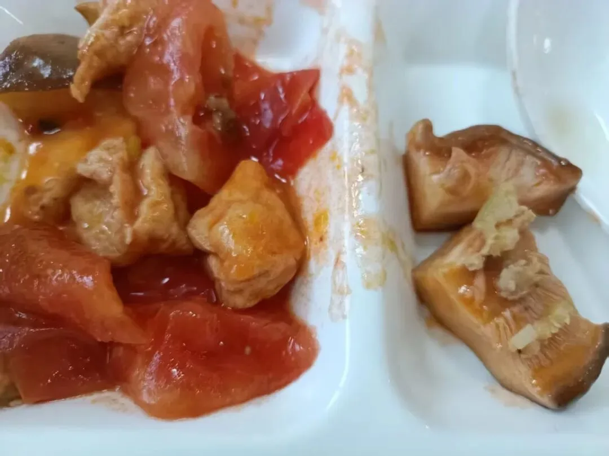

请相关部门及时关注并跟进问题。

## 1 校园基建

> “投稿，可否在南门大楼电梯口附近设置停车点，目前南门大楼附近有很多空地，但是今天锁哈喽的时候工作人员不让停在平地上，让放在草地上。目前南门大楼已投入使用，电梯口附近没有停车位置是否非常不便呢”

## 2 食堂

## “更新版：投稿一则笑话。

风味餐厅新开一家河南风味档口，其中有梅菜扣肉等菜品。A君前往点餐，发现端上来的梅菜扣肉，肉菜与饭是分离的，各放一碗。A君百思不得其解，吃过无数次梅菜扣肉，分明都是将肉与梅菜扣在饭上，让汤汁浸润米饭。

A君不得其解，遂与工作人员交谈，从其口中方知，原来是有某位领导老师不喜欢这种吃法，于是要求将肉菜与饭分离，实现梅菜扣肉这一烹饪菜品的伟大创新。

从小事往往能体现大局。若提出这个要求的相关领导老师看到此笑话，勿急得跳脚，也请勿责怪工作人员的无心之举，他们只是发扬党的良好作风实事求是而已。况且他们是最值得敬佩的劳动人民，没有这些辛苦的后勤工作人员，skd一日都难以运转，但若没有了某些领导干部，skd却也能照样运转？怪哉怪哉！若要怪，就怪梅菜扣肉的传统做法，竟敢将肉菜扣到饭上吧”

## “二食堂的香菇都臭了还在做菜给我们吃，能不能把人当人看？”

## 3 政管辅导员后续

“您好，我见我的帖子还没有发布，再加一条后续，我这边在事发当时同步反应情况到学校纪委了。当时纪委就给了回复说会了解情况。在今天 也就是事发之后第一个工作日，学校纪委就已经在出面解决。学院的老师也联系到我说了解决办法。学院的处理态度真的很好，我真的能感受到学院老师一如既往为学生考虑的态度，在这件事的处理上效率也很高。可以看出学校也好，学院也好，对这种行为都是零容忍。所以我要把帖子补充一下，真心点赞学校纪委和政府管理学院在处理此事上的效率！在毕业之际虽然被恶心一下，但是同时也再一次感受到学院和学校对学生的保护，感觉自己也是有坚强后盾的。毕业之际虽然有个小插曲 但也算快乐！祝各位生活顺利！

我还想再补充加一条，因为我今天就看见似乎有xhs营销号开始借这个事情起号，还是请各位同学擦亮双眼，理性看待。因为本人发人文之光的同时已经举报到学校纪委，纪委在人文之光发布之前已经出面在解决了，反馈很及时 、很快。本人目前对学院和学校的处理态度很满意 ，在等处理结果。我本意也不想进一步影响学校和学院的声誉，毕竟在这里读了这么多年书，真的是有感情的。来联系我告知处理结果和处理进度的学院老师真的很负责，我已经向学院提出了我的诉求，学院已经在严肃认真的推进处理了。政府管理学院还有很多老师真的都很好，我在读期间就很认真负责、真心听同学们的呼声，这件事情上也很负责的在解决问题。我真的不想牵连到其他无辜的老师，让他们费神。现阶段我个人静等学校和学院处理结果，我发在这里的本意就是想在学校内部讨论，我未来也不会在其他任何我个人的社交媒体上提及此事，请大家擦亮双眼，不要被营销号蒙蔽，感谢大家的关注和支持，相信学校会给出合适的处理。打扰各位了。”

（见《[【读者投稿】米诺陶洛斯的良乡](https://mp.weixin.qq.com/s?__biz=Mzg2MjcwNzQ1Mw==&mid=2247490997&idx=1&sn=5b5a60255fe804efe97d27f25c4bb0fb&scene=21#wechat_redirect)》第2条）

## 4 延毕问题

> “延期博士生经济困难投稿。马上要开始租房了，1250补助也刚停了，社科大是确定延期学生还要交学费吗？既然不能给予宿舍，学费方面有没有相应的优惠政策？其他好多学校延期都是不需要交学费的啊。”

（见《[【读者投稿】米诺陶洛斯的良乡](https://mp.weixin.qq.com/s?__biz=Mzg2MjcwNzQ1Mw==&mid=2247490997&idx=1&sn=5b5a60255fe804efe97d27f25c4bb0fb&scene=21#wechat_redirect)》第2条）
