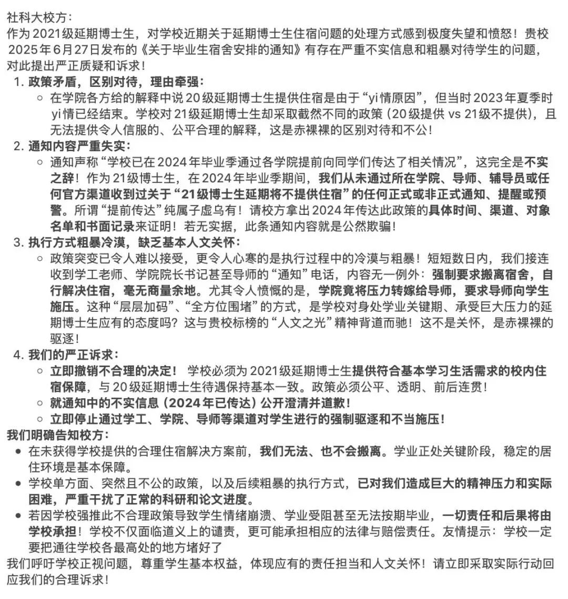
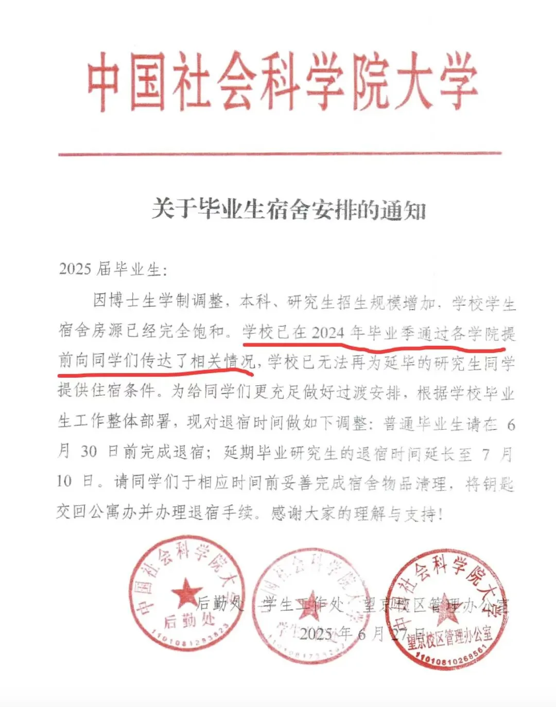
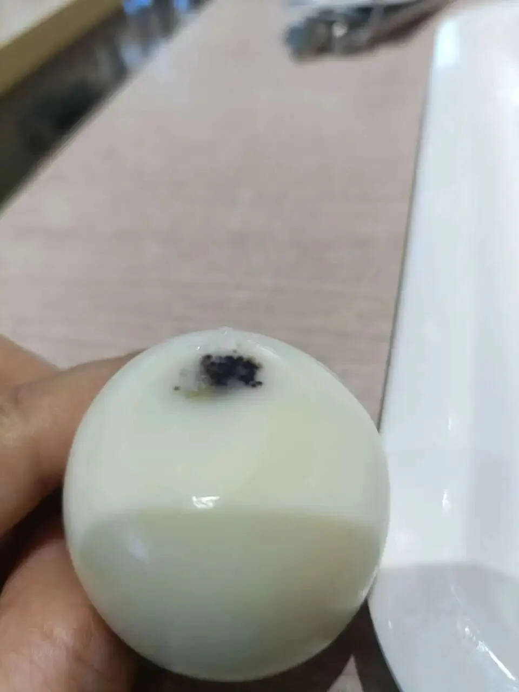

请相关部门及时关注并跟进问题。

## 1 工人权益

“【望京校区】学校最近有施工，看到工人大中午只能在室外休息，现在外面天气太热了还没有风，学校能否考虑给他们统一安排个室内凉快点地方休息呢”

## 2 医务室

“医务室你告诉我为什么三点半下班？？？我知道你发了通知但是并不代表就合理了。这有考虑学生吗真有你的。”

> “强烈投诉校医院某职员！！！根本不会操作计算机啊，而且态度极其不好，工作态度散漫。我挂不上号，就让我后面的好多人先挂。然后我说那也应该我在先吧，他说谁让你挂不上（不是 请问这怪我吗？）学校的行政人员到底有没有岗前培训 、能不能干啊！！”

## 3 宿舍

> “希望学校能够重新审视一下学生公寓管理的问题，各部门职责划分与分工是否明确，管理人员、服务人员、技术人员与服务对象比例是否存在失衡现象。学校真的需要这么多宿管以及公寓办的管理人员吗？很多宿舍微信群大多都是一些报修情况的反应，学生在群里反映各类需要报修的情况—宿管提供报修电话或直接报修。每个宿舍门后面都贴有相关报修电话，直接打电话报修不是更方便吗？ 我校各类报修或其它反映渠道还是很畅通的，像类似情况完全可以由学生直接对接反映。我校本身硕博生人数居多，大家也具备一定的社会经验与生活能力。在学校各类事务分工明确，反映渠道畅通的情况下，没有必要设置过多的管理服务岗位，这些也会产生不少的成本。衷心希望学校后勤管理与服务的钱能花在刀刃上。”

## 4 延毕问题

“skd的延毕政策真的是在吃人，你不让我们住了，那我们租房子；但您为什么还要再收学费呢？（延毕不收学费这本身就是各高校的通行做法，这个时候skd又开始特殊了呢）。

看看大家近乎于祈求的想让学校高抬贵手啊（看着都心疼），可迟至今日学校依然连个p都不放。

延毕生的这点钱你也要割一把，在重重重担之上再烧把火，是不是非要逼死人你们才能像青岛大学那样“火速安空调”（调整政策）？

你们的良心不会痛吗？还是说不知普通家庭多辛苦？

看到这个图片，送给各位领导吧，也许我们不是学生，只是资源罢了，这样整个逻辑瞬间就通了。”

> “关于延毕学生住宿问题：今天又了解到有学院领导拿就业政审不给过、强制退学来威胁，这样的领导可以下课了 可以go to hell了！ 你🐍怎么会有使这样下三烂手段的领导？ 还争双一流呢？ 还人文之光？ 一点人文关怀没有！ 怕不是学到Northern Myanmar 白家真传了吧！ ”

## “

（见《[【读者投稿】左移五米](https://mp.weixin.qq.com/s?__biz=Mzg2MjcwNzQ1Mw==&mid=2247491003&idx=1&sn=f19969bd3fa8c7293e2bc1c8bbecf443&scene=21#wechat_redirect)》第4条）

## 5 研创中期

“即将入学的硕士新生，现在退学还来得及。你们本科应该都参与过srtp大创。skd也有类似的项目，但是全校硕士没人能立项。你们来了只能在阴暗潮湿的工地同款板房里自费科研，快逃！

\*本研究系中国社会科学院大学‘研究生科研创新支持计划’（预立项编号2025437KFC）的阶段性成果”

（见《[【读者投稿】米诺陶洛斯的良乡](https://mp.weixin.qq.com/s?__biz=Mzg2MjcwNzQ1Mw==&mid=2247490997&idx=1&sn=5b5a60255fe804efe97d27f25c4bb0fb&scene=21#wechat_redirect)》第4条）

## 6 校园基建

> “强烈要求良乡校区有电动车充电位的车棚加长屋顶挡雨板。2025年7月9日的一场雨把1号楼旁边的电动车车棚里的车都淋了个透湿，车淋湿了不要紧，要紧的是很多在充电的车的插座口、车身插孔都淋到了很多水，我冒着触电的风险把插座拔下来，插头里面也全都是水。目前学校里所有的电动车棚充电一侧的屋顶延伸出去目测只有5厘米，大一点斜一点的雨就足以让雨淋湿所有的充电口，这非常危险。也许不是每次的雨都很大，但是这样的雨也不在少数，而且用电安全无小事，不可有任何的安全隐患，强烈希望能在有充电位的车棚的充电口方向加长挡板，为了同学们的生命安全”

> “强烈希望给新综合楼的电梯内部加装把手。新综合楼的电梯内部目前没有把手或者可以手扶的地方，这是一个安全隐患。今年2月昆明发生电梯故障快速冲顶导致电梯内一人头部重创死亡。如果电梯内有把手，这至少是一道安全屏障。给接诉即办建议了，但是接诉即办回复认为电梯装把手不是必要的，而且电梯属于特种设备不允许改装，但是我在网上查到有很多小区作适老化改造对电梯后加装了把手，可见电梯在建成后加装把手是可施行的。生命安全大过天，给新综合楼电梯加装把手非常有必要。”

（见《[【读者投稿】左移五米](https://mp.weixin.qq.com/s?__biz=Mzg2MjcwNzQ1Mw==&mid=2247491003&idx=1&sn=f19969bd3fa8c7293e2bc1c8bbecf443&scene=21#wechat_redirect)》第1条）

## 7 食堂

## “美好的一天从早晨开始：（良乡一食堂）剥开的鸡蛋顶部居然发霉了！【如图所示】

这就是我们的食品安全，我们的‘人文之光’！”

> “回复梅菜扣肉:别为喷而喷，也别用你自己短浅的见闻把所有吃过梅菜扣肉人都囊括到你的恶心阵营。skd行政是有问题，但是这不是超出你浅薄认知就拿领导当挡箭牌开喷的理由，不管是谁都不应该受到无端的、不正确的指责。自己只吃过盖饭就别代表其他正常吃饭的人”

> “食堂回复：关于第二条食堂，梅菜扣肉饭，饭和梅菜扣肉分开属于河南地方烹饪法，也可以扣在一起，我们以后多征询点菜学生建议。关于蘑菇发臭问题，菜都是当天采买，当天制作，以后可以现场提出问题，非常感谢同学。”

（见《[【读者投稿】左移五米](https://mp.weixin.qq.com/s?__biz=Mzg2MjcwNzQ1Mw==&mid=2247491003&idx=1&sn=f19969bd3fa8c7293e2bc1c8bbecf443&scene=21#wechat_redirect)》第2.1）
