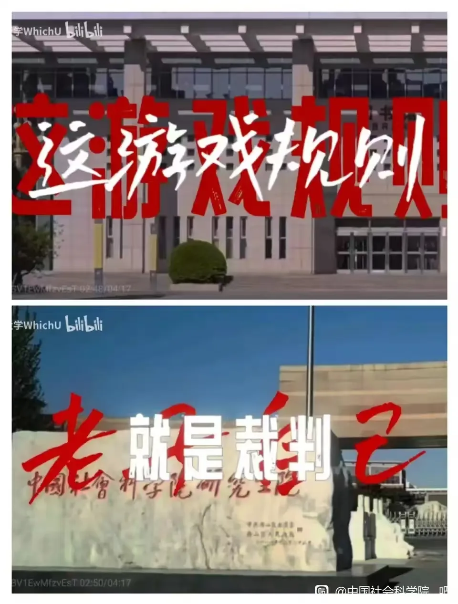
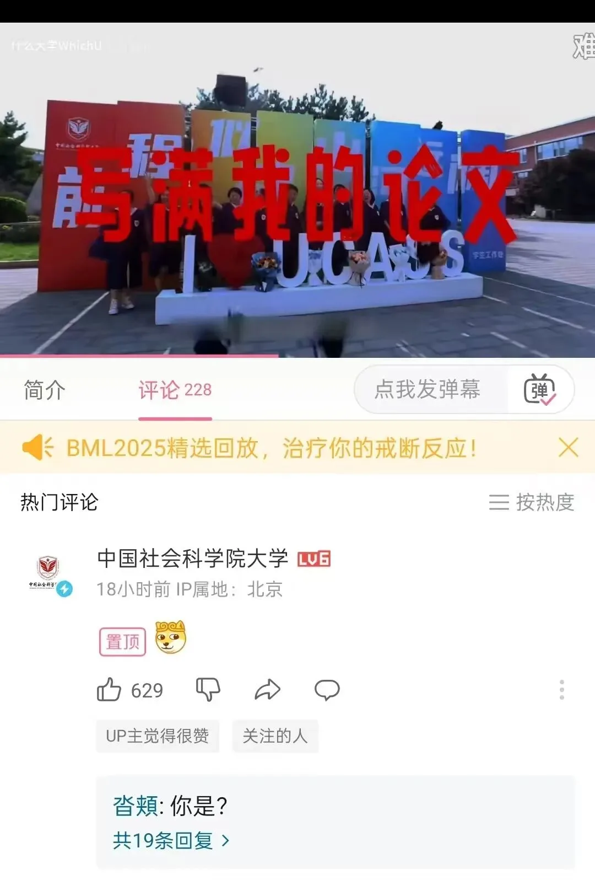

请相关部门及时关注并跟进问题。

## 1 延毕事宜

## “关于21级延期学生搬迁后给予一定补偿的倡议

1.对标的是五号楼集体搬迁事件，学校当时给了每人500搬迁款，打包袋、纸箱子，专门的人抬行李。那么，这一次，临时的毕业搬迁，我们啥都没有，甚至需要自己买打包袋、纸箱子，找人搬，至少花费300💰

2.21级的同学延期了，本就身心遭遇重创，恳请给予搬家补贴。在北京现在租房1500/月起步，如果真的让学生身处毕业/经济的两难地步，恐怕出事是早晚的了。特别对于高压的博士群体

3.给予学费减免的考虑。延期既然不能住宿了，那么学费为什么还要半年交2500元。延期学生，哪怕是延期硕博也已经经济来源了啊。高压之下，真的要去偷去抢吗。

4.开学半个月后，统计空余宿舍，公布空余名单，向延期学生抽签开放住宿四人间。哪怕你们开个座谈会呢（至少五号楼搬迁的时候开了座谈会）。就因为延期的学生就不是学生了吗？那么，真的闹出来事情，不还是冠名社科大吗

5.取消住宿不是小事，延期学生的利益也是利益，真的把狗逼急了，只能跳墙了。

还请学校重视延期学生的经济、住宿问题，谢谢！”

> “来自21级的延期毕业博士，人刚被轰走，行李寄存学校，现在都不知道回学校答辩去住哪里。也不知道回北京还要花多少钱租房，毕竟补助刚停了下来，吃饭都要掐指来吃。我们真的还要交学费吗？这是我们的母校吗？为什么我们连回北京连个住处都没有。这不是我们的母校。第一次对于一个自己生活了接近三四年的地方深恶痛觉。还请学校妥善出对于21级延期学生的安排，即便人已经赶走了，可是这样的舆情真的可以被压制吗？作为人文之光，何必把自己的学生逼到绝路呢？”

> “恳请学校不要再通过任何渠道向21级延毕博士施压要求搬离宿舍了，我们已经很累了。今年9月初还要交大论文准备秋季毕业，还有这段期间的小论文修改，让我们好好写论文吧。”

## 2 毕业生权限

> “「毕业生数据库权限已暂停」您好！我是23届毕业生，目前在其他高校深造。两年来我数十次以毕业生的身份使用学校的数据库，得到很多便利，也由衷地感谢母校的“超长质保”，并为“人文之光”感到自豪。近期，我发现学校暂停了毕业生的访问权限。中国社科院是我国马克思主义的坚强阵地、中国哲学社会科学研究的最高殿堂、党中央国务院重要的思想库和智囊团……所购买的很多数据库价格不菲且属于国内独家，在条件允许的情况下，这些数字资源理应获得更加有效的利用。目前，我已致电院部和大学的相关部门，均未得到有效解决。”

## 3 招生宣传

“许久未见的高中同学向我分享了这条视频与图片。暂且不论这位“夏老师”的何方高人，社科大的官方账号提供素材并评论置顶为其站台可以认为是学校意志吗？距离中国社会科学院第二届学风和道德建设论坛召开还有四天，脚踩其他学科吹牛逼吹天上去了，这是我们社科大的学风道德吗？

”

## “投稿

在7月13日，由up主什么大学whichu，发表的关于社科大的视频(BV1EwMfzvEsT)后半部分rap中，存在关于社科大的虚假宣传，和与其他学校学科的拉踩言论。但是在这种情况下，中国社会科学院大学的b站官号却选择在该视频下方以官方身份下场评论，颇有为该视频站台的意思。在这种视频内容存在争议的视频下方进行评论，不进行更正，恐怕起不到宣传效果的同时还会适得其反。

附上社科大官号评论的截图

另附上视频中rap部分歌词：

‘说我不是985，笑你你见识太差，社科院亲儿子需要那些塑料招牌吗，导师随手批注都是红头文件初稿，你还在刷GPA，我早给中央写报告，房山线挤成沙丁鱼但思想在飞驰，自习室开成国务院，你教室能比？院士密度高过五道口地铁高峰，双非这名头配不上咱的格局和武功。

社科院嫡传国家队基因，会议纪要里写满我的论文，科研不玩SCI那套虚的，大道至简治国就是我的课题，你说软科排名800开外，老子成果根本不屑登那破擂台，等你在Nature灌水，我在中南海开会，十四五规划第三十七页看见没？那是我作业。

法学教授昨晚刚改完民法典，经济导师今早去骂美联储耍流氓，社会学大佬下乡不是支教是定国策，这师资阵容985看了都自闭。双一流我们流的是智库脑浆，211请数数红头文件编号。你说校园小，老师才是精华，懂不懂从宿舍到教室走两步就能改变中国。

当我导师是国务院津贴钉子户，你导师还在为职称疯狂内卷，当我的论文变成各省执行文件，你还在为知网查重泪流满面。这游戏规则老子自己就是裁判，文科界的歼20是需要你评级认证，去读中央一号文件再回来说话。' 。"

## 4 人文关怀

“解散楼群真无语了，被阿姨照顾的日子没有了，感谢宿舍楼管阿姨们的辛勤工作！谢谢你们！辛苦啦！

刮风下雨时有你们提醒带伞、帮忙收衣

寒暑假有你们提醒注意住宿安全

关电取物时有你们帮忙跑腿

夜晚值班时，不能睡觉，还必须盯着楼门

进门出门时有你们的微笑

生病受伤时有你们关心

再次感谢宿舍楼管阿姨们的辛勤工作与热心奉献！”
