请相关部门及时关注并跟进问题。

## 1 “人文之光”

## “投稿：

对“人文之光”校园的事实论述与未来展望

各位领导好：

本人系社科大2024级博士生胡朝阳（我知道不实名也会被大家猜出来，还不如实名，尽管实名可能招致一些人的报复），作为一名肢体残疾学生，慕名来到“人文之光”的校园，但良乡校区的实际运营给我的感受是“人文之光”并未“普照”到真正的弱势群体身上。下面以我个人的相关事例作说明，并据此提出几点建议。（为避免承担法律责任，本人所说的事例均有录音和微信截图为证，为保护隐私，部分录音和截图并未放出）之所以没有选择校内接诉即办，是由于曾经提诉求的反馈个人认为明显存在不顾事实、不经调查而“已读乱回”的情况。

### 一、事实论述

事例1：校内“接诉即办”的回复速度与回复质量相矛盾

开学初，本人曾用一周时间在研教楼等各教学楼寻找自己可以用的符合国家标准的无障碍洗手间（《无障碍设计规范 GB50763-2012》第3.11.4条规定指出：无障碍客房卫生间内应保证轮椅进行回转，回转直径不小于1.50m，卫生器具应设置安全抓杆，其地面、门、内部设施应符合本规范第3.9.3条、第3.10.2条及第3.10.3条的有关规定）以及无障碍电梯，但很遗憾，在教学楼只找到了一个面积和安全抓杆均不符合要求的“洗手间”（如图1），且并未找到无障碍电梯。因此，曾于2024年9月询问接诉即办，快速得到的答复如图2（从时间看，显然是罔顾事实，未经调查的回复），可以看出，回复人知道学校需满足无障碍洗手间设施的建设标准，但根本不知道标准是什么，另外，如果正如回复人所说，未满足标准无法通过验收，研教楼不合格的无障碍设施是如何通过验收的呢？留待大家自行脑补。

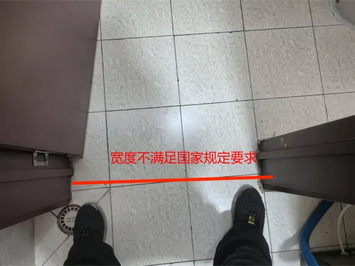

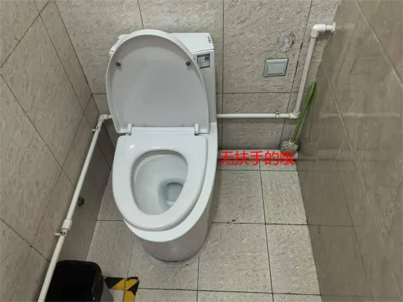

### 图1 研教楼的洗手间

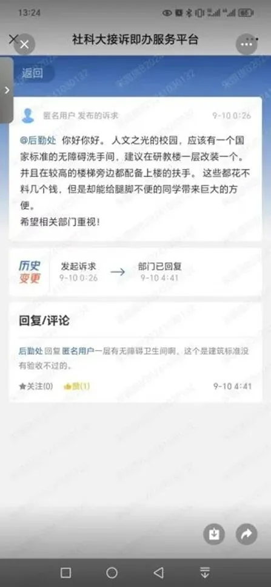

### 图2 研教楼接诉即办的回复

事例2：基础设施保障实际情况与“人文之光”的正向宣传相矛盾

2022年，人民网报道了社科大招收视障者蔡聪学长的正面宣传案例，相关报道如图3所示。在宣传中，我看到了社会科学院大学高度重视保障残疾学生的权益，这也是我选择这里的重要原因之一。但是，2024年9月入学的我，却仍然走过近一年这样崎岖不平的路（如图4），穿梭于食堂、教学楼与学校大门之间。必经之路尚且如此，更不必说其他地方了，另外，图书馆的入口处（图3）不设置扶手或无障碍通道，我如果进去只能在等待同学的援手，这种做法是否违背《中华人民共和国残疾人保障法》第二十五条，以及《中华人民共和国无障碍环境建设法》第二十六条之规定？这种实践与宣传的“双标”关怀是否合理？这些问题，留待我与同学和师长共同探讨，也留给相关部门行政老师思考。正是这种崎岖不平、缺乏无障碍设施、缺乏夜间照明设施等实际情况，进一步加速了本人脚踝磨损的进程（诊断证明如图5）。我想这也许是另一种“人文之光”吧。（“光”字在最新版《新华字典》中，也可被解释为“完了，一点不剩”的意思）

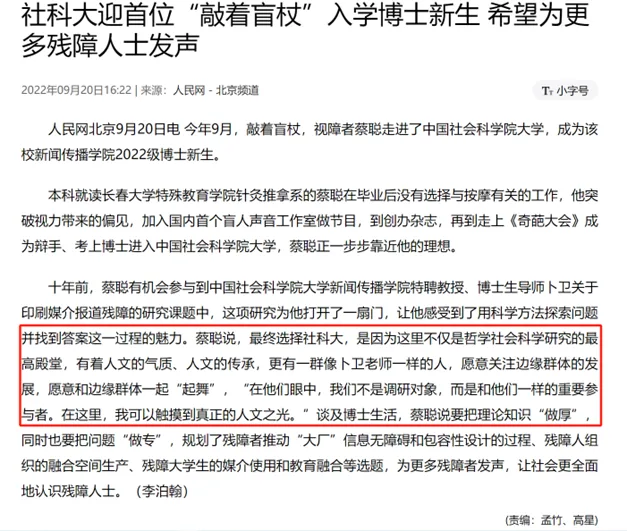

### 图3 人民网有关社科大“人文之光”的正面宣传

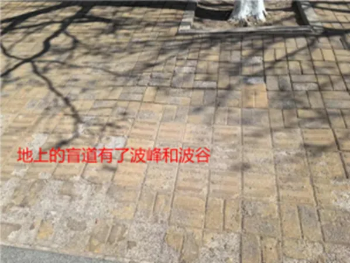

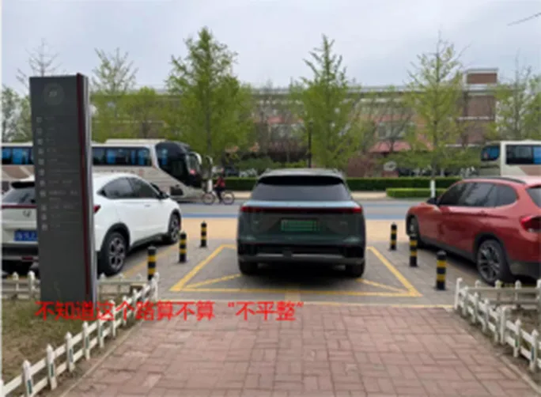

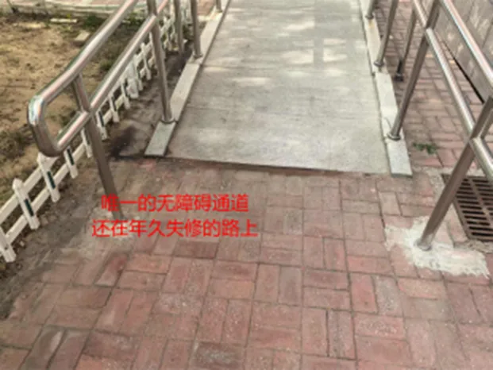

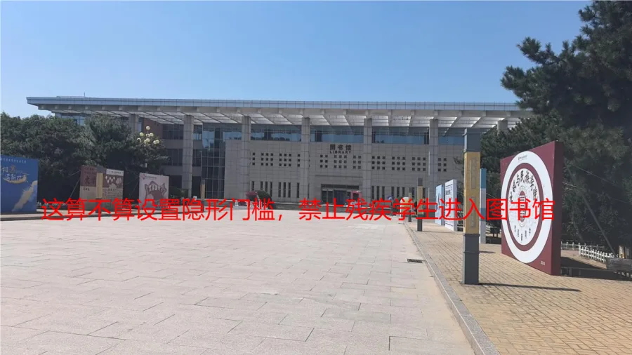

### 图4 社科大校园一角（摄于2025年4至6月）

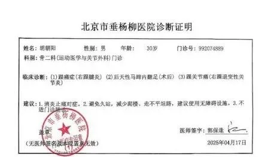

### 图5 本人病历及诊断证明 （2025年4月）

事例3：班主任老师的认真负责与行政老师的不愿作为、不能作为相矛盾

鉴于个人情况，在新生选课的当天，我曾主动试图联系学院负责老师协调自己的教室，然而，我每隔30分钟拨打一次学院联系电话，全天累计拨打办公电话15次，却在当天及两周内仍未等到任何回音。直到本人打算被迫采用“极端”手段捍卫了残疾人保障法赋予我的“受教育权”后，开学第三周，终于收到负责老师打来的电话。负责老师在电话中反复强调“我昨天晚上才知道你的情况，你自己再克服一周”。（究竟是负责老师“不知道”还是“不想知道”，留待大家脑补）万般无奈之下，我再次联系了自己的班主任老师，才得以将问题持续向上反映（如图6），最终本人部分核心课程的线上参与教学的诉求得以解决。

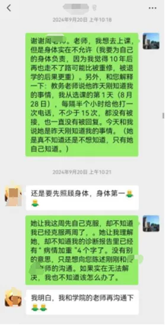

### 图6 本人于2024年9月20日与班主任老师沟通记录截图

事例4：安保人员的实际做法与“以人为本”的价值观相矛盾

2024年11月的中午，为了当天能按时上交街道残联下发的相关材料，本人曾独自前往位于学校北门附近的打印店，由于台阶太高且没有扶手，我本能地向当时坐在附近正在午休打游戏的一位保安求助，那时的他正聚精会神地盯着手机屏幕上的某款游戏（避免个人隐私泄露，我就不发照片了），然而他以自己正在工作，不能离岗为由拒绝了我，并含糊其辞地说“你要去哪，我不知道，你走那边，我在值班，不能离岗”，然而，保安所指的路并不能进入打印店，我也识趣地走开了，直到等到同学帮我扶进打印店内。（至于值班的保安为什么不能离岗却可以玩手机，请小伙伴自行脑补原因）。

事例5：重要事项的多头指导与高效透明的管理目标相矛盾

2024年12月，本人按照班级群发布的要求填写“个人培养计划”，通知中只对操作流程进行说明，并未涉及每一部分内容应该如何填写，且并没有老师的电话可供我们询问（如图7）。当我针对个人情况写下1000余字的“询问函”并发送给班长后，终于从班长处得到了行政A老师寥寥几笔的“象征性回复”，以及老师的办公电话。当本人询问并按A老师所认可的要求填写后，当日提交并通过导师审核。但在第二天就接到行政B老师的电话，被告知课程选择需要增加等其他问题。但当我发现一些课程我个人的学生端无法选择后，曾求助B老师为我开通权限，甚至在征得导师同意后，请求B老师直接在后台为我更换专业。然而B老师甚至没有走过一次学生端系统，就作出保证。

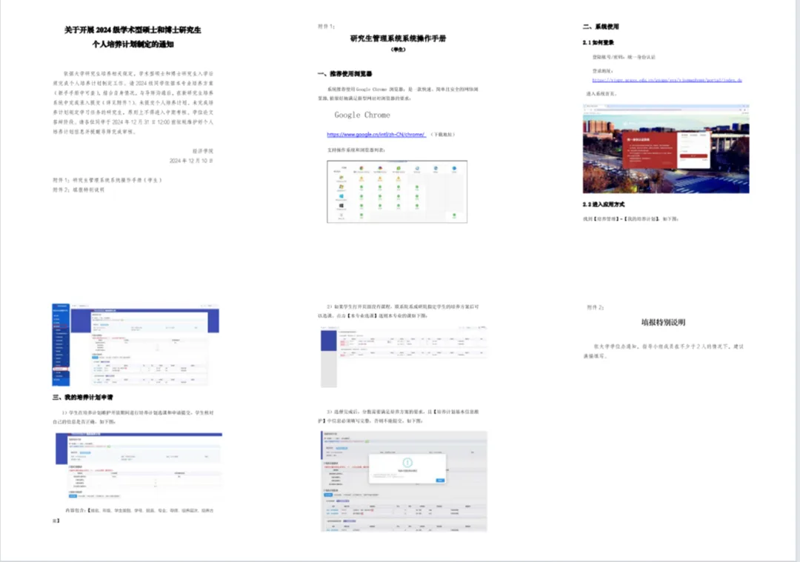

### 图7 培养计划学生端的全部通知（完整版）

之后，为了不耽误自己的事情，本人联系并线下约见B老师（如图8），在办公室见到了B老师和C老师。C老师在听完我的描述后，对我的问题逐一进行了解答。当C老师说“二级专业不能随意更改，B老师和你没有权限，这一点你不用听B老师的”；B老师则马上解释说“自己刚刚负责这一模块，还不完全明白”我的内心疑惑了（为什么老师不懂却能给学生做解答）。最后，我按照C老师的解释和要求，向导师做了汇报。这件权责不清所导致的“小插曲”最终历时3天解决，并获导师评价“白折腾了”（如图9）。（如果通知只有操作流程是为了尊重不同学科、不同学生的个体差异，为什么不能提供负责老师的电话供同学们询问；A、B、C三位老师在指导我进行选课时，为什么会存在截然相反的说辞；为什么解答最为权威的C老师，却没有最早面对学生？）

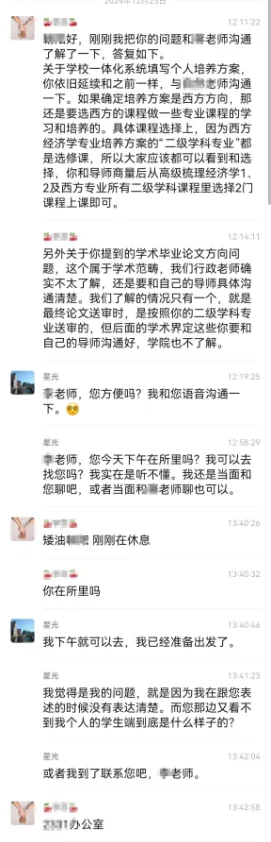

### 图9 关于培养计划选课问题与B老师（上）和导师（下）的沟通

### 二、未来展望

1.希望学校“校内接诉即办”能参照北京市接诉即办，增设基于是否落实、是否解决的回访工作，真正做到“接诉即办”而非追求回复速度的“接诉即回”，更不能将主体业务“外包”给非相关领域人员（如果没有“外包”，就烦请后勤处负责同志能认真学习国家有关法律法规，了解国家标准及相关细节）。将党中央“坚决防范纠治‘新形象工程’，深化整治形式主义”的要求落到实处。

2.希望学校自查自纠是否真正落实无障碍设计规范国家标准，倒查研教楼是如何通过验收的情况，在条件允许的情况下，真正在研教楼建设符合国家标准的无障碍洗手间，在图书馆门口和内部设立无障碍通道，修补破损的盲道和凹凸不平的路面。并积极遵守《中华人民共和国无障碍环境建设法》《中华人民共和国残疾人保障法》等规定，对无障碍设施履行按规定建设、维护和管理责任，保障无障碍设施功能正常和使用安全。

3.希望学校的安保人员能够秉持“以人为本”理念，尽量满足学生合理诉求；学校的行政人员定期主动向班主任了解学生的实际困难，在能力范围内帮助解决，或进一步提供向上反馈渠道。尤其值得一提的是，即使暂时无法解决，也不要将事情“外包”没有任何经验或不了解实际情况的同志，那样只会给提出需求的同学制造更多新困难，不利于“人文之光”的校园变得更加名副其实。

4.希望学院在发布通知，特别是选课、毕业、评奖等与学生利益紧密相关的通知时，要有行政老师至少依托学生端的测试账号“走通”一次，了解学生端到底能做什么；可能出现哪些错误。说明文字要尽可能详细可读，而非避重就轻，更不能仅有操作流程；为学生解答的老师最好清楚自己系统账号的权责边界，同时，最好能在通知中加入负责老师的办公电话或其他联系方式，方便不同学生基于自己的特殊情况进行询问，也能避免权责不清的小插曲。

最后，我希望本人的这些文字能不经删改，完整呈现。我知道这篇文字会得罪人，但我想说，我敢实名发出来就做好了一切准备。我只希望自己的文字能够让更多的师长、同学看到，了解学生，尤其是残疾学生在生活中的基本需求，能够真正帮助到未来的学弟学妹，哪怕只是某一个事例的陈述多帮助了1个人，或者某一条建议被校领导采纳，我的文字稿就有了价值。”

## 2 档案处理

> “skd你的档案室值班人员态度奇差……进去就是一副很高高在上的态度，不听诉求，先审视你一番，看一下你是学生还是老师，学生客客气气的和你说，请教怎么办，不回答。连着去了几次，总结了她的办公模式：先把东西放边上，再说一句，你去外面吧。还有哪个外面啊？站你边上就是里面，站哪是外面？？在学校好多年了，其余的老师很好，第一次体会到这种办公态度，彻底理解了为什么这么多人在这里吐槽，确实活该。”

## 3 宿舍&延毕事宜

> “我要衷心感谢四号楼的宿管阿姨们。在这里住了两年半了，阿姨们像大姐姐一样关心照顾我们。下雨了，会提醒大家收衣服，甚至帮我们收衣服。我的行李箱很重，住六楼。李增叶和郑玉红老师还亲自帮我们提下来。那么重，老师们很辛苦，却挥着汗帮我搬来搬去。今天我退宿了，对四号宿舍楼依依不舍。衷心感谢，会想念你们的！”

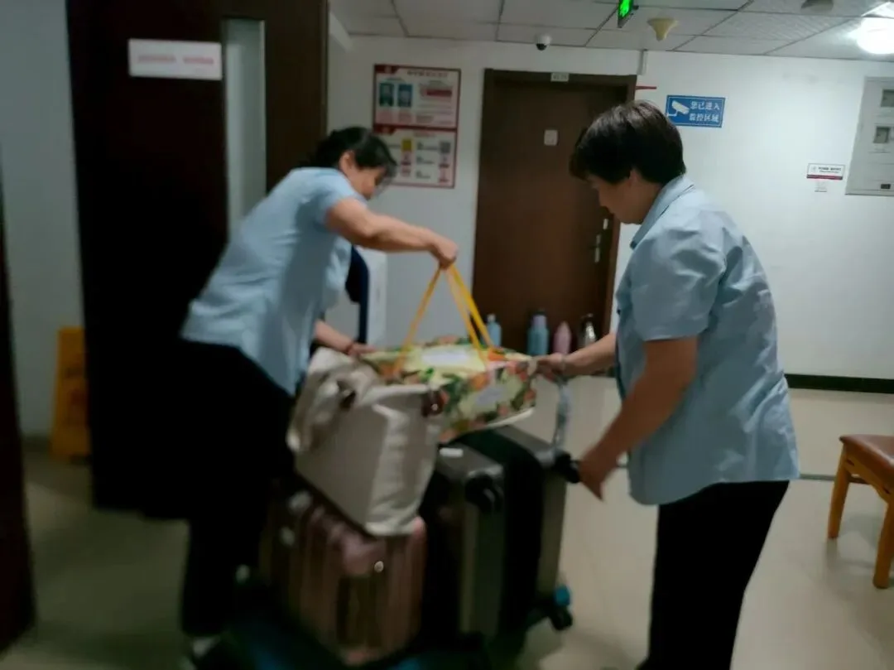

### 延毕事宜

“来自21级的延期毕业博士，正在遭受学校突然取消住宿安排、以近乎“暴力催收”的方式清空宿舍的重创。我们本就承受巨大的身心压力与经济重担，每月仅1250元、位居全国高校底线的补贴也已停发；身处良乡这么交通偏远的地区，承受了诸多不便后居然发展到连一间宿舍也无法求得，该如何安心完成学业？

延毕不是错误，延毕的学生依然学籍在册，理应获得起码的尊重和支持。可在这个最需要帮助的阶段，没有等来任何理解，只感受到来自学校制度的冷漠与压力。社科大的育人理念，就是让学生腹背受敌而置其不顾吗？

学生在校，是否应该享有最基本的生活保障？社科大行政办公室林立分散在三栋不同楼上，体贴到洗手间的纸巾从未断过，对待学生方面却连住宿都无法提供？三套管理班子体察不到几百号学生的宿舍问题？眼看社科大起高楼，眼看社科大连虚名都难保。让努力完成学业的人成了最无保障的一群人，这合理吗，公平吗？”

“2025年7月19日起，发现我们的延毕宿舍电表都被强行扣走电量至10度，原先都还剩下几百度。校方未提前通知，更未提供替代方案。当前正值论文攻坚期，我们面临：

1. 电脑无法充电：文献写作中断，论文数据面临丢失风险；

2. 手机失联危机：家人联络受阻，紧急情况无法呼救；

3.基本生存困境：夜间无照明易摔倒，炎热天无法使用空调，热射病或可导致死亡风险。

请学校于3日内恢复基础供电。请问如果因为用电问题，有人热死了或者摔死了，校方如何负责？”

## “投稿：

关于21级延期学生权益的补充

1.请校方和老师们尽快出具对于21级延期学生学费的安排。

2.请校方出具延期学生，怎么样可以获得公费医疗资格的声明。医务室2025年6月的通知已经写明，要秋季凭借缴纳学费才可以享受公费医疗。但问题是社科大的延期学生租房都租不起，根本没钱交学费了。（如果是像去年可以住宿，那交学费没问题）故今年请不要拿公费医疗资格来建议学生交学费，因为大家延期了，停补助、租房子，根本交不上学费了。请不要下一次再发声，是因为作为延期生，都没有资格看病。

3.请校方解释为什么在职的20年延期博士可以住宿的声明。关于住宿体量的疑问。一号楼六楼有好几位20年延期的在职的博士生可以住四人间（此处就是就事论事，对于学校住宿体量的疑问，并不指向在职博士生）。既然在职的都可以住，那么为什么全日制的延期没有住宿？在职的可以住，不是正体现了住宿还有空余量吗？

4.其实延期的人很多，校方可以采取都不回应。但是如果真的出了舆情，让博士生在延期，没有经济来源的情况下，还要租房、交学费、赶论文、毕业，如果真的逼到像青岛大学那样，其实届时收拾场面和邀请公关的费用比现下更高。谢谢！”

“学校无声无息的把延期学生的宿舍电偷走，就留下十度电，跟小瘪三一样在背刺你，明显没当你是自己学生，自称为母校的她怎能做出如此令人无语的行为。

行吧，无非就是开始原始社会的生活，没有电、不能开空调，一样能活，谁都能从苦难中走出来！”

（见《【读者投稿】吹牛第一名》第1条）

### “一刀切”管理

> “投稿：（关于宿舍楼群）学校因为一篇吐槽就取消宿舍楼群也是荒谬了 ，想必大部分人都知道楼群的必要性吧。每次有男工人进来前，可靠的宿管阿姨会在群里提醒大家注意着装。有比较响的施工之前，阿姨也会提醒大家。还有阿姨关于变天收衣服的暖心提醒、关于帮人找丢失的物品的暖心转发……更何况，有些报修我们学生打电话后保修方磨磨唧唧，还可能遇到人来了，楼下陪修阿姨协调不开的情况，可见宿舍楼群无论是从人文关怀角度，还是从通知、保护大家的基本生活的角度都有必要性。我可以理解有毕业生离开，需要建新群，但我们不能完全没有群，之前我们楼就有女生身体极其不适，室友又不在的情况下，在群里求助宿管阿姨得到帮忙的事。都说远亲不如近邻，这种时候就算打辅导员电话也未必能及时赶来。宿舍楼群用处多多，大家都很需要，希望学校新学期重建在住学生的宿舍楼群，还大家基础的生活保障！”

（见《【读者投稿】吹牛第一名》第4条）

## 4 招生宣传

“回复关于招生视频的那条。这个up用素材的时候没有提前联系，只是事后在评论区@了，看见自己的脸出现在视频里真的一惊。

另：这rap词一点不押韵，感觉耳朵受伤了”

> “投稿今天第3条招生宣传，我经常在站看整活儿视频， 也刷到了这个视频，整个视频 rap 风格，确实让我无快进看完全程，B 站本来就是一个抽象整活的平台，在 B 站可以看到各大高校甚至政府部门官号下场整活儿，比起每天发布一些跟新闻联播一样的文稿和新闻报道，我更希望社科大 B官号能在 B 站整点抽象娱乐视频，这次官号评论截图发了一个\[旺柴\]表情包，没发任何文字，某些同学就已经急不可耐的认定社科大招生虚假宣传乃至社科大学风道德有问题，是不会太能上升高度了\[旺柴\]”

（见《【读者投稿】吹牛第一名》第3条）
