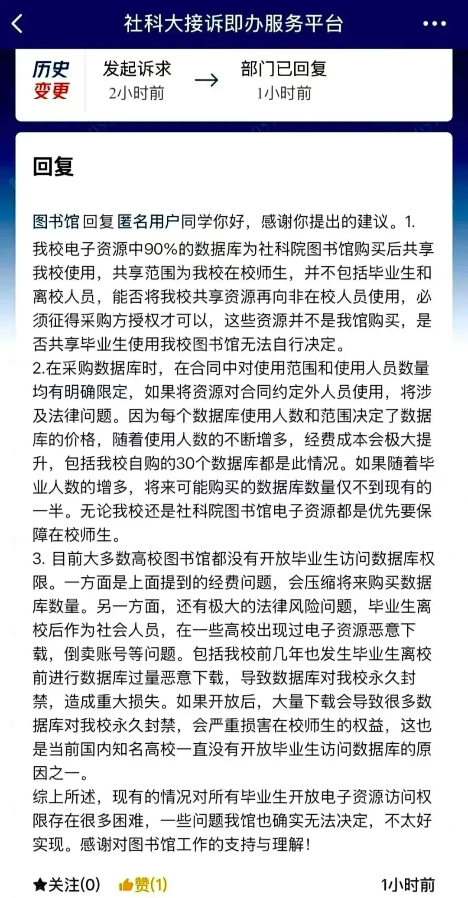

请相关部门及时关注并跟进问题。

## 1 毕业生数据库

“投稿毕业生数据库权限问题 在毕业前问过学校相关部门给过回复 短期内估计解决不了 有个替代方法就是上各省级图书馆注册读者证（具体哪个自己查找下）然后就可以使用它们采购的数据资源 像知网这种常用的或许能够满足需求

## 2 毕业答辩

“学校纸质文件里写，完成论文可以提交，明明已经尽力完成了，却连预答辩程序都不能参加！刚交了5000延毕学费……程序正义在哪里”

## 3 升旗仪式

“去年升旗仪式升旗手节奏也没有把握的很好，希望今年加油，给新生呈现更好的国旗班状态哦！加油”

## 4 后勤保障投稿

## “好完善的后勤保障！好高效的行政效率！

事情的起因是在八月上旬一位室友时隔二十天左右回到宿舍，惊奇地发现宿舍竟然变成了霉菌的老巢，床垫、桌子上布满了霉菌，室友在宿舍里仅仅待了一个小时小腿上就已经起了红疹。事情发生的第一时刻我们也就远程网购了除湿袋等物品，并且觉得宿舍现在的情况已经不适宜住人，要求换宿舍以及为了避免更大的损失，希望学校可以帮忙进行搬迁。这个时候假期一开始就把宿舍楼微信群解散了的宿管阿姨们表示拒绝，室友上上下下联系了很久，终于把楼长找来看了看，才同意我们走线上申请手续。但由于宿舍没法住人，也没有人帮我们解决这件事，室友只能立马回家，我们决定开学之后再对事情进行处理。

同时，事情发生之后我就在接诉即办上发布了诉求，建议学校在今年北京格外潮湿的情况下是否可以对宿舍进行一些监管，后勤处的回复如下：“阴雨天气多了就会出现这样的问题，楼上的房间如果长时间不通风也会发霉。”没有给出解决措施，并且告诉我一向如此。从来如此就是对的吗？我在北京上了四年学，本科也是一直住在阴面，从来没有发生过宿舍如此大面积发霉的现象，我想问难道同处于北京的房山区和海淀区还有如此大的气候差异？既然说楼上的房间也会发霉，那请问八号楼也会这样大面积发霉吗？此时我不得不怀疑宿舍楼的建筑工程质量了，不会根本就是霉菌房吧？我们的宿舍在3号楼一楼拐角处，一个终年见不到阳光的房间，每天的阳光都需要靠镜子的反射，这样的宿舍是否应该住人本身也是个问题。

以上种种我们也还是继续忍受了，毕竟人家已经大发慈悲同意你换宿舍的要求了，你还要如何“无理取闹”呢？时间线回到9月6日，陆陆续续开始报道，室友回到宿舍准备办手续领钥匙，突然被后勤处的毕茹老师告知，线上手续不行，得线下办理，她只得在后勤处和学院来回跑了好几趟，最后的结果是让辅导员先给毕茹老师打电话住进去，周一上班补其他手续。因为我和另一位室友的专业实习问题，这一个学期我们都不会回到学校，之前一直跟后勤处商量，一个人搬三个人的东西会比较慢，后勤处也同意可以慢慢搬，结果在拿到宿舍钥匙开始搬宿舍的时候，告诉我们要两三天搬完，并且要求押证件。也就是说宿舍手续还没办完，宿管就着急强制要求她一个人在两三天内将三个人的东西全部搬离。而且还说是因为之前有人赖着不走，就这个宿舍环境，呆着都会生病，谁会赖着不走呢？请某些高高在上的老师停止恶意揣测学生吧，不提供便利就算了，还要遭到恶意揣测。想让宿管帮忙但宿管说需要找领导。好的，我便继续给所谓“领导”打电话，公寓办的毕茹老师接到我的电话，我刚将我的诉求表达完，她竟然直接将我的电话挂断！好嘛，既然公寓办不能解决，我便只能找后勤处两位处长，但是电话都打不通，找到后勤处综合办公室的老师，得到“领导在开会，周一再打来”的通知。

这件事到现在已经发现一个月，后勤处与宿舍楼第一没有解决问题的态度，二没有解决问题的能力。在我们向她们反映问题时，只能得到他们“找领导”等踢皮球话术，同时推卸责任将问题怪在我们头上，是我们没有通风导致宿舍发霉。那我请问，放假期间我们是手眼通天还能预测到北京下大雨，还能回来给宿舍通风是吗，而且离开宿舍难道不应该关好门窗吗？有没有常识，下雨天屋内发霉还开窗通风只会加剧霉菌繁殖。这本来就是宿舍管理与防范风险方面做的不到位，我们甚至还没怪学校只是想要学校提供解决办法，学校与宿舍反而倒打一耙。

在学生根据要求“找领导”，提出合理诉求时，竟然十分不尊重人的将电话挂断。我们在积极寻求解决办法，学校各方互相推诿，联系不到相应部门，行政效率奇低，明明已经在线上提交过的申请线下还要再来回跑，一个月以来这件事情甚至还没有解决，室友回到学校差点就落入无地可住的处境，这是一个高校应该提供的安全卫生保障与解决问题的态度吗？

（以上所有陈述均有照片与录音作为佐证，真实性完全可以得到保证。良乡校区。如若不是事情找不到人解决也不会投稿。）”
