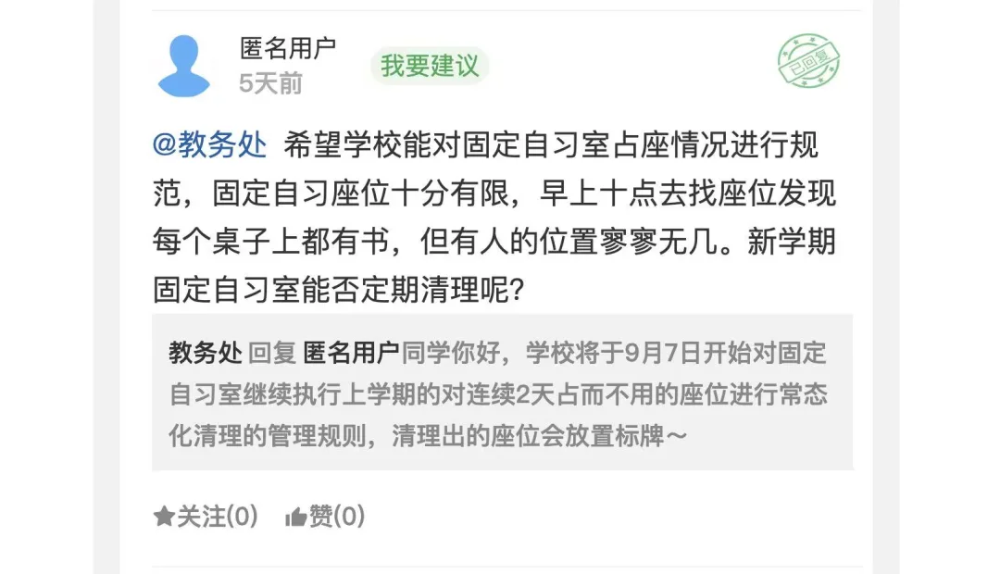
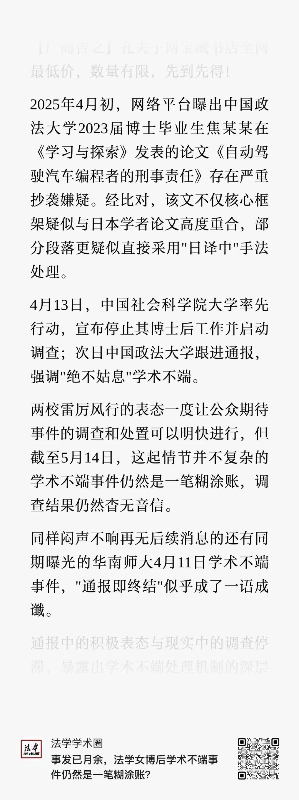
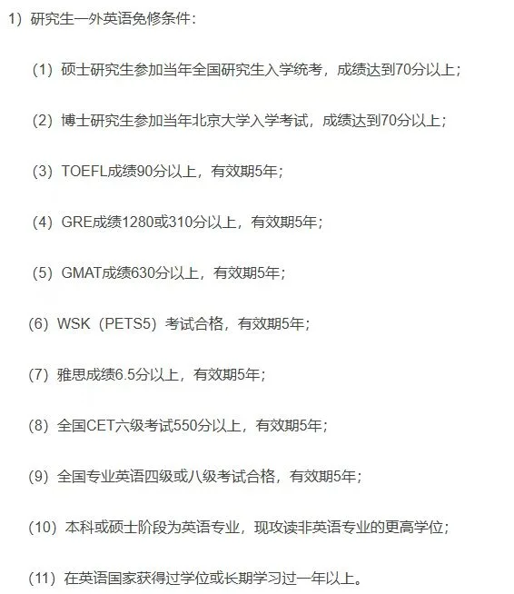
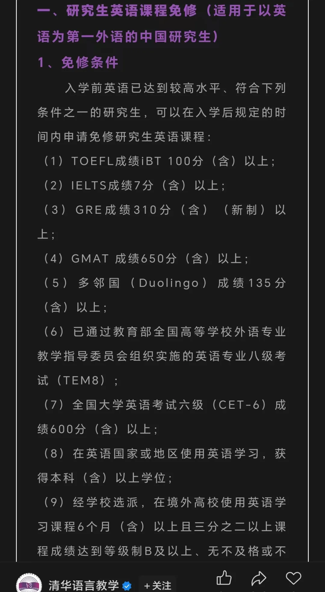

请相关部门及时关注并跟进问题。

## 1 食堂

## “二食堂的米村窗口，菜花肉片请问肉在哪？”

“投稿：学校引进的这个意大利面窗口，真的服了，十五块钱这一丢丢，还和我说足斤足两220g，按照克卖，这又不是金子。关键还特别难吃，赶紧滚出社科大！”

## 2 求拥挤的校园

## “学生基本生活保障问题：

1.吃饭问题。想问我们学校是为老师服务的学校还是为学生服务的学校？从来没见过哪个大学单独设置教师餐厅，请问为什么学生不能去教师餐厅吃饭，而老师可以去学生餐厅，请问老师们吃饭也需要排队半个小时吗？从小学开始到本科，并且从来没见过哪个大学单独设置一个为老师开放的餐厅，是毫不掩饰地告诉大家老师和学生不平等是吗？

2.学习问题。为什么一个大学没有满足学生学习的地方？既然招来了这么多学生，为什么没有相应的能承载七千人学习的空间？

本科学校四万人有七层的图书馆，也没有什么提前预约的紧迫，学生即来即坐，每天早上八点都有阿姨收拾东西，没有人坐的位置强行霸占就是一种资源浪费，并且影响其他人学习，是一种恶性行为。

将近一万人的学校，只有图书馆500个位置学习，请问老师们觉得合理吗？请问学校有多少位老师？又有多少间办公室，几个老师坐一个办公室？请老师代入一下学生，这种自习空间的缺失对于需要各种毕业考试的学生来说是不是一个重要的问题？一个大学连基本的学生学习权利都无法保障，请问怎么建设双一流大学，请老师们去看看双一流大学的自习教室吧，别装看不见了。给同学们腾几个可学习的空间很难吗？”

“想问问教务处新学期都开始了，新生也入学了，固定自习室为什么不整个儿清理完重新占用？照您这意思，只要遵守规定的老生占着位置，别人永远占不着固定教室的位置嘛？

”

## 3 军训

## “《迷彩新贵论》

校园里忽多了些穿迷彩的人物，大抵是退了伍的，领了教官的职分，倒也威风。这威风不在带兵之时，却在训练场外格外显眼。张口便是“当年我在海军某舰队”、“我们特战旅”，闭口又是“若按部队规矩”、“尔等岂能如此”。声调颇高，眉眼间俨然仍是军官模样，只差腰间再别一把九二式手枪了。

我常暗忖：既然行伍这般好，何不多穿几年军装？偏生早早退了伍，来与学生娃儿为难。大约行伍中虽有热血，终究不及校园里清风徐来，且兼有银钱可拿，舒服得多。于是迷彩服一着，旧日威风借尸还魂，俨然又成了“首长”。

这般人物中，尤以顶着“研究生”头衔者为甚。腹中多了几点墨汁，行止反倒更见骄矜。说起话来，必要将“某大学硕士”与“某部退役”两桩事并提，仿佛这两样物事合在一处，便镀了金身。我观其训练学生，口令喊得山响，动作苛求得紧，自己却躲在树荫下饮着冰茗，俨然是运筹帷幄的将军了。

这倒令我想起旧时乡间的皂隶，卸了差事还要将杀威棒悬在门前，逢人便说当年如何教训囚徒。其实大家都明白，真个好汉不必终日念叨昔日勇武，唯有那心虚的，才需借往日威风壮今日胆魄。

世上事，往往如此。分明是讨生活，偏要戴上高帽；不过混口饭吃，却摆出元帅升帐的架势。我见过真正的老兵，退役后沉默如铁，偶尔谈起行伍生涯，眼里有光，却从不拿来压人。反倒是那些半瓶水响叮当的，将军旅生涯当作市肆叫卖的吆喝，一声高过一声，只怕别人不知他曾穿过军装。

究其根源，无非是离了队伍便失了魂灵，须得借往日虎皮包裹当下躯壳。训练场上叱咤风云，回到住处仍是寻常人，这其间的落差，大约是要用虚张声势来填补的。于是对学生越发严厉，对同事越发倨傲，无非是要教自己相信：我还是昔日的我。

然而迷彩服终究要脱下，军训终要结束。到那时，这些好汉们又将去何处寻找自己的威风呢？恐怕只得等待来年新生入学，再过一回长官的瘾罢。

呜呼！所谓“退伍不褪色”，原该是保全军人气节，岂料竟成了某些人招摇的幌子。这般作派，不惟辱没了身上曾经的戎装，更将军人的尊严变作了市井叫卖的噱头。

看来学历高低与品行高低，终究是两码事。迷彩服能裹住肉身，却裹不住某些人内心的空虚哪。

校园迷彩之中，自不乏真君子。有退伍数年仍腰板笔挺如松者，训练时严苛如铁，休憩时温润如玉；亦有硕士退役兵士，腹藏诗书而口不言功，唯以行动示人。我之所讥，实为其中之极少数耳。

这极少数人，每每将军训场当作戏台。自己扮那水泊梁山的好汉，却将学生看作喽啰使唤。嗓门拔得极高，仿佛声音愈大便愈有威严，行动坐卧总要显出与众不同。迷彩服经他一套，竟穿出了戏袍的架势，也是奇事一桩。

我曾见一教官，训斥学生时必以“老子当年”开头。某日气温骤升，他却不准学生饮水，自己倒躲在荫凉处，拧开保温杯徐徐啜饮。那杯中飘出枸杞红枣的香气，与满脸的“钢铁纪律”殊不相配。这般行径，恰似旧时衙门里的差役，举着“肃静回避”的牌子，自己却在公堂后偷闲吃酒。

最妙的是这些人物往往学历不低。腹中多了几卷书，不但未减去骄矜之气，反倒添了炫耀的资本。开口便是“我在国防科大时”，闭口又是“某首长是我学长”。仿佛那文凭与戎装糅在一处，便成了金字招牌，须得教全世界都知道方称心意。

其实众人皆明白：真金何须终日自称斤两？唯有那成色不足的，才需时时吆喝。我见过一位沉默的老兵，左臂有伤疤如蜈蚣盘踞，却从不示人。训练时示范战术动作，如豹子般敏捷；休息时坐在操场边擦汗，笑得像个邻家大叔。学生敬他如严父，却不怕他如阎罗——这才是真军人气象。

而今少数人的作为，恰似给迷彩服绣上金线，本想增光添彩，反倒坏了本来朴素的质地。军人本色原在坚韧刚毅，不在虚张声势；军训之要在于育人，岂在满足某些人的虚荣？

时值黄昏，训练场上的口令声渐息。我看见大多数教官正帮学生整理着装，细心地解说不当之处——这才是中国军人的真模样。至于那极少数跳梁者，不过是大潮中的几沫浊水，终究玷污不了整片海洋。

鲁迅先生若在，大约也会说：我向来是不惮以最坏的恶意来推测中国人的，但这回却很有点例外，因为究竟还有更好的大多数在。

”

## 4 选调与双一流

> “投稿：评上双一流然后呢？？985和双一流的含金量完全两个等级，双一流都快150所学校了，光评上这个有啥用呢？重点难道不应该是评上之后的事吗：纳入北京上海等选调名单，且从已有选调名单上从三类变成一类；怎么和其他985一样过各种简历筛选，等等。这些东西落实啊！！！要等到26.27年已经挺晚的了，希望把这些事都准备好，一旦评上就可以迅速跟进落实，别再一项项拖了，在校生们可等不起。”

> “今年的黑龙江选调名单出来依旧没有社科大，身边同学一遍依靠本科院校资格报名一边感叹“这学‘下’的”。不知道今年北京选调能不能给社科大资格，孩子就要毕业就业了心里干着急，校领导麻烦给点力啊。”

## 5 不端公开

## “

”

## 6 课间时间安排

> “投稿：课程时间安排是不是不太合理，本来12点10分下课后，学生去吃饭，吃完饭回寝室大概也快1点了，休息二十分钟不到，又要前往1点50课程的教室，是否会让学生，没有办法好好休息，很多其他学校下午的课都是在两点之后的，由于没有足够的休息时间，学生没有办法恢复上午上课的疲惫，也会影响下午的上课效率，真的是很不合理，希望延长午休时间，中午多休息十分钟。”

## 7 良乡宿舍

## “投稿：同关于宿舍发霉

坐标三号楼低层阴面，我们宿舍的被子和衣服也发霉了🏳️在离开之前放了除湿剂的情况下🏳️真没招了这住宿条件🏳️以及一个老生常谈的话题，宿舍楼群在各种意义来看都是有必要的吧！希望学校尽快重建宿舍楼群，给大家反应问题、及时沟通、接受通知的渠道\[抱拳\]”

## “投稿：4号宿舍楼

1、对面的垃圾站噪音太大了，白天也没法补觉，要么缩减他的工作时间，要么改造一下垃圾站谢谢！！

2、我就没见过没有宿舍群的学校，这个旧楼隔音这么差，只能靠互相提醒，楼道内不让贴音量提示牌，也没有宿舍群能提醒别人，怎么保障睡眠？！硕博本来就压力大，需要随时休息，这楼已经建立成这样了(之前都多少人反应过隔音差的问题了)竟然还没想着改善，请想办法！！！

”

## 8 硕士公共课安排

“投稿：今年看到了一些同学询问社科大硕士免修的消息，然后去了解了一下有关学校的政策，实在是大为震惊。首先是社科大硕士免修不能免考，这一点相比许多学校已经落后了许多，就连清北两校对于硕士生的免修都是直接获得对应学分的。这点先不谈，而第二点则是硕士英语还被拆分为听说读写两大部分，可以理解这是为了对应国际标准，对应雅思和托福这两大国际认可英语测试标准的打算，打算只为听说提供免修政策，而读写不提供免修政策，这是不是实在让人有些费解。都姑且不提已经有的课程里面对于外语成绩的高要求相比清北这一档的学校更高，就硕士生当前的学习和就业现状，对于符合这些苛刻要求的硕士生来说免修课程所节省下的时间都可以拿去做其他的事情，而不是重复被迫学习一些早已经掌握的内容。所以希望外国语学院以及研究生教学管理部门可以慎重考虑研究生阶段英语课程的设置与免修，哪怕不接轨国内双一流大学标准，起码也要设置一个便利学校的免修不免考政策，不然的话难免会让人产生目前实行的严苛免修条件和一部分课程的不免修政策是不是为了单纯让老师们有课上的疑问。而且根据现行的各类规则，还会出现第二学期需要同时上英语读写和第二外语的情况，对于已经达到免修要求，而且需要开始在校外找实习等事务的同学，以及对于第二外语有更高要求，想要比较持续的第二外语课程的同学来说，有关培养部门这样不通人情的政策只是抢走了学生本就有限的时间实在是无故加大学生负担。下附清北两校的研究生英语免修条件

”
