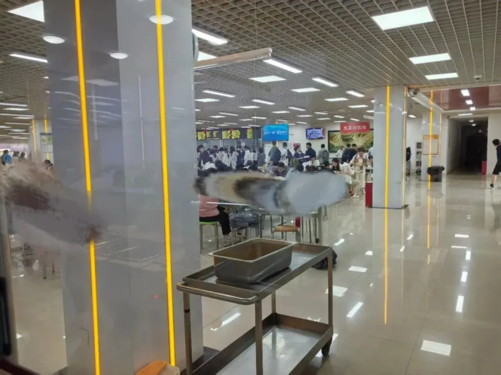
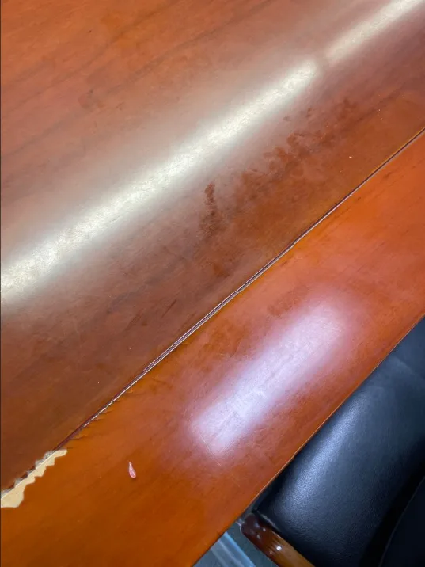

请相关部门及时关注并跟进问题。

## 1 教务安排

## “《讨导员檄》

盖闻明堂理政，贵在迅雷之决；学官传讯，当如震霆之疾。尔乃掌通讯之枢机，执通知之权柄，然则消息滞塞若淤塘死水，回复迁延似老牛破车。致使诸生困于暴雨，身染风寒；三军滞于操演，汗凝铁衣。此非人谋之失，实乃职守之堕也！

观夫暴雨将至，阴云垂幕，天象昭然若揭。尔等犹抱手机如捧玉玺，沉吟半晌方批一“可”；待得准允出门，早已滂沱漫道，衣履尽透。教官操练，本应晨钟暮鼓各有其时，尔却纵其拖延如丝牵傀儡，少年站立成林，汗雨交融，竟不知操戈者谁为主宰！

昔武周改制，奏表犹不过三刻；今学府通联，回信竟需以日计。岂智能时代反不如烽火传讯？掌中宝器竟逊于羽檄飞驰？尔等端坐空调之室，指划屏幕之间，岂知雨中奔走之艰、操场曝晒之苦？此非颟顸二字可蔽，实乃渎职之甚也！

夫学生者，非草木可任摧折；教育者，当慈母常怀惕厉。今视诸生如刍狗，待公务若儿戏。消息叠至而眼盲，申请如山而心木。岂知迟回之隙，或误求医问药之时；拖沓之间，已失传道授业之旨！

吾等非畏风雨，实怒尸位素餐；非惧操练，只愤令出多门。愿尔等振作精神，扫除惰气，使信息通达若江河奔流，号令分明如金戈铿锵。若仍固守旧习，拖延如故，则当效骆临海掷笔之怒，虽非讨武曌之师，必有谏学官之檄！”

## “《黉门赋》

泮池巍巍，广厦连云斗牛寒；庠序赫赫，雕甍画栋日月昏。金玉其表，门面之饰胜孔庙；败絮其中，梁柱之朽若危栏。夏雨滂沱，墙坍三面惊飞鸟；秋风萧瑟，阶陷九重困儒冠。

朝令夕改，令出多门如弈棋。寅时倡减负，夤夜颁题海；辰刻推新政，巳时废旧章。课表叠床架屋，晨昏颠倒；讲座铺天盖地，寒暑无疆。题海无涯，谁见骊珠出水？讲座如麻，但闻瞽说绕梁。

更观司牧诸公，沐猴而冠衮服。见泥泞则避道，闻喧哗即闭户。视察则前呼后拥，俨然巡狩；议事则左顾右盼，浑如泥塑。饕餮餐补，银箸频举；辗转会场，鼾声时露。问经邦济世之策，唯唯连声；及修墙补漏之事，诺诺疾步。

膏火学子，囚于斯狱：食宿不异圄牢，六艺竟成桎梏。晨披星以抄记，暮戴月而诵读。笔阵摧眉，犹闻训诰谆谆；试卷埋身，更添讲章簇簇。春华尽付流水，秋实皆化飞霂。

嗟乎！画地作饼，岂能充辘辘饥肠？凿光为日，何堪照昏昏孽帐？黉门已成商肆，教化早作戏场。诸公高坐，可闻稚子啼饥之声？广厦千间，不见寒士展眉之状！

呜呼！庠序若斯，教化安在？但见廊庙燕雀，争衔彩羽饰太平耳！”

## 2 宿舍与噪音问题

“你好！学校北门外街道上动工项目到底是什么？早上不到八点开工，中午午休时间也开工，周末也照挖不误。到底什么时候是个头？”

## “各位新生能不能早晚轻点挪凳子，轻点收拾东西。开学到现在，大早上六楼叮咣没完了”

“良乡新生想问一下，最近4号楼每天都有很大声的低频噪音，并且引起了楼体的共振，抖个没完没了，噪音一来心脏也不舒服很想吐🤮。看前几天的投稿说是附近有垃圾站？这是垃圾站工作的噪音吗？我还以为是在修路？所以以后每天都是这样吗😨？

以及真的没有宿舍楼群吗，非官方的也没有吗？那大家怎么出二手和吃🍉呢？”

## 3 食堂空间

## “【投稿】座位，一定是给「人」入座的

我原以为，用餐高峰期大难题是排队点餐；但我实在不能料到，居然是无处入座。

在二食堂取餐后环顾四周，我第一眼觉得十分空旷。兜兜转转三圈后，我茫然，我没有发现甚至一个能让我入座的空位：水杯、书包、耳机盒，贵重或廉价的物件堂而皇之地霸占了一个又一个座位。手上的饭菜微凉，桌上的水瓶无言。

或许说某些人是暂且去取餐也罢，但取餐一事，二三分钟也足矣；但当我在一处犄角旮旯细嚼慢咽地吃尽我的餐食时，那些水杯与书包仍然凝固在那，继续等候他们那甩手的主人。

有同学建议我无视那些占座物径直坐下，但我实在是不敢：某些对公共利益已然藐视的人，在我「抢座」后又会不会又当面与我争执，或在校墙、群聊以及人文之光社论上对我施加大肆批判呢？我确是不敢赌。

同学们，倘若你需要20分钟来候餐，就把你的候餐时间让给只需要20分钟就吃完饭的其他同学吧！我确信在如此人文闪耀的地方，我所臆想的「某些人」大抵是不会真正存在的。或许你对占座一事不看重，或许你认为你所占的座完全可以提供给他人用餐，但也请不要让他人承担那份尴尬与无奈吧！

也希望校方与食堂能分出精力对这一问题加以关注，为在用餐高峰期饥肠辘辘的同学们有一个可以坐下来吃饭的地方。”

## “社论投稿

希望学校能有效出台食堂分流政策，本身12点多下课就够累了，还要排半个多小时的队，可以看见图片中队伍已经拐弯了，站都站不下，下午一点多又要上课，学生不说休息了，一点喘息的机会都没有。学校的课程安排方面也有问题，为什么那么多12点多一起下课的，难不成我们天天吃外卖吃泡面吗，真的绝望了，吃不饱饭，人会干出很多丧心病狂的事的，没有开玩笑，这类新闻还不少，如果有人突然暴起砍人怎么办（参考武大），希望学校能给出解决方案”

## 4 补贴

## “希望学校快一点给没发补助的博士发这个月的补助呀(\≧∪≦)”

## 5 图书馆

“投稿：图书馆桌子用完能不能自己搞干净？留下来一堆油渍就算了，居然还有食物残渣，食堂桌子都比这干净。”

## 5 平台后续

## “《“人文关怀”岂能等同于“歌舞升平”？——驳25级新生对“人文之光”的指责》

这位25级新生的投稿，展现出了此君极度理想主义的色彩下，认知的浅薄与逻辑的悖论。若按此君所言，“人文之光”应当沦为校园版的“温馨告示栏”，只传播“暖心话语”与“真诚建议”，那才是真正辜负了“人文之光”四字的重量，更是对大学精神中批判性品格的公然阉割。

何为“人文之光”？社论绝非粉饰太平的暖色调滤镜，而是各位用言语照亮校园阴影角落的火炬。投稿中将9月14日的读者来信斥为“劝退新生”“泼冷水”，却刻意忽略了一个根本问题：这些批评是否基于事实？若学校存在管理缺陷、资源不足或制度不公，难道非要等到新生亲身踩坑后才准发声？真正的“人文关怀”，恰恰在于让信息透明化，让新生在全面了解现状的基础上做出判断，而非用选择性美化营造虚假的“初印象”。所谓“抹杀学校信誉”的指控，更像是一顶随意扣上的帽子——若批评不自由，则赞美无意义；若学校信誉竟脆弱到能被几篇投稿“抹杀”，那该反思的究竟是谁？

投稿者呼吁“理性”，却将一切尖锐批评贬为“情绪化发泄”；强调“人文关怀”，却要求屏蔽所有不和谐音。这种“理性”实质是驯化的代名词，这种“关怀”不过是舒适区的同义反复。社科大若真要培养立足中国、放眼世界的人才，岂能让学生沉迷于“暖心话语”的温室幻觉？一所大学的精神平台，若连直面自身问题的勇气都没有，何谈培育“人文之光”？

更吊诡的是，投稿者一方面宣称要“亲身经历”来判断社科大如何，另一方面却急不可耐地否定他人基于亲身经历的批评。这种逻辑上的双重标准，暴露出的并非理性，而是一种居高临下的傲慢：只有符合自己预期的话语才配称为“建议”，否则便是“乌烟瘴气”。殊不知，真正的学生利益，恰恰需要多元声音的碰撞才能彰显；而那些要求统一口径、消灭异见的行为，才是对校园环境最大的破坏。

“人文之光”的价值，正在于它拒绝成为任何人的喉舌，无论是校方的赞美诗还是学生的出气筒。它是一个自由的思想平台，在这里，事实胜于情感，论证强于指责。我们欢迎建设性建议，但绝不意味着要驱逐尖锐批评；我们追求理性讨论，但绝不接受以“理性”为名行“压制”之实。

最后奉劝这位同学：大学之道，在明明德，在亲民，在止于至善。这里的“明德”包括批判精神，“亲民”包括倾听不同声音，“至善”更离不开对不完美的清醒认知。若真愿社科大好，不妨先学会在刺耳之言中寻找真理的碎片，而非急于挥舞“正能量”的大棒驱逐异见。唯有如此，方配得上“人文之光”的读者与传承者之名。”

> “针对：“我们需要一个更理性，更充满人文关怀的“人文之光”；而不需要一个乌烟瘴气，无病呻吟的发泄平台。我希望点进这个公众号时，看到的更多是暖心的话语和真诚的建议。”

你不能要求一个民办平台全是阳光正能量，你不能只拥护自己想要的言论自由，你不能只在人文之光有利于你的时候才爱它。”

（见《[【读者投稿】有刺无刺，梁木难觉](https://mp.weixin.qq.com/s?__biz=Mzg2MjcwNzQ1Mw==&mid=2247491086&idx=1&sn=5d72a9cef64554411646ed8c1c212dae&scene=21#wechat_redirect)》第2条）
