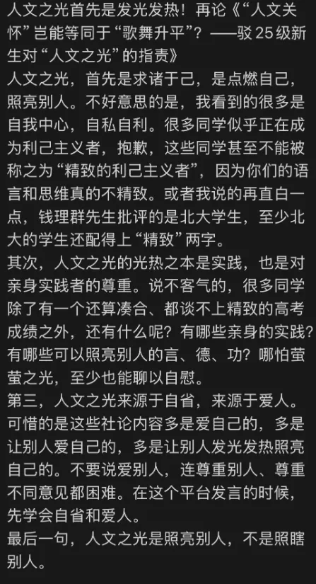

请相关部门及时关注并跟进问题。

## 1 食堂

“一食堂的雪梨银耳汤喝起来真的很不错！表扬捏。最近换季感冒喉咙痛，喝汤真的很能缓解病痛”

> “【良乡校区】学校扩招了但是食堂没有扩建，真的超级拥挤。本来就要排十几分钟的队伍现在更是要排二十多分钟才能吃上饭。这让十二点下课、一点多就要上课的学生根本没有休息的时间。希望学校能了解这个情况并采取一些措施，比如增开一些窗口，或者以盒饭的形式打包饭菜呢，按照堂食的价格和分量打包盒饭，两三个菜都可以，分类表明菜名和价格，(我看到一食堂也有让大家选择什么最喜欢的饭菜，就可以从这些饭菜里面挑着做盒饭)有一两个食堂工作人员看管着同学们有序排队刷卡拿盒饭就可以了，工作压力也不大而且高效。不想排队的同学买了盒饭就可以离开了，想堂食的同学排队压力也小一些。这个方式只是我今天看到有人在一食堂买盒饭突然出现的想法，不确定合不合理，总之希望学校能关注到这个事情，保障同学们的就餐和休息，非常感谢🏻”

## 2 新楼

## “投稿：9.17 新楼第一天开放自习座位预约 走廊上实在是太吵了”

## 3 宿舍噪音

“北门施工，四号楼震感强烈，窗户、床、桌子都在颤动。请问学校能不能询问一下，这个什么时候是个头？”

> “社论好，看到昨天有同学说四号楼噪音大，有感而发。四号楼现在没有任何交流群，很多新生可能不知道我们这栋楼的隔音效果有多差，每天午休时间与晚上很晚仍有同学在楼梯楼道大声聊天，有时候楼上的关门声振得楼下房间的门都在响，我不知道有没有新生关注社论，在此呼吁四号楼的同伴们轻声交流，文明关门，脚步轻一点，方便你我他。”

> “想回复一下今天帖子里的宿舍与噪音问题，很大声的低频噪音引起了楼体的共振就是北门外面的施工引起的，我观察了一下，施工时间是早上8-12，中间休息两小时，下午14-19，周末是不休息的，如果有下雨的话他们会稍早结束，施工时间非常之长，噪音也绝对超过了相关标准，已经周末施工应该也不是在规则之内的。周末我已不堪其扰，拨打了12345投诉，但是截止16日晚仍未有回复，建议大家一起打一下投诉电话，投诉量上去了或许有效吧。”

## 4 回应

“人文之光首先是发光发热！再论《“人文关怀”岂能等同于“歌舞升平”？——驳25级新生对“人文之光”的指责》

人文之光，首先是求诸于己，是点燃自己，照亮别人。不好意思的是，我看到的很多是自我中心，自私自利。很多同学似乎正在成为利己主义者，抱歉，这些同学甚至不能被称之为“精致的利己主义者”，因为你们的语言和思维真的不精致。或者我说的再直白一点，钱理群先生批评的是北大学生，至少北大的学生还配得上“精致”两字。

其次，人文之光的光热之本是实践，也是对亲身实践者的尊重。说不客气的，很多同学除了有一个还算凑合、都谈不上精致的高考成绩之外，还有什么呢？有哪些亲身的实践？有哪些可以照亮别人的言、德、功？哪怕萤萤之光，至少也能聊以自慰。

第三，人文之光来源于自省，来源于爱人。可惜的是这些社论内容多是爱自己的，多是让别人爱自己的，多是让别人发光发热照亮自己的。不要说爱别人，连尊重别人、尊重不同意见都困难。在这个平台发言的时候，先学会自省和爱人。

最后一句，人文之光是照亮别人，不是照瞎别人。”

（见《[【读者投稿】谈笑有鸿儒](https://mp.weixin.qq.com/s?__biz=Mzg2MjcwNzQ1Mw==&mid=2247491093&idx=1&sn=4c78a216fb9a6ed21ccb5f8c2d31a846&scene=21#wechat_redirect)》第5条）

“某位博士学长，是不是歧视咱们的同学呀？这样的老师真是一个合格的老师吗？您先学会自己做人吧！”

> “投稿，针对9.16的整篇社论，新民歌运动什么时候又在社科大复活了，以至于一月间就长出了如此多的鲁迅和郭沫若，王勃和司马相如？强烈建议社论给这些无处发泄的文学家单开一个文艺副刊，不要用自以为优越的文章来占据着大量版面恶心大家了；另外，针对第五条，如果做不到自己写东西的话就去旁听几节写作课，哪怕改一改也好，别用这种一眼ai生产的电子垃圾展示自己了”

（见《[【读者投稿】谈笑有鸿儒](https://mp.weixin.qq.com/s?__biz=Mzg2MjcwNzQ1Mw==&mid=2247491093&idx=1&sn=4c78a216fb9a6ed21ccb5f8c2d31a846&scene=21#wechat_redirect)》第1、5条）
