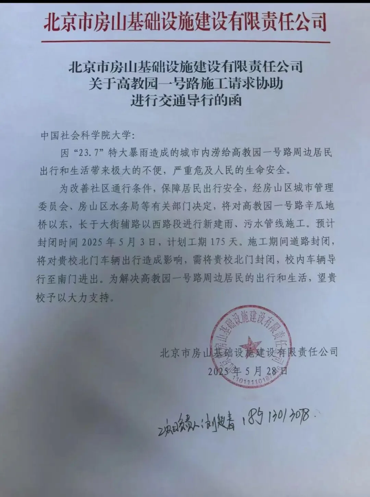

请相关部门及时关注并跟进问题。

### 置顶读者投稿一则：

0.最近关于人文之光的争议并非没有意义，但显得研究不足。若论人文之光的初衷，至今挂在置顶的《如何办好“我们的”社科大》一文就是最好的说明。其中所谈种种，我想今日仍不过时。假若参与争论的诸同学是真心为了社科大，不妨读一读这篇老文章，想必能有所收获吧。Dixerunt et salvaverunt animam meam.

## 1 电动车

“学校保卫处借免费检测的名义把对校园电动车的强制性要求合理化地推行下去了，但是无法反驳的是，电动车停错三次驱逐出校的规则仍然是一个不合理并且无比苛刻、毫无人文关怀的措施。

停放区域划线和相关规则到现在为止依旧不完善。可以看到校内很多车棚和划线区都设置在非常不便利的地方，有时候要步行很久才能到达附近的教学楼；划线区域明显供不应求，白线内的电动车都挤得满满当当的，很多车是被迫停在一旁的，或者另起一行挡住区域内电动车的去路，平添不便；也可以看到有很多车并排停放在没有划线的地方，周边并没有提示的标志，有时候不仔细看难免看错导致违停。普通师生很难完全保证在赶着上班上课的紧急情况之下，能够永远把车塞进拥挤的白线或车棚之内，除非他们花费大把的时间寻找校园另一侧还有充裕空间的车棚白线区，以及反复检查自己是否违停。

因此，要求天天火急火燎 专注于学习工作的老师同学们不小心停错三次便不得不接受学校保卫处把自己的电动车驱逐出校，这样的规则是否有些过于苛刻了？社科大究竟是老师同学们生活居住的校园，还是校领导、保卫处领导们强制“和谐”、不允许有任何便利需求、只能将师生的合理需要让渡给学校标准化管理的校园？

没有清楚的规则说明到底什么样的停放算是违停，也没有被错判违停时进行反映申诉的便利渠道，保卫处面对质疑只是声称“我们会看具体情况判定的，如果合理就不会判违停”，那么到底什么是保卫处眼中的“合理”，会不会出现广大同学和教职工认为“合理”但保卫处觉得“不合理”的情况，会不会频繁出现车主主观上并非故意但实际上被判违停的情况？在基础设施不完善且相关规则不清晰的条件下，凭什么制定出“违停满三次的电动车就不得再进入校园”这样的规则？连图书馆预约失信都有可以清零的机会，违停相对而言则并不是那么严重的行为，也对校园安全和同学利益没有任何影响，又为什么一定要给老师同学们施以如此严重的“刑罚”呢？希望校领导可以仔细研究一下保卫处的此决议，给老师同学们的校园生活多一些自由便利的空间，而不是每日在学习工作之余，还要战战兢兢于自己的电动车是否造成所谓违停。”

## 2 望京图书馆

## “投稿，望京校区图书馆的空调什么时候关，这几天像进了冻肉冷库一样。”

## 3 后勤

## “学校改名：

建议我们学校改名中国施工大学。今天早上八点不到，七号楼下的割草机准时施工，其噪音之大，宛若虎啸龙吟，震得床铺颤抖，震得人心惶惶。一天两天也就罢了，但是割草机似乎是从开学第一天就开始无休止的工作，不知道还以为我们学校建在内蒙古大草原上。哪里有那么多的草要割？就算要割草，就不能选一个合理的时间吗？非要大早上八点折磨学生？睡一个好觉越来越难了。

因此建议校内施工，早上不早于九点，下午不早于两点，晚上不晚于八点”

## “希望给望京校区的快递柜加一个遮阳伞吧，太阳直射屏幕不太方便输入取件码”

> “但是4号楼宿舍真的特别特别受影响，天天和地震一样。这让长期蹲宿舍里学习生活的博士生很痛苦，感觉一整天脑子嗡嗡的。或者我们可以集体打12345反映，让他们集中工期，把噪音大的工程固定时间弄完？学校可能真的也没有什么办法”

（见《[【读者投稿】天道不近人](https://mp.weixin.qq.com/s?__biz=Mzg2MjcwNzQ1Mw==&mid=2247491101&idx=1&sn=79ce0bb070ea4c30cbbd57ddeac75ff3&scene=21#wechat_redirect)》第3条）

“最近看到有很多投稿在说这个问题，笔者也想分享一些自己的看法，和大家一起讨论一下什么样的方案可行，以及还有哪些值得改进或调整的地方。

在此之前，社论已经有很多关于食堂打饭问题的投稿。例如，食堂中午排队人数太多、打包饭菜时间长导致排队时间增加，等等。在笔者看来，这些问题的背后都有一个共性问题，即食堂的供给量和供给的速度都比较有限。以笔者个人的体验为例：在12：10下课后，除开从教学地点走到一食堂的时间，笔者大概需要排队10-15分钟才能打到饭（备注：这个数字没有经过精准的计算，但不低于10分钟）。而真正轮到笔者打饭的时候，很多菜已经没有了、不够了。

以上这个例子反映出两个问题。其一，排队需要耗时比较久才能打到饭，这说明学生的平均的打饭时长比较高。在学校扩招、食堂及内部窗口规模不调整的情况下，这一情况会继续恶化；其二，在12：10这个许多学生才会下课的时间点、食堂迎来第二个就餐高峰的时候（备注：按食堂此前就餐建议时间的说法，食堂有两个就餐高峰。因撰写匆忙，未找到出处，欢迎补充订正），居然会出现没有菜的情况，这是很奇怪的。

笔者无意置喙扩招的决定，这也并非笔者个人意见所能左右。但食堂的问题不会因为不考虑人员数量的增加而消失。因此，笔者认为，在目前难以改变、调整就餐师生数量、食堂和窗口规模的情况下，除了一些同学提出的分流策略、增加菜量的策略之外，似乎也可以考虑改变窗口打饭的形式来提高打饭效率，减少排队等待的时间。下面我将对本人的一些想法做进一步阐述，但其中不免存在思虑不周之处，还请各位批评指正。

笔者通过对一食堂的观察和日常就餐经验发现，现行的打饭方式是：同学在大屏公布的菜单上选择菜品，然后向窗口工作人员沟通，工作人员在不同窗口间寻找菜品，打饭，最后结算金额。其中，“工作人员在不同窗口间寻找菜品”是一个削减效率、延长等待时间的流程。设想一下，倘若所有菜品在本窗口均有提供，那么何必通过上述方式到处找菜呢？更不用说，考虑到窗口工作人员的忙碌程度和年龄，时而忘却，返回窗口再次甚至多次和学生确认也是时常发生的事情。如果我们再加上一些打包的需求，这个时间就会被拉得更长。所以，这或许是一个可以考虑的方案。

但是，这一方案如要落地实施也存在困难。这是因为，目前食堂产出的菜品种类很多，在现有的打饭方式下，平均打饭的时间虽长，但却有自由选择的可能；笔者通过观察食堂窗口发现，单窗口可同时放置四个大铁盆（备注：不知道是否有更专业的称呼，暂且这样说了，欢迎指正），或八个小铁盆。这种情况下，单一窗口是不可能提供全部种类的菜品的，更不用说刚才的这段论述还没有考虑到点心的情况，显然我们也不可能为此做出削足适履，削减菜品种类的举动。因此，笔者在此也希望和大家共同探讨、商议一个效率更高的窗口打饭方式，欢迎各位提出自己的看法和建议！如果想要兼顾提升效率和菜品种类，怎样改进这个打饭方式更好呢”

（见《[【读者投稿】天道不近人](https://mp.weixin.qq.com/s?__biz=Mzg2MjcwNzQ1Mw==&mid=2247491101&idx=1&sn=79ce0bb070ea4c30cbbd57ddeac75ff3&scene=21#wechat_redirect)》第1条）

## 3 平台讨论

“投稿：呼吁投稿多观察和记录学校里真实具体的事，陈述事实和可验证的证据，不要就“人文之光”等抽象概念争论不休。”

> “投稿：针对最近在人文之光见到的两方互驳，感觉大家现在都有些情绪化了。作为一名在社科大生活了几年的学生，我一直认为这个社论平台有着十分重要且不可替代的作用，很多时候因为这个匿名社论平台才让我们能够真正维护校内民主。但是我同时也感受到大部分社论都十分的情绪化，甚至一小部分似乎已经没有了理性思考。当然，我们要允许事物的两面性嘛，不只在人文之光，几乎所有网络社交平台行政都有相似的问题。我们不应该要求一个非官方平台全是正能量，甚至不能要求那些极度情绪化或者一眼错但是并未违反道德和法律的不发。但是，我们应该要具备理性思考的能力和责任，并对这个平台的性质有充分认识。“人文之光”并不代表就一定要全平台都是温暖的话语，我们要的是一个大家理性地提出问题和见解的平台。”

> “也对“文采飞扬”的投稿说两句。“人文之光”是大家反映问题、提意见的平台，把问题、建议说得通俗简明就行了！洋洋洒洒一大篇，两指头都划不出去，你是能写，别人一眼都不想看。大家都很忙，沟通使用白话文很难吗？留着你的文采出书吧。”

“针对“人文之光首先是发光发热！再论《‘人文关怀’岂能等同于‘歌舞升平’？——驳25级新生对‘人文之光’的指责》的一些观点，同对面这位开展理性的和非理性的讨论

在社论这个平台上，不理性的发言确实有不少，我也不否认有所谓利己主义者的存在。负责社论运营的同学有时还会对（依据相关平台创作规定和法律法规不适合展示的）内容进行打码处理。可是，“这是为什么”？为什么这些不理性的发言仍然被社论采纳、允许投稿了？为什么在这里好像这么多人都呈现出一副苦于某事久矣的样子呢？难道说，社论如此多期投稿人的素质都是普遍偏低的？动机都是不纯粹的？思想都是利己的？您似乎不愿意对这个问题展开深入的探讨和追问，只一味地把原因归结于提出问题、表达观点的个体的非理性的态度，甚至还使用了“除了有一个还算凑合、都谈不上精致的高考成绩之外，还有什么呢？”这样的迷惑发言——可是您在下文中的那“连尊重别人、尊重不同意见都困难”的发言却又是和这发言的精神相违背的。

> “啊，尊重——至少在这个观点上我认同您，尊重是人的美德——也正因如此，当人感受到自己不被尊重的时候，感受到这种美德被亵渎的时候，他/她对于那不尊重自己的对象便不可能随时随地保持理性的态度。理性在这时反倒成为了限制表达的藩篱。我们是学生，或许总是被认为天生就该是循规蹈矩的——可是更重要的是，我们同样也是普通的人，而非圣人，难道连符合这种天性的、保持一点不可被遏制的非理性态度的自由都没有吗？难道在问题的确存在的时候也要保持‘超然物外’、事不关己的态度吗？一味要求保持理性的态度，而不顾人情感表达难以符合完全理性的实际，这就符合‘人文之光’的宗旨了吗？既然您不愿意让我们自己捍卫自己的利益，不愿意让我们用非理性的态度回应那些不尊重我们的现象与行为，既然您在发言中如此强调实践——那就请您，以您大公无私、心怀人文的踌躇壮志，替我们完成这项工作吧！请您看看这些问题到底哪些属实、哪些不属实，给出您的调查过程和结论吧！请您以身证道，用您的实践打动我们这些‘利己主义者’自私的内心吧！到您成功的那日，我们或许早已毕业，但我们必定会满含羞愧地跪伏在您的脚边，恳求您这身怀大义的慷慨高歌之士恩赐我们些许宽容！”

最后，以马克思的一句话赠予您：

因为我把可笑的事物看成是可笑的，这就是对它采取严肃的态度；对不谦逊仍然采取谦逊的态度，这也就是精神的最大的不谦逊。

（备注：本文全篇未使用AI，即便在那些打了引号的、故作翻译腔的段落也是如此。）”

（见《[【读者投稿】天道不近人](https://mp.weixin.qq.com/s?__biz=Mzg2MjcwNzQ1Mw==&mid=2247491101&idx=1&sn=79ce0bb070ea4c30cbbd57ddeac75ff3&scene=21#wechat_redirect)》第4条）

“再次回应：“某位博士学长，是不是歧视咱们的同学呀？这样的老师真是一个合格的老师吗？您先学会自己做人吧！”

第一，学好思政课。毛主席教导过，批评是为了团结，而不是攻击，更不是为了歧视，批评是为了真正点亮人文之光。

第二，学好逻辑学。上下三句话，连个递进关系都没表达清楚。社科大有这门必修课，我本人在二十多年前，谷老师第一次开课的时候就学过的，希望你也好好学。

第三，为人之本是实践，是知行合一。我工作教学的十几年是这么做的，你来讲讲自己有什么亲身实践，如果没有实践，也可讲讲有哪些亲身调查研究？如果都没有，那至少把《改造我们的学习》《反对本本主义》再好好学习一遍。

第四，就算是纯粹为了批评，你老虎屁股，摸不得吗？偏要摸！”

（见《[【读者投稿】天道不近人](https://mp.weixin.qq.com/s?__biz=Mzg2MjcwNzQ1Mw==&mid=2247491101&idx=1&sn=79ce0bb070ea4c30cbbd57ddeac75ff3&scene=21#wechat_redirect)》第4条）

> “虽然分数与人格无关吧，但私以为以我校学子的高考成绩，起码筛选出来的是受过教育的“人”，然而呢，这么多年下来所谓“中式”教育在此等“才俊”身上真是一点没留下痕迹，白白浪费教育资源和国家财政，不然怎么连尊师重道，宽宏待人这种最基本的道德要求都如此超出此君理解范围呢？原来在此等人眼中，这位老师站在一个老师，一个前辈学长的位置上号召大家为他人着想，不要自私自利竟成了歧视他的言论，那看来他将自己放在了主流价值观的对立面，否则，但凡懂得什么叫社会主义核心价值观的朋友，又怎么会感觉歧视呢？”

（见《[【读者投稿】天道不近人](https://mp.weixin.qq.com/s?__biz=Mzg2MjcwNzQ1Mw==&mid=2247491101&idx=1&sn=79ce0bb070ea4c30cbbd57ddeac75ff3&scene=21#wechat_redirect)》第4条）

编辑部提醒：因近日情绪化投稿偏多，编辑部呼吁各位读者保持理性，已经发出的稿件和本期投稿因我们不删改读者投稿的原则保持原样，即日起一些过于情绪化的投稿我们会与投稿人进行沟通后，修改至可以发表的程度。
