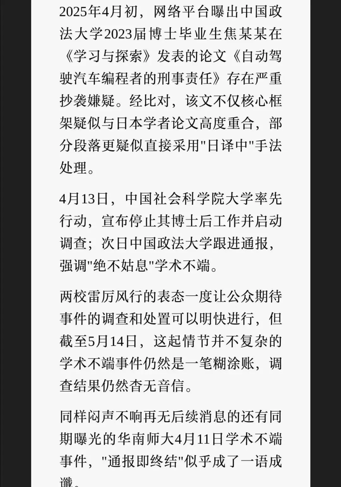
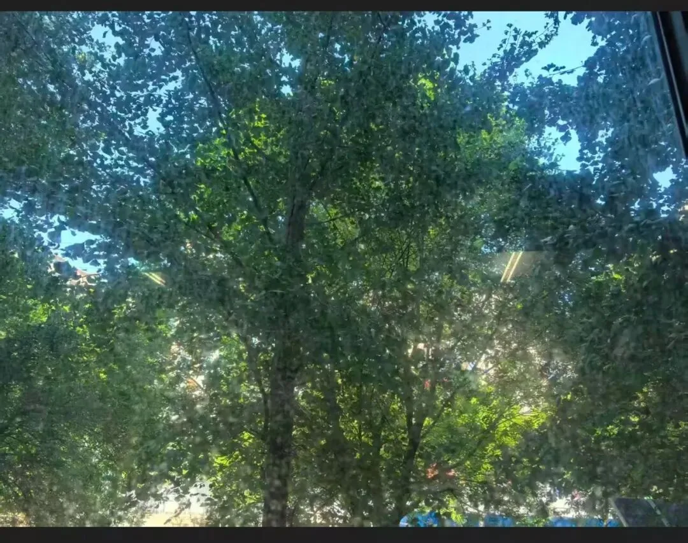
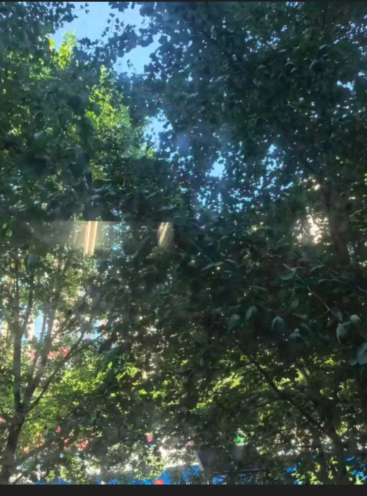

请相关部门及时关注并跟进问题。

## 1 学术生态

## “学术讲座

讲座作为重要的学术资源，对师生开拓视野具有重要作用。我们需要学校提高讲座质量和频率，邀请具有世界影响的名家（如正在北大做讲座的王汎森先生、本院前辈学人赵汀阳先生）来校开展讲座。

这固然受到本校地理位置、学者日程安排等不利因素影响，但若学校拿出得体的礼遇（包括但不限于丰厚的酬金、有分量的主持人），相信能一定程度上改善现有讲座资源状况。”

## “

”

## 2 校园卫生

“在良乡教学楼一楼找位置上课，因为需要说话所以试图寻觅一个公共的开放空间，走廊的桌子就很适合。但万万没想到的是除了以包和书本占座之外，人文之光竟然也发展出了用垃圾占座的巧思。

从现场来看，一堆已经经过风云残卷之后的食物残渣在桌面上堆积，甚至还有半块刚吃完的奶油蛋糕；饮料杯蛋糕盘和叉子散落得遍地都是。

尽管北京已经进入秋日，但其实晚间温度还是不足以保证奶油的新鲜不腐败，天然冰箱现在还尚无法起作用，可想而知在一夜（或者不知几夜）的发酵之后，蛋奶制品会挥发出多么令人作呕的味道。简直是食物的坟场，蝇蛆的迪厅，臭味一直弥漫；很难想象为什么不在吃完之后随手把垃圾带走？为什么不把公共区域的环境搞好？或者难道打算第二天再来吃一顿？实在费解。”

“习惯把垃圾塞桌洞里的同学，请下课后把垃圾随手带走！教室就有垃圾桶，走几步就能扔掉，不要留在桌洞里恶心别人了。”

## 3 图书馆

> “图书馆的座位分数可以一个星期以内自动恢复吗，现在有时候头一天太累了，第二天早上多睡一会，醒来发现还有几分钟了，后面两个脚像风火轮一样往图书馆跑/:rose/:rose”

## 4 感谢

> “感谢：昨天保安小哥救我于花丛之中。昨天没站稳被栅栏绊倒，直挺挺躺进两丛月季，被刺缠住，保安小哥很热心地跑过来帮我解开，也不知道小哥有没有受伤，忘记问保安小哥的名字。在这里感谢一下！”

## 5 宿舍环境

“投稿: 坐标2号楼西侧，每天晚上23:30之后都能听见一帮人在食堂门口那边的路上嘻嘻哈哈。说话那么大声，严重打扰西侧同学的休息。

今天（9月21日）凌晨，甚至出现了长达10分钟的楼下楼上对骂。脏话、大嗓门响彻行云，我就不信2-4号楼西边的同学们没有听见的？！实在是太过分了，真没有素质。

希望广大同学在夜里就寝时间经过食堂门前的主干道时，能够小点声。不要再三五成群底下开会，你以为你们的那点事我们听不见吗？这隔音啥都能听见。让人文之光真正“人文”点！我在此呼吁广大同学就寝时间在楼下主干道经过时请保持安静，谢谢！”

> “四号楼的噪音问题，尽管学校与施工单位沟通过，“建议施工单位将产生较大噪声作业时段放在每日上午9：00-11:30、下午14:00-18:00”，但是当天的停工时间是晚七点，第二天的开工时间是八点，噪音依然很大，地板和桌面依然能感受到震动。怎么说呢，可能学校也是被骗了吧……”

> “再投一稿，4号口北侧宿舍是否适合居住？每天从早到晚的噪音，施工时楼在颤抖，窗户被树木几乎完全遮挡，本来就是阴面，常年见不到太阳，宿舍里一股子发霉的味道，刚住进来时桌子地板角落还有霉菌！！！现在树木遮挡，大晴天屋子里都见不到光，简直不符合生存条件。不只本人宿舍如此，问过几个阴面宿舍的同学，都说是又潮又臭。施工的噪音，再加上发霉的环境，真的适合居住吗？”

（见《[【读者投稿】鸣泣之时](https://mp.weixin.qq.com/s?__biz=Mzg2MjcwNzQ1Mw==&mid=2247491108&idx=1&sn=467a83c894ebb1913bf6ea88941dcdc2&scene=21#wechat_redirect)》第3条）
