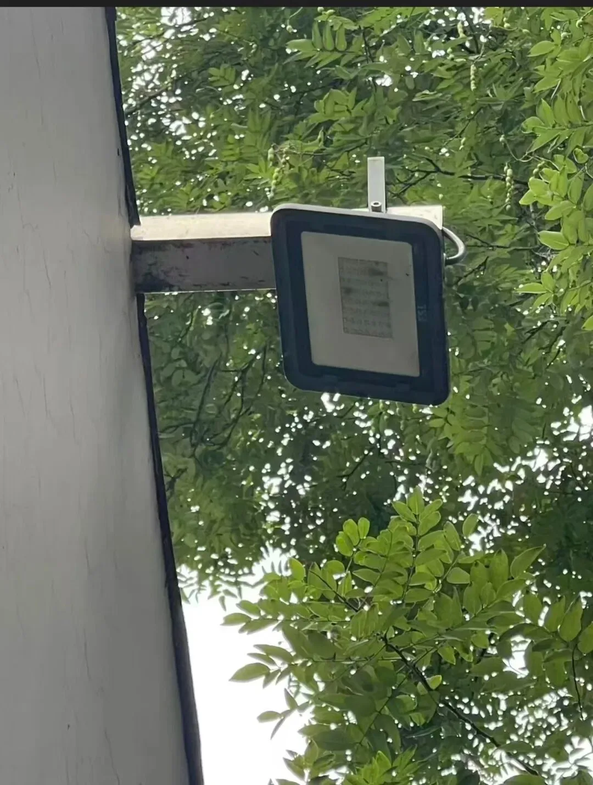
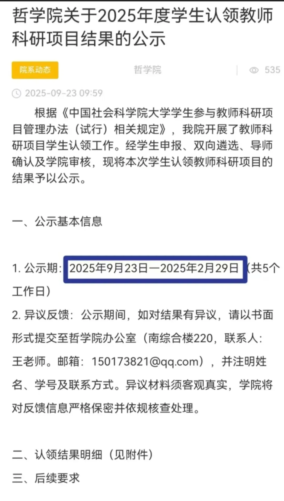
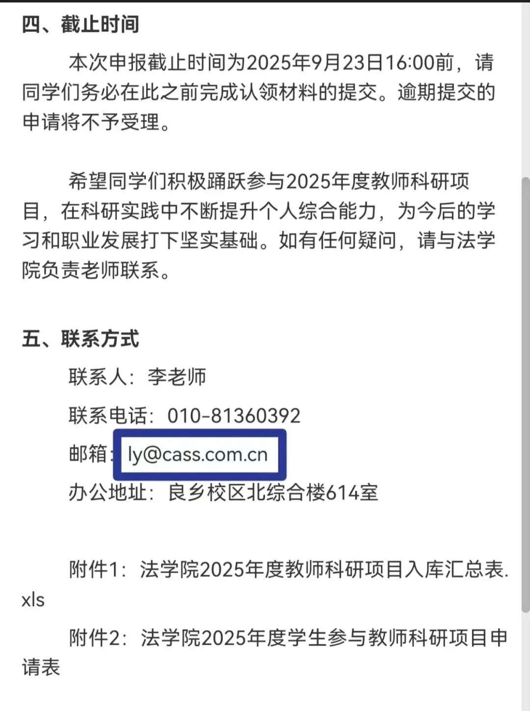
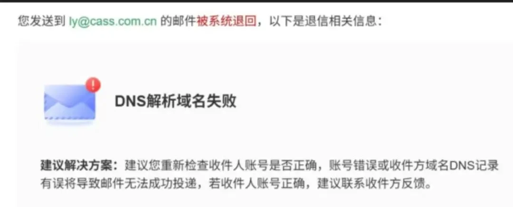
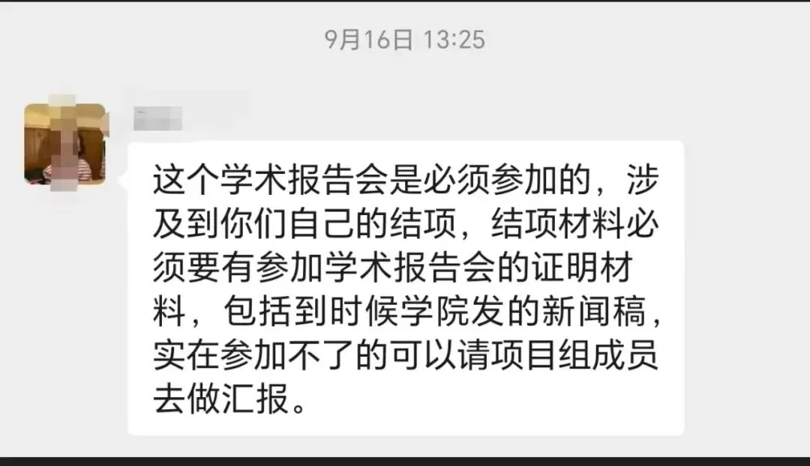

请相关部门及时关注并跟进问题。

## 1 望京校园设施

“学望京校区校园外墙的灯不亮，一个也不亮，以前是亮的，晚上很不安全，坏了不是一天两天了，也不知道物业是睁眼瞎，还是有意不给修，这么多管理人员，难道就一个也没发现，拜托了，新学期刚刚开始，为我们安全考虑一下可以吗？

”

## 2 再回应

## “在回应：针对“人文之光首先是发光发热！再论…同对面这位开展理性的和非理性的讨论

第一，这位同学能够理性的回应和讨论，而且逻辑清晰，有条有理，我非常欢迎。

第二，我批评的是“自我中心，自私自利，不尊重他人，而且还不自知”。现在人文之光社论的主体内容多是意见建议，但可惜也大多是从自己出发的，我已经很久不愿意看了。之前曾经有身体不方便的同学批评学校的残疾人设施建设不到位，有理有据，作为教师我惭愧，作为校友我支持。关注弱势、自强自立，这是真正的人文之光，是能够照亮温暖他人的，我们应该向这个标准看齐。

第三，我反复强调注重实践和调查研究，绝不是以政治正确性堵别人的嘴。就如同学自己说的，学生并没有太多的实践。从校门到校门的过程就是一次次考试中的单打独斗，衡量大家成败的标准就是个分数。这不能都怪学生，是社会制度把大家塑造成这样的，但别忘记我们在社科院学习，我们要超越自己过去的路径。所谓“知识分子以批判为使命”的观点，对于欠缺实践的年轻学生是很有诱惑力的。当这种观点和自身感受结合起来，而批评对象又比较宽容的时候，有些人就变成了被小院宠坏的一群小刺猬，满身带刺，以刺为荣，甚至不允许别人“不长刺”。小院培养真正的知识分子，是“以实践追求真理”为使命的。

最后，请大家用好这个发声的平台。实际上学校层面对同学们提的各种意见、批评甚至嘲讽，都是非常宽容的，只要言论不触及意识形态立场问题，学校也没针对过具体的同学。我不是在替学校辩护，请大家和其他大学的同学聊聊，也算调查研究，看看哪所学校有这么宽容的氛围？多数同学终有一天会走出小院，多留下一点建设性、积极性的念想不是更好吗？

”

## 3 通知规范性

“投稿：哲学院时间可以倒流！法学院通知中的邮箱不能正常接收邮件。通知是学校与学生交流的重要窗口，编辑通知和审核通知的工作者应该追责吗？请发通知之前认真核对下吧，一流，从认真做好每件小事开始。

## 4 研创计划

> “其他学校的学生科研都是跟着学年走。一直有个疑问，咱们学校的研创计划和新苗计划为啥不是跟着学期和学年走，而是按照年来算呢？比如研二和博三 9月份开始申请，第二年6月份结项，这样不是正好符合学期和学年规律吗？现在是博三下学期3月份申请，博四上学期11月结项。那硕士二年级3月份的没开题，硕士三年级作为毕业年级不允许申请6月份要毕业。正好给错过了。即使此类项目专门针对博士，也希望学校能调整一下从9月到第二年6月这样。”

## “投稿：

学校折腾完学院折腾。研创结项层层加码：必须参加，作为年底结项的考核标准之一

”

## 5 食堂大排队

## “投稿:

舌尖上的困境：社科大良乡食堂容量之困

中午十一点四十五分，社科大良乡校区的教学楼涌出人潮，学生们步履匆匆地走向同一个目的地——食堂。不过十分钟，本应飘香的食堂已成“战场”。排队的长龙蜿蜒至门口，桌椅间摩肩接踵，餐盘碰撞声中夹杂着无奈的叹息。这已成为社科大良乡校区每日中午的常态景象。

高校食堂，本应是学生们补充能量、交流思想的舒适空间，如今却成了人满为患的拥挤之地。当学生们历经漫长排队终于取得餐食，却不得不端着餐盘四处寻觅座位，甚至不得不站在角落匆匆用餐时，我们不得不追问：我们的基本用餐权利何以得不到保障？

空间与需求的矛盾日益突出。随着校区扩招，学生数量持续增加，而食堂容量却未能相应扩展。经济学中最基本的供需规律在此得到了最直观的体现——有限的食物窗口和座位无法满足集中就餐的需求，导致效率低下和体验恶化。

拥挤不仅带来不便，更衍生出一系列问题：食品安全隐患增加，就餐环境嘈杂压抑，学生休息时间被压缩，甚至影响下午的学习效率。更令人担忧的是，这种持续的压力正在消磨校园生活的品质，将本应愉悦的用餐体验变为每日不得不面对的焦虑。

或许有人会建议“错峰就餐”，但这仅是权宜之计，而非解决之道。课程设置的统一性决定了大部分学生自然会在相近时间段感到饥饿。将责任转嫁给学生，要求他们调整自己的生理需求以适应基础设施的不足，无疑是对问题本质的回避。

人文关怀体现在对基本需求的尊重与满足上。一所注重人文精神的高校，应当关注学生的日常生活体验，而非仅注重学术层面的培养。餐饮保障作为校园生活的重要支撑，其质量直接关系到学生的身心健康与学习效果。

我们呼吁学校管理者重视这一问题：科学评估食堂容量与学生需求的差距，通过扩展空间、优化布局、增加窗口、分流人员等多种方式，切实改善就餐环境。小处见大，食堂问题虽看似日常琐事，却恰恰是检验学校管理水平和人文关怀的重要标尺。

期待不久的将来，社科大良乡校区的食堂能够成为真正满足学生需求、提供舒适体验的餐饮空间，而不再是我们每日不得不面对的“战场”。毕竟，一所伟大大学的标志，不仅在于其学术成就，也在于它对每个个体基本尊严的呵护与关怀。

”

## 6 课堂上的神秘人

## “其关于社科大马院博士某课堂神秘人物一事

今天是在我们开课的第二周，课堂出现了一个很奇怪的事情：正在上课时候，不知道从哪出现了一个中高年工作人员（大家称其为老头儿）竟然在拿着手机对着学生的脸一个一个的拍照。本来我是以为他会抓拍几个同学就行了（尽管不知道目的是啥），没想到真是一个一个拍，我一抬头看到一个人在拍我真的是吓了一跳。这样给人拍特写礼貌吗？这些照片用在何处啊？你说了吗？

随后出现了更戏剧化的一幕。讲课的老师讲的很好，大家也听的很认真，几乎忘了时间。当老师突然想起来中途让大家休息五分钟的时候，老头又出来了。首先是强调了一下课堂纪律，什么开门关门轻声，不能迟到和早退，缺勤多少要重修。强调完这些，重点来了！点名！一个一个点，一百多人的博士课堂，真就一个一个点！更抽想的是，被点到还要站起来答到，但凡没站起来，他就要问为什么不站起来，并且重申要站起来。监狱点名是吧？但凡缺条腿就不配上这个课吗？关键是那时候谁也不知道这位大叔是何方神圣，连个自我介绍都没有。此事已有多位同学进行反馈，这种拍照、强调课堂纪律的做法，加上这种点名方式，很让人开眼，表示长这么大第一次遇到。

我想简单的总结一下问题：1.大叔是什么人？可以提前给我们说一下吗？2.已经是博士课堂了，课堂纪律还需要重点强调吗？最基本的轻声开关门需要你来告诉我们吗？没有哪个同学的关门开门比你拿着手机对着我拍更吓人。不能迟到早退这种事情是不是每节课都要强调一下？3.你凭什么什么都不说就拿着手机在那对着我们一个一个拍特写啊？不需要我们的同意吗？4.点名可以理解，甚至一个一个点名也可以理解。但是被点到就得站起来和你对视着喊到，你不觉得反胃吗？ 请大家关注一下这个事情，我觉得学校和学院的领导很有必要了解一下这个人的身份。我很担心是不是和007一个行业。

。”
