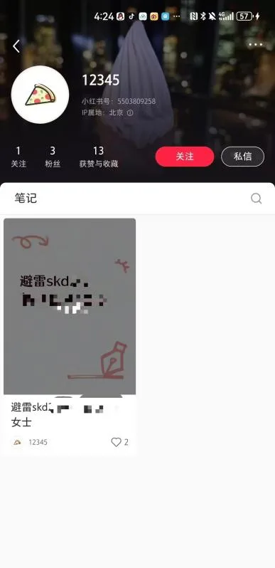

请相关部门及时关注并跟进问题。

## 1 哲学院

## “哲学院偏袒无实证举报者和造谣者

中国社会科学院大学哲学院没有培养出学术人才，却培养出了几位真正的哲学家。他们的学生志向不小，可惜胆子不大，确实在行政人员身上学到了真东西。

学生们首先学会了善用漏洞，造谣抹黑。他们发现学院为了保护隐私，不会透露举报者的姓名，为了息事宁人，甚至不会展示举报材料；那么，只要把聊天记录断章取义、添油加醋、再缝缝补补（不愧是文字工作者），就能让被举报人有苦说不出。流程大约是这样的：那人只会在莫名其妙中被叫到办公室，听一顿来不及反应的大骂，然后在威胁中签下“自愿退出”的声明书，从头到尾都没法解释自己根本是清白的（因为根本不知道犯了什么错）。只要你亲手写上自己的名字，就可以得到隐藏莫须有罪名的承诺，没有经验的大学生简直太容易被这一套骗过去了。这几位行政人员不会调查，也不想听解释，可能因为四点下班还约了人吃饭呢。

那么，这几位哲学家煞费苦心是为了什么呢？是为了最多2000元的奖学金。这就是他们学会的第二件事：利往利来，不择手段。应该没有人比某老师更知道为什么“美德即知识”，但是可惜他保护的学生看起来更愿意师从智者学派或者马基雅维利。社科大哲学院教给他们的第一课是：哲学就是爱智慧；教给他们的最后一课是：主义都是拿来贩卖的，到账的才是真的。当然了，我们学者赚钱也要爱惜羽毛名声嘛！所以一定要暗中成事，不要拿到明面上来谈。

这都是陈年旧事了。不过到了最近，有尝到了社科大哲学院处理方式甜头的人准备故技重施。这人盯上的是另外一位同学，不同的是，这次他还学会了罗织流言，引导网暴，在小红书这个几分钟就可以传遍校内外的平台，指名道姓地造这名同学的黄谣。当然还是要藏好自己的，所以他注册小号、设置不可评论、不可私信，因为早就知道会收到评论区正常同学的口诛笔伐；更可笑的是，此人一口一个“存在主义”“责任和自由”，用道德批判掩盖他贴大字报、试图借助公权力排除异己的野心（文笔还很烂，像ai写的，这是可以说的吗）。而学院看着这场不公平的、一方已经收到伤害的欺凌，居然劝说受害人与霸凌者和好（家丑不可外扬嘛）。

社科大哲学院的几位行政人员，我的请求只有二：第一，向去年“自愿退出”奖学金竞选的当事人公开举报材料，且此后的举报材料都要向当事人公开；第二，在今年的这位受害者公开承认之前不采信任何内容，并追究恶意传谣者的责任。

无需劳费心力用一贯手段排查和威胁你们的学生，因为我和贵学院与这几位同学都毫无关系。我也并不害怕在其他公开平台继续展示贵院的作风，毕竟有人已经作出了示范，用如此恶劣的手段在公开平台上对付你们的学生，看起来也没有收到什么惩罚。”

## 2 良乡电动车管理

## “【投稿】良乡校区电动车管理

昨日上午进北门校门时，听到门口闸机“车辆未授权，禁止通行”。北门安保人员告诉我电瓶车要去南门保卫处进行检查授权，我就去南门询问。南门安保人员说需要在一站式服务平台上申请，审核通过后才可以授权车辆进出学校。但在申请过程中发现需要提交车辆行驶证，我是二手买的车，二手卖家早已没有微信，当时并没有过户。我询问安保人员说这种事情怎么处理，却只得到必须要申请，否则十月一号之后电动车就不能进入校园的答案。疑惑的是如果一开始实行这个政策，严禁同学购入二手车辆倒还好，现在二手车已经骑了一年了，突然得到不能进学校的通知，是否合理。非常能理解学校对电动车管理的要求，但是一刀切的政策是否合理，买二手车的同学们该如何进入校园。”

## 3 宿舍

## “投稿:社科大安全检查，女生宿舍可不可以请女老师来？？”

## “投稿：不要再在二三楼之间的晾衣杆上系湿巾了！死亡标记啊！”

## “匿名投稿

请问学校到底出于什么目的，为什么要让女宿管带男性职工来给女生宿舍进行安全检查？还睡着觉呢宿管就猛敲门 刚睡醒没回应就马上要进来 还带着个男的 非要在别人睡觉时开门我觉得已经很离谱了还带个男职工 咱们学校的女生还有一点隐私吗？还有一点基本的被尊重吗？裸睡的同学怎么办？这个男的到底起到一个什么作用 这个时间又到底起到一个什么作用？这么喜欢破门而入下次干脆在别人洗澡的时候宣称要检查厕所然后啪的一下也推开门进去呗 一个学校连官方的宿舍楼群都没有已经够离谱了 现在更是带个男的检查女生宿舍 打开熟睡的女生宿舍的门 合适吗 就算男的站门口这事难道合适吗 怎么女宿管是眼睛有问题看不清了所以一定要带那个男的？”

## 4 医务室

## “吐槽：校医院怎么这药没有，那药也没有。口罩也不卖了”

## 5 施工噪音

## “人神共愤的施工：

北门外的施工，一个月了，依然不见任何完工的迹象，其给社科大早上九点之后施工的承诺更是从未兑现，希望相关部门能继续反应这件事，把施工时间推后一点，七号楼的学生是人！不是机器！”

（见《[【读者投稿】清音不闻](https://mp.weixin.qq.com/s?__biz=Mzg2MjcwNzQ1Mw==&mid=2247491116&idx=1&sn=338477911b5bcef846af9a9c3973613f&scene=21#wechat_redirect)》第5条）
