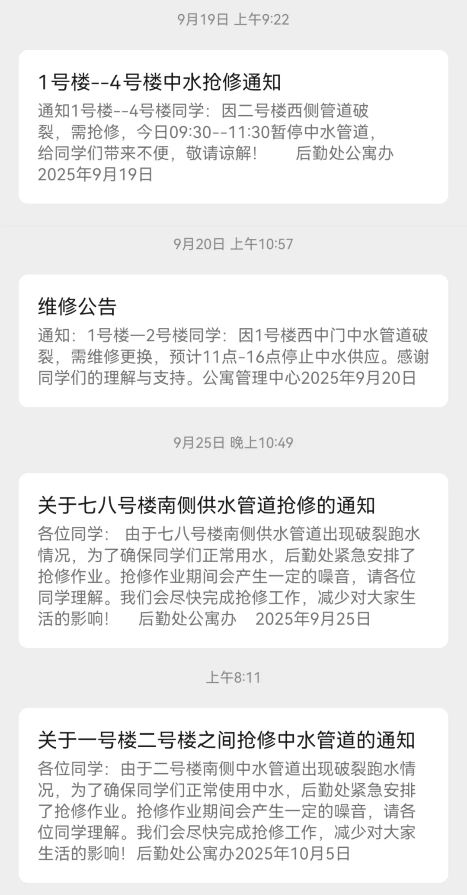

请奖助有关部门，后勤处，公寓办，学工处以及美联福超市及时关注并跟进问题。

## 1 返所疑云

“讲个笑话，现在回所上课，卡都不认了，需要提前上报。这是要干啥？社科大要不别办了，怎么越改越抽抽？学生连回所都得申报，就这还评双一流，这也叫科教融合？“

“投稿: 社科院突然开始禁止学生用校园卡进入，需要预约。那请问这样社科大和社科院的关系是什么? 社科大的同学和外校同学有什么区别。

难道每次去所里上课都需要预约吗？每次去所里利用图书馆也需要预约吗？

那是不是意味着异地上课这个问题可以得到解决?”

## 2 神秘小故事-望京

## “望京国

娱乐时间到，给大家讲一个小故事：

话说在遥远的望京国有一个权势滔天，呼风唤雨，一手遮天的女王。

这个女王平时看似平易近人，实则阴险狡诈，手段毒辣，睚眦必报，但她唯独宠爱一个小和尚。

小和尚无论做错了什么，都不会被女王责怪，反而旁人会被女王狠狠责罚。因为小和尚把自己的全部以及全部时间都献祭给了女王，只要在一起就诉说自己多么多么不容易，多么多么可怜，多么多么敬业，多么多么努力，多么多么爱她。小和尚和女王在一起时，小和尚的腰永远弯着，膝盖永远跪着！让人一时分不清他到底是小和尚还是小太监！

白天小和尚要陪着女王做运动~

中午小和尚要陪着女王做运动~

晚上小和尚也要陪着女王做运动~

女王说：朕的小和尚非常非常非常非常非常非常非常非常非常非常忙，非常非常非常非常非常非常非常辛苦，你们不要什么事都找朕的小和尚。

小和尚说：不，我的女王，我愿意辛苦，为了您，我的女王，我要努力，我要用我浑身的本事，用我的血汗，给您塑一座金身，光芒万丈，流芳百世，我以后要走望京国的正门，让那些言官再也不敢打我的脸！因为打我的脸就是打您的脸呀我的女王！我定要让您名垂青史有朝一日当上咱们社科国的女王！

女王说：艾玛~好孩子！辛苦你了！朕一定护着你，朕赐你免死金牌，朕要让你进翰林院，朕要让你当望京国第一武僧！你就是望京国的巴图鲁！你长长久久的乖乖的陪着朕永生永世吧！

未完。。。待续。。。。连载。。

”

## 3 四面漏水的校园

## “水管抢修如此频繁，为原因为何？学校有关部门能做出合理解释吗？

”

## 4 在路上的奖学金

“投稿:吐槽咱们学校每年的学业奖学金和国家奖学金都评的如此晚。其他学校国庆假期前奖学金都到账了。"

## 5 抽烟相关问题

“社论君你好，我想反映一个情况：近期有人在校园驿站的公共卫生间内抽烟，烟味飘散到了整个校园驿站，给大家造成了困扰。

请抽烟者自重！不要让自己的欲望成为他人的困扰！"

“投稿：球球大家不要在宿舍楼里抽烟好不好，楼道里的烟味都飘进宿舍了，不想吸二手烟"

## 6 对超市建议

“希望美联福超市把机器升级一下，貌似现在二维码还是有扫不上的情况，而超市的工作人员对此的应对措施就是让阿姨一个一个看着学生有没有扫，且不说人多了阿姨有工作负担，学生们有时行色匆匆或者戴着耳机出入小卖部，大呼小叫也有不会被听到的情况，遗漏付款没办法得到体面并且彻底的解决。而且有事情并且很匆忙的时候因为学校机器没扫上而被呼来喝去真的很影响心情。"
