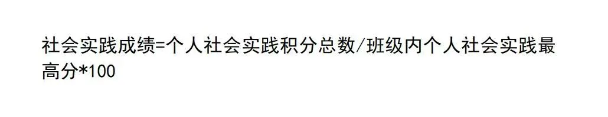
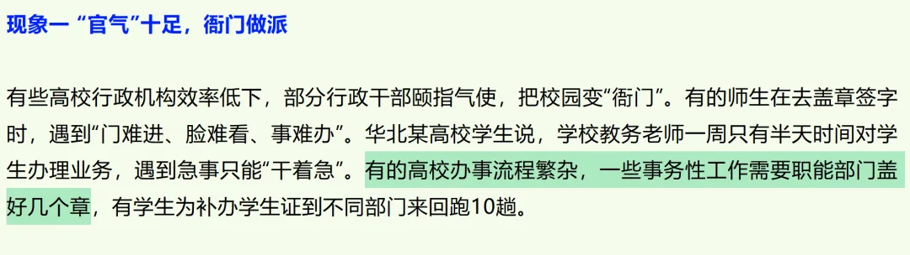

请相关部门及时关注并跟进问题。

## 1 奖助问题大爆发

“又到了一年一度的奖学金评选。学校的制度看起来越来越“规范”，但让学生签署“责任分配书”的做法，实际上把原本属于管理层的解释和协调责任转移给了学生，内部扯完就不会有人想向上找麻烦咯。

与此同时，学校将“粗则”下放给各学院，表面上是为了灵活执行，实际上造成了标准不统一。学院老师面对学生疑问时常常表示“学校没规定，学院也不好定”，结果问题始终悬而未决，既没有统一解释，也没人真正负责。

每年一变的奖学金细则改革更是好，今年搞出的所谓“研创预立项”，理由是硕士没有开题报告不能申请，但部分硕博连读生在无报告、非毕业年级的情况下却能获批并用于加分。或许，这就是制度“灵活运作”的魅力所在吧。

”

## “关于社科大博士研究生国家奖学金评选的不成熟观点，供大家讨论。

看今年评选研究生国家奖学金较热闹，很多人都在发表看法，这其中有几个问题可能值得商榷。

第一，关于评选国奖时间范围的问题。评选通知上写的很清楚，是2024到2025学年，这个时间范围应该是从2024年9月份算到2025年的7月份，如果宽限的话，那就应该最多截止到2025年8月31日之前。超出这个时间范围的科研成果，如有的人是月刊发表的成果，是2025年第9期或者第10期的，很明显是不应该计入到本次研究生国家奖学金评选范畴中的，这对于所有的人都是一样的明确要求，而且规则上早就说的很明确，不应该随意更改，这才能彰显公平性。

有的人说快要临近毕业了，或者是其他的什么原因，再多两个月，他成果出来了，向学院要求超出这个时间范畴的如在2025年8月31日后的论文成果，也算作国家奖学金的评选，可以理解他们无比想获得国家奖学金的迫切心情。

但是，这可能是对其他人很不公平，快临近毕业高年级同学的成果普遍就比低年级的人就多一些，本来就有不太公平的地方，再给高年级快毕业的学生评选成果时间范围拉长，给他们“开后门”优待，这就更加不公平了。因为任何一项活动都是有时间范围限制的，不应该因为个别的人需求随意更改规则。

本来给毕业生就已经有优先照顾了，比如说其自己申请的项目没有结项，按照他的立项时间，只要在2024年的9月到2025年8月31日之前的这个时间段立项的，也可以看作是成果。

因此，还没有获得文章纸质版刊物的，如有网络上的出版，也应该是在2024年的9月份到2025年的8月31日之前这个期间，才有资格参评本次国奖。

第二，关于评选国奖发表论文的学生是独立作者，还是一作或者二作的问题，应该学生是独立作者为最佳。首先应该鼓励独立作者发文。而有导师带着自己学生发文的，学生是第一作者或者第二作者的，其实这样情况的学生是一作和二作，他们的差别似乎并不大。之前听不少同学说道，那些特别是部分同学挂导师大名的发的C刊，自己怎么发上C刊的，心中应该有点数，有点自知之明吧。

发过文的都知道，现在独立作者发文，明显更加困难，特别是在c刊或是更顶级的期刊当中。

而且研究生评国家奖学金更加倡导学生独立科学研究，这才真正符合大学的独立科研精神。利用老师的大名发文本来就比其他独立发文的学生占了很多的优势，又来拿国奖，似乎不太好。

当然，老师带着学生发文也无可厚非，但是这是评学生的国奖，不应该按照社会其他单位的规则等同视之，特别是比较焦灼的时候，还是要有一定的标准，需要更加凸显独立科研的重要性。

在大家科研成果都差不多的情况之下，比如都只有一篇c刊，有的人通过导师关系成为一作或者二作的，加上其可能还有什么研创项目之类的，一算各项的累计加分，比独立作者发C刊的分数更高一些，但是研究生特别是博士研究生国家奖学金应该更加侧重独立科研的重要性。这时分数稍微低一点的独立作者发C刊的人，成为国家奖学金获得者，可能更能起到示范作用，也更能服众。

至于那些挂上导师大名发C刊的学生，无论是一作还是二作，实际上可能差别都不大，不过是五十步笑百步而已，二者的区分度可能并没有那么大。

如果双方都没有以独立作者在上一年度时间段期间发C刊的情况之下，那就直接比拼C刊发文数量，发文数量更多的积分高者，获得国奖。

第三，关于国奖名额分配的问题。国家奖学金，观其名称，应该不是学院的班级奖学金，也不是某一个年级的奖学金，应该要打破一个班级或者是一个年级的等额分配的平均主义的做法，实行总体上的综合分配，有能力者得到，学术成果不出众的年级或者班级可以出现一个研究生国奖获得者都没有的情况。

不应该一个班级就必须要有一个国家奖学金名额，也不是一个年级就非得要有一个国家奖学金名额。

应该是在全院只要符合国家奖学金参选的所有年级范围内的所有人员都可以参加评比，从而优中选优，也就是说是在一个学院当中的同一个学历层次的各个年级混合起来，打破年级和班级的分配名额限制，必要时由专家评委会进行鉴别，学术成果多且质量高的获得。

高年级的学生在每次评选国奖中都有普遍优势，获得了大多数国奖名额。少部分低年级的学生可能在博士二年级有的就有不错的成果。然而，在他们班上，由于大家都很优秀，可能排名只能排到第二名、第三名甚至第四名，但是放到和全院其他年级的人相比，他可能依旧有资格获得国家奖学金。这类低年级的人更加不容易，是不是也应该关注考虑下？

而反观那种搞平均主义一个班出一个国家奖学金名额的做法，每次都让部分人钻了空子。他在他们班上成果可能排第一名，但是放到全院各个年级中，他的成果就很一般。甚至他在他们班上就没有啥成果，由于全班都那样，他也拿到了班上的第一名，根据等额分配办法，获得了国家奖学金，这种人很难服众。

按照年级和班级平均主义分配国奖名额的办法，只会让一些人钻了空子，让真正应该获得国家奖学金的人获不到国家奖学金。

此外，国奖不是普通的学业奖学金，评选理应和学业奖学金有所区别。不能完全按照学业奖学金的做法评选。如有人在他班上以独立作者发表了一篇C刊，而另外的人通过导师发表了一篇一作文章，但后者他可能有学生干部的身份，加上研创项目的加分，要知道研创项目的加分等同于发表一篇文章，他就比以独立作者发C刊的分数积分高很多。按照学业奖学金规则，后者可能排名是第一。而那个独立发C刊的学生可能排第二名都比较困难。

但是，在评选国奖当中，如上所述，应该要首先看独立作者发文的情况，即使在班级学业奖学金当中综合排名第二或者靠后，他也应该是有资格去参评国家奖学金甚至获得博士生国家奖学金的。

第四，关于科研项目认证的问题。科研项目的认证中，加上2到3项的数量限制，可以解决很多事情。

有一些同学存在这类情况，如她刚入学的那一年，老师的重大科研项目已经立项了，立项书就没有她的名字。

她在二年级评选奖学金，科研项目还未结项。很多重大的国家社科基金项目要好几年才能结项，可能到她毕业的时候都无法结项，那她也拿不到结项书。

在二年级的时，也没有以这个项目发表科研论文成果，因为现在发文对学生来说，不是一件容易的事。

然而，实际当中，她确确实实参加了老师的科研项目，耗费了很多时间和精力，收集整理资料，撰写报告，撰写文稿，开会学习等。

从实际来看，不能说她没有参与老师的科研项目。

因此，科研项目参与，不应过分死板和苛刻，非要学生拿到立项书，结项书或者发表文章。应该以实际情况为准，如果她能提供一些实在的资料，证明其确实参与了老师的项目，是不是也应该以实际情况为准，算作加分项。

以上是些不成熟的观点，可能不同的人有不同的看法，可以理解。

”

## “平庸的学工处，愚蠢的评分细则

科研处设置“学生参与教师科研项目，科研系统登记”初衷在于更好的促进科教融合，和评奖学金没有半毛钱关系，你们不懂就别硬蹭啊，拿个鸡毛当令箭，非要搞成硬性规定来限制学生。

事实情况是，大多数的学生都有参与所里的、研究室的、导师的科研项目，由这些项目的负责人开具证明还不足够吗？你非盯着你那个科研处的任务认领干嘛呢？社科大哪个部门有资格可以强行要求各个所的老师将自己项目登记到社科大的科研系统下吗？跳出你的井底，睁开眼睛看看吧。

归根结底，这是重形式而轻实质，坐在办公室拍拍脑袋想出的蠢注意，这更将学生参与所里科研项目和学生参与校内科研系统任务给对立起来，破坏科教融合大局。

当然，这一直都是社科大行政的闪亮底色。望尽快取消，迷途知返。

”

> “很多班干部一年什么都不做只转发两个通知，一些学生会里也有什么活动都不参与都不组织的人，所以建议社科大所有班级以民主投票方式选出需要保留的班级委员，把根据实际情况不需要的班级委员全都撤销掉。相对应的，所有年度参与工作组织活动少于三项的团委学生会研究生会成员全都清退。不希望这些只转发两个通知的班委和什么工作都不做的成员在期末的时候拿5分任职分，这对普通学生对那些大家都认可的平时比较负责的学生干部都不公平。谢谢！”

## “国际政治经济学院奖学金评定画蛇添足、倒行逆施、人神共愤。

国政经学院在学校规定的基础上对社会实践成绩强行标准化，使得总分极度偏向学生干部。

大多数同学的成绩都在80-95之间，假设成绩权重0.3，作用到总分上，成绩最高分和最低分仅差4.5分。学校规定班长社会实践加12分，权重为0.1，作用到总分上，班长和大多数普通同学差了1.2分，这尚且合理。

但国政经学院灵机一动，强行标准化，将社会实践最高加分人为规定为100，作用到总分上，足足有10分的差值。这对大多数努力学习的普通学生合理吗？

也就是说，在国政经的评价体系下，一个成绩95分的普通学生甚至比不上一个成绩为65分的班长。这合理吗？难道这就是国政经学院研究生培养的导向吗？

”

“我硕三，也是最后一年参评奖学金，9月1号见刊的C刊就不给算，就是因为晚了1天。这合理吗？这种情况对于毕业班学生非常不友好，打击大家的积极性。希望学校和学院考虑毕业生相关诉求。这是一个需要调整和完善的地方。

## “奖学金“思想素质”的30分，有的班级按照是否担任班委区别分数。

班委本来就有单独加分项目，“二次加分”实在不合理！

看看实际情况——研究生班级除了班长、支书等少数班委，其他班委没在班群发过一句话，也没为同学们做过一件事。任何“贡献”都没有，凭什么既有班委的专门加分，又占思想素质的分数？

”

> “关于国家奖学金评审问题，学校出台的规则是只认前二作者，第三及其之后不予认可。各学院出台自己的奖学金评分规则，模糊了国奖和学业奖学金，这个学院是否能按照自己的规则，在国奖评审时认可第三、第四作者及其之后的作者？”

## 2 质问

> “ 想询问一下校里的某些领导，真的是人类吗？三分人形尚未修成，七分官威栩栩如生。院运动会彩排，每次都要晚到一两个小时，真不把排练的老师学生当人看啊。有空自己去调研调研skd哪个领导风评最差吧，成天被那么多学生方方面面地吐槽，别自以为是了。”

## 3 繁琐流程

“看到中纪委的刊文，想起师兄师姐的毕业流程，好家伙，交个论文好几层审批，导师、辅导员、系助、院长都给你搁那玩点点点，把所有人都折腾一遍，江浙办企业都没那么多流程，希望能引以为戒、简化流程、少折腾

”

## 4 校园二手烟后续

> “就二手烟问题对接诉即办后勤部进行了反馈，部门回复已进行劝阻，无法采用强制措施。首先我每天都吸二手烟，没看到有任何人进行劝阻，其次无法采取强制措施更是致学校同学的健康于不顾。吸烟点的设置也极其不合理，在人流往来密集之地设置吸烟点，居心何在。况且特意设置吸烟点是占用了学校同学的公共资源专门服务烟民的不良嗜好，有这功夫不如实现全校禁烟，社科大面积很小，人员密集，个人以为很有必要。吸烟不仅损害健康，更有可能对已有健康问题的同学造成致命伤害，不能假设所有人都是完全健康的青年，或许我们学校还有年迈的教授、怀孕的老师、工作人员、抑或者是已有基础疾病的同学，连他们也要被迫每日吸入二手烟吗？另外，有的人烟没有灭干净，秋干物燥，容易带来消防隐患，这也是一大问题。还有就是，接诉即办能不能设置一个评分或者回复系统，二手烟的问题迟迟未解决，接诉即办上的已解决三个大字当真刺眼，应当明白，不是回应了就是解决了。”

## 5 两校区图书馆

## “请学校把图书馆的凳子检修一下，我感觉老化的可能不仅我这一个凳子”

> “投稿：希望大家都能自觉在图书馆使用静音键盘鼠标，同时减小敲击力度。不要在室内交流或打电话，共同营造安静的学习环境。需要使用电脑并不是在公共场合影响其他人的理由！望京图书馆的工作人员很负责，会对一些同学进行提醒，但是没有办法及时全面地解决噪音问题。或许可以定时巡查主动提醒，或者划分沉浸式学习区域。以上是个人不成熟的建议，希望可以被看见。”
