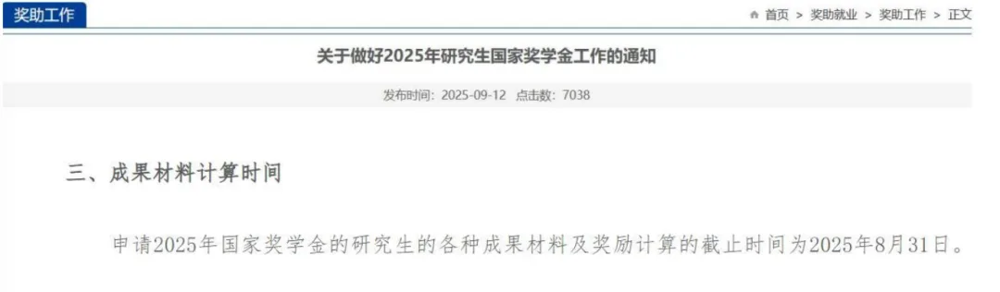
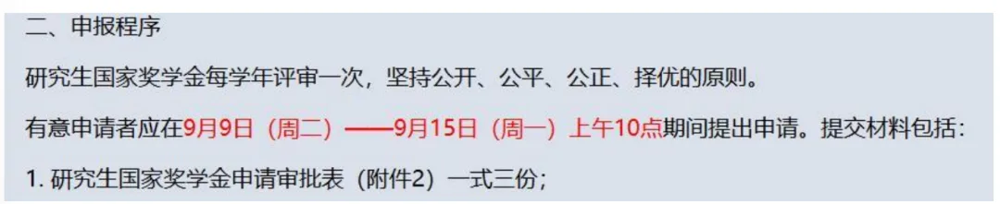
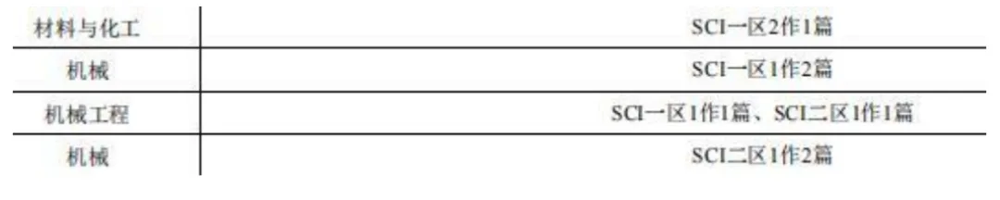

请相关部门及时关注并跟进问题。另外建议投稿人如需投稿邮箱以word文档格式为佳，非常感谢

## 1 奖助问题

“一年又一年，大家盼着社科大奖学金规则能越来越合理，评比越来越好，没想到变得越来越乱了，直到现在不少人对评奖乱象还在持续吐槽。相比学业奖学金，国家奖学金关注度更高一些。博一不能评，但在学校生活多年，比较了解，从大家吐槽来看，现规则有所变化，但选出来的人，还是有部分依旧不是应该真正获得国奖的，归纳起来，问题至少有以下几点：

1.规则每年都在变。一年政策一个样，今年又是新花样。规则适时调整是必要的，但变化这么快这么大的少见，去年、今年、甚至前年规则一对比，出现自己打脸自相矛盾的地方很明显。有人说，真可谓是把规则当儿戏，这种指挥棒让很多人都摸不着方向。同样的东西，去年不加分，今年又加分，有人认为这规则是每年在为少数人大开方便之门，看到少数人有了东西，把规则一改，他们就可以加分了。

2.一些规则不合理，有许多明显瑕疵。一些规则明显违背科研规律，不以科研为导向，违背正常认知，该明细的不明细。有些东西只稍明确一下，或加个说明，加个限定项，就可很好解决不必要的问题。然多年来，并没多大改进。采用模棱两可大而化之的规则，让很多人每年都有漏洞钻进而获得国家奖学金。个别学院将学生发文或参加项目限定老师范围，比如本校才算，跨校的不算，难道那不是学生的成果？这种画地为牢、固步自封的做法，好似只有参加本校活动才计分，其他学校的不算，那还要全国性学术会议甚至走出国门干嘛？这些荒唐的规则令人无语。

再比如，一个学生历来的吐槽点但丝毫没改进的是科研奖励和期刊认定及学院细则中违背科研常识的划定。如 AMI 核心刊物机制是社科院制定的，在知网上可看得见 AMI 顶级和权威标志，标注的很清楚，十分方便大家查询。然在社科大期刊认定分级中，前四条里，一方面认可 AMI 顶级、AMI 权威期刊、AMI 拓展版，另一方面，社科院大学却坚决不认自己主管单位划定的 AMI 核心期刊。从第一条AMI 顶级、第二条 AMI 权威期刊跳到第三条南大核心 C 刊，再到第四条的 AMI 扩展版等，四条规定中，在第三条唯独偏偏不认 AMI 核心期刊，其人为偏见因素过于明显，同学质疑这是为了少部分人牟利煞费苦心双标选择性执行。

南大核心没有顶级和权威期刊划定一说，选择性将 AMI 评价机制和其他期刊评价机制杂糅在一块，直接从 AMI 顶级、AMI 权威跳到 C 刊、AMI 拓展版等，选择性删除 AMI 核心期刊的痕迹太明显，引起评价冲突，不伦不类，划定明显不科学。

如有一些 C 刊都只能是 AMI 核心的拓展版，进不了 AMI 核心期刊。有的刊物是 C 刊，但未被评为北大核心期刊。有的是北大核心期刊或者 AMI 核心期刊，但不是 C 刊，但可能是 C 刊拓展版。第四条扩展版将 C 刊拓展版和 AMI 拓展版及入库收录期刊置于一起，与故意选择性漏掉不认可的北大核心期刊和 AMI 核心期刊，加同样的分，也就是 AMI 核心=北大核心期刊=C 刊拓展版=AMI 拓展版=AMI 入库收录期刊，这几个加分一样，这明显的不合理，中间需要再细分加分项才行。AMI 入库收录期刊明显最多算是普刊，就算 AMI 核心期刊不如 C 刊，起码也应将 AMI 核心、北大核心期刊、C 刊拓展版放到一个层次另行计分。

而且，很容易获得水分很大的研创项目加分有时等同于一篇 C 刊，或者有时加分等同于北大核心、C扩等，或者高于北大核心、C 扩，岂不荒谬？

此外，学校科研奖励办法中，期刊被几个机构办的资料转载后直接认定为权威期刊，看了下，几个机构每期转载的文章相当多，不在少数，有些人在普刊或者扩展版上发篇文章被转载了，被认定为权威期刊，是不是跨越度太大了？毕竟其原本刊物连 C 刊都不是，转载的文章在有些地方认定为普通C 刊倒是合理点，直接破几级成为权威期刊加分，不太科学。

3.政出多门，五花八门。评国家奖学金如此严肃之事，应由学校统一制定详细规则，以便各学院按照统一规则进行。然前两年学校规则模糊，备注里详见某一条，把那一条内容明确备注出来都懒得备注。此外，参照几个文件，而这几个文件，放在某个隐蔽之处，大家很难找见，通知末尾这几个文件的附件都懒得放，好像怕方便大家查询看见似的。

而现在学校的通知内容越来越简单，越变越模糊，上面啥都实质性的东西都没有，让各个学院自行操作。学校初衷是好的，方便各学院自行操作，然这恰好给各学院更大操作空间，很多同学认为，这不排除有更多的暗箱操作空间，出现更多漏洞。

很多同学甚至认为，这是学校甩锅，多年来没把事情解决好，现在干脆把所有事情都推给学院折腾。越是关乎学生切身利益的，越重要的事情，本应由学校亲自抓的，反而推卸给了学院。学校是一时轻松了，很多矛头都指向了各个学院，这样做问题减少了吗？并没有，实际上更多的问题也随之而来，不积极作为，一流大学的目标何时实现？

对比多个学院的评奖细则，发现不同学院各唱各的调，制定不同的细则。大家一对比就会发现，马院、应用经济学院、政管学院、法学院以及其他学院等，各自具体细则和评选操作都不太一样。同样事项，不同学院的规定还不一样，甚至有的出入极大，比如加分不一样，有的加的多，有的加得少，有的干脆不加。论文和项目贡献划分，独创最高，两个人 6:4，多个人加分情况，有的学院却模糊处理，让大家自行商定，但不明确总体原则和限定范围，出现了商定后排名靠后的成员分数还多于前面排名甚至比排名第一的人分数还高的情况。可是，学院老师竟认为是对的，这种明显违背科研常识的事情，不知道是真不懂，还是假装不懂。很明显，无论是项目，还是论文，还是研创项目，都应从第二位及以后不能超过负责人或前面人的分，且从第二个人及以后比重不能超过整体总分的 50%。

4.国奖名额分配问题。不是按照全学院有资格参与评比年级的人来进行筛选和优中选用，而是按照班级等额分配，一个班级一个甚至有多个名额，国家奖学金沦为了班级奖学金。

5.选择性“双标”执行评选门槛。有的学院并没有门槛，所有人都可以报国奖。有的学院评国奖自行设置了门槛，如有 C 刊才能评。设置了 C 刊才能评国奖的一些学院中，大家本以为要求高，选出来的人应实至名归，实际上同学发现，也并非如此，依旧没朝着预期方向发展，仍旧有巨大漏洞，评选出来的一些不是真正应该获得国奖的人。

一些同学独作发 C 刊，其发的刊物质量比评上国奖的人还高一些，但却最后评不上国奖，反而是利用导师名头发出文章的一作或者二作的学生评上了国奖。

大家都不是独作的情况下，发了权威期刊的评不上国奖，发个普通 C 刊的二作反而评上了国奖。既然要看 C 刊才能评国奖，门槛提高了，那么各项规定都应同步提升才对。因为 C 刊以下的C 扩、北大核心、包括社科院大学自己的主管单位大力推行的 AMI 核心都不认（有一部分 C 刊仅是AMI 核心期刊的拓展版，连 AMI 普通核心期刊都算不上）。现在扩招加剧，博士生发个普刊都不容易，独作发个C 扩、北大核心、AMI 核心等刊物更是难，其难度远比很多同学吐槽的很多人轻松混到手的研创项目等高得多。然而，评国奖时，发 C 刊以下的所有文章不认，一分不加，按此操作，其他的杂项比如研创等项目更加不能算分了。

实际上，研创项目里很多同学普刊都发不出来，但是手握几个研创项目等一些东西，却可以加分，而且加分还不少，一下加几十分，比好不容易才独作发 C 刊的同学累计加分都多。

评博士生国奖奖学金，可参照高校普遍做法，优中选优，提高所有加分项的标准，突出科研质量，一律只看 C 刊及以上或者更有影响力的科研成果，其他的基础性的项目只是作为一个基本条件不加分或者最多加几分即可。毕竟 C 刊以下的发文都不认，那其他如研创项目更不能加分。

也就是说，如果真正以科研为导向的话，按照论文和成果质量高低进行全院大排名，课程成绩、学生科研项目及社会实践之类等一律不加分，或者划定上限合起来最多加几分即可，在符合基本条件的基础上，按照硬指标，直接看论文质量和刊物质量，是独作，还是一作或者二作，至于三作及以后基本不加分。这样既有利于选出学院最优秀的科研成果参评国奖，也减少了各种繁琐的不必要的加分项干扰，还能轻松破除低年级学生成绩占了加分权重的问题，一举多得，一目了然，操作简单快捷，也很容易辨别出哪些同学才是真正该获得国奖的。

但个别学院实际操作中，却并非如此，一方面，有 C 刊的才有资格评国奖，将大部分人排除在外，不能参评国奖。另一方面，实行选择性“双标”办法，有 C 刊的同学中，却不再高标准要求，很多同学觉得很水的研创项目或者社会实践及其他乱七八糟的都可加分，里面出现了一些挂着导师的一作或者二作只有一篇 C 刊的人，加上其浑水摸鱼加入或自己申请的研创项目等几项加分，比另外独作发出C 刊且刊物质量更好的同学累计加分高（有的独作发 C 刊，可能还发了 C 扩等文章，但由于 C 刊门槛设置，一分不加）。不少人利用这些漏洞，就一篇导师带着发的普通 C 刊，加上几个较水的学生项目，没有什么其他突出的科研成果，最终堂而皇之获得国奖。而那些专心科研独立作者发在更高期刊质量的本该评上国奖的同学，却因累计分数落后而无法获国奖。少数人不应该获得国家奖学金的，钻空子拿了国奖，而那些真正该拿国奖的人却拿不到。

6.评奖细则每年随意变化，暂且不论，但每年变化了后，默默在放假期间或快要放假时，挂在某个隐蔽之处，既不在移动校园网及时挂出通知，也单独不推送给同学，很多班上导员也不及时发到班级群，很多人不知道政策又变了，直到开学后，评奖时才发现新情况，为什么那么怕同学们提前知道评奖细则呢？

7.有规不严格执行。规则本来模糊不合理，既然如此，按照现行规则执行，一碗水端平，也尚可。实际上，规则好不容易备注个清楚的地方，个别学院却人为选择视而不见。比如很明确的写着，评国奖是评上一年度的科研成果，很多学院细则还注明了是 2024 年 9 月 1 日到 2025 年 8 月 31 日期间的成果。在系统里面，每次输入事项都需要学生手动选择上一年度的时间范围，这也是在一次次提醒同学不要把超出时间范围外的东西拿来评国奖。

可是，实际有些人明知不属于上一年度时间段的科研成果，却偏要拿出来评国奖，还给自己找了很多貌似合理的理由，这对其他人而言很不公平。

照说来，这是明显无视规则，违反规则，按规定，连参评本次国奖的资格都没有，但实际却堂而皇之获得了国家奖学金。

很多学校一开学就进行上年度的奖学金评比，一下就解决了这一问题，避免了一些人钻评奖时间差的空子。

如

再如

但咱学校拖到 10 月份后才进行，甚至在 11 月份才出结果，战线拉的过长，这给很多人创造了投机的机会。

本来以期刊纸质版出版封面月份的时间日期为准是科学的，不会出现争议。

但有些学院规定，纸质版没出来，网络首发版的也可加分，初衷是为了同学着想，本意是在2024 年9月 1 日到 2025 年 8 月 31 日期间见刊的论文，没有拿到纸质版的，可以用网络刊出的电子版计分。前提是在 2024 年 9 月 1 日到 2025 年 8 月 31 日期间的才行，如果是单月刊，最多截止 2025 年第8 期；如果是双月刊，最多截止到 2025 年第 4 期。比如有同学是 2025 年第 8 期单月刊，论文纸质版在邮寄的路上，没拿到纸质版刊物，但网络版先出来了，可以计分，这是合乎规则的。可是，有的人拿出来的可能是单月刊 2025 年第 9 期或第 10 期，双月刊 2025 年第5 期或第6 期，即使其网络首发版在 2024 年 9 月 1 日到 2025 年 8 月 31 日期间发出，实际上也明显不属于2024 年9 月1 日到 2025 年 8 月 31 日期间的论文成果，按规则不应参评本次国奖。

这种很简单的常识，却在执行中睁一只眼闭一只眼，让一些人投机钻漏洞混到了国奖。若是这样的话，要规则何用？

8.很多同学千方百计成为评奖小组成员，自己评议自己的奖学金。学校的一些辅导员不搞科研，即使个别搞科研的对规则也未仔细研究。有导员是压根不懂规则，或者假装不懂规则，变相帮同学捞取好处，强行扭曲成违背正常认知的做法，让一些评议小组成员最后成了评奖的最大获利者，他们既是每次评奖的固定成员，又是每一次制定和修改评奖规则的参与者和建议者，最终评奖规则沦为这些少数人牟利的工具。

9.公示太糊弄，不公开透明。评奖结果出了后，贴个名字就完事。有些老师认为给学生看评奖加分的明细，没有必要，认为大家看不懂。大家都到博士生了，连看个简单的评奖加分都看不懂？这也是太瞧不起大家的智商水平了吧。实际上，学校人基数少，评上博士研究生国家奖学金的人总共就几十个人，人数远比很多学校少，他们提交评奖资料电子版中注明了科研成果，只需要做个汇总表就完全可以公示出来，也不麻烦。这种好事情本该多宣传，让大家向优秀的人学习。像很多高校一样，把具体成果公示出来，让大家看一看，学习一下。

然多年来，公示期间只列出个名字，什么东西都没有，大家根本不知道这些国奖获得者到底有何成果，为什么不敢公示出来呢？是怕暗箱操作的地方被同学们发现了吗？

还有的同学说，虽然学院遮掩不公开，但有个可行的办法，这儿主要是人文社科类的，不是理工科类的，到知网等网站上一查各个学院的国家奖学金获得者，便知学生的科研成果大致情况，便知这个人科研大致啥水平。有的虽然在国奖名单上，但在知网中一查询，可能一篇像样的成果都没有。

10.科研系统认定似乎是个神操作。学校的科研系统既要认定学生发表的论文，还想包揽学生参与的科研项目，这明显违背了实际情况。科研系统有时检索不到学生发出来的文章，需要手动录入，而一些学生手动录入，随意瞎勾选，审核的人不仔细看，很容易出问题。评奖时，评议小组也不在网上查询核实下，或者让学生提供文章发表的证物，纸质版或者网站截图。而仅仅看科研系统的截图，似乎很不靠谱。

11.违背科研常识和规律。不重视学生的科研成果，很多规定不以科研为导向，与研究型大学目标相背离。毕竟是博士生的国奖，是否应该专门制定区别于本科生的评选机制？

学校设立的研创项目，本意是好的，鼓励学生研究，但实际很多人认为研创项目水分很大，它既不是像挑战杯之类有巨大影响力的全国学生项目，也和老师申报的正规项目差距甚大，拿出去别人可能都不会多看一眼。

但实际上，一个研创项目却在不同学院中加分 10—20 分之间不等，堪比独作发表一篇C 刊，且远比参加国家社科基金重大项目加分多。有的人混到几个学校的项目，累计加几十分，比发表2 篇C 刊的人加分都多。

大家都知道，现在发文章是何等不易，不要说博士研究生，很多讲师独立作者发个C 刊扩展版都费劲，更何况 C 刊？

同学说，研创每年申请很容易，一个班很多人都申请成功，甚至一些项目负责人表示，参加这个只是为了钱，而且评奖学金时成果不够，研创可凑，可以加很多分，何乐不为？

12.一些获得国家奖学金的博士生名不副实。社科大，很多老师不带学生发文章，大部分人发文章很困难，少数挂着导师名字发文章的同学却十分容易，难度大大低于独作发文的，再拿上乱七八糟的研创项目一凑分，累计加分很靠前，轻松获得国家奖学金。

而且，听说毕业班级的同学横跨两个年度，多的可以用 3-4 个研创项目，有的还加入本科生新苗计划项目，去年一些人连申报立项书都不需要，都可拿个研创项目，而今年这些人又可直接用立项书就可加分，如此，加分的学生项目繁多。

13.评奖规则给学生造成不良导向。发文章明显最难，对文章的加分要求很高，实际上却这不算分，那不算分，或加分极少，但对学生研创项目、社会实践活动等要求却如此低，加分很多，给了很多人钻漏洞的机会。这种“双标”计分办法，现在很多学生看到了这种情况，真正有科研成果的人比不上会会钻漏洞的人，没有什么科研成果，利用杂七杂八的研创和实践活动来凑分的人，反而拿上了国奖，真正该评上国奖的人，却始终拿不到国奖。

既然辛苦研究发文章明显要比搞研创项目难得多，而研创项目加分却比发文章加的分多很多，同学更加不会努力争取发高质量的期刊出成果了，都热衷申报研创项目。最终国奖获得者不全都是真正的优秀同学。评国奖没有单独更加科学的统一细则，和学业奖学金混在一起，既然混在一起，有些人综合测评连自己班上都排不到前两名，在整个学院更好不到哪儿去，却堂而皇之获得国家奖学金，同学认同度不高，很多人怀疑是暗箱操作。这些人虽然获得博士生国家奖学金了，但大家对其认同度可能并不高，反而认为其不过就是一个笑话而已。

有同学说，现在国家名额已经翻倍了，相比过去，博士生国家奖学金含金量急剧下降，沦为班级奖学金，似乎也合理。有些每一年都是老生常谈的问题，但每年丝毫没有太大改进。大家每年都在提各种建议，对规则都有不少意见，然现实情况却是，今年评选出来的一些人和去年相比，可能无论是科研成果数量，还是科研成果质量，反而还不如去年评选出来的人，非但没有朝着好的方向发展，反而越变越糟糕了。很多学校单独制定国家奖学金评定细则，进行明确和优化，且文科生主要成果是文字类的高质量核心期刊文章，或者其他重要影响力的科研成果，而不是无关紧要的含金量不高的学生项目或社会实践活动凑数累计加分，一些学校国家奖学金评选公示具体明细成果。如

以上是关于 2025 年社科大奖学金评选中大家吐槽点的部分归纳，归纳不全不足之处请大家自行补充”

“ 投稿：这个月的硕博补助金什么时候发，maybe学校考虑要和奖学金一起发？但上个月是9月30号发的，已经没钱了，可怜可怜孩子能不能把补助发了先”

> “ 【投稿】真心实意地夸奖望京校区某国际xx学院奖学金、奖励评选是非常之灵活的。奖项人选是可以按照学生要求分配的，规则是可以改变的，活动分数是可以加满的，成绩理想的同学也是能够靠着多样的活动拿到奖学金的……灵活多变的评奖规则真是让大家拍手称快。”

## 2 图书馆自习讨论

“ 针对11.3那条认为图书馆使用机械键盘合理的同学，你不用就算了，你在图书馆用一次我喊一次老师过来～”

## “ 关于自习室键盘鼠标声音的回复：

看到有同学关于自习室声音的讨论，将鼠标键盘声与自然雨声类比，并认为大家对环境过于挑剔，这个观点纯粹是无稽之谈！属于诡辩！

第一，雨声是连续、均匀的背景音，属于“白噪音”，甚至能掩盖其他干扰、帮助部分人集中精力。而鼠标和键盘声是突发的、不规律的、有极强穿透力的“脉冲噪音”。神经科学研究表明，这种无法预测的、细碎的声音最易打断思维流，破坏专注力。这就像我们能安然入睡于雨夜，却很难容忍有人在耳边不定时地按下圆珠笔按钮！

第二，风雨是天意，非人力所能控制。而我们在自习室使用的每一件设备，都是一个主动的、可控的选择。用不可控的自然现象，来为一个完全可以控制的人为行为辩护，逻辑上难以成立。

第三，必须澄清一个关键事实：在综教楼自习室，保持键鼠静音并非一个可供自由选择的建议，而是一条明确的规则。每一张桌子上张贴的“键鼠静音”标语，就是这份公共契约最清晰的体现。在综教楼图书馆可容纳上百人的自习室里，任何一点不和谐的声响都会被无限放大。若有一两位同学无视规则，使用发出“咔咔”声的鼠标和“噼啪”响的键盘，所产生的噪音便不再是个人行为，而是对整个自习室学习环境的公开侵扰。但凡稍微有点道德素质，都会自觉地遵守规则吧！

最后，想告诉大家，同学们如果在自习室遇到了不遵守规则的同学，自己要是没有勇气去说他，可以在企业微信的接诉即办处，点我要求助，@图书馆，告知房间和制造噪音同学的座位号，会有值班同学来劝阻的。安静的学习环境是每一位学子享有的正当权利！不必为他人的失序妥协，大胆借助正规渠道维权，一起守住属于我们的专注空间！

”

## 3 办学设施与条件

## “【skd是如何凭“实力”证明自己是双非的】

1.唯一引以为傲的所谓“师资”好，实际上大部分导师都在放养，既不管学生就业，也不教学生东西，也不给学术资源。

2.明知地理位置偏僻，却连进城的班车都不提供，交通差成什么样了？还好意思说自己在北京？请问北京学生和房山学生的精神面貌差多少？你们没对比一下吗？

3.天天叫板92，但招生分数线越来越没有底线，听说硕博还要一堆调剂的，在唯一有决定权的招生工作上，一次次甘愿自降身价，把自己弄得像个要饭的乞丐

4.别说去其他地方有没有班车了，就连日常去所里都没有班车，造成所和大学长期分割，学生老师沟通成本巨高。而且天天就是用官僚等级那一套压着大学，没有任何一方面资源真正到位过。

5.独卫又怎样？白天连热水澡都洗不了呵呵。

6.别说背靠sky了，根本没有一样资源到位的。举个例子：这个学校甚至已经穷酸到食堂、教室和办公都挤在一个楼。你见过哪个985/双一流学校的课在食堂就能解决的？

学生在自己学校打羽个毛球都要花钱哈。别说没有别的地方班车了，就连自己学生去所里都没有任何班车！你见过哪个顶尖学校的学生连见一下老师都这么难？

7.无论如何反映问题，总是拿新建校需要时间当借口。首先，你既然建校晚，就自然应该对标建立时其他高校已经发展成熟的标准，而不是追着人家的下线做事。其次，要说建校晚，但这都几年了？大部分问题如果想解决早就能解决了，像班车这种东西，也不要说什么人少，人少本来就是你自己愿意的啊！人多了你有说什么宿舍不够用了呵呵。况且，人少怎么了？在这里的人不是人啊？人少就没需求啊？？？

有些东西，说了以前一万遍，也叫不醒装睡的人。

”

## 4 吸烟问题

“投稿:良乡校区二手烟问题到底什么时候能得到解决，把吸烟点设置在教学楼出入口是为了让大家都均等的得肺癌吗，要设就设地下室阴暗角落好吗，自产自销别祸害别人”

## 5 对校方建议

> “希望学校能够想办法整治一下外面黑心中介以学校名义虚假招生的情况。我是22级博士，已经进入毕业阶段了，今天接到一个电话，自报家门说我是中国社会科学院（他都没说是社科大），问我是否有读博的打算？我说你社科院哪个部门？他说是中国社会科学院招生办公室......我说我都快毕业了，对面直接就挂了。以前抖音和小红书上也偶尔会刷到此类广告：中国社会科学院博士招生（点进去全是黑中介），最可气的是还会加个帽子：水博好毕业快来读。简直太有损学校名誉了！顺便曝光今天接到的电话号：135\*\*\*\*2249(平台规则打码，非投稿打码)”

## 6 体测呼吁

> “良乡校区关于体测：你好！非常抱歉占用投稿，但是体测这个安排实在是有不得不说的理由。今年的体测是11月8日，当天的天气已经非常冷了，最高也超不过十度，在全国各大高校里，有很多北方学校都是春季体测的，相对来说学生和老师都可以更舒适地测试，也可以取得更好的成绩。此外，不知道咱们学校的体测能否可以拉长一点时间？像北大人大的体测多数是周中测或者两周测外加补测的，而咱们学校只安排一周中的一天测再加半天补测，如果体测当天实在是有来不了的理由那么补测的压力会非常非常大，并且女同志们的生理期也很可能刚好赶在体测和补测这两天。8号和14号之间的时间很可能都在生理期。这一次是我家出了事，突发情况我一定得回家，但这样的话14号又有来生理期的风险；这样对类似的同学们实在是有很大压力，有一些不得已的方式也是在这个过程中产生的。所以在这里很认真地想对学校说，可否将体测调成更宽松的时间？两周加补测或者周中测的话至少给老师和同学们留出来了容错的空间😢非常感谢！”

## 7 医务室

“校医院开不了海露玻璃酸钠了，说是换了采购平台，以后都没了，干眼症真的离不开这个眼药水啊，还要长时间对着电脑工作，真的很需要”

## 8 良乡校区宿舍

> “投稿：建议良乡校区在高层楼道里新安装的热水器和吹风机一样设置使用时间早上 8 点到晚上11 点，睡眠时间自动断电。热水器夜晚饮用水自动加热的声音非常吵，且也有 12 点左右上下楼梯接热水的超大脚步声，非常影响睡眠！”

“投稿：一号楼二层13-14点和晚上23点后时不时有人在过道里高声说话。休息时间请勿影响他人。另外，宿舍群被解散后反映宿舍问题实在不便。”
