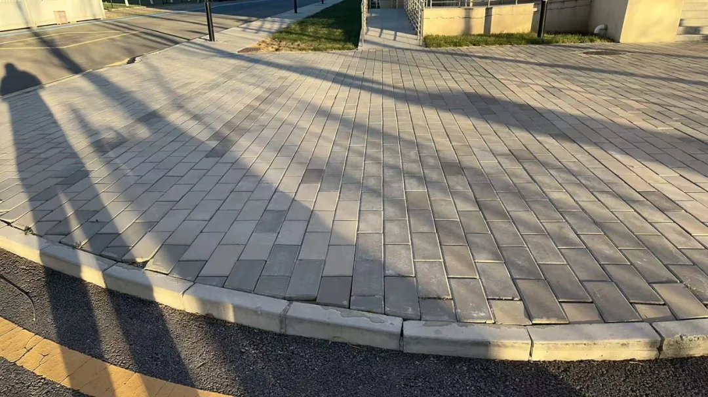
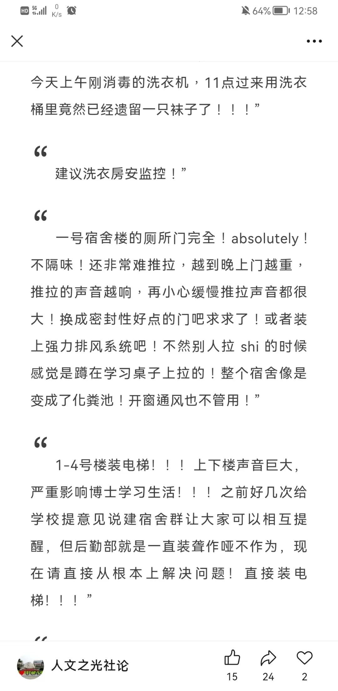
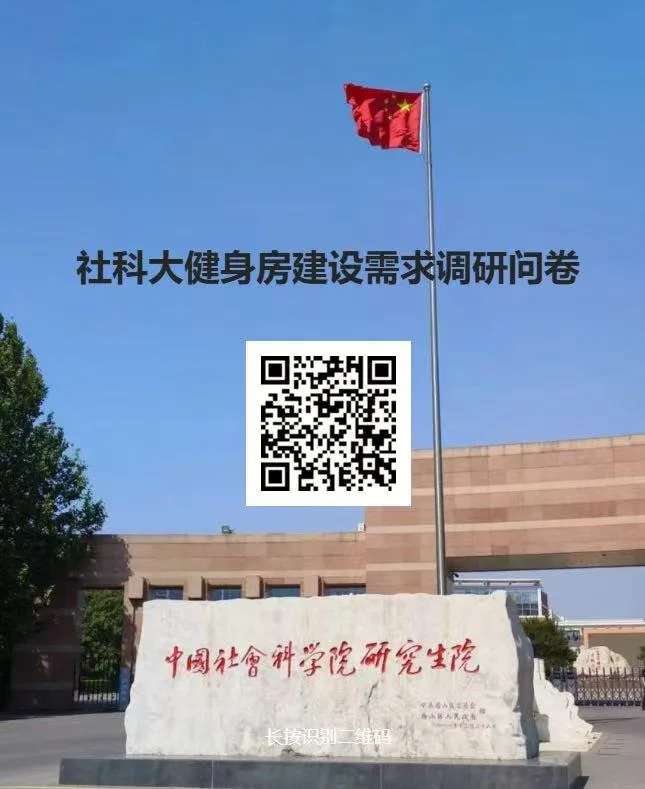

请相关部门及时关注并跟进问题。

## 1 校园基建

“【请锅炉房提高暖气供暖的总体温度】最近又遇到大降温，本人位于阴面走廊末端的寝室，室内温度通过多个温度计采样，只有17度的样子；早上6点左右，甚至只有15到16度。室内寒冷发抖，凌晨甚至要被冻醒。暖气片已经维护放气放水过，不是本人寝室暖气片的问题，寝室暖气片温度和图书馆教学楼以及其他地方的暖气片都差不多——温度都不大高。另外，本人也询问了楼上楼下以及同学寝室的情况，处在相似位置（阴面）的同学都存在供暖不良的情况，晚上甚至得盖两床被子睡觉。请锅炉房在当前寒潮时期，提高供暖总体温度。。

”

## “2号楼12.4晚上水又冰又黄，怎么回事？哪个部门能给一个合理的解释吗“

“看到有同学建议安装晾衣棚，但这样需要晾晒的衣服/被子又如何通风呢？希望这一点还是慎重考虑！

“能不能给七号楼西边修一个水泥坡道，虽然西边有无障碍通道，但是呢，底下并没有水泥坡道，所以我们还需要把板车抬起来，才能上到无障碍通道那里非常的不方便

”

> “投稿：反对上期第一条中1-4号楼加装电梯，电梯运行噪音比步梯更大，如果有因为步梯噪音大影响学习生活的情况，更不适合装电梯，考虑神经衰弱及时就医。同时反映上期第一条中宿舍楼饮水机热水有异味儿的情况，坐标二号楼高楼层，缓步台加装饮水机后确实打水方便了，谢谢后勤！但是热水闻着、喝着都有异味儿，类似于胶皮管子被开水烫了的味道，不知道形容的准确否，暖水瓶里存三天后水都冷了味儿还在。喝起来不仅有味儿，口感也偏软，加浓咖啡和浓茶都无法改善，希望有关部门跟进核实。！”

> “投稿：一个拆掉围墙给学生建外卖柜的学校，能坏到哪里去？想夸一下学校，真的有认真看学生的诉求，这几天在北门装上了外卖柜。之前北门外卖挂栅栏时代，保安们也特别好，有时候外卖挂得很高，向他们求助，他们都会很热情的帮忙。也感谢平台让我们的建议能有效被看见，希望学校能越来越好！”

“投稿：回应一下这条厕所的问题：我之前在4号楼住的时候也遇到过厕所不隔味儿的问题，后来发现其实并不是门不隔味儿，而是头顶空调管那里在墙上打的洞和厕所相连，臭味通过洞的缝隙钻出来的。我拿废纸把洞塞上之后就没出现过类似问题。供参考。

”

## 2 无止境的研创问题

> “学校的研创计划好像陷入了一个非常尴尬的境地：一方面，把研创当作科教融合的一大亮点；另一方面，花了很多钱没有多少产出，没有多少公开的高水平论文发表，不说 AMI 顶级和权威，哪怕CSSCI 也没有产出几篇。另外，结项又不能卡的太严，如果都无法结项，科研处又要挨骂，甚至又要和立项预立项一样，陷入一场舆论漩涡。毕竟需要刷数据，做宣传，睁一只眼闭一只眼，稀里糊涂就让结项了。也没有听说有结项不了的。建议可以分级结项，比如结项之前预算只有 3000 元，有高水平论文发表的，后续总经费可以适当上涨到 15000 或者 20000 甚至 30000；没有公开发表，后续无经费，总经费就 3000 元；没有任何产出的，费用追回。该卡就卡，以产出为导向。宣传的时候像国家社科基金一样，宣传立项。”

> “学校的研创计划结项，能不能提高一下结项标准？看近期很多学院的结项评审，很多人随便提交一个报告就结项了，这学校这1万块钱最后一篇文章都没出来？也不知道每年立项这么多，最后发了几篇符合结项要求的论文？至少知网上没搜到几篇挂学校的课题的论文。这一万块钱买了一个不公开的研究报告值得吗？立项的时候都抢着立项，在某种程度上也可能是结项太水了。还有一些一篇公开发表的论文都没有，还能推荐优秀？也不能这么水吧。也不知道评审结项，这个评审啥标准？。”

## 3 问卷

## “投稿：请大家多多支持校园建设，欢迎转发，感谢！！！

”
