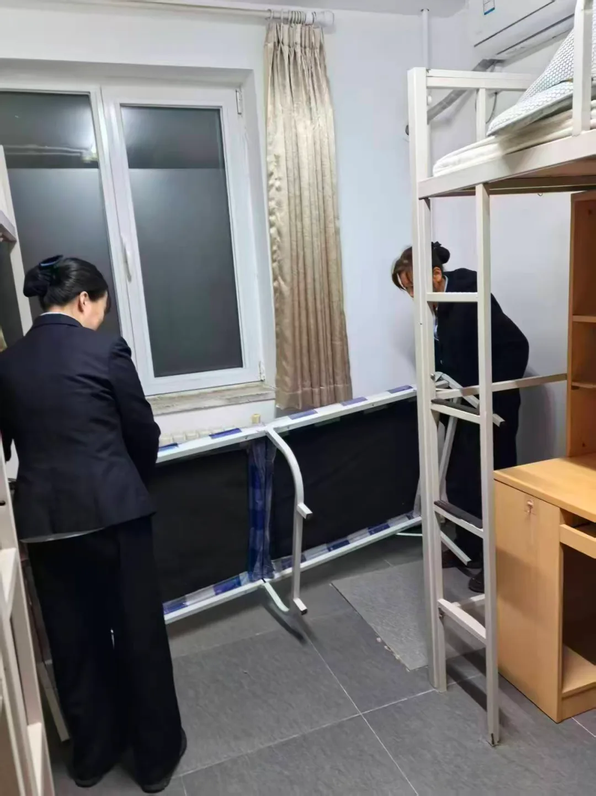
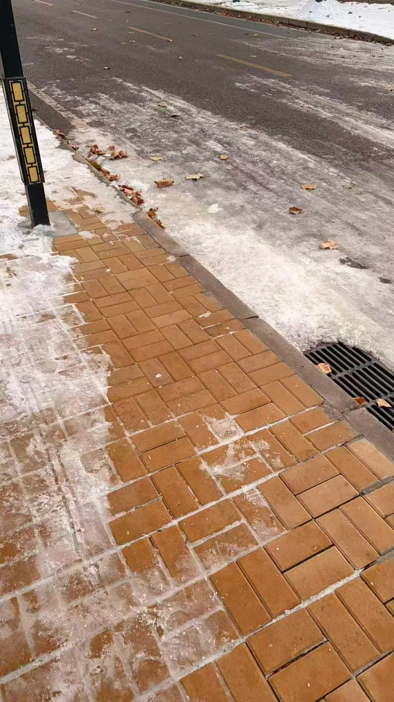
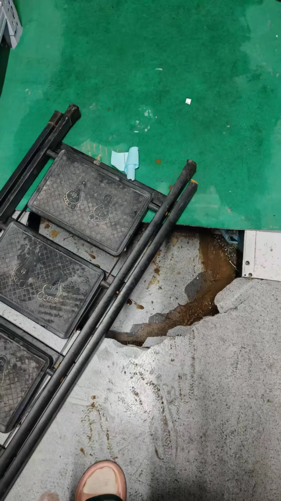

请相关部门及时关注并跟进问题。

## 1 望京校区

“我要感谢望京校区3号宿舍楼的全体宿管阿姨，还有法硕2班辅导员柳羽倩老师，以及所有提供帮助的领导。因为我阑尾炎发作，做了手术，上下床不方便，所以特意给我在宿舍一楼准备一个单人床，方便我休息，最最重要的是，还准备好了铺盖，可以直接入住。学校照顾的无微不至，真的很让人感动\[流泪\]\[流泪\]。

”

> “请问望京校区的领导，教学楼的教室是什么不可沾染之地吗？连一点东西都不能放？而且是在没有人上课的空教室。每天都要来说一遍第二天早上就要收东西，还要强调收东西的话就要乱放！我们明白物业打扫卫生的阿姨也不容易，也是受领导的命令，那请问领导能不能多划出来几个能自由支配使用的自习室呢？？？天天把这几个破教室看这么严，有考虑过宿舍在高楼层不方便长期搬运书籍而且需要备考的学生吗？？？。”

## 2 雪（此稿于12.14日投稿）

## “投稿《人口保龄化》

我校的铲雪工作充分体现了工作人员没有铲雪经验也没有经历过相关培训。扫雪，要不然不扫，要不然就要扫净，不扫是让大家踩在松雪上避免摔倒，扫净是让人踩在地面上，如果只是扫一半，白天天气回暖，雪会化，晚上又上冻，就会结冰。我们学校的扫雪工作呈现了斜坡、台阶上的雪不扫，平地上的雪扫一半的特点，这就导致了平地反光，一层薄冰结在台阶、斜坡、平地上，本来在这些地方就不容易发力保持稳定，有了一层冰之后更是寸步难行了。

”

## 3 快递驿站疑问

“投稿，12月14日晚，本人发现良乡校区快递站西侧门口，LG编号快递架附近的地板发生严重坍塌，形成了一个大坑。本人不幸踩入其中，腿部摔伤出现淤青。

令人愤慨的是，快递站管理人员对此明显安全隐患竟视而不见，仅仅放置一个梯子勉强遮挡作为所谓“处理”，这种敷衍塞责的行为，完全是对学生安全的漠视。如果继续放任不管，其他同学谁能保证不会再次遭遇意外？请有关工作人员迅速处理。

”

## 4 就业办还是考公办？

“秋招第一次被问社科大是不是就是中青政，真要命啊，学校能不能出来澄清一下，切割一下。学校本来就没名气，出了北京当二本看。本来这几个月还算是能接受了，在北京认可我校的都能当中9看（面试总被人大包围，或者央财贸大），不认可自然就去二本了，今天面试被问了差点破防了。本硕都是这地儿，一年不如一年。

就业办干脆改名叫“考公办”得了，一年上岸几个人啊？发那么多的企业招聘推送，结果经验分享都是考公。

”

## 5 呼吁

“近期某平台上“挂人”事件越来越猖獗，甚至要把人真名和年级挂出来人生攻击了，平台监管实属不力，希望多加改进”

## 6 教务问题

> “某位讲授经典名著专业课的所谓“教授”讲课实在是有一些过分了。我们先抛开个人的专业素养不谈（因为确实很差），在课上公然给学生传授“出轨是本性，不出轨是讲良心”这种观点是不是有点过分?作为一个教育者应该给学生传达正确的观点，而不是在给出轨这种行为辩护。更不要提在课上公开挑动对立，讲“男性一有钱了就不想平等”。请不要抹黑，中国本来是最重视妇女权益的国家，结果女性形象都被这么一小撮人败坏了，作为个人在社交媒体或私下场合传播这种观点我们可以接受也可以开展讨论，但作为老师在课上宣传这种观点是否有些出格?而且根据我们的了解，相关情况并不是第一次出现，历届学生也都有反映，我想请问一下为什么一个专业素养差，同时在课上宣传不正当观点的老师还能作为专业核心课程的教师?请同学们和公正正直的老师领导们关注一下相关问题，我们有很多很优秀的老师，我们的诉求就是请这位“教授”退出专业核心课的授课组，至少退出经典著作导读课程的授课组，请那些真正有学问有素养观点正确的老师给我们上课。”

## 7 何为巨婴？

> “上期的社论使我想起了一件非常重要的事。近期好几个同学因为热水卡机在锅炉房且平时又看不到热水余额，洗着洗着澡水没了，只能顶着一头湿的头发跑到锅炉房去充卡回去才能继续洗澡而导致发烧。有一个同学在接诉即办反映了，回复说还得等资金到位才能改。可是往年我们问的时候也是说要等，等了这么久，还要等。这个发出来，可能我们又会被骂巨婴了，甚至有可能会牵连那个即诉即办反映问题的学弟被约谈，但是不出声的话，难道要让我们的同学一直忍受也一直因此发烧下去吗？”

参见[【读者投稿】公平、心的背面](https://mp.weixin.qq.com/s?__biz=Mzg2MjcwNzQ1Mw==&mid=2247491300&idx=1&sn=0b5fa1b57c35a1a02f394c7cd0d45a05&scene=21#wechat_redirect)第一条
