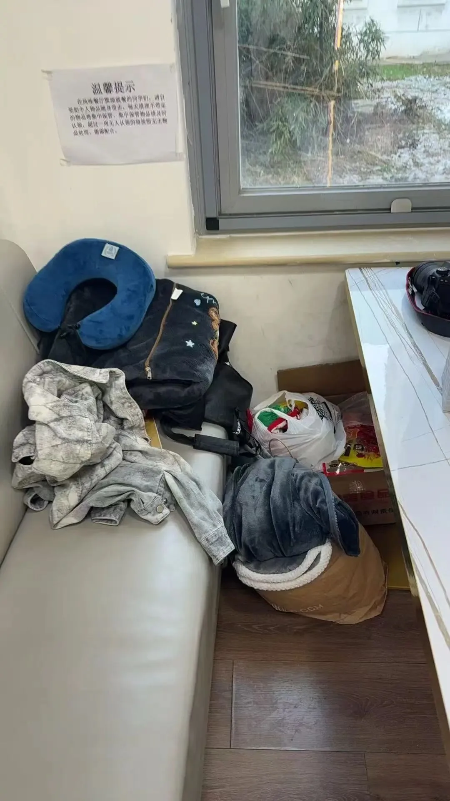
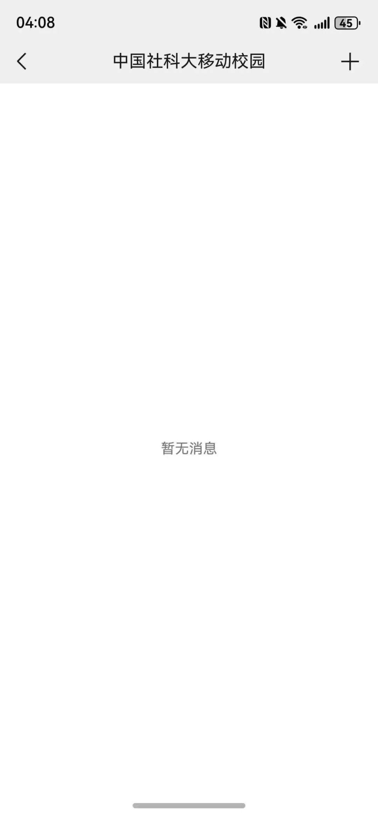
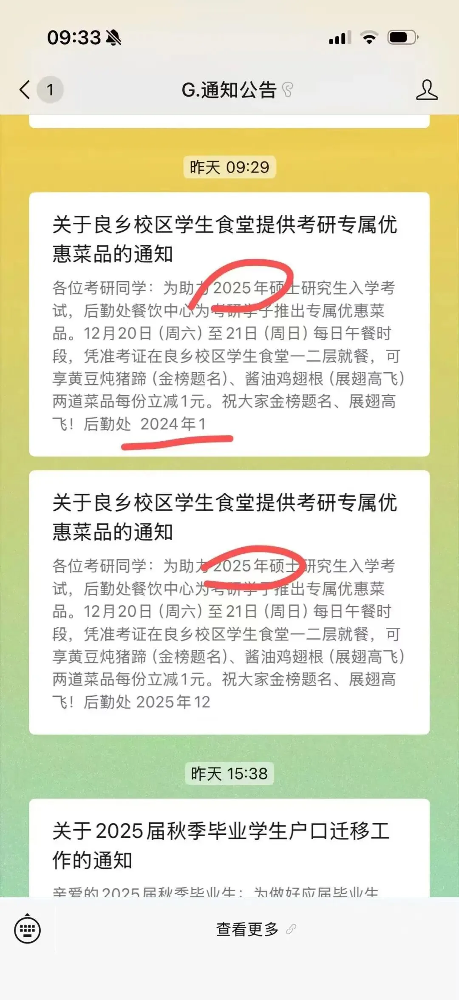
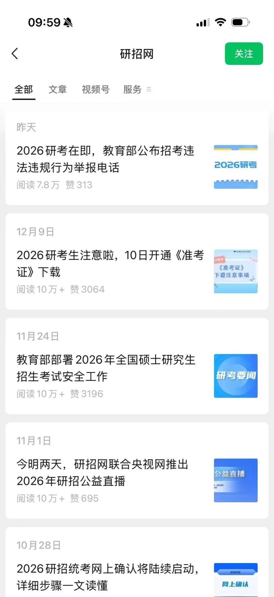
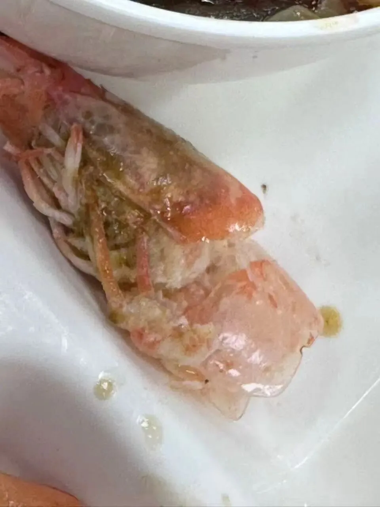

请相关部门及时关注并跟进问题。

## 1 外卖柜

## “学校增设外卖柜并没有解决非美团外卖员的核心关切：美团的外卖柜是收费的。

北门出现难绷奇观：外卖柜耸立，而外卖满地。

外卖员每跑一单只赚几块钱，而外卖柜一次收费五毛钱，这是一笔不小的额外成本。可如果外卖放北门外地上，又也要面临学生差评的风险。这显然为它们造成了一个两难抉择。

不少外卖员只好承担这5毛的成本，也有不少只好继续把外卖放在北门外的地上，后者来说，既给学生造成不便，也影响校容。后者造成的问题完全不是他们的过错，归根结底，美团外卖柜征用校园公共空间的盈利策略、京东与闪购的不作为、校方规划考虑存在不足。层层压力最终由外卖员承担成本，这显然是失当的。

在当下，广大外卖骑手也是保障校园生活正常运行的“后勤人员”。作为以人文之光著称的院校，自然不能对那些在背后支撑我们的人毫无人文关怀。首先是希望学校充分考虑这一问题，不转嫁成本给广大外卖骑手；其次是呼吁大家对非美团骑手有所体谅，且尽量避免让他们承担那些不合理的成本。”

## 2 校园空间

> “投稿 关于爱去公共场所但不爱不洗澡的人们冬天洗澡真的很困难吗？实际上我校提供每天8个小时的热水供应，24小时的供暖服务，以及几乎全天的公共洗衣房。那么为什么每到图书馆（良乡）总有一些人散发着数日不沐浴的体味，头油体体油味衣服味要把人熏晕……加上室内供暖本来就不怎么开窗通风，只要有人不洗澡周围的人都能闻到，求求各位大哥要么行行好至少两三天洗一次，要么就呆在宿舍不出门无人在意你的洗漱问题，互相体谅一下吧”

“请学校各位车主在晚上开车的时候注意行人！！很多次遇到不主动让行人的情况，一点素质没有！”

> “食堂公共座，有人直接把 “小家” 安这儿了，被子睡衣零食一应俱全，主打一个 “食堂是我家，舒服全靠它”。就是可惜了那张 “私人物品随身带走”的温馨提示，怕不是来给这位同学的 “独居生活” 当背景板的。”

## 3 移动校园

> “这是鸿蒙6.0的社科大移动校园。现在看来微信这边没法直接去，得从企业微信才行，导致我使用各种校园服务都很不方便，虽然这个事华为和腾讯也有责任，但是还是麻烦校方进行一下适配”

“有没有可能本周六日的研究生入学考试是2026年。稍微长点心也不至于一个通知，两遍都发不出一个对的吧？”

## 4 后勤

“二食堂自助餐盘冰凉凉的，打上菜凉的更快了，可以加一些餐盘保温措施吗，比如放在常温柜或者盖上厚厚餐布?”

> “这破学校还让不让人睡觉啊？又是热水TM比冷水还冷，又是卡机改进迟迟不动工冻坏人，现在暖气又整晚整晚的响丢你老木啊。把宿舍群解散了就TM万事大吉了是吧？宿舍天天不是这儿出问题就是哪儿出问题，反映了然后就是报修、等、继续坏着，之后不管多长时间多少人找，回应全都是等等等。以为没群了大家就不知道问题了一样/::d你心瞎了看不见就以为大家眼睛看不见了吗？自欺欺人的把戏还玩多久？发现大家实在忍不了了就找人上社论骂反映情况的人，塞你木，林北没教过你们怎么做人吗？真的要把所有学生都逼到做人的地步吗？我们不想做汉尼拔，但更不想做冻死、饿死、猝死！”

> “投稿：12月18日一食堂午餐水煮大虾，虾头咬开一口爆汁，就是坏了，味道很怪。想说一快到期末一食堂饭的质量就下降吗？每天大家中午12:10下课，来食堂就排起了长队，等到了12:25左右好不容易排到了，结果大多数菜都没有了，控制菜品菜量可以理解，但是高峰期那么多同学就不能多做一些吗”

## 5 就业

> “社科大，希望下一轮双一流评选，你可以入选。最近秋招时，遇到面试官问我“社科大是哪个学校”，让我介绍一下。解释之后，对方直接说“比不上江南大学，人家是211”，当时真的有点沉默。你在南方的知名度需要被更多人看见，我们毕业生在求职时也常因此面临额外的解释。我相信，以我们学校的实力和特色，一定能进入双一流，请你加加油。这不仅是一个名号，更是我们所有社科大人前行的底气。”

> “回复“就业办还是考公办”：点赞！学校不看skd网评的吗？太尴尬了，把中9的学生骗过来就要打名气啊！不然本硕博都不好就业！另外，墙裂建议：社科院的各种岗位招聘多向自家学生倾斜！比如列个加分项的高校名单，里面有清北人复交和skd\[Doge\]，等等。只要你肯，有的是各种具体的方法。真的，你难道要逼着这些中9水平的孩子们都去考公吗？还是要逼着大家去和双非抢饭碗？给条活路吧！！！”

（见《[【读者投稿】究竟该怎样](https://mp.weixin.qq.com/s?__biz=Mzg2MjcwNzQ1Mw==&mid=2247491314&idx=1&sn=932b3ac92b9599e4125d6c4d84279679&scene=21#wechat_redirect)》第4条）

## 6 回复

“您好，关于这个看不到热水余额的问题，其实我们的热水卡在寝室的水表上刷一下就会显示热水余额的，如果担心余额问题，可以用之前刷一下卡就知道了。”

“看了最新一期的人文之光，针对某教授在原著课上的危害性，我们认为有必要支持正义的一方，不再冷眼旁观。

第一，这位教授的ppt是ai做的，对待课程敷衍，不认真。可能有人会认为用ai做PPT也没什么大不了的，但是如果知道这位教授所用的PPT用完全不符合课程内容的图片，以至到了令人哭笑不得的程度，不知能否打消这种想法（列宁著作放李大钊先生和开国大典的图片）。

第二，教授讲课的内容是抄袭他人论文不加出处的。也有可能有人会认为只是不加出处而已，能讲好课就好了，但是这位教授是直接一字不改念别人的论文，就这样上了两节课，且不止一次，还要作为考试内容。

第三，讲课是必然跟心理健康有关的。这可能是这位教授的专长了，原著课成为了其心理健康课的宣传场所，动不动就说心理问题、焦虑问题，浪费了大量课堂时间，如果学院认为原著课就该这样的话，那直接把必修的原著课改成心理健康吧。

第四，对原著内容避重就轻（普遍现象），有时断章取义。上课时突然来一番惊世骇俗的论述，还打着革命导师的旗号，只是一翻原文，发现人家表达的和这位教授宣扬的完全是相反的，不知这位教授将革命导师的话截一句出来为某些思想辩护是为了什么，还是以为学生是真的不读原著？对原著内容不加讲述，ai的内容倒是念得很愉快。

这绝对不是故意苛责某位老师。而是经典原著对相关专业的学生来说真的很重要，可是我们并不能从课上得到什么，那么我们是否有必要浪费时间去课上再听一点还不如自己阅读获得知识更多的水课，浪费生命，甚至有的观点是完全与马列主义相悖的机会主义改良思想？甚至这样的“教授”不止一个。我们需要的是真正能够解答我们在阅读中的问题，厘清原著观点的老师和课程，众所周知马院还是有读原著并且能讲好的老师的，但是为什么他们没有讲课的机会？甚至某些教授的问题每一届都有学生反馈，为什么得不到解决？评教的作用在于打造真正意义上的好课，但如果每次反映都不能改变的话，评教的意义在哪？

每每翻开原文看到革命导师崇高思想和事业就是这样被传播讲授的，愤怒的心情让我们无法坐视不理。

最后，借用鲁迅先生的一句话激励自己和有同样心情的同学们，“愿中国青年都摆脱冷气，只是向上走……有一分热，发一分光，就令萤火一般，也可以在黑暗里发一点光”。”

（见《[【读者投稿】究竟该怎样](https://mp.weixin.qq.com/s?__biz=Mzg2MjcwNzQ1Mw==&mid=2247491101&idx=1&sn=79ce0bb070ea4c30cbbd57ddeac75ff3&scene=21#wechat_redirect)》第6条）
