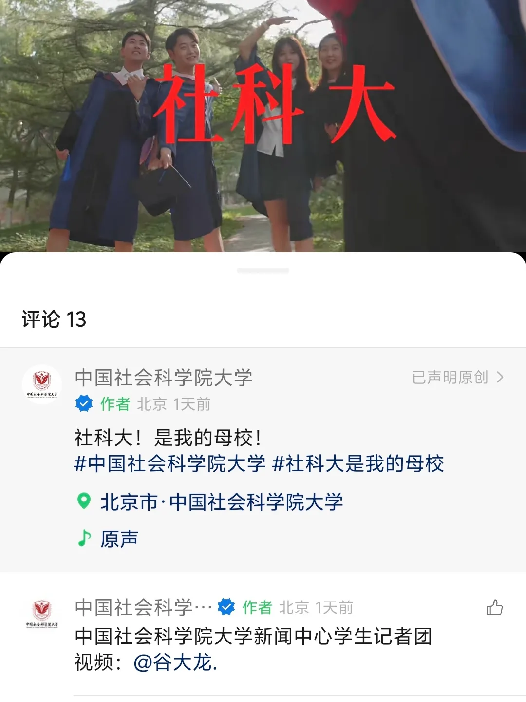
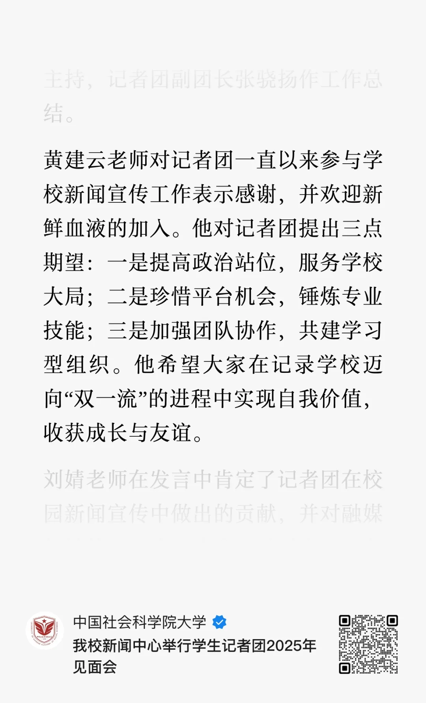

请相关部门及时关注并跟进问题。

## 1 教务

> “您好，投稿：本科生课程替换程序存在严重缺陷！一门课如果在开课当年是通选（方案内），第二年变为专选，就没有办法替换为选修课学分。相当于提前上了选修课，却没有办法算进学分，必须要再上一次！马上大三下学期了，但23级一些学院的不少同学因为不尽合理的培养方案和这样吊诡的替换程序还差好几门选修课才能修够选修课学分。教务处给出的答复是技术问题所以无法替换，但是否技术也可以进行更新？一门曾修过的课现在需要再修才能算进学分，这是否是资源的极大浪费呢？！希望教务处技术人员对于这种情况能有所了解，并能真正解决这一极其影响学生学习的选课问题！！！”

> “学校是不是只开放学生对任课老师的评价，有没有对行政岗位老师的评价途径？看上去部分老师在上班期间经常带娃（非婴儿），建议加强在岗检查。行政老师与学生的沟通，大段大段语音，并且表述不清楚，学校有对行政老师进行工作评价吗？”

“在人文之光平台发表意见时，我未曾预料到会得到回应——毕竟此前的多次反映，都未能让这位老师有任何改变。衷心感谢各位的关注与声援。

原著课程具有不可替代的重要性，它是马克思主义理论各专业的基础，不研读原著、不懂理论，便难以进行深入的学习。这样一门每周四课时的课程，理应通过充实而精彩的课堂内容，引导学生真正投入知识的学习。马克思主义学院拥有众多优秀教师，为何偏偏安排一位专业素养存疑、在讲课中夹带无关私货、备课也显得不够认真的老师，来承担如此关键的课程？又为何在长期、多方面的反映之后，情况依然如故？

我们的诉求其实很简单：我们只想上好这门课，在课堂上汲取真知，而不是将宝贵的时间浪费在与课程无关的所谓“心理学”内容上，该教授的课程安排在多次反映后毫无变化，那我们只能提出更换老师的诉求了。”

## 2 官方宣发

> “社科大的宣传不是第一次出问题了，各位领导看了不觉得官方账号发表这种内容很聒噪奇怪吗？人文社科在哪里？校内各种宣传平台倒是不少可惜都是滥竽充数，如果不知道怎么外宣完全可以不搞，新闻中心之类的机构我看完全可以取消了”

> “社科大宣发每年招人不少、花钱不少。各类广告动辄数十万经费（感兴趣同学招标可查），可惜内容是和人文之光的精神一点不沾边。有这钱能不能把经费磨在刀刃上？多请点学术大牛、改善下大家的学习科研环境不好嘛？”

“今天看了官方账号的AI巨作《大东北》，特地查阅了解我校新闻中心相关报道，结合文中的“三点期望”，我瞬间感到如醍醐灌顶，受益匪浅。

关于“提高政治站位，服务学校大局”。我原以为“大局”是严谨的治学态度和高端的学术形象，看了这首AI神曲后我才明白，真正的“大局”是放下身段、大破大立。用这种连短视频博主都嫌弃的、充满土味审美和五毛钱特效来代表我们中国社会科学院大学的宣发水平，这无疑是一种极具勇气的“政治站位”——向全网展示了我们学校在自黑与消解严肃性方面的博大胸怀。

关于“珍惜平台机会，锤炼专业技能”。我们的宣发部门确实用实际行动诠释了什么叫“专业”。在大家都还在苦练写稿的时候，官号已经率先实现了“技术跃迁”：放弃了人工的审美，抛弃了复杂的剪辑，直接用最粗糙的AI唱腔和最混乱的画面拼接，精准地完成了对“低质内容”的极限挑战。AI时代下文科生的困境难题在我们社科大的大AI歌曲创作中迎刃而解，这种“珍惜平台、糊弄至死”的专业精神，确实值得每一位想走捷径的同学深度“学习”。

最后，关于“在记录学校迈向‘双一流’的进程中实现自我价值”。在迈向“双一流”的征途中，别的学校在发重大成果，而我们用一首《大东北》AI神曲，直接把学校的艺术格调拉到了AI粗制滥造的垃圾水准。这也为广大写不出论文的学子指明了“自我价值实现”的方向。既然官方账号可以用这种“毫无灵魂、甚至带点诡异”的AI记录校史，那我们用AI写点不知所云的学术垃圾来应付期末，简直是顺理成章、紧跟校风。感谢我校良苦用心！”

## 3 外卖柜

> “给12月21日的第一条帖子点个赞，大冬天一单外卖就赚那么有限几块钱儿，放外卖柜扣五毛，外卖小哥们确实太不容易了，如果我们可以接受的话，放在北门外立马去取其实也不会对我们造成太大的不方便。当然，放外卖这件事会有麻烦的一个根源在于总是有人偷外卖，在这一点上，也请偷外卖的人做个人吧。”

> “如果把外卖员也要纳入社科大后勤人员来考虑福利问题，那诸位同学是否也该体谅考虑下北门外施工工人乃至房山区供水供电的各位工作人员？有些同学是不是关心太多了，有这个心要不要关心下校内教职工的编制和收入问题？”

## “投稿：回应12.21关于外卖柜的社论。

有些同学要知道：人文之光不是圣母心泛滥。一开始说外卖柜远，学校调到北门。现在说没有解决外卖员关切问题，把成本转嫁给外卖员？

拜托，成本哪来的，你不愿意在门口等他，他不愿意在门口等你，才需要支付的，这叫租金好吧。说什么学校把成本转嫁给外卖员？这个主体不对吧，学校强迫你点外卖强迫你必须用外卖柜了？但凡你跟外卖员说等你两分钟，你直接取，他不会等？他不愿意等那就存柜付钱，天经地义好吧。

可能有的同学要说人家一单几块钱不容易，不容易你就早点去等着，不是把这个要求转给学校让学校给你承担，学校的钱风刮来的啊？那也是税好吧。

说学校把外卖柜的费用转嫁给外卖员，那请你别把自己的懒转嫁给别人为你承担。”

## “《行政干预与福利损失》

——原贴于2025年12月5日23:03发布于社科汇树洞

背景知识：美团外卖柜，美团骑手可以免费使用，而京东和淘宝闪购的骑手每次使用大概是0.55元，且不是单次计费，需要预存10元以上才能使用。这就是为什么平时大家点外卖的时候，淘宝闪购和京东的骑手往往选择放在北门栅栏，而不是外卖柜，不是骑手懒蛋，不愿走远路，而是本就微薄的配送收入经不起折腾，台上是平台的竞争，台下是无数外卖小哥的生计。

但校方的脑子里是装不下这笔账的，他们想的只有躲避麻烦，躲避北门外卖成堆的麻烦，躲避外卖被偷、诉诸于己的麻烦，于是，以skd从未有过的基建速度，在原来的栅栏处装上了美团外卖柜，然后做个撒手掌柜。

这样的结果是什么呢？要么是京东和淘宝闪购骑手自认倒霉，垫钱存外卖柜；要么是骑手和学生协商，由学生通过打赏的方式支付这笔费用；要么是学生放弃自己的原始偏好，更多的点美团外卖；又或是一个北门栅栏倒下了，千百个北门栅栏又揭竿而起，“师傅，帮我放在从东往西第37根栅栏吧，谢谢”，你拆得过来吗？从哪一个结果看，对于学生，对于京东和淘宝骑手，校方这次鲁莽的行为都没有任何价值，是借着“规范基建、便利管理”的名头把责任转嫁到了骑手身上，转嫁到了学生身上。

哲学社会科学的最高殿堂，为何钟情于做个不粘锅？智慧化、规范化的校园建设不应如此机械、冰冷。”

“ 美团投入外卖柜，京东和淘宝闪购的骑手需付费使用，这是企业间的排他性竞争或商业租赁行为。要求学校去协调京东、淘宝免费使用美团的基建，有点过度干预市场了吧？对学校而言，不让外卖在栅栏上被偷或丢弃，这叫履行校园管理职责。秩序本身就是一种高昂的、却容易被忽视的集体福利。高校本身就不该是温情脉脉、什么都管的和事佬，就该划清权责边界，让社科大真正负起应负的责任，不要让你校教务后勤天天影响大家学习了！

如果京东、淘宝的骑手确实因为这0.5元而丧失竞争力，最终会通过市场机制倒逼这两家平台在校内增设自己的存储设备，或与美团达成互通协议。这种在学校区域上由行政划定红线带来的市场倒逼，远比学校、学生挨个去补贴骑手更有可持续性吧”

## 4 医务室

## “【良乡校区医务室】转诊要先自费确诊，学生看病陷入两难

近日，我前往良乡校医院二诊室申请开具转诊单，拟转诊至北京医院皮肤科就诊。我向医生如实描述了自身症状：近一个月内脱发非常严重，头皮屑异常增多，呈现大量白色碎屑，头皮瘙痒很明显（尤其在早晚时段），已经严重影响到我的学习和生活。我已尝试更换多种洗发水，但均无明显改善，仅能通过每天洗头暂时缓解。鉴于症状明显异常，且本人此前曾被确诊为脂溢性皮炎，我本人十分担心是否存在复发或发展为银屑病的可能，故希望通过正规转诊进一步检查治疗。

但校医院医务人员以“脱发和头皮屑不属于转诊及报销范围”为由，拒绝为我开具转诊单，并要求我必须先自费前往医院确诊，确认存在头皮炎症后才能申请转诊。对方还表示，只有在我头皮上“现在能看到红色疙瘩”，才能证明我仍然患有皮炎。我多次说明：皮肤病本身具有反复性和阶段性，并非所有症状都必须以肉眼可见的红疹作为唯一判断标准。如果不开转诊单我将无法报销，而确诊与用药本可一次完成，无需反复奔波，且良乡校区距离北京医院较远，若非症状严重，我也不会选择大老远地去医院看病。在多次沟通无果后，我退一步请求：是否可以先开具转诊单，若最终医院开具的药物并非用于治疗皮炎，学校不予报销，我可以自行承担费用。但无论我如何说明合理性，对方都坚持要求我必须先自费确诊，才肯履行转诊流程。

我认为，这种做法既不合理，也严重增加了学生的就医成本和时间负担，违背了转诊制度本应起到的便民与保障作用。学校医务室作为基础医疗保障机构，在自身无法诊治的情况下，理应协助学生完成合理转诊，而非以“先自费确诊”为前提推诿转诊责任。当前做法使学生陷入“校内无法治疗、校外无法报销”的困境，也令人质疑：当校医院拒绝履行转诊职责时，学生的基本就医权益应由谁来保障？”

## 5 选调

## “请社科大再努努力，拿下北京选调吧，作为在京高校，至少得到北京的认可吧”
