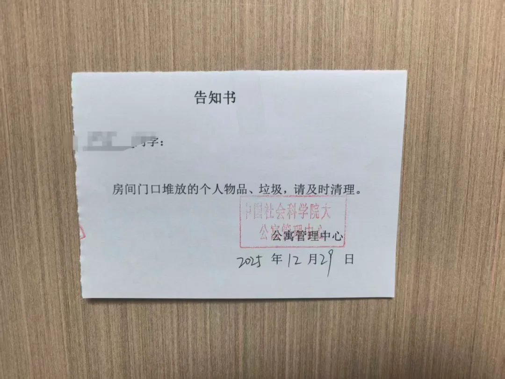

请相关部门及时关注并跟进问题。人文之光社论读者QQ群欢迎各位读者朋友前来交流讨论，群号720937152。

## 1 宿舍

## “社论好。

我想客观地表达一个通过接诉即办可能解决不了的诉求，即重建官方宿舍楼微信群。

今天凌晨两点，我心脏位置发生接近两秒的刺痛感，想问宿管要速效救心丸。

根据本人所掌握的医学知识，此时应当保持平躺仰卧，尽量减少活动。但舍友不在，我只能下楼找楼妈。

如果此时有宿舍群，我可以在群里询问楼妈是否有速效救心丸，如果有，请麻烦送至我的房间。若有任何不测，也可最快通过宿舍楼群通知楼妈来查看。

望校方在制定公共政策进行多方考量时，莫忘：舆论诚可贵，生命价更高。

（此事已妥善处理，请校方对事不对人，勿扰当事宿管阿姨）”

“坐标良乡七号楼十层，大约两个月前，图一图三两张图所示箱子莫名出现在我们寝室门口，里面是一套军训服装，两个月内一直没人收走，有时候又莫名其妙离我们寝室门口越来越近，今日下课回寝突然发现门口被宿管阿姨贴上了整理门口杂物的通知，我们寝室杂物从来没有放到过寝室门口，就算有也是当天要扔出去的垃圾，被贴单子的这天门口只有这个来路不明的箱子。

寝室楼道堆放杂物的问题不是一天两天了，上个学年因为有寝室楼微信群聊的存在，宿管阿姨会经常提醒大家收拾杂物，自从新学年寝室楼群聊解散之后，楼道里的东西越来越多，首先这是消防通道，堆放杂物一定会带来安全隐患，其次这是大家的公共空间，堆放的杂物里有时会带有异味，楼道通风不及时就会充满怪味，有时候堆放的多了甚至连正常走路都会被耽误。

近期每个寝室门口都有新贴上的收拾走廊杂物的提示，至于有没有效果大家都能看见，还是想提醒大家，寝室楼道是大家的公共空间，长期堆放杂物影响的是大家共同的生活质量，大垃圾桶就在寝室楼下，下楼扔个垃圾耗费不了太大的精力，自己没扔下去的垃圾让整个楼道共同承担后果属实有点自私。

至于我们寝室门口这个箱子，我们不会动，不会替你丢下去，都已经是大学生成年人了，自己的东西自己看好，不要乱丢乱放，还请原主人尽快带走自己的东西。

备注：箱子已经被收走”

## 2 毕业论文

> “应用经济学院突然冒出来一个毕业论文预外审，硬生生把论文时间提前到1月份，提前没有一个通知，让人措手不及。而且不参与无法参与后边的预答辩和外审，必须要延期。这是哪里的红头文件规定的吗？还是随意出台的政策?打乱了很多同学的节奏，就因为这样让人延期合理吗？征求意见了吗？”

> “应用经济学院是怎么想到提前一个月不到，要求博士生提前一个月交毕业论文预外审这样神操作的？就业压力够大了，各个单位招聘和试岗工作都提前了，为了完成延毕指标，就业率不要了吗，左右脑互搏。考虑一下政策提前说吧，提前一个月，整的大家都延毕有啥意义呢，延毕率提高这就能建设一流学科了，开八百个会有考虑应届博士生死活吗，开会是拉关系还是提升博士生就业能力，社会还是要拿就业数据说话就算为了减少抽检不合格率，以前招收那么多在职博士生，抽检到我们这届双一流都评完两三年了，这个压力问责到这届学生有啥意义呢？总而言之，感谢这份给全日制博士应届难就业毕业生的新年大礼。”

## 3 食堂

“一食堂在早餐的时候又开始卖不新鲜的包子了，前段时间有人反映过之后确实整改了，但是现在又开始了”

## 4 马院原著课

“仍旧是马院的原著课问题，前几次社论说得很明白了，这次我们要重申某些核心问题，明确我们的诉求。

1.问：你们的问题到底有什么？

答：归根结底，问题就是：我们认为该教授不能上好核心原著课。具体问题包括但不限于：原著的基本理论不能讲解透彻，课件制作不用心，课上过分宣扬无关问题，甚至发表某些不当言论等。这些问题都被数届学生多次印证过，是不容置疑的。

2.问：你们的诉求是什么？

答：我们的核心诉求就是：请学院调整系列经典原著课的授课教师，不要让该教授继续核心经典原著课的授课，让有水平、有口碑的老师取代。

3.问：难道就应当把这个教授驱逐出去吗？

答：我们决不是要把该教授“轰”出去，该教授有其擅长的方面，比如健康心理学，那就让该教授专门地去教授健康心理学好了。该教授可能有能力教好很多课，但是，在我们看来，其所擅长的决不是马克思、列宁或者其他经典作家。”
