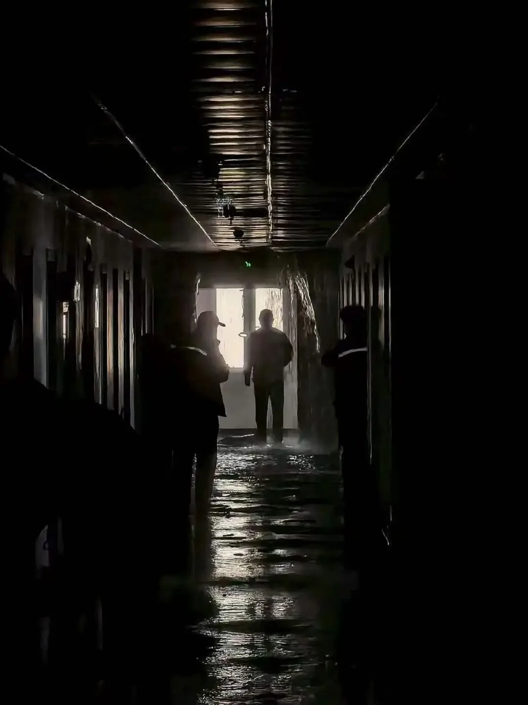
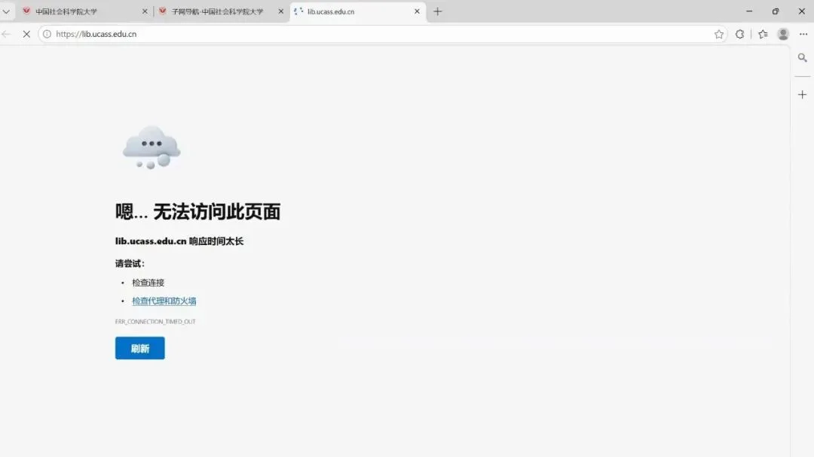
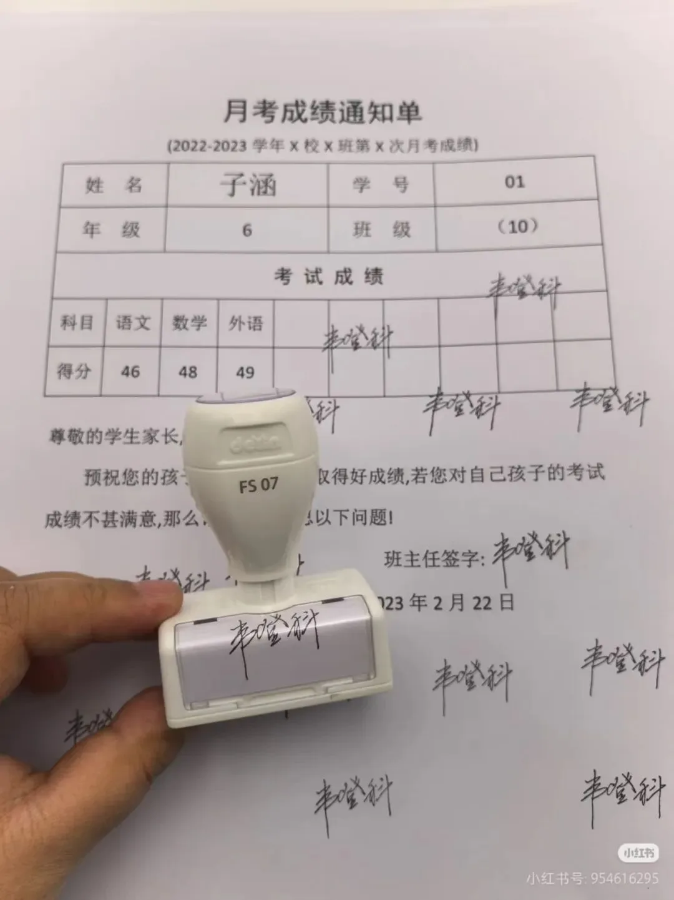

请相关部门及时关注并跟进问题。编辑部拟计划对一些投稿人进行回访，如有意向的投稿人，可以直接私信公众号后台

## 1 校园建设

> “令人唏嘘，五年的时间，足够检验一个工程的良心。可惜，我们的七号楼没能经受住时间的考验，仅顶楼严重漏水影响电梯使用就已经两次了，更不要说隔音差之类的小毛病了，经费花的有水分就算了，但宿舍里里真的不能有水流！！！”

## “投稿：七号楼福地，水帘洞洞天（图片转自群聊）”

“关于去年暑假那篇对校园基建提出意见的文章，不知道后续如何，当事人似乎也没有后续投稿，希望社论可以尝试跟进一下”

“网络中心可不可以优化一下啊，经常进不了图书馆，也不知道什么情况，需要查文献的时候查不了，太耽误事了”

“投稿：这几天双一流评选似乎已经正式开始了，希望学校能够不要重蹈22年的覆辙，给所有曾经就读的校友以及依然在校的同学们一个让大家满意的答卷”

## 2 行政教务问题

“今天上午在社科大找学院签字盖章的流程十分荒谬。不说是哪个学院了，一个常规文件的签字（为不暴露隐私不说太多，只能说是每一届毕业生中都必定有一定比例的人需要签的文件），学院的学工、教务、研究生班主任、副院长都拒绝签字，跑了至少5个办公室，告知只有书记能签。其中有一位居然说距离截止时间还有三天让人明天再来，太好笑了，我猜真的明天再来只会获得同样的敷衍回答。

我觉得社科大的行政可能不太了解其他学校是怎么工作的。毕业季学生升学、就业各种文件一个年级下来估计有几百个签字，所有文件都物理意义上由一个学院唯一的书记本人亲自签字是一件不可能的事情。

仅作参考：前置就读学校的做法是分管本科教学秘书的老师手里有面向学生的领导的姓名章，遇到成绩排名证明、思想品德表这类常规文件该签的签、改盖的盖，本科生只需要与本科辅导员与本科教学秘书两个人打交道，本人本科时所有需领导签字的文件，最高只到分管本科生教学的副院长这个层级，副院长的姓名章在本科教学秘书手里，教学秘书的日常工作会有2位学生干部辅助，凡用过姓名章教学秘书会及时记录。（签字章是这个东西，不知道学校是不是不知道有这种东西存在，还是不敢用，本人前置就读学校为百年重点校，不存在办学不如社科大正规的问题。）

我理解学院老师怕担责任，觉得只有一把手才能对大家负责，但事实上我的材料最终也不是由一把手签的，是某个行政老师请示过后代签的。但这样没有形成制度，遇到事找不到人，所有的事情都是临时请示，组织架构太混乱了，如果真的出了问题，再去找当时的聊天记录还有可能吗？不如好好想想如何分工分权。

总之我喜欢我的学校，但社科大行政流程还可以再改进。

”

> “关于研究生考勤问题，只能说很难想象一个课程管理研究生教务的方式是通过恫吓学生采用监控巡查签到的方式。大部分研究生都面临着就业和升学压力，各种考学以及实习活动是大家不一定会准时出席课程的主要原因，为什么大部分课程都会在一定程度上谅解学生而部分课程却要用这么糟糕的方式让学生强制出席呢？”

## 3 食堂

“社论君你好，想表扬一下二食堂最近回归的烤盘饭，感觉不管是价格还是卫生上相比几年前都有进步了，希望二食堂档口可以增强这样的有益变化”
