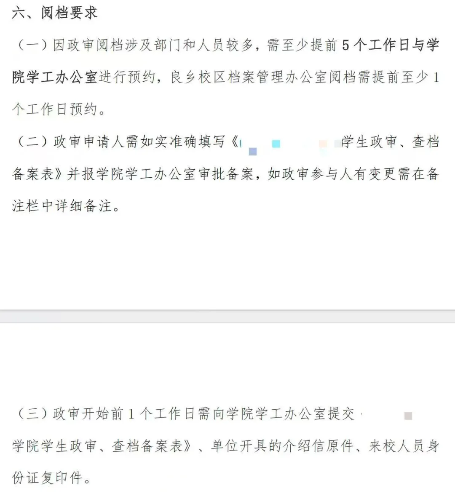
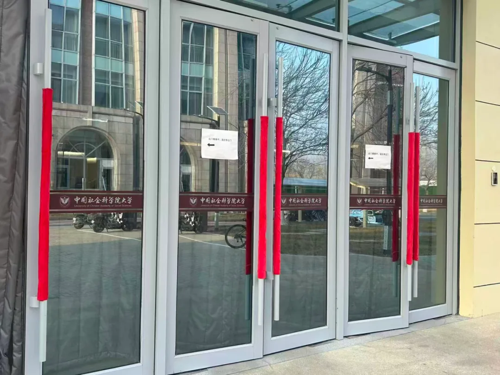

请相关部门及时关注并跟进问题。

### 编辑部持续招新中，欢迎有志者点击“我要加入”

## 1 水帘洞天之后

“投稿：近日学校七号楼再次爆出工程质量问题，实在令人汗颜。这个新宿舍楼自21年中建成至今，使用时间不到五年，但工程质量问题的反馈却是从未中断，隔三岔五就能看到有人反映相关问题，而且问题更是一次比一次严重。这次甚至是水漫金山了，连电梯都整个地变成水帘洞，不知最终有多少设备浸水需要大修，也弄得很难看，可以说是造成了恶劣的影响，万幸是没有造成人员伤亡。可更严重的问题一定是等在后面的，随着时间的推移工程质量问题只会越发不可知的严重，长此以往，整修维护这些楼也恐怕会造成经费人力损耗的无底黑洞。而究竟再发生多么严重的事故、造成多么严重的后果，校方才能有所动容、有所检讨？是不是有一天真的所有人都被拉下水，这个问题才会有处理的可能？

可迄今为止，面对时有发生的反馈，校方有司却似乎从未真正正面应对过。最有力的措施，也只是之前象征性地面向住户征集目前存在的工程质量问题，毫不检讨过去，也闭眼不看未来。我们不禁要问，校方究竟能不能拿出让社科大人所信服的有力措施？相对大型工程的修建，历来是一个可以看出校方有些管理人员真实水平及办事想法的切口。事已至此，起码而言，呼吁院校相关部门严格查处、严肃追责，看一看这个宿舍楼的工程建设过程中，究竟存不存在相关管理监管人员失职渎职甚至更加严重的情况，并且进行有力有理的处理。校方应该怎么认真检讨此事，后续需要怎么处理这个问题，需要有面向全体社科大人严肃的、真正的、令人信服的回答。也提醒有些人，账是记在那儿的，相关工程的建设中有很多报道、文件、投诉、反馈，你装作视而不见，总有人心明眼亮。

无论如何，社科大人不是冤大头，不应该吞咽因有些人不负责而建宿舍楼这个哑巴亏。如果再没有严肃的处理方式，恐怕新宿舍楼将要变成一个后患无穷的遗留问题：学校本就不多的经费还要面对修补维护的无底黑洞，基层工作人员隔三岔五就需要面对整修维护要求而身心俱疲，而住在里面的人时时提心吊胆、不堪其扰，这将是一个非常晦暗的结果。假如一个宿舍工程的修建及维护，让每个与此楼相关的社科大人均受到损害，让相关拨款不断地被吞噬；又会是谁可以是受益者，能在建及修的过程中吃到一顿又一顿的盛宴呢？让社科大人做我不负责的受害者，再让他们为我的宴席来埋单，整个一个两吃。将社科大人变作自己两吃的冤大头，让他们大吃哑巴亏，希望有些人的管理神通，不会给人以这样的印象。更希望，这样的的管理神通，从没有行使的空间。

”

## “投稿：七号楼的电梯还会好吗？”

## 2 行政流程优化建议

## “【投稿】关于某学院优化毕业生政审档案查阅流程的建议如下，请对号入座：

1.流程设计背离实际： 用人单位政审多为临时通知，强制“提前5个工作日”不符合常识，无异于人为设置就业壁垒。建议学院采取弹性预约制度，针对就业政审等紧急事项开通“绿色通道”，避免因程序僵化导致学生错失入职机会。

2.制度冗余增加负担： 在校级档案系统已具备监管功能的前提下，学院增设纸质报备流程，属于典型的“过度留痕”，极大地消耗了处于论文冲刺期毕业生的精力。建议通过校院信息共享，简化或免除重复的纸质报备。

3.材料要求缺乏合理性： 学生在政审关系中处于弱势，向政审人员索要身份证复印件等私密材料既不礼貌也无必要，严重影响用人单位对学校管理水平的评价，也极易引起用人单位反感，且涉及隐私安全。建议对标其他在京高校，简化材料要求，由学院统一对接或认可校档案室的审核结果。

4.毕业季是学生压力最大的时期。繁杂的流程不仅降低了行政效率，也损害了学校在用人单位眼中的职业化形象。望相关部门本着“服务学生、促进就业”的原则，优化流程壁垒，提升管理效能。北京各高校在毕业生服务方面多有成熟经验。建议相关部门反思现行制度的合理性，变“设卡”为“护航”，真正落实“精准就业帮扶

”。

## 3 一食堂的态度问题

> “你好，我要投稿。很生气！现在是3月16日晚上九点，从图书馆结束了一天疲惫的学习时光，开开心心去食堂买夜宵。食堂阿姨拿起盘子，我说我要一个鸭腿打包谢谢，她瞬间不耐烦了放下盘子，然后说还要什么，一次性说完，那个语气真的好像我欠了她钱一样，本来还想点更多东西的，她凶我的语气让我瞬间啥也不想吃了，凭啥啊？我作为消费者，全程客客气气开开心心的，你一上来就给我甩脸色，你有工作情绪也不能往我身上发吧。吐槽归吐槽，我知道很多饭堂叔叔阿姨工作很辛苦，平常都挺好的，但是还是请你们少出现点这种情况吧，因为真的很影响我们学生心情，真的很生气很生气很生气！”

## 4 一食堂的排队与口味问题

“投稿：良乡食堂问题

今天在一食堂排队时，有人打包7分钟队伍都不动。乐。排的时候听到四个人在议论怎么这么慢怎么不出打包窗口

大家早就建议设专门打包窗口以便堂食打包两不误，但小碗菜都落实了，打包窗口却杳无音信。

希望学校再考虑一下设一个专门的打包窗口吧 不然排队跟开盲盒一样 前面只有三个人 居然十五分钟都没排到”

“投稿：希望一食堂一楼的菜品适当减少油盐量添加，感觉0317日的西红柿炒鸡蛋和吃咸菜已经没有区别了。”

## 5 公共场所抽烟

## “投稿！良乡校区二号楼二层有人在楼道和走廊吸烟！

哪家少爷吸嗨了跑楼道吸烟了，走楼梯全是一股烟味。

这种丧尽天良的事情居然真有人做得出来。

所有经过的人都要被迫吸食二手烟。

难道不知道二号楼通风有着严重的问题，你要全楼的人吸多少二手烟？

烟瘾这么大？精神如此空虚。您是在（平台规则此段文字无法展示，各位读者可自行领会此处投稿人的愤怒）？

二手烟自个躲厕所吸吧，别在公共场所害人了。

”

“投稿:7号楼男生宿舍请勿在公共卫生间抽烟。一进门一股烟味，架子上晒的衣服床单都沾染上来烟味，还得重新洗，可以在外面或者走廊抽，感谢。”

编辑部提醒：请各位投稿人在投稿时尽量克制语言使用，以保证平台的持续运行，非常感谢。

## 6 图书馆与教室公德倡议

“图书馆三楼外文靠窗这边，有个同学一直在卡痰，好几天了。真的同学，你要是生病了就去看病好吗。如果是坏习惯就改。真的很影响别人学习和工作。”

## “投稿:

不要在你的座位上小声念书！请各位在图书馆自习的同学注意，不要在座位上出声念书、背书。特别是一戴耳机就开始在那疯狂念的行为，非常打扰别人。

自去年年底到现在开学，在新旧两馆均遇到不少这样的人。特别是到考试周更多。背书可以去外边，落座请遵守公序良俗，保持安静。你自己一个劲在那用气声背书，别人怎么思考和写论文？明显的噪音（如外放、大力敲键盘）我们应该禁止，那么这种微小的变相噪音也应该注意！谢谢！”

“社论你好，我要投稿良乡校区教室经常有人在安静的教室敲击键盘或者点击鼠标发出刺耳的声音，距离很远也能听到，凑近一看此人竟然在打游戏。

最起码在教室打游戏的时候不要打扰到他人吧，如果做不到就去网吧打，别来教室影响其他人学习”

## 7 图书馆大门

## “

想问一下，新图书馆大多数门，大多数时候都是坏的。新图书馆刚刚建成，为什么四扇门有三扇都需要维修？是不是采购质量有问题？”

## 8 美联福超市

## “投稿，美联福超市卖的草莓是坏的。

美联福超市已经被学生曝光过很多次卖坏的东西了。这三一五还没过今天就又开始卖烂水果，我买的草莓回宿舍仔细一看除了一个没熟的其他全是坏的。学生们说了这么多次也不见一次整改，为什么学校相关部门和超市经营管理人员没有一方重视的呢？又要赚学生钱，又不让学生买到正常的商品吗？”

## 9 新名字投票

烦请各位读者为文章后附的投票内容投上一票，非常感谢！
