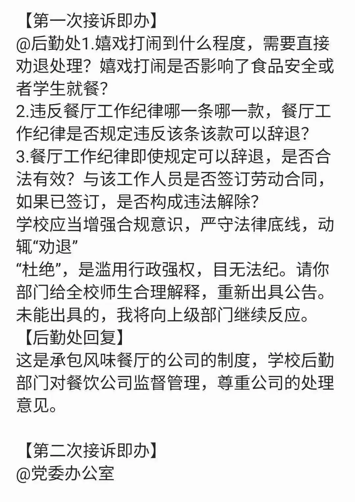

请相关部门及时关注并跟进问题。同时希望留言区读者理性讨论，不要使用情绪化发言以免导致稿件被举报，我们也呼吁如有意见可直接投稿进行讨论，感谢大家的理解与支持。

## 1 后勤问题

## “坐标良乡校区

请后勤处正面回答并给出解决方案！！！

1.上学期宿舍处就持续产生消毒水味，尤以冲厕所的味道最重！

去年年底到现在发过多次接诉即办，第一次学校回应去问公司就没有后续回应，第二次直接甩锅说是房山区水质就有问题，最新一次去催结果来了句周边小区水质都下降了已经说过了，然后呢？？？我投接诉即办对责任在谁一点兴趣都没有，我在学校生活这个环境出问题了难道你们不该管吗？不是你们的责任你们就可以一句和其他人说了就可以敷衍了事？？？

我需要的是到底是什么问题！危害是什么！怎么解决！什么时候解决！能解决到什么效果！不是随便一句问了说了就能搪塞过去！！！

这个接诉即办不能再回复追问也是太鸡肋了，随便打两个字就能默认“已解决”也是太搞笑了

2.上学期期末七八号楼阴面阳面均开始出现不同程度的发霉，至今没有任何解决方案！

这个也投了很多次，宿管倒是带人看过几轮，但是后续呢？？？给的说法一开始是指责学生自己卫生习惯不行，发现多个宿舍多处都有发霉情况就说楼面漏水，现在又说具体原因还要调查，所以呢？这件事怎么归责同样不是我现在最关心的、我只想知道怎么解决！学校到底能不能给解决？什么时候能解决？你们慢慢悠悠讨论问题是什么，霉菌在墙上挂着每天睡毒窝里的学生一点也不苦一点也不难受哈哈。讨论就讨论吧还没有个具体时间，怎么着前置程序走不了就不能继续下一步了吗？

哦今天倒是回应会去刷墙，那么请问这样治本吗？大面积补刷墙产生的甲醛对学生就没有危害了吗？要等多久才能恢复正常？等讨论出来原因以后又什么时候能给出完整的防范再出现这种问题的方案呢？

3.这学期开始宿舍水龙头/喷头热水端开始不定时流白水/黄水，也是没有任何说明和解决方案

具体需求同上，这么看我们还真是命硬呢哈哈。

上周末后勤处还特意发推文说正式启动“暖心服务 用心守护”主题活动，具体就是这么体现的吗？？？

试图好好说话过，可惜每次都得不到合理的解答……我寻思我提的要求也不过分吧，后勤处别再大事化了小事化大了

接诉即办每回都是顾左右而言他，这和形同虚设有什么区别？？？希望能重视下校内反馈渠道建立的初衷，不要总是虚假繁荣自我吹捧，只会寒了更多人的心”

“学校热水问题频发，水质质量堪忧，洗衣机容量变小性价比降低，很多问题不解决，在接诉即办上虽然回复很快，但逃避解决 推诿扯皮，现在却直接把两个打闹的员工开除。

这样学生们下次还敢投诉给建议吗？我相信没有学生的本意是想过度苛责员工，甚至开除闹到这种地步。如果激进一点，可否认为是在激化学生和员工工人之间的矛盾呢？试问这种行径是否符合劳动法?

> “同学们在餐厅用餐方面如有意见和建议，可通过权益部、接诉即办、办公电话或当面向后勤处身穿红马甲的工作人员反馈。”倘若接诉即办可以真正地，诚恳地解决问题，有谁愿意来人文之光？以斗争求和平则和平存，真切地希望学校重视接诉即办。”

## 2 办好说清讨论

“过去说是拟人处理，现在应该说是似人处理。你们到底是有动于衷，还是无动于衷？我看是无动于衷。

下一步是不是要楚楚可怜的说“我们都处理你们怎么还不满意”？”

“后勤处太厉害了 这么会矫枉过正吗 打闹一下至于给人开除吗 谁教你们这么管理的，七号楼发大水怎么不给后勤全开除了呢”

## “投稿:

今天看到企业微信推送。学校后勤对食堂“嬉戏打闹”员工，进行“劝退”处理。让人不寒而栗。

我绝没有认为工作期间“打闹”是无过错的意思。但是，且不论“打闹”一词的程度如何，因为“打闹”就“劝退处理”，是不是处罚也太重了?这是不是一种罪刑失当的暴政，是不是一种苛法呢？

通报中提到了“同学投诉”。我也在昨天的贴子里看到了同学的原文。我相信，这个让人丢了工作的结果，绝不是同学的本意！

所谓“违反员工纪律”。又请问，有哪一条明文纪律写了若工作期间打闹则劝退呢？如果有，希望我们大家能够看见；如果没有，那就是“不教而杀谓之虐，不戒视成谓之暴”了。

无论从常理上，学校管理的现实上，还是投诉同学的本意上讲，对工作期间打闹，都应该作以诫勉为目的小惩罚，而不该是丢了工作这样的大后果。

如果随随便便就会使后勤人员丢了工作，那从今往后，同学们还该不该投诉呢？遇到问题，同学们还敢不敢指出呢？我们是作为“人文之光”的学校，行政处罚也应该是立德树人的。这样苛待为同学服务的后勤员工，会对教育有什么正面的影响吗？社科大不该是人人自危的社科大，不该是工作人员与同学互相敌视的社科大。我相信，社科大是 平等，公正的，社科大的生活是团结，友善的。您对学生意见的重视同学们有目共睹，恳请领导撤回决定。”

> “你好，我想为食堂打闹的那两位师傅说几句话。对于学校的处理结果我是非常伤心的，当时我在场 ，周末本来吃饭的人不多，当时应该也是两点左右，食堂没有几个人，师傅嬉笑打闹的声音是有点大，但是也就持续了一下，并没有影响我的饮食，但是没有想到还是被同学挂了。这本来是一件很小的事，可以督促他们，警告他们就行了，没想到学校直接劝退了。我每次从那个档口走过，有个师傅就会特别热心的跟我们打招呼问我们要不要去那吃，态度非常好，人很热情，仅仅因为一件小事，一个同学的一段小作文，就让两个有热情的师傅失去了工作是不是太过残忍了？”

> “谢谢，辛苦了。既然后勤处会看，那么希望他们把所谓被“劝退”的员工请回来。发投稿的同学本意应该是提醒工作人员注意人身安全，而其他某些同学或许并不介意食堂多一些热闹的人声——快乐的厨师做更好吃的饭，何况本身你院就已经够死气沉沉的了，就业环境够糟糕、社会情绪也够紧绷的了，一次不耽本职未酿大错的违规，“食堂员工”偶尔作为“人”的嬉笑打闹，不应成为被直接开除的理由。提醒教育员工注重安全有一百种方式，杀鸡儆猴绝对是最差的一种。”

## “投稿

建议劝退后勤处的工作人员，因为我认为他们每天在办公室嬉笑打闹严重破坏了学校的教育生活秩序和学生学习氛围，建议相关主管部门严查。”

“注意到昨天公众号这位同学发的帖子，没想到学校今天直接给员工辞退了。没有批评这位同学的意思，责任全在学校。后勤处以合同外包为理由，拒不解释，我已经向校党委办继续投诉。希望人文之光真的是人文之光，而不是随意辞退员工，违反劳动法制的三流学校。

补充一下后续情况：指示餐饮公司开除人时，我是甲方，让你干啥你听着；学生有投诉时，由餐饮公司负责，和学校无关

”

“这两天的“人文之光”和“办好说清”真给人看力竭了，说一句不中听的话，这是一从上到下都特紧绷的学校。

因为之前在某团学组织任职过，亲身经历过这一套自下而上的组合拳。因为某同学在社论上没有凭据的一句情绪化投诉，该组织从负责人到相关老师需要调查取证、反映问题/检讨，打磨措辞，折腾了三五天终于发出一份“办好说清”，虽然查明所反映问题不属实，但涉及到的同学那几天正常的学习生活完全被打乱。

说回这次的开除事件，不清楚是何种程度的“打闹”需要被举报被开除，只知道若一个学校的氛围是风声鹤唳，草木皆兵，那又谈何“人文之光”。

社论上充斥着不求事实证据的情绪宣泄，真正反映现实问题的投稿被淹没。学校领导时刻监控着社论上的所谓“舆情”，一有情况就警铃大作大展身手。这中间消耗了多少师生的时间精力和情绪，学校有变好吗？

给某些同学和学相关部门:

“少管点闲事，多做点实事”。”

## “原来校领导真的会看和解决这里的问题，那么本人诉求如下：

1.学校禁烟问题到底能不能落实，宿舍楼道 图书馆卫生间和二食堂卫生间（有时餐厅里也有很重的烟味）烟味过重，严重干扰学生身体健康和压缩不吸烟者的日常生存空间，而且吸烟者不止学生，本人多次目击校方管理人员和后勤人员包括保安宿管保洁等人在公共场合吸烟。

2.学校基础建设和维修款项能不能公开，动不动发洪水的78号宿舍楼，隔三差五忍受装修钻墙砸墙还是破旧不堪1234号楼，宿舍区到体育馆门口一年翻修几次的崭新地砖，莫名其妙换掉的洗衣机（还越来越小），再往前追溯还有令人无语到发笑的几公里的蓝色油漆跑道（美名其曰室外运动场所），研究型大学发不出学生的科研经费要学生自费做研创，预立项同时结项后费用再无人提。

3.宿舍隔音极差，居住环境极差，墙体发霉开裂，动不动大清早一群人有男有女的去女生宿舍安全检查严重侵犯学生隐私和休息，自来水发黄带渣是常有的事，洗澡热水经常不热，饮用水经常一股怪味甚至接回来放一会就有很多沉淀和絮状物。食堂食品安全堪忧，吃出点活物都是家常便饭，钢丝球塑料袋橡皮圈数不胜数，一食堂窗口大排队菜少，肉经常发硬发腥，入学这么久吃出几次肠胃炎了，医务室说是吃了不干净的东西可本人一天三顿都是食堂，水喝的是楼梯间的饮用水，且没吃过喝过别的东西。

请学校按照处理二食堂嬉笑打闹的员工的方式，立即严格劝退本人提到问题的后勤处相关人员和校方相关管理人员，一视同仁方为人文之光。”

> “投稿:看到学校今天的“办好说清”，对昨日人文之光提及的食堂人员进行“劝退”。处理速度很快，但是也质疑这样的处理结果是否太重？比如可以批评教育或者罚款之类，结果直接让人丢了饭碗。不知学校有没有相应的依据。”

“我不杀伯仁，伯仁却因我而死原通知：“近日，有同学反映我校良乡校区风味餐行员工在上班期间存在嬉戏打闹行为……经核查，在上班期间嬉戏打闹为七档员工。该行为违反了餐厅工作纪律，影响了正常就餐秩序。为严肃纪律，强化管理，决定对涉事员工予以劝退处理，杜绝此类现象再次发生。”DS 锐评： 学校的处理方式，透露出的是一种典型的“管理懒惰”——用最严厉的处罚（劝退）来回应最轻微的问题（嬉戏打闹），试图以此彰显“零容忍”的态度，实则暴露了规则意识与人文关怀的双重缺失。

1.处罚与过失严重失衡。“嬉戏打闹”属于工作纪律问题，情节轻微。即便是违反规定，首次发现的标准处理流程应是批评教育、内部通报或经济处罚。直接“劝退”属于解除劳动合同的顶格处罚，相当于用大炮打蚊子。这种不按梯度、一步到位的处理，既不符合劳动法规的“比例原则”，也显得管理方缺乏基本的容错机制。

2.程序正义缺失，有“弃车保帅”之嫌。公告中仅提到“有同学反映”，便直接跳到“核查后劝退”。整个过程中，我们看不到对员工的申辩机会的描述，也看不到对“嬉戏打闹”是否造成严重后果的界定。这种处理更像是为了给“反映问题”的同学一个交代，而迅速推出的“平息方案”。将员工当作平息舆论的牺牲品，是一种极其不负责任的管理方式。

3.逻辑荒谬，上纲上线。将“嬉戏打闹”定性为“影响了正常就餐秩序”，通常属于过度解读。如果几名员工在非服务窗口的短暂互动就能影响整个餐厅的秩序，那只能说明餐厅的管理体系本身就很脆弱。真正的秩序混乱，往往源于出餐慢、排队乱或服务态度差，而非员工在工作间隙的人性化互动。4.我不杀伯仁，伯仁却因我而死。员工或许确实违反了纪律，但罪不至“死”（被劝退）。而学校为了维护那点脆弱的“面子”或应对所谓的“舆情”，选择了最决绝的方式。这不仅寒了员工的心，也在向所有在校学生传递一个错误的信号：在这里，解决问题靠的不是公平公正的沟通，而是“谁举报谁有理”以及“宁可错杀不可放过”的丛林法则。总结：这种处理方式，本质上是对劳动者尊严的践踏，也是管理能力低下的体现。一个真正高水平的后勤管理团队，应该有能力通过日常巡检和制度约束来避免员工嬉戏打闹，而不是等到学生举报后，用一名员工的饭碗来为自己的管理失职买单”

## 3 食堂问题

“昨晚（3月24日）在餐车炸串的冰箱里有虫子在飞，已经不止一次看到冰柜里有飞虫了，真的很倒人胃口！后勤能不能出来回应下？！！”

> “投稿，3月24日下午六点初，在食堂一楼排队时小河虾已经没有，轮到我时刚好端出来了新做的小河虾，结果一碗河虾全部是彻底凉透的。合理怀疑是一次性做好之后分阶段放出，针对于紧俏的食品，可以多做点吧。”

## “已经不止一次在食堂吃到毛发了，希望食堂可以重视一下卫生问题吧。”
