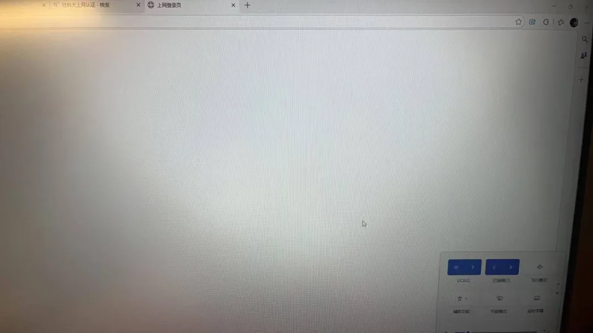

请相关部门及时关注并跟进问题。近期稿件过多，如有遗漏请在后台留言提醒，非常感谢！

## 1 宿舍生活倡议

> “投稿：希望同学们午休时候在楼道上走的时候，或者阿姨有事情要处理的时候能稍微小点声交流（非常理解阿姨有工作要处理，也不得不处理，但是如果在可以小声交流的情况下小声交流一下，会很方便同学们的休息）。有时候刚睡着没几分钟就被吵醒然后再也睡不着的感觉实在太难受了。”

“投稿：请四号楼六楼的同学尽量不要在中午休息时间一边上楼一边大声聊天，更不要站在别人宿舍门口聊，隔音很差，感谢理解！”

## 2 二食堂辞退后续讨论

## “关于二食堂西餐窗口劝退员工事件的相关主张——截至3月26号晚

二食堂西餐窗口员工辞退问题首要的是学校处理的问题。学校未给出充足理由而直接辞退员工，于情于理都不合适，更别提还有违反劳动法的嫌疑。

所以学校现在最应该做的是公开调查和处理的细节，给出合理解释。若是辞退员工本身惯犯等严重违反纪律的原因，相信同学们也能支持；若是不能给出充足理由，则学校有责任对被辞退员工给出补偿

现在有同学把这件事的矛头转向在人文之光揭露问题的同学，此举不仅忽视了过错方学校的责任，而且也不利于监督：人文之光本就只是一意见发表平台，同学们有权利在上面发表意见反应问题。如果发表人文之光就可以行使学校权力了，那么问题就在人文之光编辑部本身的审查力度上。（编者按：如果是这样就好了）

哪怕真的有同学是精致利己主义者，各位也不应该忘记，单个同学和单个食堂员工一样都是无权无势的普通人。与其把怒火洒向投诉的同学，不如把热情投入对学校建设的完善上。

以上写于25号下午学校办好说清刚公布处理结果时，彼时笔者尚未清楚学校与外包公司的合作关系。尽管文章部分内容有问题，笔者仍然认为学校也承担着部分责任。同时上文谈及的对人文之光的相关主张，笔者认为还是值得一发供同学们讨论。

3月25号晚11：00左右笔者在二食堂看见了公司发的通知，内容说明公司已对劝退员工进行补偿。但笔者认为补偿只是一部分，公司还是应该把直接劝退的隐情说清楚。

“首先，公司对员工的管理权是有限制的，现在我们尚不清楚合同和员工的守则上是否有如此严苛的条款，就算有，也极有可能因不具有合理性而无效。一般而言，学校饭堂工作人员在无人的地方短时间地嬉戏打闹并不属于《劳动合同法》第三十九条第二项“严重违反用人单位的规章制度”的行为。此外，“劝退”又是什么意思？是员工“自愿”离职，还是“被自愿”离职，抑或是直接辞退？是否有给予足够的补偿？如果不能将被辞退的员工请回来或者提供足够的补偿，建议两位员工提起劳动仲裁。

2.就算是承包风味餐厅的公司做出的决定，那么是否和学校完全没有关系呢？难道风味餐厅的公司一直在关注这个小小的账号，并且看到投稿后马上主动做出了劝退的处理？还是学校相关部门看到投稿以后行使“监督管理”职责的结果呢？承包公司是否受到了相关的压力？这些学校都没有说明，难道没有甩锅的嫌疑？”

> “后勤处简直不要太牛，就这么处理问题的啊，想把自己管理能力不行转嫁成学生和食堂矛盾呗，和上学期强行驱赶延毕生如出一辙，真是越来越成熟了，这种学校还天天谈人文关怀，真是可笑”

> “甩锅是这个学校鲜明的行政特色。他们总能找一些莫名其妙的理由将责任推卸给别人以及提出问题的人。我见过这个学校三个部门联合发的一个文件，但单独找到三个部门时，他们口径一致的说不归自己管。那既然都这样了，那我可以问，宿舍成水帘洞是谁的责任？高考排名连年下降是谁的责任？管理服务混乱是谁的责任？”

## 3 宿舍管理

“一堆工作人员，在未经允许的情况下，私自进入女生宿舍，收走我的电锅，我去楼下找宿管要回来还不给我，请问这个做法对吗？”

## 4 研创计划

“2025年度研创计划结项已过去接近半年，天数已超过毕业年级离校剩余天数，我们不经要问：某部门声称的“不影响毕业年级报销”是否仍然成立？该部门是否在“至少有如下行为”被公之于众后吸取教训？

附：《该部门至少有如下行为》\*

“Q: 预立项项目和后期资助项目的经费是一次性拨付还是分批次拨付？

A: 两类项目均于完成结项后的第二年一次性拨付经费，不影响毕业年级报销”\[1\]。

“近日，人文之光社论收到一些投稿以及同学反映，称学校某部门尝试施压学生，阻止学生向社论投稿，因此就投稿者隐私有关事宜做一个简要的说明。根据目前收到稿件来看，该部门至少有如下行为：1.试图通过直接投稿社论试探“询问”人社是否会“因行政部门的‘劝导’"透露投稿人身份信息；2.在试探得知社论不会透露投稿者信息后，又意欲驱使各学院找出投稿人，并且登记线下询问同学的信息”\[2\]。

\[1\] 中国社科大科研处. Q&A丨“新苗计划”“研创计划”常见问题\[EB/OL\].

2025-04-24\[2026-03-24\]. https://mp.weixin.qq.com/s/BhgQk-QTqfd82ccQCE8m9A.

\[2\] 人文之光社论. 【编辑部声音】就近日研创有关舆情的声明\[EB/OL\]. 2025-03-17\[2026-03-24\]. https://mp.weixin.qq.com/s/xCI8IPkfyQFQ29S51xdHFA.

\*本研究系中国社会科学院大学“研究生科研创新支持计划”（预立项编号2025435KFC）的阶段性成果。

”

## 5 网络问题

“投稿，良乡社科大网络中心，每次设备重新认证既不弹出认证窗口，也无法连接内网，不想多说了，祝社科大早日评上双一流吧。

”

## “投稿:坐标新综407，校园网凭空消失”

## 6 一食堂开饭

## “救救孩子吧，12点10来吃饭不正常吗？为什么来一食堂要三个菜，三个菜都没有了。

可是这不是下课的时间点吗？”

## 7 困惑

“投稿：既然参观小米的活动都有回复了，想了解一下去年九月初重大活动的志愿者是所谓的团学组织“近水楼台先得月”吗？”

## 8 洗衣机问题

> “投稿：还我一个花了钱能洗干净衣服的洗衣机!以前的洗衣机，容量大，质量好，洗得干干净净，那发旧发黄的白T恤洗出来跟新的一样，非常喜欢洗衣服。现在的洗衣机，容量又小，洗衣液倒成原来的两倍，居然洗不干净!每次洗完衣服都要手动返工，体验太差了!后勤光是动嘴皮子说让厂家看一下，厂家看一下能把转速容量洗衣水平提高嘛？！不知道你们为什么非要给我们换洗衣机，经过我们这些花钱洗衣服的消费者的同意了嘛？换厂家之前不知道做个问卷调查嘛？太独断专裁了!把洗衣机直接从法拉利换成了电动车，一步步损害学生的生活体验和福利，真是让人心寒!”

## 9 这合理吗？

## “优秀团员评选，这合理吗？

我所在的学院即将开展团员评选活动，然而，在班级同学咨询团支书相关事宜时，私认为存在着一个相当不合理的地方：

本学期优秀团员的评选要求是“上学期攒够20个小时的志愿时长”，但这一条在投票前完全没有被明确告知。也就是说，这学期攒的时长不算，只认上学期。

那么，

1️⃣投票时没人知道谁够20小时，大家都是凭感觉投，所以如果被投的人时长不够要怎么办？以及为什么不先把有资格的人列出来再投？

2️⃣有同学觉得不合理去问，得到的回答是：“大二大三也是这么过来的。”——但制度不合理，就要因为一直存在就继续不合理下去吗？

3️⃣包括去问辅导员，得到的回答是“一直在跟你们强调志愿时长的重要性”，这句话是不是可以理解为“你们不重视，不能参评我们也没办法”？

确实，你们强调了重要性，却没有强调具体影响到什么活动/工作，重点在于并没有明确告知学生这个时长直接决定了你有没有资格被评优。这不是让学生自己踩坑吗？而且，我们在评选前一天才知道这个规章制度，甚至如果我们不主动问团支书，恐怕是评选活动进行的时候才知道吧？

标准不提前说清楚，投票信息也不透明，我校在这方面的工作实在难以令人满意。希望能将效率和效果落到实处，而不是在某些无关紧要的小事上“雷厉风行”，谢谢！”

## 10 社科大金曲系列

## “投稿：

观2026年3月26日社论有感：

伟大的新苗要拖多少月

区区的水管

爆了再建

小小的宿舍

肮脏的池水

官僚主义

一手遮天

双一流的承诺

说过多少遍

说来说去

从来没实现

宣传的口号

说世界第一流

基础设施烂

假装没看见

这不再是个适合好人读的校

礼义廉耻没有面子重要

这不再是个适合学生住的校

三年的辛苦连个宿舍都住不好

食堂不通畅

接诉即办谈

一刀切开除

甩锅工人忙

2026要冲世界强

浮夸的口号

向现实投降

有人提意见

平台起公愤

放眼看校园

遍地是拥堵

社科的未来

究竟会怎样

行政和学生

大家还在想

这不再是个正常运作下的校

生存和面子问题哪个重要

这不再是个明天会更好的校

何去何从几千位同窗

学生九成搞科研

还有一成在观望

伟大的目标挥挥手

社科社科一定强

这不再是个适合好人读的校

礼义廉耻没有政绩重要

这不再是个适合学生住的校

三年的辛苦连个宿舍都住不好

这不再是个强大的学校

生存和面子问题哪个重要

这不再是个明天会更好的校

何去何从几千位同窗”
