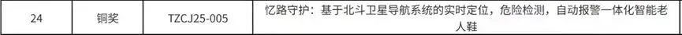
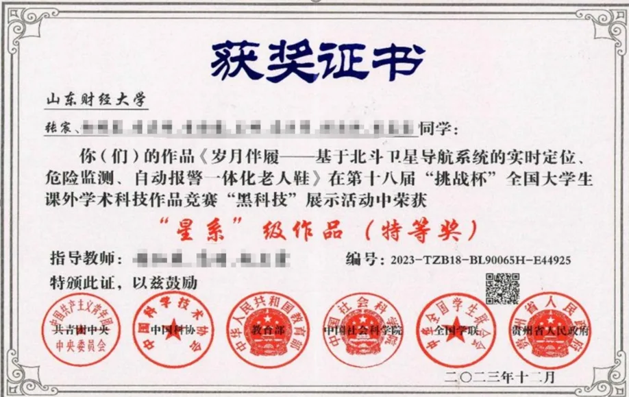
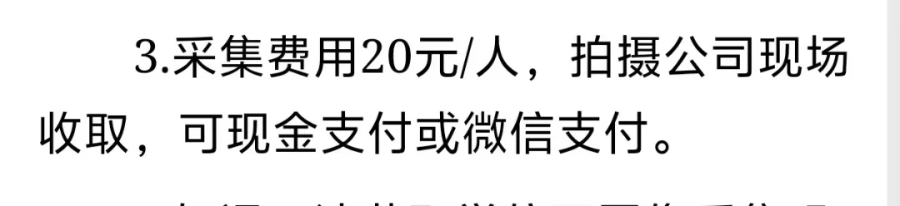

请相关部门及时关注并跟进问题。

## 1 科研

“希望科研处维护下科研系统，更新下期刊目录，2026年了科研成果登记还是2018年版本AMI目录和2021年CSSCI目录”

## “

一问负责人：这项目是你做的吗？

二问指导教师：这项目是你指导的吗？

三问PowerPoint(一种展示工具，通常在演讲中使用，很先进)：这项目是挂的社科大校徽吗？

挑战杯的举办目的与参赛要求：

（一）引导和激励高校学生实事求是、刻苦钻研、勇于创新、多出成果、提高素质，培养学生创新精神和实践能力，带动高校学生课外学术科技活动蓬勃开展，助力发现和培养更多拔尖创新人才 。

（二）参赛项目应有较高立意，积极践行社会主义核心价值观。应符合国家相关法律法规规定、政策导向。应为参赛团队真实项目，不得侵犯他人知识产权，不得借用他人项目参赛；存在剽窃、盗用、提供虚假材料或违反相关法律法规的，一经发现将取消参赛相关权利并自负一切法律责任 。

图1：中国社会科学院大学第六届“挑战杯”大学生创业计划竞赛获奖名单

图2：第十八届“挑战杯”全国大学生课外学术科技作品竞赛获奖证书

\[1\]校团委：“关于中国社会科学院大学第六届“挑战杯”大学生创业计划竞赛获奖名单的公示”\[EB\\OL\]2026-03-23(2026-04-02),https://youth.ucass.edu.cn/info/1006/3077.htm.

\[2\]山东财经大学国际教育学院:“国际教育学院在第十八届“挑战杯”全国大学生课外学术科技作品竞赛中获佳绩”\[N\]2023-11-03(2026-04-02),https://mp.weixin.qq.com/s/1NXl4LwKsJ1-wvDZacvkDA.

”

## 2 毕业相关事宜

> “学校毕业典礼暨学位授予仪式能不能像哈工大 西工大一样搞的正式点，这不仅是为毕业生上好最后一课，也是更好的宣传学校，社科院就这么一所直属大学，好好办！把党中央交办的任务不仅要办好，也要办漂亮。往年的学位授予一批批的上，没神圣感，也没给毕业生留下美好的个人影像，毕竟学位授予是学习阶段重要的仪式，请学校领导充分考虑、调研并改善仪式程序”

## “社科大，毕业图像采集非要线下折腾人是吧？

毕业生最后一个学期，基本都不在学校，大家都在全国各地忙着找工作、实习、考公、面试。结果学生办毕业生图像采集，非得要求所有人必须回学校线下拍，一个都不能少，时间还卡死在某一天某个时段。

我就想问一句：现在什么年代了？

明明可以自己上传电子照片，很多学校早就支持线上采集了。人家其他高校（包括不少985）都没这种奇葩要求，都是给一两周的时间段，学生在此期间既可以自己上传符合要求的照片，也可以自愿到学校提供的地点线下拍，上传时间很灵活，不会逼着所有人集中在同一天某几个小时内赶回学校拍照。

怎么到了社科大，反而要让学生专门买机票、坐高铁、请假、折腾奔波来回，就为了拍一张照片？

学校是不是觉得我们学生的钱是大风刮来的？ 还是觉得我们时间不值钱？

学校通知说是为了确保图像的真实性，看似冠冕堂皇，实际根本站不住脚。学生自己在外面拍，不P图、眼镜、五官不遮挡等问题，其他学校线上上传都能搞定，凭什么社科大不行？本人以前的学校亦有此要求，照样线上搞定，是学校觉得毕业生能考上大学但是智力不足不能支持达到上述要求，还是说是学校治理水平不足无法做到其他学校的基本操作，亦或是这其实就是一种新的创收方式？

来回机票、车票、住宿、请假扣的工资……一个学生为了一张电子照片，几千块就扔出去了。而这一切，仅仅是因为学校自己不愿意采用线上采集方案，因为线下统一拍，老师可以一次性收齐，自己省事。就算线上需要老师一张一张审核，那点工作量跟成百上千个学生每人多花几千块路费、浪费至少两天比起来，根本不值一提。审核照片本来就是学生办的正常工作任务，其他学校能做的，为什么我们学校做不了？

说白了，就是为了减少自己的工作量，要求成千上万的学生，每个人多花成百数千块钱。这到底是服务学生，还是折腾学生？ 这种管理方式是极度自私的，不负责任，典型的懒政表现。

社科大的管理能不能稍微跟上一丢丢时代？有点同理心好不好？

希望学校能听到学生的声音。这种明明可以线上解决、明明可以给学生选择权的事，请先问问自己：到底是为了学生方便，还是为了方便自己管理？

不要再消磨毕业生最后一点对学校的好感了，本来行政水平就已经饱受质疑，实在让人怀疑是否达到北京高校应有的管理水准，请学生办给出合理的解释。

”

> “请问26届毕业生的毕业图像采集为什么不能开通线上渠道？学校难道不知道毕业生不只在北京就业吗？强制要求线下采集的后果是在其他地区就业的毕业生千里迢迢往返北京只为了拍一张照，这合理吗？还是说学校不清楚现在体制外的就业市场都会要求毕业生提前实习，觉得26届毕业生现在都待在学校无所事事呢？”

## 3 考勤

> “您好，我要投稿，税专不知道怎么回事，最近天天抓考勤，宣布包括请假在内缺课次数达到两次及以上就取消期末考试资格。但是老师们自己却随意调课，根本不管学生有没有空，这不就是变相不允许学生请假。谁也没办法保证一直都能有时间，万一突然生病了，或者家里有什么事情需要请假呢。而且本来下学期大家都要准备考公和实习，就业形势已经很严峻了，大家需要早些做准备，学院还一直抓人，不为学生考虑，就想着给学生增加负担吧。”

## 4 接诉即办

> “您好！想给学校提个建议，“接诉即办”功能能不能在学校工作人员回复完后还能允许我们继续追问呢？因为个别工作人员答非所问，或者回答的十分模糊乃至空话套话。有时候很想进一步追问。”

## 5 团学

“对去年那次重大活动参与者名单有疑惑的同学，把参与保障的同学的名字放到学工、团学、团委的公众号的搜索栏底下看看就好了。看看重合率高不高。这个操作还是比较简单的”

## 6 医务室

> “良乡校区每周四都在发热门诊处安排了抽血检验体检，于是我图方便，就在这周四（4月2号）去了医务室复查血常规，隔了一天，检验报告出来，我共勾选付费了三项检验:血常规、血型、血糖。报告上只显示了血糖的值，其他一概没有，打电话问医务室，只说等到下个周四外包的体检人员来了，让我再去咨询原因他们不负责体检这个事情。所以简单的一个血常规报告，我要折腾两个星期才能看到不知道存不存在的结果吗？如果这个体检只是针对不紧急的人群，那就直接说明，让确实需要体检结果的人直接去医院检查，不要遛学生。”

## 7 宿舍

## “

洗手池坠亡事件：被敷衍的日常，终会以破碎收场

当我透过台面向下张望，未曾看见水池那熟悉而又温馨的身影，却看见了一个陌生的黑洞，如同一只陌生的眼睛，盯着我，仿佛要和我倾诉它数日来承受的煎熬与折磨。瓷盆残躯斜倚墙边，碎瓦零落，宛如不甘的泪，在它离去时悄然淌尽。

今日，本宿舍民生核心工程——洗手池，未经任何预告，从面台上彻底脱落、轰然坠地，以一种惨烈又荒诞的方式，永远的离开了我们。

它本是宿舍最卑微的基础设施，每日承接我们的牙膏泡沫、晨起困意、熬夜后的潦草洗漱，承受着杯具挤压、水流冲刷、边缘重压，却以一种惨烈却卑微的方式结束了它短暂又意义重大的一生。

愿此次“坠池惨案”，能让那些视而不见的管理者听见——别等床架、墙体、更危险的部件接连坍塌，才想起这被长期怠慢的、我们朝夕相处的日常。毕竟，学生的生活从不该建立在“随时会掉下来”的侥幸之上，也不该建立在“今天活着离开宿舍了”的劫后余生之上。

（PS：拜水池所赐，本宿舍损失两个盆，数件衣物）”
