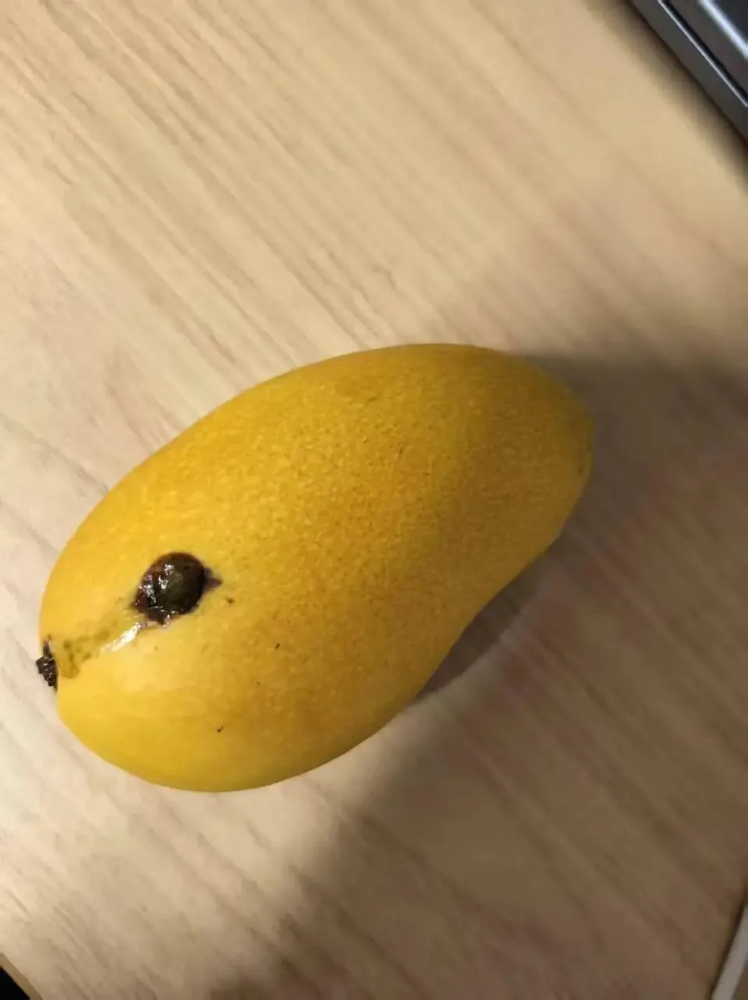

请相关部门及时关注并跟进问题。

## 1 校园空间

## “板房、地下室的自习室问题

"自习室属于公共资源，请勿占而不用，自习结束后带走随身物品，对于连续占而不用的座位，学校将进行集中清理，感谢你的配合与理解，让我们共同营造良好的学习环境"这是自习室的每张桌子上都贴着的标语，而现实是，还没等学校感谢用上自习室的学生，公共资源自习室的私人化已经成为了一个既定的、公开的事实。尽管在社科汇里已经有好几条帖子指出这种行为的完全的不合理，但是留言中可以看到有人，甚至是相当一部分，首先想到的却是"自己没占到怪谁"、"突发想学习被逼急了吧"诸如此类，当然要承认表示支持的还是占多数。于是，在一部分人有意或无意的推动之下，校园墙在朋友圈中又转发了多条有偿"求"自习室作为的帖子，可以看到有同学在朋友圈下发送了抵制的留言，但是这当然只会让共同好友看到，"于是，我们不禁要问"，为什么会出现这样荒谬的"求助"帖？这种需求与供给又是如何产生的？.....

直白的讲，有人不知廉耻地（审核大大如果太露骨可以删）利用学校强制力手段无法直接像管理图书馆一样及时而有效的管理自习室这一条件，天然的在自习室创生出了一套独属于自习室的规则，俨然将"公共资源"视为个人财产，并且可以"出售"、"转让"。我们幡然醒悟，原来财富的来源可以不是出自自己的劳动，尽管自习室来自于学校的公共目的的劳动，但是只要撇下脸面，他就可以从自己的财产的坚守中自然的生长出来。奇葩的一幕出现了，空无一人的自习室里摆满了书本，甚至电脑、茶叶、热水壶，据身边社会学，有人甚至只是因为宿舍放不下就把书堆到地下室里。我们不得不感叹同学们高尚的品德与安全感，从这一角度来看，这不是同学们有北鼻的通行证，相反是同学们高尚的墓志铭啊！

这并不能全怪罪于一些只要自己不是受害者就将罪责推之于勇于发声的或是对公共道德熟视无睹的同学之上，还是不得不在涉及管理的问题上提一嘴学校的问题。权力本身就有膨胀性，更何况是对公共座位无偿占有支配的权力，虽然当然不可能像图书馆一般每天定点清查，况且还是要看到例如，回宿舍睡几小时后又要为自己奋斗的同学将物品在一般情况下不会有他人占有的半夜时放在自习室并且在第二天一早就正常使用座位的，没有出现占而不用、占而转卖、用完即撤下物品的正常的真实需求。因此，或许每周定点的清理或许可以纳入一种可能的解决方式，当然，更欢迎同学们在各个公共平台上集思广益，毕竟建设性的意见总要出现在破坏性的语言之后。”

> “投稿。学校除寝室等涉及个人隐私的场所外的场所都是是公认的公共场所，但仍有许多人吸烟与乱扔烟头。请问校方：《北京市控制吸烟管理条例》已经出台12年了，为什么学校公共场所吸烟情况没有杜绝？校方会尊重不吸烟者以及协助不吸烟者维护自身健康权这一基本人权吗？如果校方答案是会，那么请尽早行动，履行控烟条例”

> “投稿：学校车位数量在绝大多数时候都是有富裕的，但是工作日白天的充电车位却被很多没有在充电的车所占据。能否请不需要充电的车辆移至非充电车位停放，方便有充电需求的开车来校师生？”

“近期校园内柳絮、杨絮漫天飞舞，导致很多同学过敏性鼻炎严重发作，极大影响正常学习和生活。

恳请学校先排查校园内部是否种植杨树、柳树，若校内存在此类树木，请及时进行抑絮治理。 如校内无相关树木，推测飞絮主要来源于学校南门外的一排杨树和柳树，飞絮持续飘入校园。希望学校能协调市政园林部门，安排水炮车对校外该路段树木进行喷淋降絮处理，从源头缓解飞絮问题，保障同学们的身体健康。”

> “想表扬一下研教楼二楼的保洁大叔！为人特别和善，周六早上去教室正好赶上他打扫卫生的话，他还会特别亲切地寒暄一下，看他打扫卫生也挺细致的，有时候还会帮忙协调一下教室，很有人文关怀了。”

## 2 校园基建

## “基建处，

一条备用的路都不留，贵部门的施工方案有没有最起码的应急考虑啊。一下子把这一大片全封起来，你们的施工也没有推进的那么快啊，急着一刀切表现什么呢，封路也算我们参选双一流的有力指标吗？

六号楼西侧这条路日常使用频率很高，从各个教学楼到快递驿站、外卖柜，从7、8号楼到一食堂、到超市、到北综、到南综、到教综，本来很短的一段路程，被你们封路搞得平白要绕一大圈。

冠冕堂皇地说着“最大限度降低对师生生活学习的影响、保障师生安全顺畅出行”，但这不是你发一条温馨提示就能自欺欺人的。”

“学校里的蜜雪冰城灯牌能不能打烊之后就关掉，朝西的窗户即使拉上窗帘晚上还是很亮，影响睡眠”

## 3 宿舍

“补稿：继4.9日早上之后，今天（4.10）依旧是历史的重演：阿姨象征性喊了两声，我说稍等一下，还没等我再次回应她，就已经打开了门，给我弄的很尴尬…然后依旧是如同昨天一样，留一位工人与我单独在宿舍，自己带着另一位工人去其他寝室

我不知道这样的情况还要延续多久，只感到被冒犯（指阿姨象征性喊两句就直接开门的行为）与不安，再次呼吁学校能重视此类细节，制定更合理的维修陪同制度，保障学生的基本权益与安全感！！”

> “投稿：各位后勤处的求求了还我们一个安静的不被打扰的休息环境\[合十\]\[合十\]\[合十\]一大清早的到底出什么事了需要一大堆人在宿舍走廊里吵吵，什么时候工作人员们能意识到宿舍楼是skd学生为数不多可以安静学习和休息的地方”

> “寝室挨着楼梯口真是无妄之灾啊，平时要忍受吹风机吵，忍受楼梯间吸烟的味道，忍受楼梯间小情侣吵架打闹，忍受每天坐台阶上煲电话粥的人，现在还得忍受后勤处男男女女的宿管和保安的吵闹，想安静学习安静休息就这么难吗，后勤处能不能别光管学生也管管自己啊”

## 4 图书馆

> “你好～我想请您刊登一下这一条。我在图书馆的时候，总是觉得我们有些同学不是太有“公德”（这里指公共场合中的基本道德），就是并不在乎别人的感受。像是肆意地砸键盘、打电报般的按鼠标、甚至有在图书馆直接电话的等等，都会在一定程度上干扰到其他同学。但囿于不太好意思，其他同学可能不太会当面指出（比如我），所以只能求助社论。希望大家在图书馆的时候，可以稍微顾及一下其他同学的感受，一起营造一个安静、和谐的学习环境～”

> “对于学校某些同学真的无语，在新图书馆一楼，图书馆进出口处的信息检索区域使用公共电脑自习，居然还去找老师抱怨说键盘敲击声大。要是这么神经脆弱，可以不选择在公开区域自习，别以为整个世界都要围着你转。（而且让人感到很莫名其妙的是，我都没有在敲字，使用的是mac air自带的键盘，怎么就键盘敲击声音大呢，明明在专注看论文，突然被打断，感觉心情很不爽啊，麻烦这些巨婴以后也多考虑考虑别人的感受吧）也辛苦图书馆的老师，在打断同学学习的时候，进行最基本的判断，别影响正在认真学习的同学。”

## 5 升旗

> “投稿，升国旗应该在国歌演奏结束一刻完成升旗，而不是先把国旗升上去然后大家站在地下听国歌。国旗班切实是退步了，小学生升旗手都能做到的事情，大学生专业升旗手竟然做不到”

## 6 食堂超市

“投稿食堂：2.6元一根的玉米现在已经缩水到只给半根了，砍断一半，很想知道政府补贴了食堂经费，食堂甚至连一整根完整的玉米都不给吗？”

“四月九日晚一食堂一楼的板栗烧鸡消毒水味道实在过重，好像在吃酒精棉花，此类情况已不是第一次出现，希望食堂后勤可以多加注意。”

> “投稿：学校小卖部是不是太过分了一点，本人精挑细选了五分钟的芒果，拿回宿舍吃翻过来背面有一个流水的大黑斑，何意味呢，以后都不会在小卖部买水果了，也借此给同学们避雷了”

## 7 研创

## “您好 投稿 看到26年研创计划发通知了 但是25年研创的报销还没发 何意味…”

## “投稿：

千呼万唤，研创预立项项目经费终于下来了。但某些学院，在各类票上出台了一堆要求，比如只能报2026的发票、劳务费不超30%、需要工行卡支付、上课期间的票据不给报销……种种规定。

试问，项目都结项了，论文都发了。发票、支付记录全是2025的，现在要怎么给你搞出一个2026的发票来？

不以劳务费形式发给项目组成员，是说学校、学院提倡经费乱用、挪用到其他地方。让大家四处搜集各种各样的2026发票来套现吗？

去年就一直询问相关部门，预立项在2026拨款报销会怎么弄？得到的答案一直是：会妥善安排，不会让2025的发票报销不了的，报销不了也会以劳务形式发给大家，让经费实际用在项目和项目组成员身上。

请问这就是妥善安排之后的结果吗？要是真不想让大家报这一笔钱，只想嫖一些论文署名，干脆一点好吧”

## 8 图像采集

“都不用说985，就连专科，图像信息采集早八百年前就可以自己照了上传（诸君可以微信搜索一下），不知道社科大的行政能力不如专科，还是人文关怀不如专科。

于行政而言，你们动一动手指的事；于学生而言，却要伤筋动骨。不得不说，贵校在败光好感度方面真是一流。为政者，慎用自己手中的权力，让人留几分念想，也算给自己积点德。”

## 9 劳动实践

> “不通知不商议突然告诉劳动实践时间改了，提前两个月通知大家都安排妥当了，临时一周告诉不去了，你校就这样临时变卦又变卦吧。理由没有民主没有，把学生当猴耍还是当狗溜。”

## 10 反诈

> “我要投稿，今天在社科汇上看到一个招兼职的，他没说清楚具体是什么，说是线上兼职，一单结算，我去加了他的微信，他跟我说要进群，他们主要是做AI漫剧的形式，还让我听一个老师的直播课。他给的信息里，一条视频就200块钱，价格非常高，我就起了疑惑，后来在小红书上发现这是个骗局，让你看直播课后面要收钱，确实很具有诱惑力。在小红书上被骗的，跟我今天看的这个直播还是同一个老师。真的很让人生气，这骗子都来到我们社科汇了，大家一定要注意。”
